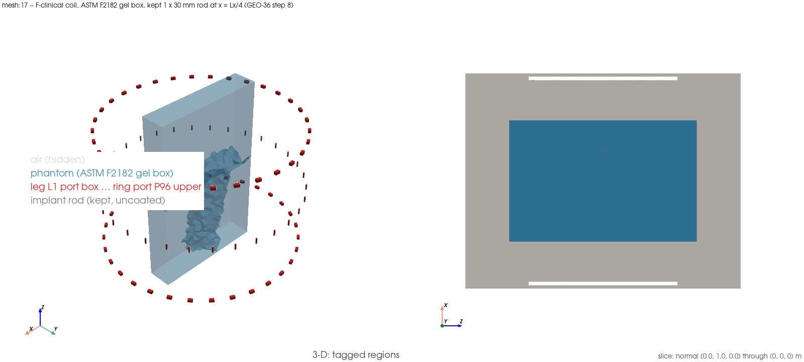

# `ans:11` — F-clinical-1.5T loaded with the ASTM gel box, two-port ccw drive at 64 MHz (ANS-11, our degree-1 record)

The record page of [`SPEC.md`](SPEC.md): our degree-1 column of the
F-clinical-1.5T birdcage loaded with the ASTM F2182 gel box, driven at P33 /
P41 in quadrature at its in-model Larmor node (C = 193.5996 pF + 0.2 Ω on all
64 gaps). **This is a degree-1 record; the adjudication column is C19**
(degree 2, `xxl` entry 62, not yet run). The AED column of
[`COMPARISON.md`](COMPARISON.md) stays blank: AED values are private.

The page makes **no solve and builds no mesh**. Entry 52's run (868 s,
41 GiB, `-n 8`) cannot run in a slot, and its JSON is gitignored, so the
script reads the tracked harness log
`docs/testing/logs/20261103T080009Z_GEO-38-C6.log` (or its `.gz` once
retention has rotated it).

## 1. What this demonstrates

- `parse_c6_log` (`11_f_clinical_1p5t_box_loaded_64MHz.py`) reads the
  `[GEO-38 C6a]` lines with `re.search` and keeps every token as its printed
  string with its line number:
  - `:12063` the node, Z_RC, Z_th and V_s;
  - `:12281` the 2×2 S;
  - `:12285` / `:12286` Y_in under ccw and cw;
  - `:12288` the 400-centroid means and the sense ratio;
  - `:12289–12306` the 18 lattice lines (`|B₁⁺|`_ccw, SAR10g, ball mass);
  - `:12307` c\*;
  - `:12310` the normalisers P_box / P_src / P_acc;
  - `:12311` the JSON write and `:12312` the price.
- The lattice labels, the sense weights' P_acc and the lattice size are
  imported from C6's module
  (`tests/validation/test_geo38_f_clinical_box_loaded.py`: `_lattice`,
  `_p_acc_spec`, `BRIEF_LATTICE_N`, `C6A_LATTICE_DZ_M`), never re-implemented.
- Asserted (here and in `tests/unit/test_ans11_record_page.py`):
  - (X) the labels equal `_lattice()`; every value the SPEC quotes equals
    its log token; the SPEC's 36 six-digit lattice entries equal the log's
    tokens at six digits;
  - (D) P_acc re-derived from the printed S and V_s, SAR10g(c\*)/P_acc,
    P_box/P_acc, the 18-point lattice mean and its per-√P_acc value, each at
    half a unit in its last printed digit; argmax of the 18 SAR values is
    c\*; S₁₂ = S₂₁ as strings;
  - (R) the writer reproduces `COMPARISON.md` from `metrics.json` byte for
    byte.
- Controls: one changed digit in a copy of the log fails (X) and (D); a
  dropped lattice line makes the parser raise; a changed digit in a copy of
  `COMPARISON.md` differs from the render. The cw weights' P_acc is printed
  only.

## Setup figure



`examples/ansys_benchmarks/ans11_f_clinical_1p5t_box_loaded_64MHz/figures/ans11_f_clinical_1p5t_box_loaded_64MHz_setup.png`
is a byte-identical copy of `mesh:17`'s committed render
(`examples/meshing/figures/meshing_17_f_clinical_rod_in_astm_box_setup.png`) of
the same build: the F-clinical-1.5T coil, the ASTM F2182 box (0.42 x 0.09 x
0.65 m, long side on the coil axis) and the rod sub-volume (r = 1 mm, length
0.030 m on z) at x = Lx/4 = 0.105 m, matching `SPEC.md`'s geometry section.
This page parses a log and draws nothing and builds no mesh; the figure was
not rendered here. In `ANS-11` the rod sub-volume carries the gel's material
(`SPEC.md`), so it is a refinement artefact of the mesh, not an implant.
Geometry only; the figure carries no field, power or SAR value.

## 2. How to run it

```
./scripts/run_examples.sh -e ans:11 -n 1 -t 180
```

The `ans:` group sources the complex DolfinX build (C6's module imports
dolfinx). The run is a few seconds (smoke tier) and writes `metrics.json`
and `COMPARISON.md` beside this guide.

## 3. How to analyze it, step by step

1. Read the `[PASS]` / `[FAIL]` lines: each (X) and (D) check is printed with
   its comparand and tolerance.
2. `COMPARISON.md` carries SPEC rows 1–6 in three columns: ours at degree 1
   (entry 52, a record), ours at degree 2 (C19, pending, blank) and AED First
   Order (blank). Row 2's comparison row is the 18-point lattice mean; the
   400-centroid mean is a second record in row 4.
3. `metrics.json` holds the parsed strings with their log lines and the
   derived per-P_acc values.

## 4. SPEC v2's node (the capacitor the operator enters)

SPEC v2's node is C = 185.7629 pF on all 64 gaps, each with r = 0.2 Ω series
ESR. The R_p ‖ C below is HFSS's parallel entry at 64 MHz. After the `[PASS]`
block the page prints a node section, built by `node_section_lines` from
`node_figures` / `parse_spec_node` (ω = 2π · 64 MHz from `FREQUENCY_HZ_C4`,
r from `ESR_OHM`, Z_RC / Z_th from `WF-10`'s `_z_rc` /
`_thevenin_feed_impedance`, nothing retyped). The digits here are those
printed by the closing window, `ANS-11-C43-page`:

- the node line: C = 185.7629 pF = `f"{ROOT_D2_PF:.4f}"`, the four-decimal
  form of entry 56's crossing 185.762904 pF (`SPEC.md:17–19`);
- `[PASS]` on each v2 figure, derived at that root and equal to the SPEC's
  string: R_p = 896.1 Ω by the high-Q form 1/(ω²C²r), Q_C = 66.9,
  C_p = 185.7215 pF, Z_RC = 0.2 − 13.386935347j Ω and
  Z_th = 3.505604063 − 12.39875443j Ω. A `[FAIL]` here makes the page
  exit 1;
- R_p by r(1 + Q²), printed beside the SPEC's high-Q form: 896.3 Ω.

**Printed, not asserted (the weekly's to rule).** At the node C itself
(185.7629 pF, the value entered in HFSS) the page prints the same figures with
their moves in units of the SPEC v2 string's last digit: R_p and Q_C do not
move, C_p reads 185.7214 pF (−1), and −Im Z_RC, Re Z_th and −Im Z_th move by
+289, +133 and +23. The SPEC's v2 digits follow from the full-digit root, not
from the four-decimal node.

The degree-1 record column in sections 1–3 ran at the degree-1 node (C6 log
`:12063`, the top of this page). 185.7629 pF is the node of the degree-2
adjudication column (C19, `xxl` entry 62).

## Not claimed

The degree-2 rows, any adjudication or AED number, the
box-wide 10 g maximum (not read in entry 52), the copper / ESR fractions
under the ccw drive (not printed by entry 52), and a setup figure of its own (this page
builds no mesh; the setup figure is `mesh:17`'s render, copied).
