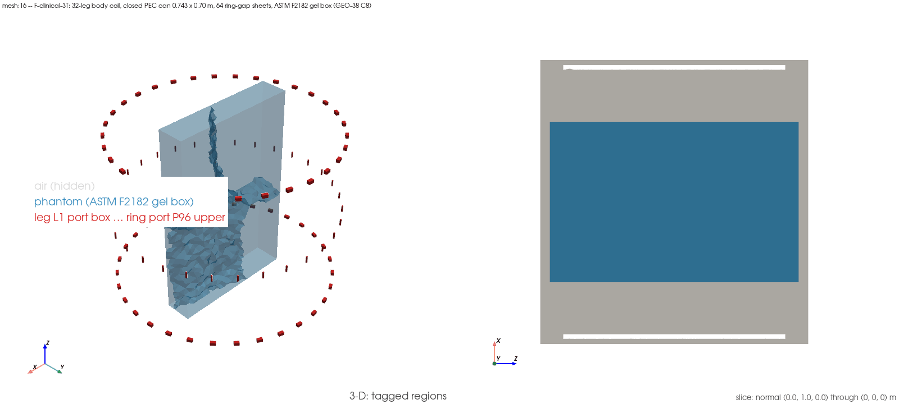

# `ans:12` — F-clinical-3T loaded with the ASTM gel box, two-port ccw drive at 128 MHz (ANS-12, our degree-1 record)

The record page of [`SPEC.md`](SPEC.md): our degree-1 column of the
F-clinical-3T birdcage loaded with the ASTM F2182 gel box, driven at P33 /
P41 in quadrature (ccw, (1, −1j)) with C = 44.0525 pF + 0.2 Ω on all 64 gaps.
**This is a degree-1 record at the degree-1 root 44.0525 pF, not the node to
enter; the adjudication column is entry 66** (degree 2, `xxl`, not yet run;
the node is SPEC v2's). No AED value is read or written here.

The page makes **no solve and builds no mesh**. Entry 58's run (780 s,
33.48 GiB peak, `-n 8`) cannot run in a slot and its JSON is gitignored, so
the script reads the tracked harness log
`docs/testing/logs/20261109T080008Z_GEO-38-C6-3T.log` (or its `.gz` once
retention has rotated it), found through C33's `find_log`.

## 1. What this demonstrates

- The log is parsed by the `ans:11` page's `parse_c6_log`, loaded through
  C33's `_load_page` (`tests/validation/test_geo38_c33_field_strength_reader.py`),
  never re-implemented. Every token is kept as its printed string with its
  line number:
  - `:12010` the node 44.0525 pF, Z_RC, Z_th and V_s;
  - `:12228` the 2×2 S;
  - `:12232` / `:12233` Y_in under ccw and cw;
  - `:12235` the `(C21)` ccw line: centroid mean and 18-point lattice mean
    (the one new regex on this page);
  - `:12237` the 400-centroid means, the sense ratio and the CV;
  - `:12238–12255` the 18 lattice lines (`|B₁⁺|`_ccw, SAR10g, ball mass);
  - `:12256` c\*;
  - `:12259` the normalisers P_box / P_src / P_acc;
  - `:12261` the price; `:12345` the `memory.peak` bytes; `:12350` the
    harness elapsed time.
- The lattice, its size and its z offsets come from C6a's module through
  C21's `_modules()` (`tests/validation/test_geo38_f_clinical_3t_box_loaded.py`);
  the 3 T / 1.5 T ratios come from C33's `side` / `ratios` (entry 52's log
  read for that row only).
- Asserted (here and in `tests/unit/test_ans12_record_page.py`):
  - (X) the labels equal `_lattice()`; the node equals `ENTRY58_NODE_PF`;
    each of the 28 quantity-table tokens of `SPEC.md`, parsed by regex,
    equals its parsed log field (r and az as floats, the SPEC printing fewer
    decimals; c\*'s x / z from its label's lattice point); the 36 six-digit
    lattice entries equal the log's tokens at six digits; the 14 header gate
    tokens (R1, P, NEG, P_RC, coverage, the price, 780 s, 33.48 GiB) equal
    their log tokens; every SPEC token is matched to exactly one field;
  - (D) C33's `check_side` on entry 58 ((D-Pacc), (D-box), (D-sar), (D-cen),
    argmax = c\*, the c\* string, S₁₂ = S₂₁, the node); (D-lat), the mean of
    the 18 tokens against the printed lattice mean 1.174932617e-08 T, rel
    1.419e-11; (D-latP), the lattice mean per √P_acc against the SPEC's
    8.581609e-08, rel 1.113e-08;
  - (R) the lattice table rendered from the parsed tokens equals
    `SPEC.md:178–182` byte for byte (662 B).
- Controls: one changed digit in the c\* lattice line of a log copy fails
  (D), (X) and (R); a dropped lattice line makes the parser raise; a changed
  digit in a SPEC copy's lattice table fails (R); moving x+105mm dz−50mm's
  SAR by −1.96 % leaves a one-member tie set. The cw / ccw P_acc ratio
  (1.0116) is printed only.

## The row-3 tie set

The lattice balls with SAR10g within 1 % of the lattice maximum (the 11-09
weekly's tie clause, `SPEC.md` row 3): **x+105mm dz+50mm** (c\*,
1.748477085e-04 W/kg, 0.00 %) and **x+105mm dz−50mm** (1.734192670e-04,
−0.82 %). The nearest outsider is x−105mm dz−50mm (1.714031706e-04,
−1.97 %). The percentages equal the SPEC's strings.

## The SPEC's "Log line" column

Printed beside the parsed lines, never asserted and never edited (a SPEC
transcription question for the weekly): S is cited `:12227` and parsed at
`:12228`; Y_in ccw `:12233` / `:12232`; Y_in cw `:12234` / `:12233`; the
header's price citation `:12260` is the JSON-write line, the price is
`:12261`. The other five rows agree.

## Setup figure



`examples/ansys_benchmarks/ans12_f_clinical_3t_box_loaded_128MHz/figures/ans12_f_clinical_3t_box_loaded_128MHz_setup.png`
is a byte-identical copy of `mesh:16`'s committed render
(`examples/meshing/figures/meshing_16_f_clinical_3t_coil_astm_box_setup.png`):
the F-clinical-3T coil with the ASTM F2182 box (0.42 x 0.09 x 0.65 m). This
page parses a log, draws nothing and builds no mesh; the figure was not
rendered here. Entry 58's mesh also holds C20's rod sub-volume (tag 403),
which carries the gel's material (`SPEC.md`), so it is a refinement
artefact, not an implant. Geometry only; the figure carries no field, power
or SAR value.

## 2. How to run it

```
./scripts/run_examples.sh -e ans:12 -n 1 -t 180
```

The `ans:` group sources the complex DolfinX build (C21's import pulls in
dolfinx). The run takes a few seconds and writes nothing.

## 3. How to analyze it, step by step

1. Read the `[PASS]` / `[FAIL]` lines: each (X), (D) and (R) check is
   printed with its comparand and tolerance; any `[FAIL]` exits 1.
2. The lattice block prints the 18 rows with all digits and per P_acc
   (|B₁⁺|/√P_acc and SAR10g/P_acc, from the `ans:11` page's `derived`).
3. The tie-set line and the SPEC-line table follow.
4. `(R-cmp)` re-renders ANS-12's `COMPARISON.md` once item 931 (C49) has
   written it; until then the page prints "absent — item 931 (C49)". That
   file, `COMPARISON.md` (C49's), does not exist yet.

## Not claimed

The degree-2 rows (entry 66), SPEC v2's node, any adjudication or AED
number, a box-wide 10 g maximum (the grid reader was off in entry 58), and
any tuning, compliance or homogeneity statement.
