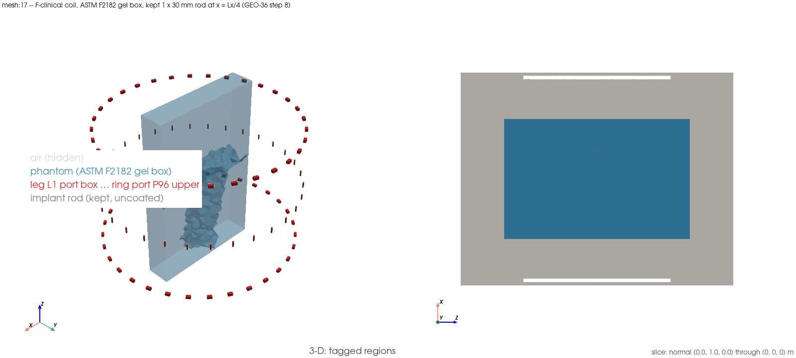

# `ans:13` — the box-loaded F-clinical birdcages' gel heating at 64 and 128 MHz, per deposited watt (ANS-13, our degree-1 records)

The record page of [`SPEC.md`](SPEC.md): our degree-1 columns of the
F-clinical box-heating case. The F-clinical-1.5T and F-clinical-3T birdcages
are loaded with the ASTM F2182 gel box and driven ccw (1, −1j) at P33 / P41.
The EM loss in the box heats it for t\* = 2821.5 s, with Robin h = 10 on all
six faces to 20 °C. **These are degree-1 records at the degree-1 roots
193.5996 / 44.0525 pF; the adjudication columns are entries 69 / 70 (degree
2, PENDING on P87).** No AED value is read or written here.

The page makes **no solve and builds no mesh**. Entries 59 and 60 (`xl`,
`-n 8`, 852 s and 732 s) cannot run in a slot and write no JSON, so the
script reads their tracked harness logs (or the `.gz` once retention has
rotated them), found through C46's `find_log`:
`docs/testing/logs/20261110T080008Z_GEO-38-P33.log` (entry 59, 1.5 T) and
`docs/testing/logs/20261111T080008Z_GEO-38-P33-3T.log` (entry 60, 3 T).

## 1. What this demonstrates

- Each log is parsed once by C46's `parse_heat_log`
  (`tests/validation/test_geo38_c39_thermal_reader.py`), never
  re-implemented. Entry 59's block runs from `:139` to its gates line
  `:12356`, entry 60's from `:141` to `:12307`. Every token is kept as its
  printed string with its line number. Entry 60's cw probe lines sit after
  a pytest test-id prefix at `:12298–12303`; the reader's `re.search` reads
  them.
- The page's own regexes, applied only inside each block, read the lines C46
  does not parse:
  - the I32 source line's `V_sub` / `Robin area` (`:12315` / `:12265`);
  - the I32 (B) line `int_sub q` (ccw `:12316` / `:12266`, cw `:12334` /
    `:12284`);
  - the CN line's (E′) `stored + surface` and (S2) tokens (ccw `:12324` /
    `:12274`, cw `:12342` / `:12292`);
  - C6a's `normalisers:` line (`:12312` / `:12262`) for the SAR10g(c\*) per
    P_acc lever.
- Outside the blocks the page reads the footer `Elapsed (s):` (`:12457` /
  `:12375`), the `memory.peak` bytes (`:12452` / `:12370`) and each log's
  command line (`:12`) for the knob tokens.
- C39's table is read from `docs/testing/logs/20261111T103024Z_GEO-38-C39-W1.log`
  (22 rows from `:371`). The second printed copy from `:407` is asserted
  identical. C33's lever strings (lines `:197–198` of
  `docs/testing/logs/20261109T103557Z_GEO-38-C33-W1-r2.log`) are printed
  beside the page's own and never asserted.
- The probe set is P61's `_probes()`
  (`tests/validation/test_geo38_f_clinical_box_heating.py`). The thermal
  constants are the MAT-15 / MAT-21 modules'. C31's module
  (`tests/validation/test_geo38_f_clinical_3t_box_heating.py`) is imported
  for its knob name and to check that `c31.p61 is p61`: the 3 T column is
  P61's body under C21's patches.
- Asserted (here and in `tests/unit/test_ans13_record_page.py`):
  - (X): C46's `check_block` on both blocks, every check green. That covers
    (Node), (D-f), (P_gel), (D-scale), (Cem), (RA), (T\*) and (Probes).
    Custody: entry 59's command carries `FEM_EM_GEO38_C6_HEAT=1` and entry
    60's `FEM_EM_GEO38_C31=1`, both carry `FEM_EM_GEO38_C6_HEAT_SENSE=both`
    and their node. SPEC row 2's seven coordinates equal `_probes()` and the
    parsed hotspot points. All 52 tokens and cites of the SPEC's record table
    are each matched to exactly one parsed field. The thermal table (k, ρc,
    h, T∞, t\*, Δt, N, the box, V, Robin area) equals the imported constants
    and the log tokens.
  - (D): (D-dep) checks, 24 of them, that θ per P_acc watt divided by the
    factor equals I32's per-deposited-watt token, at the Σ half-ulp of the
    three tokens. (D-c\*) checks the SPEC's 3.050e-02 / 3.338e-02 against
    3.049908e-02 / 3.338108e-02 (rel 3.002e-05 / 3.248e-05). (D-ratio)
    checks C46's `ratios` against C39's 22 strings, and the SPEC's 4.0425 /
    4.5397. (D-lever) checks 3.6935 (P_box / P_acc) and 4.1014 (SAR10g per
    P_acc). (D-cal) checks 9.737e-06 = 1 / (ρc · V_sub).
  - (R): the record table rendered from the parsed tokens equals
    `SPEC.md:140–148` byte for byte (1332 B).
- Controls: one changed digit in entry 60's ccw P3 token fails (D-dep) on
  that probe alone, and fails (X) and (R). Reading entry 59 as 3 T fails
  (Node) and (D-c\*) at ≈ 9.4 %. One changed digit in a C39 ratio fails
  (D-ratio). One changed digit in a SPEC copy's `:144` fails (R).

## Per accepted watt vs per deposited watt

The logs print θ per **accepted** watt (P_acc, the two feeds' lumped line
cut). The SPEC's convention (item 4) is θ per watt **deposited in the box**.
The two differ by P61's factor P_gel / P_acc, which is the SPEC's P_box /
P_acc because tag 403 is counted as gel (`:12314`). The page prints, for
each probe and c\*, both senses and both field strengths: θ per P_acc watt,
the factor, the quotient (per deposited watt, at `.6e`) and I32's gel-twin
token beside it. The gel-twin token is θ at G·P = 1 W, i.e. per deposited
watt. At c\* under cw neither log prints a point comparator; those
quotients (3.040714e-02 at 1.5 T, 3.219548e-02 at 3 T) are printed only.
The EM normaliser's 6-digit `P_box/P_acc` is printed, never used.

## The SPEC's line cites outside the record table

The thermal table's V / Robin area cite (entry 59 `:12315`, after SPEC
v1.0.1) is printed beside the parsed line and never asserted. It agrees.

## Setup figure



`examples/ansys_benchmarks/ans13_f_clinical_box_heating_64_128MHz/figures/ans13_f_clinical_box_heating_64_128MHz_setup.png`
is a byte-identical copy of the `ans:11` page's figure
(`examples/ansys_benchmarks/ans11_f_clinical_1p5t_box_loaded_64MHz/figures/ans11_f_clinical_1p5t_box_loaded_64MHz_setup.png`,
itself `mesh:17`'s render). It shows the 1.5 T coil with the ASTM F2182 box
(0.42 x 0.09 x 0.65 m). The thermal domain is the box alone. The 3 T coil is
the `ans:12` page's figure
(`examples/ansys_benchmarks/ans12_f_clinical_3t_box_loaded_128MHz/figures/ans12_f_clinical_3t_box_loaded_128MHz_setup.png`).
This page parses logs, draws nothing and builds no mesh; the figure was not
rendered here. The rod sub-volume in the figure (tag 403) carries the gel's
material, so it is a refinement artefact, not an implant. Geometry only: the
figure carries no field, power or temperature value.

## 2. How to run it

```
./scripts/run_examples.sh -e ans:13 -n 1 -t 180
```

The `ans:` group sources the complex DolfinX build (P61's import pulls in
dolfinx). The run takes a few seconds and writes nothing.

## 3. How to analyze it, step by step

1. Read the `[PASS]` / `[FAIL]` lines: each (X), (D) and (R) check is
   printed with its comparand and tolerance. Any `[FAIL]` exits 1.
2. The per-probe block prints θ per P_acc watt, the factor, the quotient per
   deposited watt and I32's token, for both senses and both field strengths.
3. The (B), (E′) and (S2) tokens of each sense follow. Then come the
   factor identity, C33's lever strings beside the page's, C39's table
   multiplicity, the re-rendered SPEC table and the SPEC-line table.
4. `(R-cmp)` will re-render ANS-13's `COMPARISON.md` once item 959 (C54) has
   written it. Until then the page prints "absent — item 959 (C54)". That
   file, `COMPARISON.md` (C54's), does not exist yet.

## Not claimed

The degree-2 columns (entries 69 / 70, P87), row 3's slope value (the logs
print only its (S2) relative miss), row 5 (P87 prints it), any adjudication
or AED number, a dose per watt (the per-watt `cem43` is the 20 °C
baseline), compliance, tissue, homogeneity, a container wall or an implant.
