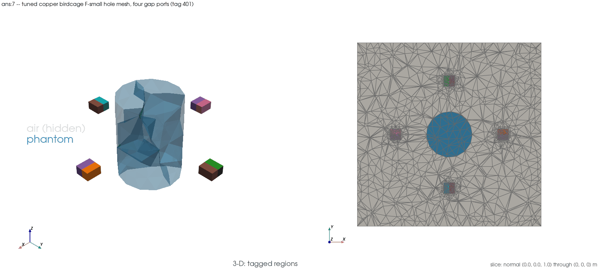

# `ans:7` — tuned copper F-small birdcage, drive across C₁ (SPEC v2, Route B)

The runnable half of `ANS-7` v2 (PROJECT_PLAN §9 items 63 / 69, §10 T10).
The case definition is `SPEC.md` in this directory: C = 66.29 pF on all four
leg gaps, gap 1 driven with C₁ across the port (parallel resonance), degree
1, Cu and PEC columns, rows read on `Y_in` over the FineWindow 62.0 → 67.0
MHz in 0.1 MHz steps.

## Degree 2 on exact rectangles (current; §10 T20)

`ANS-7` step 9 (§9 item 230) re-issues the example at degree 2 on the exact
CAD-rectangle port sheets, κ off (operator ruling 2026-10-02), on the ×1
F-small hole mesh (80 798 cells), SPEC C = 66.29 pF. The tracked
`metrics.json` carries the result under `degree2_exact`, `COMPARISON.md`
leads with the degree-2 table, and the degree-1 ragged κ-corrected keys are
labelled **superseded** (`metrics.json` `superseded`; they stay in place,
unchanged, for their readers).

Stages (`FEM_EM_ANS7_STAGE`, complex build, `FEM_EM_REQUIRE_COMPLEX=1`,
`FEM_EM_ANS_SKIP_PRIVATE=1`, no `FEM_EM_ANS6_*` / `FEM_EM_ANS7_EXACT_*` /
`FEM_EM_ANS7_SPARSE_*` knob, `-n 8`, each under 590 s; stage files in the
gitignored `/workspace/logs/ans7_p2/`):

| Stage | Does | Asserted |
|---|---|---|
| `X1` | nodes 62.0, 62.3 MHz (Cu + PEC) | (F) fixture tie, reciprocity, passivity |
| `X2` | nodes 63.2, 64.5 MHz, field solve | reciprocity, passivity, copper identity, (L) at 64.5 MHz |
| `X3` | nodes 65.8, 66.7 MHz | reciprocity, passivity |
| `X4` | node 67.0 MHz, then the seven-node assembly | one − → + zero per column, k-share, Δ_LOO ≤ `BANDS`, (R2x), (N-deg), (K) |
| `XA` | Route A at degree 2, Cu, 62.6 / 62.7 / 62.8 MHz | (AB) ≤ `REDUCTION_BAND`, one crossing, (K); control (i) printed |

Anchors, every record and band imported from the gate modules: **(R2x)** the
example's seven-node rows reproduce `ANS7_EXACT_STRIP_ROUTE_B_ROWS_P2`
(item 196) within `NODE_S_RTOL` at `-n 8` (printed, not asserted at another
width); **(L)** the loss identity at 64.5 MHz; **(AB)** Route A = Route B at
the SPEC's C; **(N-deg)** the degree-2 Cu `f₀` sits more than
`N_FACTOR`·`BANDS["f0_hz"]` from the superseded degree-1 value; **(K)** every
pre-existing `metrics.json` key re-serialises identically. Stages `B1` / `B2`
/ `A` are not re-run; `B2`'s writer carries the `degree2_exact` /
`superseded` keys over if present.

## Tuned to the Larmor frequency (current; §10 T23)

`ANS-7` step 10 (§9 item 288) adds two stages that re-drive Route A at degree 2
on the same ×1 exact-sheet mesh (80 798 cells), κ off, copper, at **C_in** (the
capacitor that puts the circuit-model zero on the target, read from the field's
stored tune stage file in the gitignored `logs/ans7_exact/` stage files, never
recomputed) at three tune points per field. They re-assert the T21′ / T22′ gates
through the example and write the rows into `metrics.json`
(`degree2_exact["tuned_larmor"]`) and a third `COMPARISON.md` section. The
degree-1 and X-stage keys are untouched ((K)). Each stage selects its field set
by name alone; every `FEM_EM_ANS7_EXACT_*` knob stays unset.

| Stage | Does | Asserted |
|---|---|---|
| `XT64` | C_in at 63.9 / 64.0 / 64.1 MHz | (AB′), (T2′), (R-T), (N1′), (N-C), (K); (N2′) printed |
| `XT128` | C_in at 127.64 / 127.74 / 127.84 MHz | (AB″), (T2″), (R-T), (N0′), (N-C), (K); (N2″) printed |

Command (complex build, `-n 8`, under 590 s, one stage per window):
`FEM_EM_REQUIRE_COMPLEX=1 FEM_EM_ANS_SKIP_PRIVATE=1 FEM_EM_ANS7_STAGE=XT64 mpiexec -n 8 python3 07_tuned_copper_birdcage_driven_sweep.py`
(and `XT128`).

Anchors, every record and band imported: **(AB′) / (AB″)** Route A = Route B at
C_in, ≤ `REDUCTION_BAND`; **(T2′) / (T2″)** exactly one − → + crossing of
Im `Y_in`,A inside the tune window and |f₀,A/target − 1| ≤ `T21P_ZERO_RESOLUTION`
/ `T22P_ZERO_RESOLUTION`; **(R-T)** the example reproduces the registered
run's stored C_in readings within `NODE_S_RTOL` at `-n 8` (printed only at
another width). Negative controls: **(N1′)** the untuned zero is ≥ 10 bands
from 64 MHz; **(N0′)** at C_F the stored 127.74 MHz grid has no up-crossing;
**(N-C)** the (R-T) comparator separates C_in from C_mode by > 100 ×
`NODE_S_RTOL`. **(N2′) / (N2″)** (circuit at 0.5·C_in) is predicted and
printed. c, r, R_in and Q at C_in are records, not gates. The `tuned_larmor`
rows are the **lossless-capacitor (r = 0)** rows and stay byte-identical.

## Capacitor ESR (current; §10 T27 / T36)

`ANS-7` step 13 (§9 item 378) adds one stage, `XT64R`, that re-drives Route A at
degree 2 on the same ×1 mesh at **(r = 0.2 Ω, C_in(r))** — the ESR ruling's
uniform r on every capacitor, both sides — at 63.9 / 64.0 / 64.1 MHz: the
series-RC sheet on P2–P4 and the feed gap's (r + C) branch in parallel at P1.
r and C_in(r) are read from the gitignored `logs/ans7_exact/` stage files that
item 311 (T26) wrote, never recomputed. The circuit layer gains an `esr_ohm`
keyword (default 0, which keeps the old expression by a branch). The rows go to
`degree2_exact["tuned_larmor_esr"]["64.0"]` and a fourth `COMPARISON.md` section;
there is no AED column (no AED ESR case exists).

Command (complex build, `-n 8`, under 590 s):
`FEM_EM_REQUIRE_COMPLEX=1 FEM_EM_ANS_SKIP_PRIVATE=1 FEM_EM_ANS7_STAGE=XT64R mpiexec -n 8 python3 07_tuned_copper_birdcage_driven_sweep.py`.

Anchors, every band imported: **(R0)** `z_cap`, the gap helper, `add_c1` and
`route_b_z` with `esr_ohm=0.0` equal the unkeyworded call bit for bit on the
stored ×1 `z64`; **(AB-r)** Route A = Route B at (r, C_in(r)), ≤ `REDUCTION_BAND`;
**(T2-r)** exactly one − → + crossing of Im `Y_in`,A in (63.9, 64.1) MHz and
|f₀,A/64 MHz − 1| ≤ `T21P_ZERO_RESOLUTION`; **(R-T-r)** the example reproduces
item 311's registered ESR run within `NODE_S_RTOL` at `-n 8`; **(K)** every
pre-existing `metrics.json` key, `tuned_larmor` included, is byte-identical.
**(N-L)** (lossless circuit at C_in(0) against the in-model ESR S11) is printed
beside item 311's reading and not asserted; **(N-C-r)** is asserted only if
item 311's own f₀,A(r) / f₀,A(0) separation exceeded 1e-7, otherwise printed.
Printed: Q(r)/Q_0 against the closed form 1/Q = 1/Q_0 + 1/Q_C with
Q_C = 1/(ωC_in r), and C_in(r)/C_in(0) − 1.

### Capacitor ESR at 127.74 MHz (`XT128R`; §9 items 391 / 392, §10 T36)

`ANS-7` step 13b adds `XT128R`, the 127.74 MHz sibling of `XT64R`, at 127.64 /
127.74 / 127.84 MHz on the same ×1 mesh at (r = 0.2 Ω, C_in(r)). r and C_in(r) are read
from the gitignored `logs/ans7_exact/t127.74/` stage files that item 387 (T35) wrote,
never recomputed; f₀,B is formed as `XT64R` forms it (three-point `parallel_rows`).
It writes `degree2_exact["tuned_larmor_esr"]["127.74"]` and appends a sibling section,
"Tuned with capacitor ESR at 127.74 MHz (§10 T35 / T36)", to `COMPARISON.md` right after the
64 MHz ESR section, through a writer only `XT128R` calls; the 64 MHz section stays byte-identical.

Command (complex build, `-n 8`, under 590 s):
`FEM_EM_REQUIRE_COMPLEX=1 FEM_EM_ANS_SKIP_PRIVATE=1 FEM_EM_ANS7_STAGE=XT128R mpiexec -n 8 python3 07_tuned_copper_birdcage_driven_sweep.py`.

Anchors, every band imported: **(R0′)** the r = 0 branch is bitwise at 127.74 MHz;
**(AB-r′)** ≤ `REDUCTION_BAND`; **(T2-r′)** one − → + crossing in (127.64, 127.84) MHz and
|f₀,A/127.74 MHz − 1| ≤ `T22P_ZERO_RESOLUTION`; **(R-T-r′)** reproduces item 387's
registered run within `NODE_S_RTOL` at `-n 8`; **(K)** every pre-existing `metrics.json` key,
`tuned_larmor` and `tuned_larmor_esr["64.0"]` included, is byte-identical.
**(N-C-S′)** (S11 against the lossless run's stored S11, > 100 × `NODE_S_RTOL`) is asserted
because the two stored S11 sets differ by > 1e-7 at every point; **(N-C-r′)** and **(N-L′)** are
printed (item 387's readings did not meet their bars). Printed: Q(r)/Q_0 against the closed form
and C_in(r)/C_in(0) − 1 beside the 64 MHz value.

## Superseded: degree 1, ragged sheets, κ-corrected (kept as the record)

The sections below describe the degree-1 stages `B1` / `B2` / `A` of
2026-09-29. Their numbers remain in `metrics.json` and in the second table
of `COMPARISON.md`.

## 1. What this demonstrates

The four-leg F-small birdcage of `ans:6`, tuned with one lumped capacitor per
leg gap and driven across C₁, read as a one-port: the parallel resonance
`f₀` (the − → + zero of `Im Y_in`), `R_in(f₀)` and the loaded Q, for copper
(Leontovich) and PEC, with the k = ±1 gap-current share at the point nearest
`f₀`. The rows are self-consistency readings on one fixture, not an
absolute-accuracy or tuning claim.

## 2. How to run it

Complex build, `FEM_EM_REQUIRE_COMPLEX=1`, `FEM_EM_ANS_SKIP_PRIVATE=1`, every
`FEM_EM_ANS6_*` knob unset; `FEM_EM_ANS7_STAGE=B1`, then `B2`, then `A`, at
`-n 4` (each stage ≈ 6–9 min). `B2` and `A` read `B1`'s stage file, so run
`B1` first; `A` also reads the tracked `metrics.json` that `B2` writes.
Stage files go to the gitignored `/workspace/logs/ans7/`
(`FEM_EM_ANS7_RESULTS_DIR` overrides).

## 3. How to analyze it, step by step

1. **Stage `B1`** — builds `TH-14`'s F-small hole ladder (imported
   `_build_ladder`, never re-implemented) uncorrected at 64 MHz and checks it
   reproduces the tracked `ans:6` `metrics.json` (anchor 1); asserts the
   Cu-vs-PEC negative control on that 4×4; derives κ (`PORT-14` step 3's
   pooled terminal-form deficit, `PORT-22`'s `_kappa_at` route) from the Cu P1
   solve; then sweeps 62.0 → 64.4 MHz with κ-corrected sheets.
2. **Stage `B2`** — reads κ from `B1`, sweeps 64.5 → 67.0 MHz, re-derives
   `B1`'s circuit layer from its stored S, and assembles the window: rows
   (a)–(c) per column, the k = ±1 gap-current share at the point nearest
   `f₀`, the predicted readings and the 2·C control; writes `metrics.json`
   and `COMPARISON.md` (AED and Route A columns blank).
3. **Stage `A`** — Route A (§9 item 68): the in-model C on every sheet over
   the same 51 points, both columns. It asserts the in-run κ recompute
   within `KAPPA_RECOMPUTE_ATOL` of `B1`'s, every one of the 102
   `S11_bare` A − B residuals ≤ `REDUCTION_BAND` (imported from
   `test_port_circuit_layer_field`), and exactly one − → + zero of
   `Im Y_in` per column. Control (i) — the circuit at
   `CONTROL_I_C_FACTOR`·C against the in-model solve at C, 64 MHz Cu — and
   control (ii) — uncorrected Route A against the circuit on the uncorrected
   4×4 — are *predicted* and printed with their ratio to the band, not
   asserted. On green it writes the Route A cells into `metrics.json`, a
   combined Cu/PEC XDMF (P1 E at the point nearest the Cu `f₀`) to the
   results directory, and the private table only when
   `FEM_EM_ANS_SKIP_PRIVATE` is unset and `aed_results/` exists.

Route B's circuit layer: `Z_bare = tuned_input(s4, f, C)[0]` (`PORT-15`,
ports 2–4 in C), `Z_in = 1/(1/Z_bare + jωC)`; cross-checked against the
SPEC's Z formula on the network Z = z0 (I + S)(I − S)⁻¹ of the same S.
The sweep's own `z_matrix`, kept in the stage file as `z_sweep`, is the
*terminated* transimpedance on the lumped-sheet route
(`ports/sparameters.py:484–493`), a diagnostic and never an open-circuit Z.
The S-vs-Z route check (≤ 1e-9) is circuit-layer algebra on one S, so it is
a **record**, not a gate on the field solve (2026-09-29 03:00 review ruling;
the script still prints it and stops on a miss).

## Setup figure

`examples/ansys_benchmarks/ans7_tuned_copper_birdcage_driven_sweep/figures/ans7_tuned_copper_birdcage_driven_sweep_setup.png`,
rendered by stage `A` right after the hole mesh is built
(`FEM_EM_SETUP_FIGURES=1`): air hidden, the phantom translucent, the slice
normal to `z` through the mid-plane showing the phantom and the four gap-port
boxes (the ports survive because no half-space clip is applied). The coil is
a hole in the mesh (tag 401 is a boundary, not a region), so it draws as
empty space between the phantom and the port boxes; the lumped capacitors are
circuit elements added across the gaps and are not part of the mesh. Geometry
only — no number in the figure.

## Not claimed

Any absolute `Z_in`, any match to AED; an absolute Q or R_in (INCONCLUSIVE
against AED First Order, T48). C_in, f₀, R_in, Q at C_in are ×1-mesh degree-2
records — no absolute tuned C or tuning-accuracy claim. A measured ESR or its
frequency dependence; ESR rows (64 and 127.74 MHz) are ×1-mesh degree-2
records. No AED value is read or written; the weekly's adjudication (f₀ AGREE
with its h-statement, T13; Q / R_in converged in h, T41) is `COMPARISON.md`
§ Verdict.
