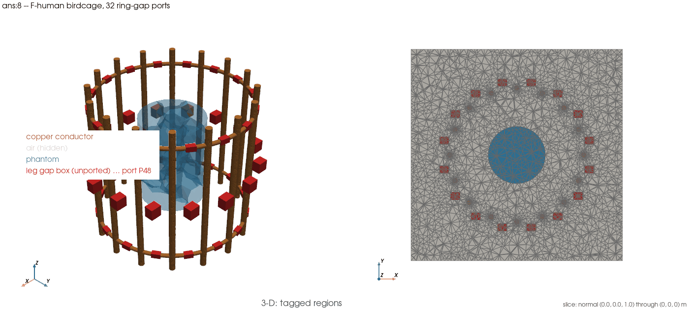

# `ans:8` — F-human birdcage, two-port quadrature mode content at 64 MHz (Route B)

The runnable half of `ANS-8` step 1 (PROJECT_PLAN §9 item 141, §10 chain H;
brief `docs/planning/chunks/ANS-8.md`). The case definition is `SPEC.md` in
this directory: the 16-leg F-human birdcage with 32 ring gaps and the `WF-7`
phantom, σ = 800 S/m coil solved inside, 64 MHz, degree 1, C = 113.11 pF on
every gap, feeds P17 / P21 (90° apart on the bottom ring).

## 1. What this demonstrates

Our 32×32 gap-port S matrix of the tuned F-human coil, read through circuit
algebra as SPEC rows 1–3: the k = 1 block's `C_mode` (and the k = 2 block's
C), the C16-breaking off-block norm, the per-ring k-spectrum of the gap
currents under drives (i) P17 alone, (ii) ccw quadrature `(1, −j)` and (iii)
cw `(1, +j)` — the k = ±1 share and the k = 0 leak — and the feed rows. All
of it comes from one function, `fem_em_solver.ports.ring_modes.ring_mode_rows`,
which the private writer also applies to AED's exported 32×32, so the two
codes' rows are the same algebra by construction. The rows are readings on
one fixture, not an absolute-accuracy, tuning or B₁ claim.

SPEC v2 (§9 item 161) adds, with no new solve, through
`fem_em_solver.ports.ring_modes.ring_mode_rows_v2` (which composes
`ring_mode_rows` and leaves v1's rows bit-identical): **row 2b** — the same
drives with every gap, the feeds included, at the matrix's *own* row-1
`C_mode`, wired from the function's own output so neither code can be handed
the other's; **row 2c** — the opposite pair (P17 / P25) and the four-port ccw
(P17 / P21 / P25 / P29) controls at both C, whose k = 0 leak is a
C16-breaking gauge and whose k = ±1 share is the drive-independent ceiling;
**row 4a** — the one-point resonance `f₀ = f·√(C_mode / C)`. On our side the
SPEC's 113.11 pF sits +1.700e-5 above our `C_mode`, so row 2 (fixed C) is
our own detuning record and 2b is not row 2.

## Setup figure

`examples/ansys_benchmarks/ans8_f_human_quadrature_mode_content_64MHz/figures/ans8_f_human_quadrature_mode_content_64MHz_setup.png`,
rendered right after stage S builds its mesh (`FEM_EM_SETUP_FIGURES=1`, one
flagged `-n 8` window): air hidden, the phantom translucent, the copper
conductor (tag 1) drawn solid — 16 legs and two rings — with the 32 ring-gap
port boxes (P17 … P48) and the 16 unported leg-gap boxes (tags 101–116) in
the red class. The right panel is the slice normal to `z` through the coil
mid-plane, which cuts the phantom and the leg-gap boxes. No half-space clip.
Geometry only; the figure carries no field or S-parameter value.

## 2. How to run it

Complex build, `FEM_EM_REQUIRE_COMPLEX=1`, `FEM_EM_ANS_SKIP_PRIVATE=1`:

1. `FEM_EM_ANS8_STAGE=S` at `-n 8` (heavy, ≈ 5 min, ≈ 12 GiB summed RSS) —
   builds the matrix and saves `s32.npz` to the gitignored
   `/workspace/logs/ans8/` (`FEM_EM_ANS8_RESULTS_DIR` overrides).
2. `FEM_EM_ANS8_STAGE=R` at `-n 1` (seconds) — loads that npz (never
   recomputes; a missing npz stops the stage) and writes `metrics.json` and
   `COMPARISON.md` beside the script, the AED column blank.

## 3. How to analyze it, step by step

1. **Stage `S`** builds the fixture exactly as `test_wf10_step1c_c_sweep`
   W1 does, from imported pieces (`_build_f_human`, `_ring_quadrature_slots`,
   `_solve_one_drive`, `terminal_form_deficit`, `_respec` — never
   re-implemented): κ (`PORT-14` step 3's pooled terminal-form deficit) from
   the uncorrected P17 solve, then the κ-corrected 32 columns. It asserts (G1)
   the cell count within `CELL_COUNT_BAND` of the F-human record,
   reciprocity ≤ `RECIPROCITY_BAND` and σ_max ≤ `MATRIX_PASSIVITY_CEILING`.
2. **Stage `R`** re-checks G1 from the npz, asserts (G2) that the fixture's
   measured (slot, ring) map equals the SPEC naming map P(17 + j) → (j,
   bottom), P(33 + j) → (j, top), and (G3) — when item 128's held matrix is
   on the box — the rebuild against it entrywise within
   `LEG_D0_REPRODUCTION_BAND`.
3. **Anchors** (asserted, at `C_MODE_F` imported from the `WF-10` test and
   the **cw** sense item 133 used): `C_mode` and C₂ within
   `LEG_D0_REPRODUCTION_BAND` of item 133's records, the off-block norm, the
   P17-alone, two-port cw, opposite-pair and four-port circuit shares to
   their printed digits, the |k| folds to 1e-4, even-|k| ≈ 0 on the
   symmetric drives. Negative control: at C₂ the P17-alone feed-ring share
   falls below 0.5.
4. **Rows** at the SPEC's C = 1.1311e-10 F and the three SPEC drives go to
   `metrics.json` (`rows`) and `COMPARISON.md`. The algebra: `Z = z0 (I +
   S)(I − S)⁻¹`; the unitary per-ring DFT into 2×2 blocks `Ẑ_k`; `C_k =
   1/(ω Im λ)` of the ring-antisymmetric eigenpair; every non-feed gap in
   `jωC`, each feed a Norton source `V_f/50` in parallel with `1/50 + jωC`;
   `(Y_net + Y_load) V = I_s`, gap currents `I = Y_net V`; per ring the NumPy
   `fft` bins (ccw content in bin 15, cw in bin 1). The feed rows are `V_f /
   I_f` per feed under drive (ii) and the 2×2 network admittance at the
   feeds with every other gap in C.
5. **SPEC v2 rows** (stage R, after the anchors; `rows_v2` in
   `metrics.json`, v1's `rows` unchanged): `ring_mode_rows_v2` runs rows 1–3
   at the SPEC C (`fixed_c`), then the same drives at `C_own =
   fixed_c.c_mode_f` (`own_c_mode`, row 2b, with row 3 at own C as 3b), each
   control as its own call with its own feeds (the Norton 1/50 sits on driven
   ports only) at both C (row 2c), and `f0_one_point_hz` (row 4a). Asserted
   on our matrix: (B0) `C_own` bitwise equal to row 1 and within
   `LEG_D0_REPRODUCTION_BAND` of `C_MODE_F`; (B1 / B2) 2b reproduces the
   P17-alone and cw anchors, (B3) equals the `C_MODE_F` blocks to 1e-9,
   (B4) `|ccw − cw|` = 1.912e-3 ± 1e-6 with ccw below cw; (C1) the opposite
   pair reproduces A6, (C1–C3) both controls' k = 0 leak and even-|k| folds
   ≤ 5e-5 at both C, (C4) every control share above every two-port share;
   (F1) `f₀` against `64 MHz·√(C_MODE_F / C)` to 1e-9 and below 64 MHz. The
   negative controls: the C₂ record 0.099704 through the v2 function, and
   the two-port ccw leak (> 0.1) against the controls' (≤ 5e-5). `COMPARISON.md`
   gains rows (2b), (3b), (2c) and (4a); row 2 is captioned as the detuning
   record. The private writer applies the same function to each AED design,
   so AED's 2b runs at AED's own `C_mode`; it never overwrites a private file
   whose first line is not its own header.

The loss partition is not computed on our side in this step and is left
blank. The traps: anchors run at `C_MODE_F` and cw, the published rows at
the SPEC's 113.11 pF and ccw — mixing them shifts the shares ≈ 1e-5; item
133 used Thevenin feeds, the SPEC Norton — the shares agree, V/I does not.

## Not claimed

Any AED value, verdict or agreement level; the frequency sweep (row 4);
Route A; the loss partition; copper. No AED value is read or written by the
tracked outputs; the weekly adjudicates share and leak at a stated relative
level once the AED half lands. From SPEC v2: not the row-4 sweep
interpolation (4a is the one-point form with λ₁ taken ∝ ω; its first-order
error (1 − p)·δ/2, p = d ln Im λ₁ / d ln ω, is unmeasured), not the degree-2
32×32 (a new solve the weekly prices), not copper (`WF-12` step 3), not
`P_coil`, not Route A, and no adjudication.
