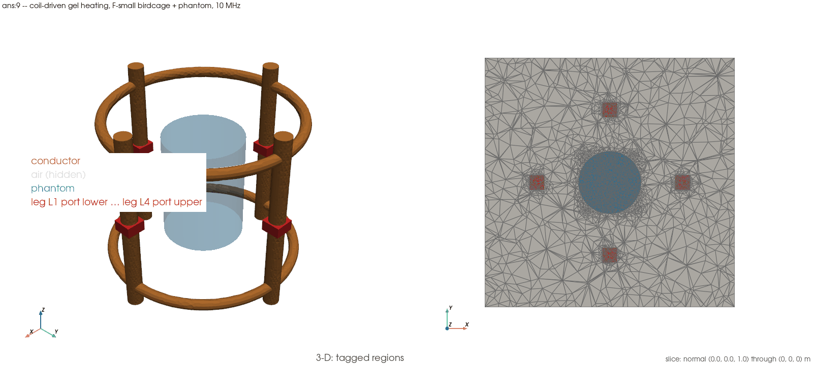

# `ans:9` — coil-driven gel heating at 10 MHz, drive P1 (ANS-9 steps 1a / 1d, our side)

The runnable half of [`SPEC.md`](SPEC.md): the 10 MHz loaded F-small
birdcage driven at P1, its ½σ|E|² loss as a heat source in the gel phantom
normalised to 1 W, and a Robin-cooled transient (k 0.6, ρc 4.18e6, h 10,
T∞ = T(0) = 20 °C) to 1254 s. The script fills our columns of the SPEC's rows
1–7; the AED columns stay blank (AED values are private).

**Degree 2 primary, degree-1 column carried** (step 1d, §9 item 410,
2026-10-13). The primary column is N1curl degree 2 on the exact-rectangle
F-small fixture, κ off, with the h_p = 0.0025 m phantom (route B: 201 072 EM
cells, 58 960 thermal cells). The 2026-10-04 degree-1 column (ragged
pre-10-03 sheets, `MAT-15` step 1 fixture, 199 920 / 58 866 cells,
adjudicated 2026-10-10) is carried beside it as a labelled record
(`D1_RAGGED_COLUMN`, `metrics.json` → `columns.d1_ragged`), not re-solved.

## 1. What this demonstrates

- Drive P1 through route B (`GEO-27` step 2's builder → one-factorisation
  four-port sweep with fields kept), re-run thermally with every CN step
  kept, the first Rannacher half-step and one calorimetric BE step.
  Thermal constants and bands are imported from
  `tests/validation/test_mat15_coil_driven_heating_phantom.py`, the EM bands
  from their owning modules; the SPEC's typed numbers are used only in the
  (A0) structure check.
- Asserted: (A0) SPEC constants equal the imports; (P1W) the independent
  phantom integral is 1 W; (G2) the four exact strip areas; (i) reciprocity
  of the 4×4 S; (R) the cell and degree-2 dof records; (R1) row 1 is 1 W;
  (E) every run's balance residual; (R3) the calorimetric slope equals
  1 W/(ρc·V); (R6) the energy balance row 1 × 1254 s = ρc∫θ + row 6, with
  row 6 built as an independent sum of the scheme's own surface term per
  (half-)step.
- Negative controls: (d6) a doubled source misses (R6); (s6) dropping the
  surface term misses (R6) by row 6's surface fraction.
- Printed: the phantom volume beside the 58 866-cell record, the
  reproduction against `ANS-9` step 1c's h0025 window, and degree 2 /
  degree 1 per row.

## Setup figure



`examples/ansys_benchmarks/ans9_coil_driven_gel_heating_10MHz/figures/ans9_coil_driven_gel_heating_10MHz_setup.png`,
rendered from the 2026-10-04 `MAT-15` P1 fixture
(`FEM_EM_SETUP_FIGURES=1`, one flagged `-n 2` window), outside every printed
timer; step 1d did not regenerate it (geometry only, opt-in). *Left:* the gapped four-leg birdcage with the 0.0025 m phantom rung;
the `conductor` (copper legs and rings outside the gaps) and the `phantom`
(translucent) are drawn, `air` is hidden, and each leg's gap is split into a
lower and an upper lumped-sheet terminal, both in the `port` colour class.
*Right:* the slice normal to `z` at `z = 0`, the port-gap mid-plane. Geometry
only; the figure carries no field, power or temperature value.

## 2. How to run it

```
./scripts/run_examples.sh -e ans:9 -n 8 -t 590
```

The `ans:` group sources the complex DolfinX build. The run takes ≈ 6 min
at `-n 8` (heavy tier; measured 330 s, ≈ 47 GiB summed peak RSS). Do not
run it at `-n 2`: the degree-2 h0025 solve is priced at `-n 8` only.

## 3. How to analyze it, step by step

1. Read the `[PASS]` / `[FAIL]` lines: every anchor and control is printed
   with its band.
2. `ROW1` … `ROW7` lines carry the SPEC rows; `metrics.json` holds the same
   numbers, and `COMPARISON.md` the row table with blank AED columns and the
   SPEC's pre-registered readout.
3. Open
   `paraview_output/ans9_coil_driven_gel_heating_10mhz_combined.xdmf` in
   ParaView: P1 `theta_t0313`, `theta_t0627`, `theta_t0940`, `theta_t1254`
   (rise in K) and DG0 `q_h` (W/m³) on the phantom submesh. The hot region
   sits near the driven leg at +x.

## Not claimed

No AED value or verdict; one mesh rung on each column and no h-statement on
either the EM or the thermal side; constant σ; no perfusion or tissue; the
1 W normalisation means no absolute temperature.
