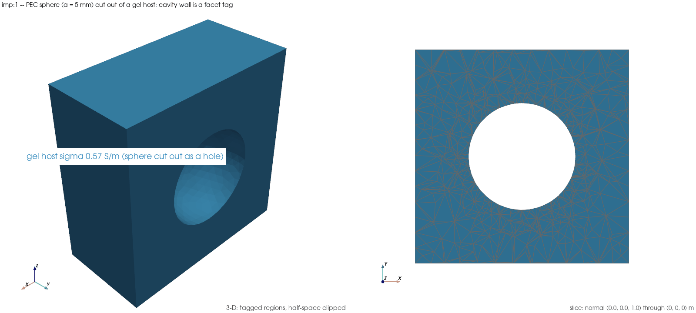

# `-e imp:1` — a metal sphere in the gel: the dipole it adds and the SAR it concentrates

Guide for `examples/implants/01_pec_sphere_in_gel.py`. Written to be followed
without the source open.

## 1. What this demonstrates

**The first implant example.** A perfectly conducting ball (radius
a = 5 mm), cut out of the mesh as a hole (`th:9`'s route), sits in the
gelled-saline host of `MAT-4` (σ = 0.57 S/m, εᵣ = 78) at 64 MHz under an
imposed quasi-static field E₀ẑ, solved at degree 2. `th:9` is lossless at
4.77 MHz and reads only the dipole coefficient β; this adds the lossy host
and the quantity an implant is about, the SAR it concentrates. Outside the
sphere

```
E = E0 zhat + beta E0 a^3 (3 (zhat.rhat) rhat - zhat) / r^3,   beta = 1
```

so over the shell a < r < 1.5a the cross term integrates to zero and the
shell-mean SAR enhancement is Φ = ⟨|E|²⟩/E₀² = 1 + 2β²(a/c)³ = **1.5926**
(local SAR = σ|E|²/(2ρ) in a homogeneous host). At r = 1.2a the pattern is
a pole peak and an equator dip.

Every record, band and helper is **imported** from the gate module
(`tests/validation/test_imp1_pec_sphere_lossy_host.py`, `IMP-1` step 1),
never restated; the example reproduces the gate's own records to the digit
at the a/6 rung (13 467 cells).

Scope: a/6 rung, degree 2, imposed quasi-static field. **No coil, no tissue,
no heating, no ASTM F2182 claim** — a closed-form fixture in a small sphere.

On record at `-n 2` (`20261001T170201Z_EX-72.log`, flagged run, 44 s
harness-wall; `20261001T170250Z_EX-72-control.log`, unflagged re-run, 36 s,
records identical):

| Quantity | Closed form / band | Measured | Gate record |
| --- | --- | --- | --- |
| Dipole coefficient β | 1 | **0.985596** (miss 1.4404 %) | 0.985596, band `TH15_BETA_BAND` 4.8860 % |
| Φ_h (shell mean, discrete mask) | Φ_cf,h = 1.605264 | **1.606456** (miss 0.0743 %) | 1.606456, band `MAT4_BAND` 10 % |
| Cavity dofs / max \|E\| on them | > 0 / < 1e-12 | **5670 / 0.000e+00** | 5670 / 0 |
| SAR/SAR₀ at 1.2a, pole (3°) | cf 4.6421 | **4.5288** | 4.5288 |
| SAR/SAR₀ at 1.2a, equator (87°) | cf 0.1898 | **0.2072** | 0.2072 |
| Control β (cavity natural) | band 4.8860 % | **−0.432813** (\|Δβ\| 1.4328) | 1.4328 |
| Control Φ miss | band 10 % | **44.2975 %** | 44.2975 % |

## Setup figure



`examples/implants/figures/implants_01_pec_sphere_in_gel_setup.png`. The
sphere is cut from the mesh (`as_hole=True`), so the only cell tag is `2`
(the gel host, σ = 0.57 S/m); the cavity wall is a *facet* tag
(`CAVITY_TAG = 2` on `facet_tags`) and cannot be drawn as its own region.
The left panel clips the block at y = 0 (keeping y < 0) so the spherical
void is visible; the right panel slices at z = 0, the sphere's equatorial
plane, where the void is a white disc in the meshed gel.

## 2. How to run it

```
./scripts/run_examples.sh -e imp:1 -n 2 -t 180
```

**Complex build required** — the `imp:` group sources it automatically and a
real build raises. Tier: **standard**; ≈ 40 s in-example (two solves on one
cached mesh). In a scheduled session, emit with `--dry-run` and run the
printed command through `scripts/testing/run_and_log.sh`; set
`FEM_EM_SETUP_FIGURES=1` in the container command to regenerate the figure.

## 3. How to analyze it, step by step

**Step 1 — the dipole coefficient.** Fitted on 24 + 24 Fibonacci probe
points at r = 1.2a and 1.5a:

```
  fitted beta = 0.985596   |beta - 1| = 1.4404%   TH15_BETA_BAND = 4.8860%
```

**Step 2 — the SAR enhancement Φ.** The solved ⟨|E|²⟩ over the shell cells
against the closed form integrated over the *same discrete mask*:

```
  Phi_h = 1.606456, Phi_cf,h = 1.605264, miss 0.0743%   MAT4_BAND = 10%
```

Both differ from the continuous 1.5926 by under 1 %, which is the mask's
discreteness, not the solve.

**Step 3 — the pattern.** At r = 1.2a the SAR/SAR₀ is 4.5288 at the pole
(closed form 4.6421) and 0.2072 at the equator (0.1898): the implant
concentrates SAR on the field axis and shields the equator. These two are
printed records, not asserted.

**Step 4 — structure.** The cavity facet tag reaches 5670 dofs, all pinned
to zero (max \|E\| = 0): the hole route works at degree 2.

**Step 5 — the negative control, asserted.** Drop the cavity tag from the
Dirichlet set and the cavity becomes a natural (void) boundary:

```
  control beta = -0.432813 (void -0.50)   |dbeta| = 1.4328  >> band 4.8860%
  control Phi_h = 0.894172 vs 1.605264: miss 44.2975%  >> band 10%
```

Both bands are missed by wide margins on the same mesh, so the passes above
are the conductor condition's doing and not a loose band.

**Step 6 — open it in ParaView.**
`File → Open → examples/implants/paraview_output/implants_01_pec_sphere_in_gel_combined.xdmf`,
colour by `sar_ratio` (DG0, = \|E\|²/E₀² = SAR/SAR₀). Clip through y = 0: the
SAR peaks at the poles on the field axis and falls below the far field at
the equator. `E_real` / `E_magnitude` (CG1) and the facet tags are in the
same file.

**Step 7 — what a deviation means.** β or Φ off the gate's record at six
decimals is an example/test divergence — report it, do not move a band. A
control that lands inside a band means `pec_facet_tags` no longer
distinguishes a conductor from a void.

## Related

- The gate: `tests/validation/test_imp1_pec_sphere_lossy_host.py`
  (`IMP-1` step 1).
- The lossless sibling: `examples/time_harmonic/09_pec_sphere_as_hole.py`
  (`th:9`).
- The host and its SAR gate: `examples/materials/02_lossy_sphere_sar.py`
  (`mat:2`).
