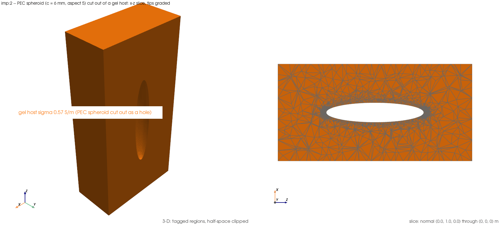

# `-e imp:2` — a rod-tip stand-in in the gel: elongation, and the field along it

Script: `examples/implants/02_pec_spheroid_tip_in_gel.py` (`EX-77`)
Gate: `tests/validation/test_imp2_spheroid_fem.py` (`IMP-2` step 1)

## 1. What this demonstrates

`imp:1` is a metal sphere, whose SAR enhancement is modest (the shell mean is
1.59). Elongation, not metal alone, is what makes a tip hot. This example
solves `IMP-2`'s perfectly conducting prolate spheroid (semi-major c = 6 mm
along z, semi-minor a = 1.2 mm, aspect 5) cut out of a box of half-extents
(6, 6, 12) mm as a hole, in `MAT-4`'s gelled-saline host (σ = 0.57 S/m,
ε_r = 78) at 64 MHz, degree 2, under the imposed quasi-static field E₀ẑ
(44 304 cells).

- The tip field is E₀/L_z with 1/L_z = 17.914415, so the pointwise tip
  SAR/SAR₀ is (1/L_z)² = 320.9.
- The mesh resolves a tip-ball mean, over r_t = 2a²/c = 0.48 mm: Φ_tip =
  ⟨|E|²⟩/E₀² = 49.8. Averaging takes the peak down by 0.155×.
- Turning the same field crosswise (E₀x̂) drops Φ_tip to 0.72.

Everything is imported from the gate module and nothing is restated. The
`return_fields` keyword on `_solve_spheroid` (keyword-only, default `False`,
test bodies untouched) is the only change to a test file; the module was
re-gated green in the same slot before any example window.

Asserted (imported bands):

- (i) |β − 1| ≤ `TH15_BETA_BAND` (4.886 %); β = 0.990979 (0.9021 %), the
  record in `20261001T201608Z_IMP-2-step1-W1.log:450`;
- (ii) |Φ_tip,h/Φ_tip,cf,h − 1| ≤ `MAT4_BAND` (10 %): 49.805748 against
  49.904262, 0.1974 %;
- (iii) cavity dofs 23 886 > 0 at max |E| = 0 < 1e-12.

**Negative control (asserted only as "> band"):** the transverse drive on the
same cached mesh gives β = 0.000044 (|β − 1| = 1.0000 against the 4.886 %
band) and Φ_tip,h = 0.718499 against the axial closed form 49.904262, a miss
of 98.5602 % against the 10 % band.

Printed, not gated: 1/L_z at aspect 1.01 / 2 / 5 / 20 = 3.024038 / 5.761564
/ 17.914415 / 148.168897 (the `IMP-2` W0 records; (1/L_z)² = 9.1 / 33.2 /
320.9 / 21 954) — the trend from `imp:1`'s sphere to a rod.

Not claimed: aspect 2, a finite-k spheroid, a rod, a coil, tissue, 1 g SAR,
heating, ASTM F2182, convergence.

## 2. How to run it

```
./run_examples.sh -e imp:2 -n 2 -t 400
```

Needs the complex DolfinX build, which the runner sources for the `imp:`
group. Tier: **heavy**. The run takes ≈ 113 s wall at `-n 2` (axial 53 s +
transverse 53 s), ≈ 6.1 GiB summed RSS. Verification runs go through the
logging harness with the runner's emitted command
(`./scripts/run_examples.sh -e imp:2 --dry-run`). Add `-e FEM_EM_SETUP_FIGURES=1`
after `exec -T` to re-render the setup figure.

## Setup figure



`examples/implants/figures/implants_02_pec_spheroid_tip_in_gel_setup.png`.
The figure shows the gel host (cell tag 2 only; the spheroid is a hole), the
block clipped at y < 0, and the x–z slice at y = 0 showing the long axis and
the mesh graded toward the tips.

## 3. How to analyze it, step by step

**Step 1 — the closed form.** `[closed form]` and `[trend]` print 1/L_z and
(1/L_z)² from `prolate_spheroid_depolarisation`; the aspect-5 value matches
the W0 record to six decimals.

**Step 2 — the anchor.** `[anchor] (i)` and `(ii)` print β and the tip-ball Φ
beside the gate's W1 records; the digits agree. The tip-ball mean 49.8 sits
below the pointwise 320.9 because r_t averages over the steep falloff away
from the apex.

**Step 3 — the control.** `[control]` shows that the crosswise field gives
β ≈ 0 by x-parity and Φ_tip = 0.72: the tip enhancement exists only for the
field along the long axis.

**Step 4 — ParaView.** Open
`examples/implants/paraview_output/implants_02_pec_spheroid_tip_in_gel_combined.xdmf`
and colour by `sar_ratio_axial` (DG0, SAR/SAR₀) on an x–z cut. Compare with
`sar_ratio_closed_form` (closed form at cell midpoints), `sar_ratio_transverse`,
`tip_mask` (the tip-ball cells) and the CG1 `E_real_axial`. Nothing in the
file is asserted beyond the printed anchors.

## Related

- The sphere: `examples/implants/01_pec_sphere_in_gel.md`.
- The gate modules: `tests/validation/test_imp2_spheroid_fem.py`,
  `tests/validation/test_imp1_pec_sphere_lossy_host.py`.
