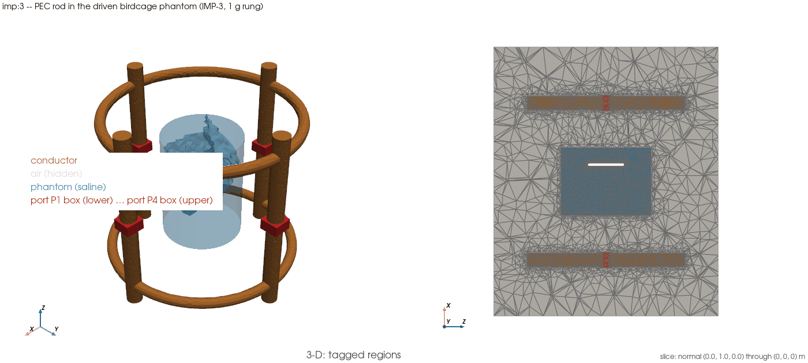

# `-e imp:3` — a PEC rod in the coil-driven phantom: the 1 g tip SAR with and without it

Script: `examples/implants/03_rod_in_birdcage_tip_sar.py` (`EX-83`)
Gate: `tests/validation/test_imp3_rod_birdcage.py` (`IMP-3`, the 1 g rung, `test_imp3_one_gram_rung`)

## 1. What this demonstrates

`imp:1` and `imp:2` impose a uniform field on a metal body in gel; `mri:3`
drives the birdcage into a phantom with no implant. This example solves the
gapped 4-port birdcage (untuned solid coil, 50 Ω lumped sheets) at 64 MHz,
degree 1, on the 1 g phantom rung twice: as built (199 920 cells), and with a
2 mm diameter, 32 mm tip-to-tip PEC rod standing axially in the phantom on
leg 1's azimuth (250 866 cells). The 1 g mass-averaged SAR is read at the two
rod tips on six drives (P1–P4 and the quadrature ccw / cw).

- Q = SAR₁g(rod) / SAR₁g(without): P1 4.496 / 4.498 (top / bottom), P3 3.806 /
  3.796, ccw 3.965 / 3.962, cw 3.959 / 3.958 — inside the gate's `PRED_Q`
  [2, 10]. P2 and P4 (1.580 / 1.576, 1.586 / 1.582) read OUT of `PRED_Q`
  because their field on the rod axis is transverse (η_z = 0.405 / 0.443); the
  rod barely couples to it.
- The gate's own table (Q, η_z, M_cf, the `IMP-2` estimate, Q / estimate) is
  printed unchanged by the lifted body.
- Along the axis just beyond the top tip |E|_rod / |E|_without = 7.79 (P1) at
  z = 16.5 mm, falling to ≈ 1 by z ≈ 30 mm; along the midplane just off the
  shaft wall it is 0.143 (P1), recovering to 0.87 at x = 28 mm.

Everything is imported from the gate module and nothing is restated.
`_run_one_gram_rung(*, field_hook=None)` is the body of the gate's
`test_imp3_one_gram_rung` lifted to module level (rule (a), additive); the
test calls it and every print is unchanged with the default. The same lift
threads a `field_hook` through `_case` and `_arm`, called just before each
arm's solved fields are freed. Both gate windows (W1 at `-n 2`, W2 at `-n 4`)
were re-run green from this tree in the same slot with digit-identical
records, before any example window.

Asserted (imported bands):

- (A0) without-rod cells 199 920 = `ONE_GRAM_RUNG_CELL_RECORD`; rod arm
  250 866 under `ROD_CELL_GUARD_W2`;
- (i) reciprocity (2.1e-15 / 2.9e-15 against 1e-3) and (ii) passivity
  (σ_max 0.999752 / 0.999758) on both arms;
- (P) the power identity on all four port drives of both arms, 1e-15
  against `DISCRETE_IDENTITY_RTOL` (1e-6);
- (M) rod-arm σ_y mirror pairs max 0.0819 % against 0.50 %;
- (E) 7 437 tag-402 dofs, max |E| = 0 against `PEC_WALL_MAX_E` (1e-12);
- (S) without-rod separation 402.7× against the floor 10.

Round-off readings ((i), (P), (E)) vary from run to run and are asserted at
their bands only.

Example-side checks (asserted, true by construction): the owned sum of the P1
DG0 phantom-loss vector, assembled from `0.5·σ·(E·conj E)·conj(v)·dx(phantom)`,
equals the gate's `shares["P1"]["phantom"]` on both arms (rel 6.2e-15 and
1.5e-14 against 1e-6); every profile point's `ok` mask is True.

**Negative control (asserted):** the rod-blind arm under-reads every tip, so
Q > 1 on all 6 drives × 2 tips. Minimum Q − 1 = 0.576124 (P2 bottom), i.e.
1 − 1/Q = 36.55 % — the same digits as the `IMP-3` record
(`20261002T170843Z_IMP-3-step1-W2.log:3867`). The ceiling of 1 − 1/Q is 100 %;
Q has none, so no factor is claimed.

Printed, not gated: the |E| ratios on the two lines above; the first P1 points
(axial 7.785, predicted [2, 20]; midplane 0.143, predicted [0.05, 0.9]) both
land in their predicted ranges.

Not claimed: the accuracy of Q (`ANS-10`), absolute or pointwise SAR, heating
or compliance, the natural-wall control C1 on this rung, a without-rod map on
the rod mesh, the tuned or copper coil, other placements, `WF-9`.

## 2. How to run it

```
./run_examples.sh -e imp:3 -n 4 -t 480
```

Needs the complex DolfinX build, which the runner sources for the `imp:`
group. Tier: **heavy**, complex. The run takes ≈ 223 s wall at `-n 4`
(≈ 217 s of it the gate body). Verification runs go through the logging
harness with the runner's emitted command
(`./scripts/run_examples.sh -e imp:3 -n 4 -t 480 --dry-run`). Add
`-e FEM_EM_SETUP_FIGURES=1` after `exec -T` to re-render the setup figure.

## Setup figure



`examples/implants/figures/implants_03_rod_in_birdcage_tip_sar_setup.png`.
The left panel shows the conductor (legs and rings) and the port boxes with
the phantom translucent and the air hidden. The right panel is the x–z slice
at y = 0: the white bar in the phantom is the rod's hole, lying along z on
leg 1's azimuth, with the mesh graded around it.

## 3. How to analyze it, step by step

**Step 1 — the gate.** The block `[IMP-3 W2 …]` is the gate's own report; its
rod-arm, without-rod and ratio lines match `20261002T170843Z_IMP-3-step1-W2.log`
digit for digit (Q, M_cf, masses).

**Step 2 — the anchors.** The `[anchors]` block prints (A0), (i), (ii), (P),
(M), (E) and (S) beside their bands.

**Step 3 — the control.** The `[control]` block prints Q for every drive and
tip and the asserted Q > 1.

**Step 4 — the profiles.** `[printed, no band]` gives |E|_rod / |E|_without
at 12 points on the axial line beyond the top tip and on the midplane line.
The two arms are on different meshes, so the ratio is taken at identical
points, not cell by cell.

**Step 5 — ParaView.** Open
`examples/implants/paraview_output/implants_03_rod_in_birdcage_tip_sar_combined.xdmf`
(rod mesh only; facet tags in the same file). Colour by `local_sar_rod_P1` or
`local_sar_rod_ccw` (per-cell phantom loss ÷ (ρ·V), DG0) and `E_magnitude_rod_P1`
/ `E_magnitude_rod_ccw` on an x–z cut, and threshold `one_gram_ball_top` /
`one_gram_ball_bottom` (cell-midpoint masks of the two 1 g balls). There is no
without-rod map on this mesh; that arm appears only as profiles.

## Related

- The imposed-field implants: `examples/implants/01_pec_sphere_in_gel.md`,
  `examples/implants/02_pec_spheroid_tip_in_gel.md`.
- The coil without an implant: `examples/mri/03_birdcage_mass_averaged_sar.md`,
  `examples/mri/02_mass_averaged_sar.md`.
- The gate module: `tests/validation/test_imp3_rod_birdcage.py`.
