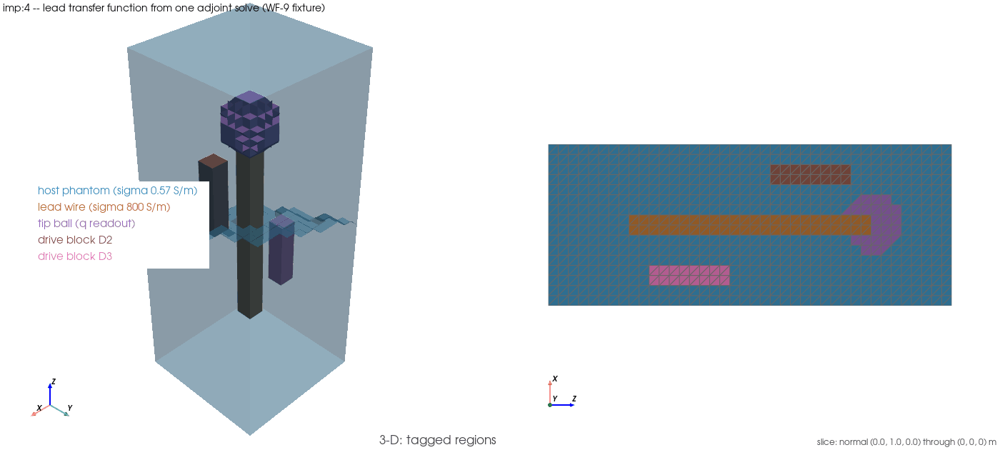

# `-e imp:4` — one adjoint solve gives an implant lead's transfer function

Script: `examples/implants/04_lead_transfer_function_adjoint.py` (`EX-84`)
Gate: `tests/validation/test_wf9_transfer_function_identity.py` (`WF-9` step 0, `test_wf9_identities`)

## 1. What this demonstrates

`imp:1`, `imp:2` and `imp:3` read the field near a PEC body. This example does what an
implant study does next: it computes the lead's **transfer function** TF(z) — the tip
response to a unit impressed current at height z along the lead — with **one adjoint
solve**, and then uses it to predict the tip response to an exposure the adjoint never
saw. The fixture is `IMP-1`'s lossy host (σ 0.57 S/m, εᵣ 78) at 64 MHz, one structured
box, N1curl degree 1, with a σ = 800 S/m square lead (2 × 2 × 24 mm, 24 layers of 1 mm)
and a tip ball (624 cells) at the lead's upper end. The scalar read out is
q = mean E_z over the ball.

Since the with- and without-lead operators differ only by ΔA = jωμ₀Δσ·M_lead, the
with-lead tip response to any exposure is the lead-free response plus the with-lead
response to the equivalent current J_eq = Δσ·E_inc on the lead. The adjoint field w
(one with-lead solve with the tip functional as the source) reads that response off as
a fold: **q_with − q_without = −jωμ₀Δσ ∫χ_lead w·E_inc dV** (the (T3) identity;
Jin §6.4 eqs (6.78)–(6.85)). The per-layer read-back −jωμ₀Δσ ∫χ_j w_z dV is TF_adj[j].

- The TF(z) table is printed: the magnitude peaks at j = 19 (z = 7.5 mm), rises
  almost linearly from the bottom end, and the last layers j = 22 / 23 have phase
  −166.19° / −175.37°, within 20° of ±180° — all as the gate's own profile
  (`20261003T003327Z_WF-9-step0-W1.log:145–149`).
- D1 (uniform Dirichlet E₀ ẑ) and D2 (an impressed ẑ block at 4 < x < 6 mm) are the
  gate's drives. **D3 is new**: D2's block mirrored through x = 0 and z = 0
  (−6 < x < −4 mm, −10 < z < −2 mm), 192 cells. The same adjoint field w, folded
  against D3's lead-free field, equals D3's direct with-lead tip response to
  1.4e-11 (band 1e-6). The TF is computed once and predicts the response to an
  exposure it never saw.
- D3: |q_with / q_without| = 0.782 (predicted [0.05, 50]). The ISO 10974 path fold
  (Σ over the 24 layer segments of TF_k · Ē_k, with the layer-mean field) misses
  dq by 0.92 % at N = 24 (predicted [1e-4, 0.1]); the transverse term, which a
  z-only path fold drops, is 1.56 % of |dq|. The band for the path fold is the
  weekly's; nothing here claims one.

Everything is imported from the gate module; nothing is restated.
`_run_identities()` is the body of `test_wf9_identities` lifted to module level
(rule (a), additive: one trailing `return`); the test calls it and every print is
unchanged. Both gate windows (`-n 2` and `-n 4`) were re-run green from this tree in
the same slot, with the census and the D1 / D2 q digits matching the gate's records.

Asserted (imported bands, `DISCRETE_IDENTITY_RTOL` = 1e-6, `SYMMETRY_RTOL` = 1e-10):

- (A1) ‖A − Aᵀ‖/‖A‖ = 1.1e-16; (T2) 1.5e-12; (H) 1.2e-14;
- (T1) and (T3) on D1 and D2 at 1e-6 × |dq| (readings 1.7e-13 / 1.4e-12 and
  4.8e-14 / 1.1e-12).

Round-off readings vary from run to run and are asserted at their bands only.

Example-side checks (asserted, true by construction):

- (X0) the D3 block has 192 owned cells (= `BLOCK_CELL_COUNT`) and is disjoint from the
  lead, the tip ball and D2's block;
- (X1) the per-cell TF-density vector sums, layer by layer, to `tf_adj` (3.7e-16);
- (X2) the per-cell fold-integrand vector sums to the (T3) fold on D1 and D2
  (8.6e-16, 3.1e-16);
- (X3) D3's two solves (a held back-substitution on the lead-free operator for E_inc,
  a fresh lead-in solve for E_with) reproduce dq through the gate's adjoint field.

**Negative controls (asserted, each wired):**

- **C1, why A = Aᵀ and not A = Aᴴ.** The operator is complex symmetric (real basis,
  scalar ε_c), not Hermitian, so the adjoint solve is *transpose* reciprocity and the
  TF is read with w, not conj(w). Reading conj(w) differs from the right answer by
  199.87 % (ceiling 200 %, since |a − ā| ≤ 2|a|; no factor is claimed).
- **C2, the total-field fold.** Folding w against the *with-lead* field double-counts
  the lead's response: it misses dq by 94.6 % (D1), 97.3 % (D2) and 58.7 % (D3).
  The D3 value is below the predicted [80 %, 105 %]; the control is wired
  (miss > 1e-6), the prediction is a printed range, not an asserted one.
- **C3, why the adjoint must include the lead.** The Born control folds the
  *lead-free* adjoint w₀ against the lead-free field. It misses dq by a factor of
  12.9 (D1), 72.4 (D2) and 404.7 (D3) in |Q_B| / |dq| (predicted [3, 300] on D1,
  [1, 1000] on D2 and D3). The field inside a σ = 800 S/m lead is a small fraction of
  the lead-free field, so a TF built without the lead is off by the inverse of that
  fraction. The ratio has no ceiling, so no factor is asserted.

Not claimed: the path fold's band (the weekly's), ISO 10974's measured TF or its
calibration, a PEC or insulated lead, a coil or F-small drive, a gel-phantom fixture,
heating, SAR or compliance, h-convergence, `WF-9`'s check mark (its row has no
Done-when).

## 2. How to run it

```
./run_examples.sh -e imp:4 -n 2 -t 420
```

Needs the complex DolfinX build, which the runner sources for the `imp:` group. Tier:
**heavy**, complex. The run takes ≈ 87 s wall at `-n 2` (≈ 63 s of it the gate body).
Verification runs go through the logging harness with the runner's emitted command
(`./scripts/run_examples.sh -e imp:4 -n 2 -t 420 --dry-run`). Add
`-e FEM_EM_SETUP_FIGURES=1` after `exec -T` to re-render the setup figure.

The gate body writes `/workspace/logs/wf9_step0_tf_n2.npy` (gitignored) and prints the
W1 / W2 TF agreement against the `-n 4` file when it exists (1.2e-12, predicted ≤ 1e-10).

## Setup figure



`examples/implants/figures/implants_04_lead_transfer_function_adjoint_setup.png`. The
left panel shows the lead, tip ball and the two drive blocks D2 (x > 0) and D3 (x < 0)
inside the translucent host. The right panel is the x–z slice at y = 0, which cuts the
lead, the ball and both blocks lengthwise. The tags are figure-only; no solve sees them.

## 3. How to analyze it, step by step

**Step 1 — the gate.** The `[WF-9 step0 identities]` block is the gate's own report; its
census-level and q lines match `20261003T003327Z_WF-9-step0-W1.log` digit for digit.

**Step 2 — the anchors.** The `[anchors]` block prints (A1), (T2), (H), (T1) and (T3)
beside their bands and the gate's records.

**Step 3 — the example-side checks.** `[example-side, asserted]` prints (X0)–(X3).
(X3) is the example's angle: dq, the fold and their relative miss for D3.

**Step 4 — the controls.** `[controls]` prints C1, and C2 / C3 on all three drives with
their predicted ranges and IN / OUT.

**Step 5 — the TF(z) table and the path fold.** `[printed, no band]` lists TF_adj along
the lead and D3's ratio and path fold.

**Step 6 — ParaView.** Open
`examples/implants/paraview_output/implants_04_lead_transfer_function_adjoint_combined.xdmf`.
Threshold `CellTags` = 2 (the lead), colour by `tf_density_magnitude` (per-cell
−jωμ₀Δσ ∫ w_z, DG0; the sum over the cells of one layer is TF_adj[j]), and use Plot Over
Line along x = y = 0 for the profile. `tf_density_phase_deg`, `adjoint_w_magnitude`,
`fold_integrand_magnitude_D2` / `_D3` (the per-cell terms of the (T3) fold),
`E_inc_magnitude_D3`, `lead_layer_index` (j + 1 on the lead, 0 elsewhere),
`tip_ball_mask`, `drive_block_D2` and `drive_block_D3` are in the same file.

## Related

- The imposed-field implants: `examples/implants/01_pec_sphere_in_gel.md`,
  `examples/implants/02_pec_spheroid_tip_in_gel.md`.
- The coil-driven rod: `examples/implants/03_rod_in_birdcage_tip_sar.md`.
- The gate module: `tests/validation/test_wf9_transfer_function_identity.py`.
