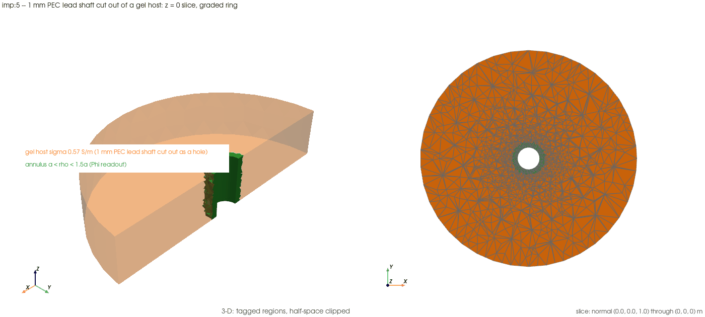

# `-e imp:5` — a lead shaft in the gel: shorted along it, doubled across it

Script: `examples/implants/05_lead_shaft_polarisation_in_gel.py` (`EX-87`)
Gate: `tests/validation/test_imp4_pec_cylinder_fem.py` (`IMP-4` step 1, `test_both_drives`, `test_natural_cavity_controls`)

## 1. What this demonstrates

A 1 mm PEC shaft (infinite and 2D-invariant, a stand-in for the straight part of an
implant lead) sits in `IMP-1`'s gel host (σ 0.57 S/m, εᵣ 78) at 64 MHz and **finite k**
(k = 15.178 − 9.489j 1/m, |k|a = 0.0179). It is cut out of a coaxial c = 10 mm, L = 4 mm
slab as a hole (degree 2, 25 568 cells). One mesh, driven two ways:

- **E along the shaft (TM_z, n = 0).** The wire shorts the field. In the annulus
  a < ρ < 1.5a the mean |E|²/E₀² is Φ = 3.742e-3 (closed form on the same cells
  3.705e-3): SAR there is ≈ 0.4 % of open gel. The drive's energy goes into the axial
  current, |I| = 2.917e-3 A per V/m (closed form 2.918e-3). On a *finite* lead that
  current is what `imp:2` – `imp:4` find at the tip.
- **E across the shaft (TE_z, n = 1).** The field doubles where the wire faces it:
  the closed-form surface value |E|²/E₀² at ρ = a, φ = π/2 is 4.0009 (TM: 0), and the
  flanks (φ = 0) are nearly cold (FEM 0.0906 at 1.2a). The annulus mean is Φ = 1.4404
  (closed form 1.4438).
- **Contrast.** Φ_TE / Φ_TM = 384.9 on the FEM, 389.7 on the closed form over the same
  cells, 396.8 for the continuous values (predicted 384.9 / 389.7 / 396.9).

Everything is imported from the gate module; nothing is restated. Rule (a), disclosed:
`_solve_cylinder` gained keyword-only `return_fields` and `trace` (defaults change
nothing). The whole module was re-gated at `-n 2` in the complex build in the same slot
(`20261004T033046Z_EX-87-imp4-regate.log`: 15 passed, 233 s), with the census (25 568
cells), β, Φ, cavity and z-invariance lines equal to
`20261003T200454Z_IMP-4-step1-W1.log` (lines 133–142) and
`20261003T200703Z_IMP-4-step1-W2.log` (lines 133–143) at the printed digits.

**Anchors (asserted at the imported bands, each drive).** |β − 1| ≤ `TH15_BETA_BAND`
(4.886 %): TM β = 0.999655 − 0.000093j (0.0357 %), TE β = 0.992258 − 0.000001j
(0.7742 %); |Φ_h/Φ_cf,h − 1| ≤ `MAT4_BAND` (10 %): TM +1.0110 %, TE −0.2345 %; cavity
dofs 10 704 with max |E| 3.726e-20 (TM) / 2.095e-34 (TE) < 1e-12. Every printed value
equals the W1 record at the printed digits (`20261003T200454Z_IMP-4-step1-W1.log:133–142`).

**Example-side checks (asserted, true by construction).** (X1) the DG0 FEM
`sar_ratio_<drive>` map, volume-weighted over the annulus, equals Φ_h (≈ 1e-14, band
1e-12); (X2) the DG0 closed-form map equals Φ_cf,h (2.2e-16); (X3) all four solves report
25 568 cells, so the one cached mesh serves them, the figure and the XDMF. Round-off
readings vary run to run and are asserted at their band only.

**Why each polarisation needs its own end plane.** The slab stands in for an infinite wire
only if the end planes carry the condition the exact z-invariant field already satisfies
(Jin §1.4.2 eqs (1.44)/(1.45), §11.2.1 eq (11.53)). TM_z has n̂ × E = 0 on z = const: the
ends are PEC. TE_z has n̂ × H = 0 there: the ends are natural (PMC). The controls swap
them (asserted, wired; factors printed, not asserted):

- **C1, TM with natural ends.** The weak form then imposes E_z = 0 on the ends, but the
  exact field has E_z ≠ 0, so the outer-wall trace reaches the shaft only through slab
  modes that decay as e^(−πd/L). Φ_h = 5.99e-6 against 3.705e-3: miss −99.84 % (band
  10 %; predicted [−100 %, −90 %], IN). β = 1.1023 + 0.0287j, |β − 1| = 0.106 (printed;
  predicted ≈ 0.11, IN): next to a PEC wire the TM scattered field nearly cancels the
  incident one, so a field-free slab (E_h ≈ 0) fits β ≈ −E_inc·E_s*/|E_s|² ≈ 1.10;
  β only separates from the band by ≈ 2×, and Φ is the TM discriminator.
- **C2, TE with PEC ends.** Here the end-plane trace is zeroed (a PEC tag constrains to
  the trace callable, not to zero: with the exact trace TE on PEC ends is exact again).
  β = 0.0006 − 0.0023j (|β − 1| = 0.999, predicted [0.9, 1.1], IN); Φ_h = 3.20e-6 against
  1.444: miss −99.9998 % (predicted [−100 %, −90 %], IN). The gate's own TE
  natural-cavity control can only miss on β, because a line dipole of either sign has the
  same annulus-mean |E|²; zeroing the trace removes the field outright, so Φ discriminates.
- **z-invariance as a scale.** The gate drives read 7.3e-3 (TM) and 1.3e-2 (TE); the
  controls read 1.597 (C1; predicted [0.1, 1.0], **OUT**, reported as measured) and 0.295
  (C2, IN). A wrong end condition reads one to two decades above the gate drives. This
  does not explain the gate's own 1e-2.

**Pointwise |E|²/E₀² at z = 0 (FEM beside closed form; φ = π/2 faces the field).**
TE at 1.2a: 2.8705 / 2.8718 facing, 0.0906 / 0.0934 flank; TE at 2a: 1.5669 / 1.5627
facing, 0.5656 / 0.5622 flank; TM at 1.2a: 1.871e-3 and 1.850e-3 against 1.831e-3; TM at
2a: 0.0265 against 0.0265. All inside the predicted ±5 % (±10 % at the TE flank).

**Finite k against quasi-static.** For TE the continuous annulus mean is 1.444718 against
the static 1.444444 (= 1 + 4/9): +1.9e-4, predicted +1.9e-4 [+1.5e-4, +2.3e-4], IN. The TE
near field is quasi-static. The TM field is not: the closed-form radius sweep at fixed k
(numpy only; a = 1 nm is k → 1e-6 k at 1 mm) reads

| a | |E_z(1.5a)|/E₀ | \|I\| (A per V/m) | TE \|E(1.5a, π/2)\|/E₀ |
|---|---|---|---|
| 0.1 mm | 0.0622 | 1.907e-3 | 1.44445 |
| 0.25 mm | 0.0722 | 2.214e-3 | 1.44446 |
| 0.5 mm | 0.0821 | 2.519e-3 | 1.44450 |
| 1 mm | 0.0952 | 2.918e-3 | 1.44458 |
| 2 mm | 0.1129 | 3.463e-3 | 1.44471 |
| 1 nm | 0.0225 | 6.914e-4 | 1.44444 |

(all inside the predictions). The TE value is independent of radius; the TM field has no
static limit and vanishes only logarithmically as |k|a → 0 (≈ 1/ln(1/|k|a)). A 10×
thinner wire still carries ≈ 65 % of the current, so a quasi-static solver has no answer
for the axial drive at any frequency.

Not claimed: a finite, insulated or coated lead, a tip, a coil, heating, convergence, the
plane-wave multi-mode series (n ≥ 2), or FEM at any radius other than 1 mm (the sweep is
closed form only).

## 2. How to run it

```
./scripts/run_examples.sh -e imp:5 -n 2 -t 420
```

Needs the complex DolfinX build, which the runner sources for the `imp:` group; the
script raises in a real build. Tier: **heavy**, complex. The run takes ≈ 135–145 s wall at
`-n 2` (four solves of ≈ 30–40 s). Verification runs go through the logging harness with
the runner's emitted command (`./scripts/run_examples.sh -e imp:5 -n 2 -t 420 --dry-run`).
Add `-e FEM_EM_SETUP_FIGURES=1` after `exec -T` to re-render the setup figure.

## Setup figure



`examples/implants/figures/implants_05_lead_shaft_polarisation_in_gel_setup.png`. The left
panel is the translucent gel host with the shaft as a hole; the right panel is the z = 0
slice, which shows the graded ring around the hole (h = ρ/6) and the annulus
a < ρ < 1.5a (tag 3) where Φ is read. The tags are figure-only; no solve sees them.

## 3. How to analyze it, step by step

**Step 1 — the gate solves.** `[gate tm]` and `[gate te]` print (i) β, (ii) Φ_h against
Φ_cf,h and (iii) the cavity dofs beside the W1 record, and the TM current beside
`:137`.

**Step 2 — the example-side checks.** `[example-side, asserted]` prints (X1), (X2) and (X3).

**Step 3 — the controls.** `[control C1]` and `[control C2]` print β, Φ and z-invariance
beside their predictions with IN / OUT.

**Step 4 — the printed readings.** Polarisation contrast, the pointwise table, the TE
finite-k difference and the radius sweep. Read the sweep as above.

**Step 5 — ParaView.** Open
`examples/implants/paraview_output/implants_05_lead_shaft_polarisation_in_gel_combined.xdmf`
(`implants_05_lead_shaft_polarisation_in_gel_combined.h5` beside it). Slice z = 0; colour
by `sar_ratio_te` on a log scale, then by `sar_ratio_tm`. A Calculator
`sar_ratio_te/sar_ratio_te_closed_form` shows the FEM/closed-form ratio. Plot Over Line
along the x and y axes through the shaft shows the TE flank (x) against the facing
direction (y). A Slice at x = 0 on `sar_ratio_te_pec_ends` shows the field dying toward
the end plates; `sar_ratio_tm_natural_ends` is the TM counterpart. `annulus_mask`,
`sar_ratio_tm_closed_form`, `sar_ratio_te_closed_form`, `E_real_tm` and `E_real_te` are in
the same file.

## Related

- The imposed-field implants: `examples/implants/01_pec_sphere_in_gel.md`,
  `examples/implants/02_pec_spheroid_tip_in_gel.md` (the axial field that heats a *tip*).
- The coil-driven rod: `examples/implants/03_rod_in_birdcage_tip_sar.md`; the adjoint
  transfer function: `examples/implants/04_lead_transfer_function_adjoint.md`.
- The gate module: `tests/validation/test_imp4_pec_cylinder_fem.py`; its records
  `20261003T200454Z_IMP-4-step1-W1.log` and `20261003T200703Z_IMP-4-step1-W2.log`.
