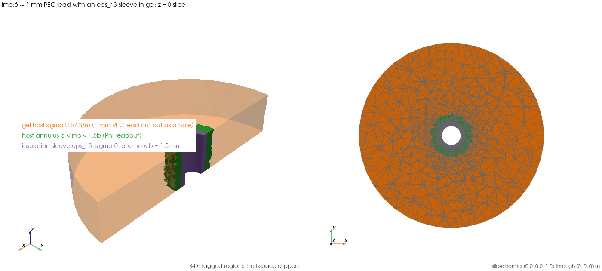

# `-e imp:6` — an insulated lead shaft in the gel: the sleeve rotates the hot spot

Script: `examples/implants/06_insulated_lead_shaft_in_gel.py` (`EX-88`)
Gate: `tests/validation/test_imp5_coated_cylinder_fem.py` (`IMP-5` step 1, `test_tm_drive`, `test_te_drive`, `test_control_te_coating_omitted`)

## 1. What this demonstrates

`imp:5` is a bare 1 mm PEC shaft in `IMP-1`'s gel host (σ 0.57 S/m, εᵣ 78) at 64 MHz and
finite k. This example puts a **0.5 mm lossless εᵣ 3 sleeve** (a < ρ < b = 1.5 mm) around it,
meshed as its own conforming cell tag 4 and assigned through `material_map`, on one mesh
(25 878 cells: host 16 255, sleeve 9 623; degree 2, 176 216 dofs). It is the project's
first conforming dielectric interface under a closed form at finite k. Two drives, each
checked against `IMP-5` step 0's exact coated Bessel/Hankel series:

- **E across the shaft (TE_z, n = 1).** Normal **D** is continuous at ρ = b, so normal **E**
  jumps by ≈ |ε_c,host/ε_c,coat| = 59.36 (closed form at exactly ρ = b, as predicted from
  `20261004T003556Z_IMP-5-step0-W1b.log:115`). Tangential E is continuous. The field
  crowds into the insulation: the sleeve mean |E|²/E₀² is 17.99 (FEM) against 1.444 for
  the bare wire over the same annulus, a ratio of 12.46 (predicted 12.45). The gel just
  outside sees its normal field suppressed and its tangential field nearly doubled, so
  **the near-lead hot spot moves from the two facing points to the two flanks**, and the
  host-annulus mean |E|² (b < ρ < 1.5b, proportional to SAR) rises by a factor 1.298
  (predicted 1.297, `…step0-W1b.log:116`). The 12.46 is |E|² in a σ = 0 dielectric:
  dielectric stress, not SAR.
- **E along the shaft (TM_z, n = 0).** A non-magnetic sleeve is nearly invisible at
  k_z = 0: μ is equal on both sides and ε enters only through k²ρ² terms. The closed-form
  wire current moves by |I_coated/I_bare − 1| = 4.270e-5 and the scattering coefficient by
  3.084e-6 (cited from `…step0-W1b.log:113`). The FEM gate's own |β − 1| = 3.096e-4 is
  7.3× the current shift and 100× the s shift, so **the FEM cannot see the coating in TM**,
  and the TM gate is not a coating test. This is a k_z = 0 statement. On a real insulated
  lead, k_z ≠ 0 propagation is where insulation sets lead heating, and that is not this
  fixture.

Everything is imported from the gate modules; nothing is restated. Rule (a), disclosed:
`_solve_coated` gained keyword-only `return_fields` and `trace` (defaults change nothing).
The whole module was re-gated at `-n 2` in the complex build in the same slot
(`20261005T033404Z_EX-88-imp5-regate.log`: 17 passed, 211 s), with census, β, Φ and cavity
lines equal to `20261004T035027Z_IMP-5-step1-W1a.log` (145–150),
`20261004T035247Z_IMP-5-step1-W1b.log` (145–149) and
`20261004T035543Z_IMP-5-step1-W2a.log` (145–150) at the printed digits.

**Anchors (asserted at the imported bands, each drive).** |β − 1| ≤ `TH15_BETA_BAND`
(4.886 %): TM β = 0.999703 − 0.000089j (0.0310 %), TE β = 0.994548 − 0.000062j (0.5452 %);
|Φ_h/Φ_cf,h − 1| ≤ `MAT4_BAND` (10 %) on the sleeve (TM +1.0438 %, TE −0.1656 %) and the
host annulus (TM +0.3631 %, TE −0.1850 %); cavity dofs 10 704 with max |E| 0 (TM) /
7.272e-34 (TE) < 1e-12. Every printed value equals its record at the printed digits
(`20261004T035027Z_IMP-5-step1-W1a.log:145–150`, `20261004T035247Z_IMP-5-step1-W1b.log:145–149`).

**Example-side checks (asserted, true by construction).** (X1) the DG0 FEM `e2_ratio_<drive>`
map, volume-weighted over each mask's owned cells, equals Φ_h (≈ 3e-14, band 1e-12);
(X2) the DG0 closed-form map, region forced by cell tag, equals Φ_cf,h (≈ 4e-16);
(X3) all four solves report 25 878 cells, so the one cached mesh serves them, the figure
and the XDMF. Round-off readings vary run to run and are asserted at their band only.

**Negative controls (asserted; the factors beside their records or predictions).**

- **C1, coating omitted.** The sleeve cells carry the host material and the wall keeps the
  coated trace. |β − 1| = 1.4735 (record `20261004T035543Z_IMP-5-step1-W2a.log:146`), sleeve
  Φ miss −91.4590 %, host −18.0148 %: all equal to the record and all outside the bands.
- **B0, the bare wire on the same mesh.** The same solve with `trace=` the bare wire's exact
  trace (a PEC tag constrains to the trace callable, so C1 is not a bare wire).
  Against the *coated* closed form: β = −0.4582 − 0.0352j (predicted −0.4606 − 0.0354j),
  |β − 1| = 1.4586 (predicted [1.3, 1.65], IN), sleeve miss −91.99 % (predicted [−95, −88],
  IN), host miss −23.08 % (predicted [−27, −19], IN); each asserted only as outside the band.
  Against its *own* bare closed form (printed, no band): |β_bare − 1| = 0.5198 %, sleeve-region
  Φ_h/Φ_cf − 1 = −0.230 %, host −0.061 %, continuous Φ 1.4447 / 1.0878 as predicted.
- The TM natural-cavity control (`IMP-5`'s c2, `20261004T035832Z_IMP-5-step1-W2b.log:146–148`)
  is not re-run: TM is not the story here and C1 already shows a material map that does not
  reach the sleeve.

**The jump and the pointwise table (printed; φ = π/2 faces the field, φ = 0 is the flank).**
At ρ = 0.97b / 1.03b, closed form |E_y| ratio 43.55 (predicted 43.5 [42, 45]); the FEM
reads 40.91 (FEM/cf − 1 = −6.1 %, inside the predicted ±15 %: the host value is a small
difference). The bare wire at the same two points gives 1.038, no jump. |E|²/E₀² at z = 0,
FEM beside closed form:

| point | coated FEM | coated cf | bare FEM | bare cf |
|---|---|---|---|---|
| 1.1a facing | 41.76 | 41.541 | 3.3518 | 3.3366 |
| 1.1a flank | 0.4075 | 0.3751 | 0.03268 | 0.03012 |
| 0.97b facing | 26.777 | 26.995 | 2.1589 | 2.1683 |
| 0.97b flank | 3.6791 | 3.4668 | 0.2956 | 0.2783 |
| 1.03b facing | 0.01599 | 0.01423 | 2.0007 | 2.0137 |
| 1.03b flank | 3.5557 | 3.630 | 0.3482 | 0.3376 |
| 2b facing | 0.5846 | 0.5778 | 1.2299 | 1.2345 |
| 2b flank | 1.5374 | 1.5363 | 0.7890 | 0.7893 |

Two things to read off. Inside the sleeve the field is the bare wire's static pattern
scaled by ≈ 12.46 in |E|² (1.1a: 41.54 against 3.337). Just outside it the pattern is
rotated: the gel is cold where the bare wire is hot (facing 0.014 against 2.01) and hot
where the bare wire is cold (flank 3.63 against 0.338). **Two printed readings were
outside their predicted ±5 %** and are reported as measured: the FEM/closed-form − 1 at
0.97b, flank, is +6.12 % (coated) and +6.19 % (bare). Both closed forms are within 1 % of
the prediction, and the two solves miss by the same amount, so this is the faceted
circle (chord sag at ρ = b is ≈ 1 % of b) at a small-gradient point, not the coating. It has
no status effect.

Not claimed: k_z ≠ 0 guided waves along an insulated lead (the regime where insulation sets
lead heating), a lossy, thin or real-thickness insulation, a measured insulation material,
a finite lead, a tip, a coil, heating, 1 g SAR, ISO 10974 or ASTM F2182, the plane-wave
multi-mode series or modes n ≥ 2, h-convergence, or a gate on B0.

Why the weak form needs no interface condition: tangential E and tangential μ⁻¹ curl E are
continuous across ρ = b and the Nédélec basis leaves the normal component free to jump
(Jin §1.5.1, eqs (1.46)–(1.49)).

## 2. How to run it

```
./scripts/run_examples.sh -e imp:6 -n 2 -t 600
```

Needs the complex DolfinX build, which the runner sources for the `imp:` group; the
script raises in a real build. Tier: **heavy**, complex. The run takes ≈ 150 s wall at
`-n 2` (four solves of ≈ 35 s). Verification runs go through the logging harness with the
runner's emitted command (`./scripts/run_examples.sh -e imp:6 -n 2 -t 600 --dry-run`).
Add `-e FEM_EM_SETUP_FIGURES=1` after `exec -T` to re-render the setup figure.

## Setup figure



`examples/implants/figures/implants_06_insulated_lead_shaft_in_gel_setup.png`. The left
panel is the translucent gel host with the lead as a hole; the right panel is the z = 0
slice, which shows the sleeve (tag 4, a < ρ < b) as its own conforming cell layer and the
host annulus b < ρ < 1.5b (tag 3) where Φ is read. The tags are figure-only; no solve sees
them.

## 3. How to analyze it, step by step

**Step 1 — the gate solves.** `[gate tm]` and `[gate te]` print (i) β, (ii/iii) Φ_h against
Φ_cf,h on the sleeve and host annulus, and (iv) the cavity dofs beside the records.

**Step 2 — the example-side checks.** `[example-side, asserted]` prints (X1) and (X2);
`(X3)` follows the controls.

**Step 3 — the controls.** `[control C1]` and `[control B0]` print β and the two Φ misses
beside their records / predictions with IN / OUT. B0 also prints the bare wire against its
own closed form.

**Step 4 — the printed readings.** The interface jump, the pointwise table, the coated-over-
bare ratios and the TM paragraph. Read the TM paragraph as above: the FEM's error is larger
than the effect.

**Step 5 — ParaView.** Open
`examples/implants/paraview_output/implants_06_insulated_lead_shaft_in_gel_combined.xdmf`
(`implants_06_insulated_lead_shaft_in_gel_combined.h5` beside it). Slice z = 0; colour by
`e2_ratio_te` on a log scale to see the jump at ρ = b; then `sar_ratio_te` and
`sar_ratio_te_bare` on one linear scale. A Calculator `sar_ratio_te/sar_ratio_te_bare` on the
host gives the per-cell SAR gain of the insulation. Plot Over Line along the y axis (facing)
and the x axis (flank) on the DG0 maps. `E_real_tm`, `E_real_te` and `E_real_te_bare` are CG1
and smear the jump: read it from the DG0 maps or the printed probes. Also in the file:
`e2_ratio_tm`, `e2_ratio_te_closed_form`, `e2_ratio_te_bare`,
`e2_ratio_te_bare_closed_form`, `e2_ratio_te_coating_omitted`, `host_annulus_mask`.

## Related

- The bare shaft this one is read against: `examples/implants/05_lead_shaft_polarisation_in_gel.md`.
- The imposed-field implants: `examples/implants/01_pec_sphere_in_gel.md`,
  `examples/implants/02_pec_spheroid_tip_in_gel.md`; the coil-driven rod
  `examples/implants/03_rod_in_birdcage_tip_sar.md`; the adjoint transfer function
  `examples/implants/04_lead_transfer_function_adjoint.md`.
- A dielectric sphere in a uniform field (the other εᵣ interface in the field):
  `examples/time_harmonic/03_dielectric_sphere_in_uniform_field.md` (`th:3`).
- The gate module: `tests/validation/test_imp5_coated_cylinder_fem.py`; its records
  `20261004T035027Z_IMP-5-step1-W1a.log`, `20261004T035247Z_IMP-5-step1-W1b.log`,
  `20261004T035543Z_IMP-5-step1-W2a.log` and `20261004T035832Z_IMP-5-step1-W2b.log`.
