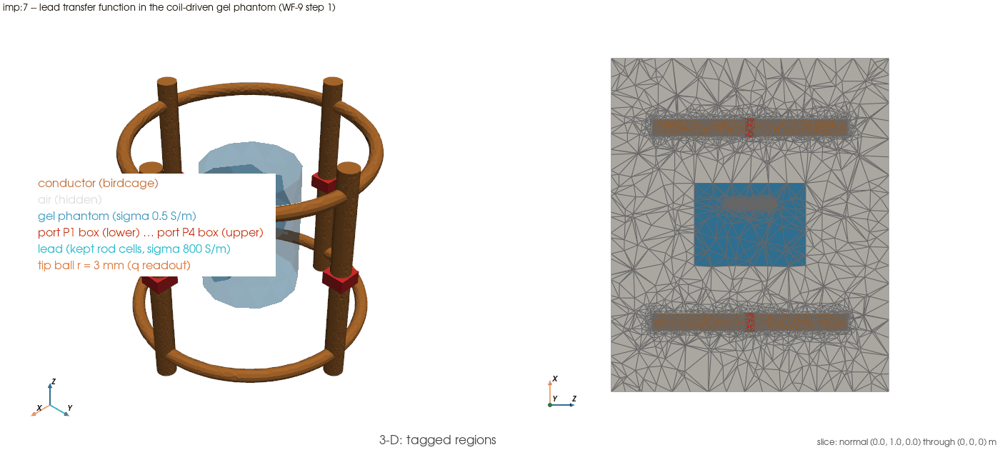

# `-e imp:7` — why a lead's tip response cannot be read off the lead-free field

Script: `examples/implants/07_lead_tf_in_the_coil.py` (`EX-89`)
Gate: `tests/validation/test_wf9_lead_in_coil_phantom.py` (`WF-9` step 1, `test_wf9_step1_identities`) and `tests/validation/test_wf9_insulated_lead.py` (`WF-9` step 3, `test_wf9_step3_identities`)

## 1. What this demonstrates

`imp:4` computes a lead's transfer function (TF) with one adjoint solve in a plain gel
box with current-block drives and no coil. This example does it in the coil: the F-small
untuned 4-leg birdcage (50 Ω lumped sheets) with its gel phantom at 64 MHz, degree 1, on
one mesh of 182 371 cells. A σ = 800 S/m capped rod (r = 1 mm, tip to tip 32 mm, centre
(15, 0, 0) mm, on leg 1's azimuth) is kept as cell tag 403 (15 000 cells) and switched
by material only. The tip functional is q = mean E_z in a 3 mm ball at the top tip
(7 605 cells).

- **One adjoint solve gives the TF.** A unit tip load solved *with the lead present*
  gives w. TF(z) = −jωμ₀Δσ·w_z along the lead (32 slabs of 1 mm). Folded with each port
  drive's lead-free field, w predicts the with-lead tip response exactly (T3, Jin §6.4
  eqs (6.78)–(6.85)): ≤ 4.3e-12 on all four drives. The same TF as a 1-D path integral
  ∫TF(z)·E_z(z) dz at N = 32 is within 1.4e-4 / 1.5e-3 / 1.5e-4 / 1.0e-3 of the with-lead
  response on P1 … P4 (the 5 % band is the weekly's, `PROJECT_PLAN.md` §10 `WF-9`
  ruling).
- **A drive the adjoint never saw.** The clinical quadrature drive (all four ports at
  once, phases `quadrature_phase_weights(ks, "ccw")` from the fixture's own azimuths,
  ks = 0, 1, 2, 3) is solved fresh with the lead, one new factorisation (12.0 s). The
  same w folded with the superposed lead-free field E_without,ccw = Σ a_d E_without,d
  (no solve) equals its direct with-lead tip response to 1.9e-13 (band 1e-6; predicted
  ≤ 1e-11), and equals Σ a_d t3_d to 6.6e-15. The TF is a property of the lead in this
  coil and phantom, not of the drive. |Δq_ccw| = 0.3898 V/m per V, |q_with/q_without| =
  2.341; the ccw path fold at N = 32 misses by 3.5e-4.
- **Why the lead-free field is not enough.** The with-lead tip response is 2.3× the
  lead-free one on every drive, and a Born fold (the adjoint solved *without* the lead,
  folded with the lead-free field) overstates the response: it misses by 1 399 / 1 435 /
  1 389 / 1 344 % on P1 … P4 and 1 394 % on ccw (|B|/|Δq| = 14.8). The reason is
  depolarisation: the lead excludes the axial field from its own interior. The ratio
  |∫χ_lead E_with,ccw,z| / |∫χ_lead E_without,ccw,z| = 0.068 (quasi-static value 0.07 at
  aspect 16), so a TF built from the lead-free field is off by about its inverse.

Everything is imported from the gate module; nothing is restated. `_run_step1_identities`
is the body of `test_wf9_step1_identities` lifted to module level (rule (a), additive:
one trailing `return`); the test calls it and every print is unchanged. Both gate windows
(`-n 2` and `-n 4`) were re-run green from this tree in the same slot, with the census
and per-drive q / (PF) / (BF) digits matching `20261004T201655Z_WF-9-step1-W1.log` and
`20261004T202017Z_WF-9-step1-W2.log`.

**The insulated lead (`WF-9` step 3).** After the step 1 section the example runs the same
adjoint-fold identities on the insulated lead: the rod (tag 403, 15 035 cells) inside an
ε_r 3 shaft sleeve (tag 404, 18 495 cells), caps bare, on `GEO-36` step 5's coated build
(190 747 cells), with the bare arm re-solved on that mesh for comparison. It calls
`_run_step3_identities`, the body of `test_wf9_step3_identities` lifted to module level
(rule (a), additive: a `shaft_tip` dict and one trailing `return`; no assertion added,
removed or re-banded), once, and adds no form, solve or field write. The rows equal
`20261008T142909Z_WF-9-step3-W1.log` digit for digit (round-off columns, times and RSS
excepted): the tip response with the lead is 1.901 / 1.865 / 1.955 / 1.887 times the
lead-free one on P1 … P4 coated against 2.516 / 2.456 / 2.611 / 2.494 bare; (T3c) ≤ 2.5e-12
(band 1e-6); (PF) at N = 32 is 1.2e-3 / 2.5e-3 / 2.9e-3 / 1.9e-3 coated; (BF) misses by
2 578 … 2 870 % coated and 1 493 … 1 667 % bare; the shaft/tip |TF| ratio is 3.043634 coated
against 8.670205 bare. The coated rows run on a second mesh that the setup figure below
does not show. The coated C1 (≈ 200.5–200.8 %) and C2 (≈ 363–371 %) were outside step 1's
predicted bands and are printed records with no band, not predictions.

**Why A = Aᵀ and not A = Aᴴ.** The operator is complex symmetric (real basis, symmetric
sheet terms), not Hermitian. The adjoint solve is therefore *transpose* reciprocity, the
TF is read with w and not conj(w), and the adjoint must be solved **with** the lead, since
the TF is the response of the lead-loaded structure.

Asserted (imported bands): (A0) cells = 182 371 within `CELL_COUNT_BAND`, lead / ball
15 000 / 7 605; (A1) ‖A − Aᵀ‖/‖A‖ = 9.757e-17 (band `SYMMETRY_RTOL`); (i′) 1.5e-15 /
2.1e-15 (band `RECIPROCITY_BAND`); (H) 0 (band `DISCRETE_IDENTITY_RTOL` = 1e-6); (T3), (PF),
(BF) per drive; the q digits equal the W1 record to 1e-8. Round-off readings vary from run
to run and are asserted at their bands only.

Example-side checks (asserted):

- (X0) port azimuths 360 / 90 / 180 / 270°, ks = [0, 1, 2, 3], a permutation of {0, 1, 2, 3};
- (X1) the per-cell TF-density vector (kept complex) sums, slab by slab, to `tf_k`
  (1.4e-15 over 32 slabs);
- (X2) the per-cell fold-integrand vectors sum to (T3)'s fold on every drive (≤ 1.2e-14);
- (X3) the fresh quadrature solve and the fold agree (above).

**Negative controls (asserted, each wired):**

- **(BF), the Born fold:** misses by > 5 % on every drive and on ccw (1 394 %). No ceiling
  exists, so no factor is asserted.
- **C1, the Hermitian read-back** (conj(w)): 199.5 % on every drive (ceiling 200 %).
- **C2, the total-field fold** (w with E_with): 93.5 % on every drive.
- **C4, the unphased drive:** the fold of w with Σ_d E_without,d (all weights 1) against
  the fresh ccw Δq misses by 24.5 %. It shows that (X3) reads the phased solve, not any
  four-port sum.

**cw and ccw agree at this lead.** |Δq_cw/Δq_ccw − 1| = 2.3e-3: the rod lies on leg 1's
azimuth in the y = 0 mirror plane, so Δq_P2 ≈ Δq_P4 and the lead cannot tell the two
rotation senses apart. This result is not a statement about B₁⁺ polarisation.

Not claimed: a measured or ISO 10974-calibrated TF; heating, SAR or tip temperature (q is
a mean axial field, not |E|²); a PEC or real lead (the insulated lead only as `WF-9` step
3's record on one mesh), F-human, or a tuned coil;
any S, Z or port-accuracy figure from the sheets; the path-fold band (the weekly's);
h-convergence.

## 2. How to run it

```
./run_examples.sh -e imp:7 -n 2 -t 540
```

Needs the complex DolfinX build, which the runner sources for the `imp:` group. Tier:
**heavy**, complex. The run takes ≈ 280 s wall at `-n 2` (step 1 section ≈ 130 s, coated section
≈ 147 s: 52 s mesh, ≈ 96 s gate body). Verification runs go through the logging harness with the runner's emitted
command (`./scripts/run_examples.sh -e imp:7 -n 2 -t 540 --dry-run`). Add
`-e FEM_EM_SETUP_FIGURES=1` after `exec -T` to re-render the setup figure.

The gate body writes `/workspace/logs/wf9_step1_tf_n2.npy` (gitignored) and prints the
W1 / W2 TF agreement against the `-n 4` file when it exists (2.9e-12, predicted ≤ 1e-10).

## Setup figure



`examples/implants/figures/implants_07_lead_tf_in_the_coil_setup.png`. The left panel shows
the birdcage, the ports and the translucent gel phantom with the lead (tag 403) and the
tip ball (tag 404, figure-only); the right panel is the x–z slice at y = 0, which cuts the
lead and the ball lengthwise. Air is hidden. The tip-ball tag is figure-only; no solve sees
it.

## 3. How to analyze it, step by step

**Step 1 — the gate.** The `[WF-9 step1 identities]` block is the gate's own report; its
q, (PF) and (BF) lines match `20261004T201655Z_WF-9-step1-W1.log` digit for digit.

**Step 1b — the insulated lead.** After the `[paraview]` line, the `[WF-9 step3 reproduced]`
banner introduces the gate's own `[WF-9 step3 identities]` block (coated and bare rows),
followed by `[coated lead]`: (A0c) cells and the 403 / 404 counts, (R1) / (A1) / (H), and
per arm and drive q_with, Δq, (T3c), (PF), (BF), (C3c) and the coat share beside
`20261008T142909Z_WF-9-step3-W1.log`, then shaft/tip |TF|. The C1 / C2 rows there carry no
band.

**Step 2 — the anchors.** `[anchors]` prints (A0), (A1), (i′), (H) and, per drive, q,
(T3), (PF), (BF) beside their bands and records.

**Step 3 — the example-side checks.** `[example-side, asserted]` prints (X0)–(X3). (X3) is
the example's angle: Δq_ccw from a fresh phased solve, and the fold of the adjoint field
the quadrature drive never entered.

**Step 4 — the controls.** `[controls]` prints (BF) on ccw, C1 / C2 per drive and C4.

**Step 5 — the printed block.** `[printed, no band]` lists the ccw ratios, the path fold
against N (per port and ccw; non-monotone on P2 / P4 is the record), the cw / ccw
difference, the in-lead field ratio and the TF(z) table (peak at k = 27, z = 11.5 mm,
|TF| = 7.477e-02; phase −6.45° … −1.85°).

**Step 6 — ParaView.** Open
`examples/implants/paraview_output/implants_07_lead_tf_in_the_coil_combined.xdmf`.
Threshold `CellTags` = 403 (the lead) and colour by `tf_density_magnitude` (per-cell
−jωμ₀Δσ ∫ w_z, DG0; the sum over the cells of one slab is TF_k). Use Plot Over Line along
x = 15 mm, y = 0 and compare `adjoint_w_magnitude` with `adjoint_w0_magnitude` on the lead:
the lead shields its interior. Slice y = 0 on `E_without_magnitude_ccw` (and
`E_with_magnitude_ccw`). `tf_density_phase_deg`, `fold_integrand_magnitude_P1` … `_P4` and
`_ccw`, `born_integrand_magnitude_ccw`, `lead_slab_index` (k + 1 on the lead, 0 elsewhere)
and `tip_ball_mask` are in the same file.

## Related

- The adjoint TF in a plain gel box, current-block drives, no coil: `examples/implants/04_lead_transfer_function_adjoint.md`.
- The coil-driven PEC rod, direct with / without tip SAR: `examples/implants/03_rod_in_birdcage_tip_sar.md`.
- Lead-shaft polarisation in gel: `examples/implants/05_lead_shaft_polarisation_in_gel.md`, `examples/implants/06_insulated_lead_shaft_in_gel.md`.
- The gate modules: `tests/validation/test_wf9_lead_in_coil_phantom.py`, `tests/validation/test_wf9_insulated_lead.py`.
