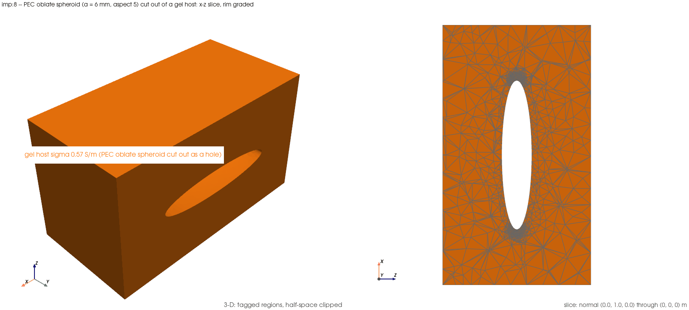

# `-e imp:8` — a disc-edge stand-in in the gel: the rim, and the field across it

Script: `examples/implants/08_pec_oblate_disc_edge_in_gel.py` (`EX-111`)
Gate: `tests/validation/test_imp6_oblate_fem.py` (`IMP-6` step 1)

## 1. What this demonstrates

`imp:2` showed the tip of an elongated body under a field along it. A flat
body's hot spot is its **edge**, and it appears only when the field lies in the
plane of the flat. This example solves `IMP-6`'s perfectly conducting oblate
spheroid (equatorial semi-axis a = 6 mm in x and y, polar c = 1.2 mm along z,
aspect 5) cut out of a box of half-extents (10.5, 10.5, 6) mm as a hole, in
`MAT-4`'s gelled-saline host (σ = 0.57 S/m, ε_r = 78) at 64 MHz, degree 2,
under the imposed quasi-static in-plane field E₀x̂ (32 676 cells).

- The rim field is E₀/L_x with 1/L_x = 8.015515, so the pointwise rim
  SAR/SAR₀ is (1/L_x)² = 64.25. The mesh resolves a rim-ball mean over
  r_r = 2c²/a = 0.48 mm: Φ_rim = ⟨|E|²⟩/E₀² = 23.02, which keeps 0.358 of the
  pointwise peak, because the ball averages over the falloff away from the rim.
- Driven face-on (E₀ẑ) the same disc gives only E₀/L_z = 1.332474 at its flat
  faces, and the normal field vanishes at z = 0, so the rim stays cold:
  Φ_rim = 0.49.
- Under E₀x̂ the rim's normal field goes as cos φ: maximal at (±a, 0, 0), near
  zero at (0, ±a, 0). The edge is **two hot arcs, not a ring**. Printed on four
  azimuths at r = a + ρ_r/2: |E|/E₀ = 5.60 / 5.24 / 3.05 / 0.135 at
  φ = 0° / 30° / 60° / 90° against the closed form 5.56 / 4.82 / 2.78 / 0.129
  (FEM +0.6 % / +8.7 % / +9.7 % / +4.6 % above; a reading, not a gate).

Everything is imported from the gate module and nothing is restated. The
`return_fields` keyword on `_solve_oblate` (keyword-only, default `False`, test
bodies untouched) is the only change to a test file; the module was re-gated
green (16 passed) in the same slot before any example window.

Asserted (imported bands), each beside `20261012T184537Z_IMP-6-step1-W1b.log:189–192`:

- (i) |β − 1| ≤ `TH15_BETA_BAND` (4.886 %); β = 1.006343 (0.6343 %);
- (ii) |Φ_rim,h/Φ_rim,cf,h − 1| ≤ `MAT4_BAND` (10 %): 23.024938 against
  22.702995, 1.4181 %;
- (iii) cavity dofs 19 952 > 0 at max |E| = 0 < 1e-12.

**Negative control (asserted only as "> band"):** the axial drive on the same
cached mesh gives β = −0.001796 on the in-plane basis (|β − 1| = 1.0018 against
the 4.886 % band) and Φ_rim,h = 0.491473 against the in-plane closed form
22.702995, a miss of 97.8352 % against the 10 % band (record
`20261012T184748Z_IMP-6-step1-W2.log:190–191`).

**Edge against tip (closed form and two gate records, printed, not gated).** At
aspect 5 with the same 6 mm long semi-axis, `imp:2`'s prolate tip and this
disc rim have the same curvature radius at the hot spot (ρ = 0.24 mm) and the
same averaging-ball radius (0.48 mm). The depolarisation factors depend on
aspect only, so the comparison is a function of aspect:

- field: 1/L_z (prolate) / 1/L_x (oblate) = 17.914415 / 8.015515 = 2.2350;
- pointwise squares 320.9 / 64.25 = 4.995;
- ball means 49.805748 / 23.024938 = 2.1631;
- retained fraction of the pointwise peak: 0.358 (rim) against 0.155 (tip).

As explanation, not a claim: the edge is curved sharply in one direction only
(the rim is line-like), so the field falls off more slowly away from it than
from a point-like tip, and the ball mean keeps more of the peak. The rim line
(next) shows it: at s = ρ_r the disc rim reads 4.46 against the prolate tip's
6.02, but at s ≈ 10ρ_r the rim reads 1.59 against 1.39.

**Not a plate.** A real square-edged plate carries a wedge singularity at its
edge that the smooth spheroid does not. This body is a stand-in for a flat
body's rim, not a plate.

Not claimed: a square-edged plate, a thin plate (aspect ≥ 20 in FEM), aspect 2
in this example, a coil, finite k, tissue, 1 g / 10 g SAR averaging, heating,
ASTM F2182, convergence, or the rim-line agreement as a gate.

## 2. How to run it

```
./run_examples.sh -e imp:8 -n 2 -t 400
```

The runner sources the complex DolfinX build for the `imp:` group. Tier:
**heavy**. The run takes ≈ 84–86 s wall at `-n 2` (in-plane 38.8 s + axial
37.2 s of solves), ≈ 4.3 GiB summed RSS. Verification runs go through the
logging harness with the runner's emitted command
(`./scripts/run_examples.sh -e imp:8 --dry-run`). Add `-e FEM_EM_SETUP_FIGURES=1`
after `exec -T` to re-render the setup figure.

## Setup figure



`examples/implants/figures/implants_08_pec_oblate_disc_edge_in_gel_setup.png`.
The figure shows the gel host (cell tag 2 only; the disc is a hole), the block
clipped at y < 0, and the x–z slice at y = 0, which shows the disc edge-on with
both rims graded.

## 3. How to analyze it, step by step

**Step 1 — the closed form.** `[closed form]` and `[trend]` print 1/L_x and
1/L_z from `oblate_spheroid_depolarisation` and
`prolate_spheroid_depolarisation`; the aspect 1.01 / 2 / 5 / 20 / 100 rim
values (3.0120 / 4.2301 / 8.0155 / 27.0935 / 128.9466) match the step-0
records, and the prolate tip pulls away with aspect (17.9 at 5, 148.2 at 20).

**Step 2 — the anchor.** `[anchor] (i)` and `(ii)` print β and the rim-ball Φ
beside the gate's W1b records; the digits agree. The rim-ball mean 23.0 sits
below the pointwise 64.25 because r_r averages over the falloff.

**Step 3 — the azimuths and the rim line.** `[azimuth]` shows the two hot arcs.
`[rim line]` compares the FEM |E|/E₀ along y = z = 0 with the closed form from
s = ρ_r/10 to 0.7a. FEM is +3.75 % off the closed form at s = ρ_r/10, within
0.6 % at s = ρ_r/2, ρ_r and 2ρ_r, and within 4.51 % over all s ≥ 2ρ_r (the
prediction was ≤ 2 %; reported, not a gate). These are readings.

**Step 4 — the control.** `[control]` shows that the face-on field gives β ≈ 0
on the in-plane basis and Φ_rim = 0.49: the rim enhancement exists only for
the in-plane field.

**Step 5 — ParaView.** Open
`examples/implants/paraview_output/implants_08_pec_oblate_disc_edge_in_gel_combined.xdmf`.
Cut y = 0 and z = 0 and colour by `sar_ratio_inplane` (DG0, SAR/SAR₀). Compare
with `sar_ratio_closed_form`, then `sar_ratio_minus_closed_form` (a difference,
not a ratio: the closed form vanishes near (0, ±a, 0)), then
`sar_ratio_axial` (the control). `rim_mask` marks the rim-ball cells and
`E_real_inplane` is the CG1 field. For the line, open
`examples/implants/paraview_output/implants_08_pec_oblate_disc_edge_in_gel_rim_line.csv`
in a Line Chart View and plot `absE_fem_over_E0` and `absE_closed_form_over_E0`
against `s_over_rho_r` (log x), with `absE_prolate_tip_closed_form_over_E0`
beside them. Nothing in the files is asserted beyond the printed anchors.

## Related

- The prolate tip: `examples/implants/02_pec_spheroid_tip_in_gel.md`.
- The sphere: `examples/implants/01_pec_sphere_in_gel.md`.
- The gate modules: `tests/validation/test_imp6_oblate_fem.py`,
  `tests/validation/test_imp6_oblate_closed_form.py`,
  `tests/validation/test_imp1_pec_sphere_lossy_host.py`.
