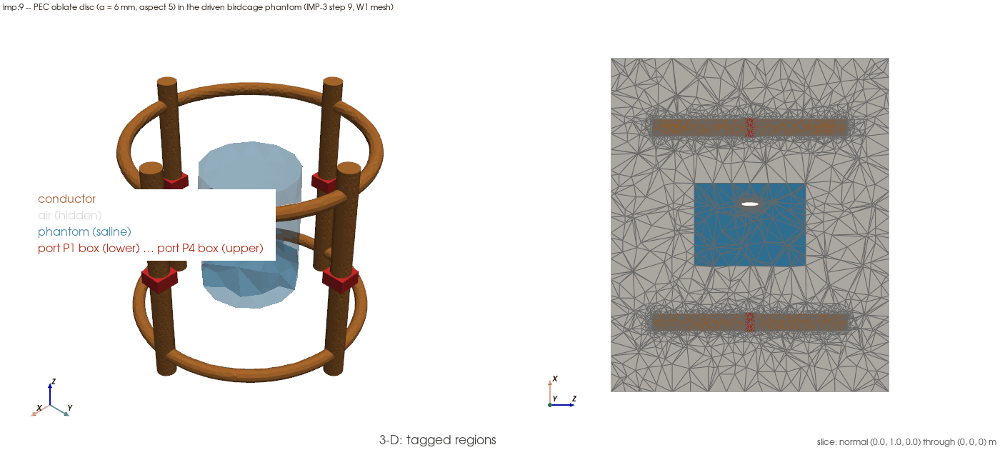

# `-e imp:9` — a PEC disc in the coil-driven phantom: the rim 1 g SAR with and without it, and the PEC-versus-natural wall map

Script: `examples/implants/09_pec_disc_in_birdcage_rim_sar.py` (`EX-122`)
Gate: `tests/validation/test_imp3_disc_birdcage.py` (`IMP-3` step 9, `test_imp3_disc_default_phantom`, the W1 record meshes)

## 1. What this demonstrates

`imp:8` puts this disc (an exactly revolved PEC oblate spheroid, a = 6 mm,
c = 1.2 mm, aspect 5, normal x̂, centre (0.015, 0, 0)) in an imposed
quasi-static field with no coil. `imp:3` puts a rod in the coil. This example
puts the flat body in the coil: the loaded F-small 4-leg birdcage at 64 MHz
(untuned σ = 800 S/m solid coil, 50 Ω lumped sheets, degree 1), solved without
the disc (116 085 cells) and with it cut out of the phantom as a hole whose wall
(facet tag 402) is pinned by the default exterior PEC (150 140 cells). **W1 is
the coarse record mesh; W2, the 1 g rung, is the ratio of record and is cited,
not run.**

- Rim ratio Q = SAR₁g,rim(disc) / SAR₁g,rim(without): P1 1.637623 / 1.646293
  (top / bottom), P3 1.608237 / 1.591011, ccw 1.607983 / 1.533428, cw 1.614373 /
  1.531498. On the 1 g rung (W2, cited) P1 reads 1.592094 / 1.593359.
- The in-plane rim enhancement of the closed form, (1/L_x)² = 64.25 pointwise
  (`imp:8`), is diluted by the 1 g ball to Q ≈ 1.6: the ball averages the rim
  spike with the quiet gel and with the volume the body displaces (ball mass
  0.923 g of gel against 1.000 g).
- The with / without comparison is a 1 g ratio because the two arms are on
  different meshes; a cellwise ratio across them would mean nothing. The map
  ratio is therefore PEC versus natural wall, two P1 fields on the **same** disc
  mesh. At the rim 1 g, PEC / natural = 1.536348 / 1.551662, the gate's C1
  digits reproduced by a fresh natural solve. In the cells within 1.0 mm of a
  rim point the local-SAR ratio reaches 395.3 (top) and 365.3 (bottom), with
  volume-weighted means 33.8 and 36.2 (305 and 331 cells). The max is a
  single-cell reading on a degree-1 mesh; no ceiling is claimed.
- |E| above the top rim, normalised at 12 mm: PEC 3.555 at z = 6.25 mm against
  natural 0.997 and the quasi-static closed-form shape 3.807 (PEC / closed form
  0.934, predicted [0.5, 2]). A shape comparator only; the coil background,
  finite k and degree 1 all enter it.
- P2 and P4 rim SARs are weak drives (≈ 30× below P1) and mesh-noisy on this
  coarse mesh: their bottom-rim Q reads 0.849 and 0.715 (below 1) beside top
  1.196 and 1.565. They are printed, never asserted.

Everything is imported from the gate module: `_case_disc(None)`, `_report`
and `_control_c1_disc` are called unchanged, and the gate's lines print in W1's
format (the records below match `20261013T213344Z_IMP-3-step9-W1.log` digit for
digit). Every band is read through the module's namespace. No `test_*` name is
used.

Asserted (imported bands):

- (A0) cells 116 085 / 150 140 equal the records (band 1 %); (R0) without-disc
  Z against the 64 MHz record 2.983e-10 (band 1e-6);
- (i) reciprocity 9.950e-16 / 3.922e-15 (band 1e-3) and (ii) passivity
  (σ_max 0.999721 / 0.999723) on both arms;
- (P) the power identity on every drive of both arms: worst 6.973e-15 /
  8.467e-15 against `DISCRETE_IDENTITY_RTOL` (1e-6);
- (M) disc-arm σ_y pairs max 0.0425 % against 0.50 %;
- (E) 6 669 tag-402 dofs, max |E| = 0 against 1e-12;
- (S) without-disc separation 671.1× against the floor 10; containment of the
  1 g ball.

Example-side (asserted, discrete identities): (F-pec) a fresh P1 PEC solve
closes (P) at 3.652e-15 with max |E| = 0 on the wall dofs, and reproduces the
sweep's phantom power and rim SARs to 2e-14 / 3e-14 (printed); (N) the
natural-wall problem's census reads exterior 7 764 = outer 3 318 + 402 4 446
with tag 499 absent, and (P) closes at 1.992e-15; (L) the owned DG0 loss-map
sums equal each solve's phantom power (1.626e-15 PEC, 2.814e-15 natural).

**Negative controls (asserted, each backed by a W1 measurement of the same
comparison on the same mesh):** (C1) the gate's, unchanged, resid 3.154e-15
and wall max |E| 2.627e-4 against 1e-12; (C1-r) the PEC wall raises the rim
1 g SAR over the natural wall (> 1 at both points); (Cq) the disc-blind arm
under-reads the rim, Q > 1 for P1, P3, ccw and cw at both points (minimum
1.531498, cw bottom, as recorded).

Not claimed: the accuracy of the rim ratio (`ANS-10`), absolute or pointwise
SAR, convergence or the 1 g rung, tissue, heating, ISO 10974 or F2182
compliance, a tuned or copper coil, a square-edged plate, an external check.

## 2. How to run it

```
./scripts/run_examples.sh -e imp:9 -n 2 -t 590
```

Needs the complex DolfinX build, which the runner sources for the `imp:`
group. Tier: **heavy**, complex, `-n 2`. The run takes ≈ 204 s wall (154.5 s of
it the gate body, 14.8 s the gate's C1). Verification runs go through the
logging harness with the runner's emitted command
(`./scripts/run_examples.sh -e imp:9 -n 2 -t 590 --dry-run`). Add
`-e FEM_EM_SETUP_FIGURES=1` after `exec -T` to re-render the setup figure.

## Setup figure



`examples/implants/figures/implants_09_pec_disc_in_birdcage_rim_sar_setup.png`.
The left panel shows the conductor and the port boxes with the phantom
translucent and the air hidden. The right panel is the x–z slice at y = 0,
which cuts the disc as its 2.4 mm × 12 mm section beside leg 1.

## 3. How to analyze it, step by step

**Step 1 — the gate.** The `[IMP-3 W1 …]` blocks are the gate's own report;
the cell counts, (R0), the Q table and the C1 lines match
`20261013T213344Z_IMP-3-step9-W1.log` digit for digit.

**Step 2 — the anchors.** The `[anchors]` block prints (A0), (R0), (i), (ii),
(P), (M), (E), (S) and containment beside their bands and records.

**Step 3 — the fresh solves.** `(F-pec)`, `(N)` and `(L)` show the PEC and
natural solves closing (P) and the DG0 map sums matching the shares.

**Step 4 — the controls.** `[control C1]`, `[control C1-r]` and `[control Cq]`
print the asserted comparisons; the W2 ratio of record is printed beside W1's.

**Step 5 — the map and the profile.** `[printed, no band]` gives the rim-near
PEC / natural local-SAR ratio and the |E| profile above the top rim beside the
closed-form shape.

**Step 6 — ParaView.** Open
`examples/implants/paraview_output/implants_09_pec_disc_in_birdcage_rim_sar_combined.xdmf`
(the disc mesh; facet tags in the same file). Threshold cell tag 3 (the gel),
then colour by `local_sar_pec_over_natural_P1` on an x = 0.015 slice. Add the
facet-tag-402 block to see the disc wall, then Plot Over Line along z through
the rim. `E_magnitude_pec_P1`, `E_magnitude_natural_P1`, `local_sar_pec_P1`
and `local_sar_natural_P1` are the two fields; `one_gram_ball_top` and
`one_gram_ball_bottom` mask the 1 g balls. The profile is also written to
`examples/implants/paraview_output/implants_09_pec_disc_in_birdcage_rim_sar_rim_profile.csv`.

## Related

- The same disc under an imposed field: `examples/implants/08_pec_oblate_disc_edge_in_gel.md`.
- The rod in the coil: `examples/implants/03_rod_in_birdcage_tip_sar.md`.
- The gate module: `tests/validation/test_imp3_disc_birdcage.py`.
- The disc builder: `tests/mesh/test_birdcage_implant_spheroid.py`.
- The rod gate: `tests/validation/test_imp3_rod_birdcage.py`.
