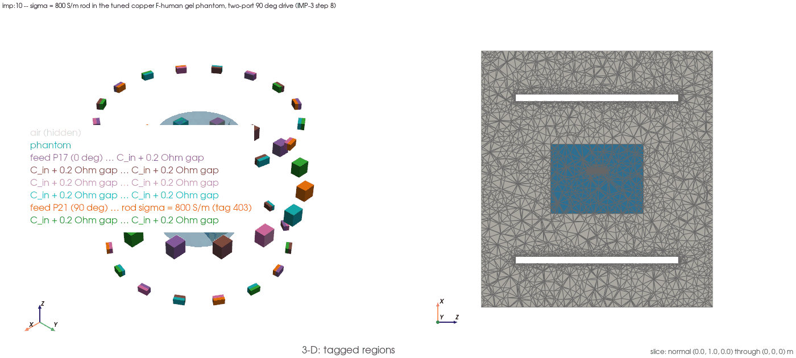

# `-e imp:10` — a σ = 800 S/m rod in the tuned copper F-human's gel phantom: with and without on one mesh, the tip 1 g SAR ratio, the adjoint fold at human scale, and the local-SAR ratio map

Script: `examples/implants/10_sigma_rod_in_tuned_f_human_tip_sar.py` (`EX-128`)
Gate: `tests/validation/test_imp3_f_human_tuned_rod.py` (`IMP-3` step 8, the W1b rod run)

## 1. What this demonstrates

`imp:3` and `imp:9` put an implant in the untuned F-small birdcage as a hole, so
the with and without arms are different meshes and a cellwise ratio between them
means nothing. This example puts one capped rod (r = 1 mm, ℓ = 30 mm between cap
centres, axis ẑ, centre (0.015, 0, 0)) in the **tuned copper (Leontovich)
F-human** at 64 MHz, degree 1, κ off, r = 0.2 Ω on all 32 gaps, under the
clinical two-port 90° drive (feeds P17 and P21) at the rod-free root
C_in = 118.2437 pF. The rod is kept as cell tag 403 on a 436 541-cell mesh and is
**switched by material only**: gel (the *without* arm) or σ = 800 S/m (the *with*
arm). Both arms run on **one mesh**, so SAR_with / SAR_without is a meaningful
cellwise map, for the first time in the implants group.

- Tip 1 g ratio Q = SAR₁g(with) / SAR₁g(without), top / bottom: ccw 3.80436 /
  3.64201, P17 1.77689 / 1.64787, P21 4.08493 / 4.01418. Smallest Q 1.64787 (P17
  bottom).
- Beside the `IMP-2` estimate η_z·M_cf + (1 − η_z): top ccw est 2.7498 (Q/est
  1.38351), η_z,ccw = 0.918468, M_cf = 2.90512. P17 alone has η_z = 0.459361
  (the drive barely lines E up with the rod), so its estimate is 1.87514 and Q
  reads ≈ 1.8; ccw lines E up (η_z 0.918) and reads 3.8.
- The rod's own dissipation P_rod = 6.80968e-07 W (ccw), 8.307e-05 of the phantom
  power. That fraction is also the miss of C3 below.
- SAR10g at the hotspot centre c\* (ccw, σ₃): 4.87745e-03 W/kg without, 4.79685e-03
  with, a −1.6525 % move.
- Map readings (printed, no band; ratio = SAR_with / SAR_without, ccw, gel cells,
  volume-weighted): within 1 mm of the top tip 850 cells, mean 81.421, max 189.45;
  bottom tip 799 cells, mean 77.82, max 186.81. The tip pointwise ratio exceeds
  the 1 g average (3.80) by the ball dilution. Shaft shadow (1–2 mm from the axis,
  |z| < 5 mm): 9 671 cells, mean 0.66333, max 4.4715. Far (more than 30 mm from the
  axis): 2 754 cells, mean 1.0009, max 1.0337. The maxima are single-cell readings
  on a degree-1 mesh; no ceiling is claimed.

Why the tip enhances and the shaft shadows: the conductor shorts E_z along its
shaft (shadow, mean ratio below 1) and the field piles up at the capped ends
(tip, ratio of order 10² at the cell scale, diluted to ≈ 3.8 by the 1 g ball).
The shadow is a mean: the same shell has a max of 4.47, where the field leaves
the rod sideways.

Everything is imported from the gate module: the example repeats the body of the
gate's rod run verbatim (the gate function returns nothing, and a second build
would add ≈ 177 s), imports `_read_record`, `_load`, `_build_f_human_rod`, `_say`,
`_in` and every band and record from the gate module, and prints the gate's lines
in its format. The records below match
`20261011T200932Z_IMP-3-step8-W1b-rod.log` (record checks at 10^−(d−2) for d
printed digits; the largest relative difference is 2.48e-05, in the printed
readings). No `test_*` name is used.

Asserted (imported bands):

- (A0r) cells 436 541 against the record (relative 0), census clean, tag-403
  cells 15 025; (M0) σ / εᵣ on tag 403, with (800, 78) and without (0.5, 78).
- (P_RC) node power partition per arm, 1.060e-12 / 1.062e-12 against
  `DISCRETE_IDENTITY_RTOL` (1e-6); (P_w) ccw and cw per arm, ≤ 7.884e-13.
- (T3) the adjoint fold against the with-arm solve: relative 2.172e-14 (P17) and
  5.177e-14 (P21), ccw by linearity 4.431e-14.
- (Σ_P) `mean_sar` against the partition P_phantom: relative 0 on both arms;
  coverage power / mass misses ≤ 3.220e-15 / 1.221e-14; R_cov 108.143 mm.

The adjoint fold (T3): Δq = q_with − q_without comes from **one held solve** on
the with-arm P17 factorisation, LOAD·Δσ·∫χ_lead w·E_without, and is compared with
the difference of the two solves, so the 3 mm lead-ball transfer function never
needs a second solve per implant.

Example-side (asserted, discrete identities): (L)₀ and (L)_w, the owned DG0
phantom-loss maps, sum to each arm's P_phantom (relative 0 and 1.33e-15); (L-rod),
the rod's loss map, sums to P_rod (5.88e-15); (B) both 1 g masks hold gel cells
(12 721 top, 12 724 bottom) and no tag-403 cell.

**Negative controls (asserted, each backed by W1b on the same comparison, fixture
and mesh):**

- The gate's C1 (Hermitian read-back, conj(w)) misses 1.9933 / 1.9932 and C2
  (total-field fold, E_with) misses 0.9306 / 0.9305, against the bar
  `DISCRETE_IDENTITY_RTOL`; they are the conjugation and total-field traps of the
  fold.
- Node NEG (the P_surf-blind miss of (P_RC)) 7.0154e-03 / 7.0153e-03, 701.5× the
  bar.
- C3: the whole ball with the solver σ instead of σ₃ misses 8.307e-05 against
  1e-10 (and equals P_rod / P_phantom, printed). The rod sits inside every
  whole-phantom ball, so every SAR here is computed with the gel σ₃.
- (Cq) Q > 1 on all six tip rows, minimum 1.6479.

Not claimed: an accurate tip ratio (`ANS-10` is the accuracy route), a PEC,
insulated or real lead, ISO 10974 or ASTM F2182, heating, absolute, tuned-coil or
pointwise SAR, compliance, degree 2 or h-convergence, f₀, Q, match or a re-tune
with the rod in (C_in is the rod-free root), the (S_rep) reproduction on the
earlier mesh (cited, not run), or any external check. Degree 1, one fixture, one
σ rod.

## 2. How to run it

```
./scripts/run_examples.sh -e imp:10 -n 8 -t 590
```

Needs the complex DolfinX build, which the runner sources for the `imp:` group.
Tier: **heavy**, complex, `-n 8`, runner `-t 590`. The run takes ≈ 316 s wall (the
kept-rod build 177 s, without arm 47 s, with arm 45 s, tip balls 28 s), summed RSS
10.92 GiB. It reads the node record of the rod-free root, named `NODE_JSON` in the
script, and stops if it is absent. Verification runs go through the logging
harness with the runner's emitted command
(`./scripts/run_examples.sh -e imp:10 -n 8 -t 590 --dry-run`). Add
`-e FEM_EM_SETUP_FIGURES=1` after `exec -T` to re-render the setup figure.

## Setup figure



`examples/implants/figures/implants_10_sigma_rod_in_tuned_f_human_tip_sar_setup.png`.
The left panel shows the conductor, the 32 gap boxes (feeds P17 at 0° and P21 at
90°) and the rod with the phantom translucent and the air hidden. The right panel
is the x–z slice at y = 0, which cuts the rod's axis at x = 15 mm.

## 3. How to analyze it, step by step

**Step 1 — the gate.** The `[IMP-3 step8] [rod]` lines are the gate's own report;
the cell count, (M0), the partitions, (T3), the tip rows and the SAR10g line
match the W1b run digit for digit.

**Step 2 — the records.** The `[EX-128] REC …` lines compare every covered record
with W1b at 10^−(d−2) and print the largest relative difference per group.

**Step 3 — the controls.** `node NEG`, `C3` and `(Cq)` print the asserted
separations beside their bars.

**Step 4 — the identities.** `(L)_0`, `(L)_w`, `(L-rod)` and `(B)` print the DG0
map sums and the mask counts.

**Step 5 — the readings.** `reading tip-near`, `shaft shadow` and `far` print the
cellwise ratio statistics beside their predicted range as IN or OUT (printed,
never a band).

**Step 6 — ParaView.** Open
`examples/implants/paraview_output/implants_10_sigma_rod_in_tuned_f_human_tip_sar_combined.xdmf`
(its heavy data is in the `.h5` of the same stem,
`examples/implants/paraview_output/implants_10_sigma_rod_in_tuned_f_human_tip_sar_combined.h5`).
Threshold `CellTags` = 3 (the gel), slice y = 0 and colour by
`SAR_local_with_over_without_ccw` on a log scale. Add a threshold `CellTags` = 403
coloured by `rod_loss_density_with_ccw_per_W`, then Plot Over Line along
x = 0.015, y = 0. `SAR_local_without_ccw_per_W` and `SAR_local_with_ccw_per_W` are
the two arms' fields per watt of source power; `one_gram_ball_top`,
`one_gram_ball_bottom` and `tf_probe_ball` mask the balls. The six tip rows are
also written to
`examples/implants/paraview_output/implants_10_sigma_rod_in_tuned_f_human_tip_sar_tip_rows.csv`.

Scope: degree 1, one fixture, one σ rod; SAR values are not an absolute, a
tip-ratio accuracy or a compliance figure, and there is no heating here.

## Related

- The rod in the F-small coil, different meshes per arm: `examples/implants/03_rod_in_birdcage_tip_sar.md`.
- The lead transfer function in the coil: `examples/implants/07_lead_tf_in_the_coil.md`.
- The disc in the F-small coil: `examples/implants/09_pec_disc_in_birdcage_rim_sar.md`.
- The tuned copper F-human, no implant: `examples/mri/17_f_human_tuned_quadrature_b1_sar.md`.
- The gate module: `tests/validation/test_imp3_f_human_tuned_rod.py`.
- The kept-rod mesh builder: `tests/mesh/test_birdcage_implant_rod_f_human.py`.
- The lead-in-coil gate: `tests/validation/test_wf9_lead_in_coil_phantom.py`.
