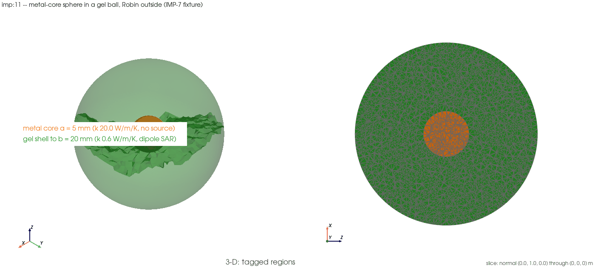

# `-e imp:11` — the gel heated by an implant's own SAR

Guide for `examples/implants/11_pec_sphere_implant_heating_in_gel_ball.py`. Written to be followed
without the source open.

## 1. What this demonstrates

**A temperature rise driven by an implant's own SAR.** `imp:1` shows the
SAR a PEC sphere concentrates in gel; `mat:12` shows conduction through a
two-layer gel ball. This example joins them: a 5 mm metal core (k = 20 W/m/K,
`a`) sits in a gel shell (k = 0.6 W/m/K) out to b = 4a, cooled by a Robin
film (h = 100 W/m²/K, T∞ = 20 °C). The heat source is the β = 1
quasi-static dipole SAR of the PEC sphere, on the shell only (q_far =
2000 W/m³ far from the core); the core itself carries no source. The
steady temperature is solved at P1 and compared with `IMP-7` step 0's
closed form. It is `IMP-7` step 1's metal-core case on **one rung** (the
middle one, 1.0 mm, 152 914 cells) in the complex build.

Every band, constant and helper is **imported** from the `IMP-7` step 1
gate modules (`tests/validation/test_imp7_implant_heating_fem.py`,
`test_imp7_implant_heating_closed_form.py`) and `MAT-18`'s FEM module — never restated. One local
re-definition, disclosed: the gate's error helper squares the error as `d**2`,
which is not a norm in the complex build, so this example computes the same
three quantities with `ufl.inner(d, d)`; it reproduces the gate's record to
all printed digits.

Scope: one rung (no rate claimed), steady state. **No coil, no finite-k
field, no rod, no tissue, no perfusion, no transient, no published implant
datum, no AED.** The adiabatic-hole variant is `IMP-7`'s other case and is not
run here.

## Setup figure



`examples/implants/figures/implants_11_pec_sphere_implant_heating_in_gel_ball_setup.png`.
The shell (tag 2, the heated gel) is translucent so the 5 mm metal core
(tag 1) shows through; the right panel slices at y = 0.

## 2. How to run it

```
./scripts/run_examples.sh -e imp:11 -n 2 -t 180
```

**Complex build required** — the `imp:` group sources it automatically.
Tier: **standard**; ≈ 17 s in-example, 19 s harness-wall at `-n 2`. In a
scheduled session, emit with `--dry-run` and run the printed command through
`scripts/testing/run_and_log.sh`; set `FEM_EM_SETUP_FIGURES=1` in the container
command to regenerate the figure.

## 3. How to analyze it, step by step

Records below are from `20261023T005150Z_EX-140.log` (`-n 2`, flagged run).

**Step 1 — the source.** The shell source continuation equals `IMP-7`
step 0's gated closed-form source at 512 random points: 0.000e+00, asserted
≤ `B1_BAND` (1e-12). The assembled source power is 6.802147e-02 W — the
gate's record to all digits — against the closed-form shell integral
6.803512e-02 W (−2.0e-04, mesh volume discretisation; printed).

**Step 2 — (S2), the interior error, asserted.**

```
  interior rel L2 1.2080e-03 (record 1.2080e-03)   band S2_BAND 1e-2
```

**Step 3 — (S3), the balance, asserted.** Convected power equals source
power: 5.039e-14 against the band `S3_BAND` 1e-9 (gate record 9.099e-14;
the residual is at round-off and differs run to run, so only the band is
asserted).

**Step 4 — the negative control, asserted.** Drop the l = 2 term of the
source (an isotropic source of the same mean):

```
  (c-iso) interior miss 2.7326e-02 (record 2.7326e-02) = 2.7x the band
```

The dipole's angular structure is what the 1e-3 agreement of Step 2 rests on.

**Step 5 — printed, never gated.**

- Pole / equator rise at r = 1.1a: solved 0.358025 / 0.345290 K against the
  closed form 0.361610 / 0.343661 K (the gate's finest rung reads 0.359626 /
  0.344320 K).
- The l = 2 readout R₂,h = 8.9967e-03 against 1.1966e-02 is **a difference of
  two near-equal numbers** (pole − equator is ≈ 5 % of the mean), so a
  sub-percent pointwise error shows as a double-digit percent on R₂. It is a
  cancellation readout, not a defect; no band.
- The core is near-uniform: range 0.350835–0.354020 K (spread 3.2e-03 K)
  against 0.131558–0.364679 K (spread 0.233 K) in the shell.
- Heating factor of the dipole field: centre rise 0.35068 K (β = 1) against
  0.31875 K (β = 0), factor 1.1002 — `IMP-7` step 0 printed 1.1002.

**Step 6 — complex build.** max |Im T_h| = 0 over both solves, asserted.

**Step 7 — open it in ParaView.**
`File → Open → examples/implants/paraview_output/implants_11_pec_sphere_implant_heating_in_gel_ball_combined.xdmf`.
Colour by `theta_h` (rise above T∞, K): the core is a flat hot plateau and the
shell cools outward. Then colour by `theta_abs_error`, and add a Clip through
the z-axis (normal along y): the error is largest where the l = 2 lobes of
`q_source` are (poles and equator of the core surface). `theta_exact` is the
closed form interpolated to P1.

**Step 8 — what a deviation means.** S2 or the control off the gate's record
at the printed digits is an example/test divergence — report it, do not move
a band. A control that lands under `S2_BAND` means the l = 2 source term no
longer reaches the solve.

## Related

- The gate: `tests/validation/test_imp7_implant_heating_fem.py`
  (`IMP-7` step 1) and its closed form `tests/validation/test_imp7_implant_heating_closed_form.py` (step 0).
- The sibling SAR field: `examples/implants/01_pec_sphere_in_gel.py` (`imp:1`).
- The two-layer conduction sibling: `examples/materials/12_gel_ball_in_container_wall.py` (`mat:12`).
