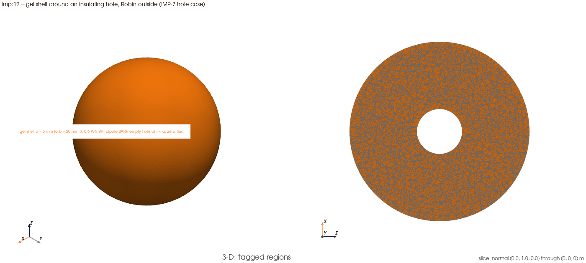

# `-e imp:12` — the same SAR source around an insulating implant

Guide for `examples/implants/12_insulating_implant_heating_in_gel_shell.py`. Written to be followed
without the source open.

## 1. What this demonstrates

**What an insulating implant does to the heating pattern, beside what a
metal one does.** `imp:11` heats the gel around a 5 mm *metal* core
(k = 20 W/m/K), which carries heat across itself. This example runs `IMP-7`
step 1's other boundary case, the **adiabatic hole**, on one rung (the middle
one, 1.0 mm, 150 334 cells): the implant is removed, the gel shell
a < r < b (a = 5 mm, b = 20 mm, k = 0.6 W/m/K) is cut out of the two-layer
ball as its own submesh, and the inner surface r = a is a natural,
**zero-flux** boundary. This is how an implant is treated when its own
conduction is ignored. The outer surface is a Robin film (h = 100 W/m²/K,
T∞ = 20 °C). The heat source is the same β = 1 quasi-static dipole SAR of the
PEC sphere (q_far = 2000 W/m³ far away). The steady temperature is solved at
P1 and compared with the closed form's adiabatic branch (k_core = 0).

The comparison sentence: the metal core flattens the l = 2 (pole − equator)
pattern of the gel's heating; an insulating implant does not. At r = 1.1a the
closed-form pole − equator split is 0.067189 K for the hole against 0.017949 K
for the metal core, **3.74×** larger.

Every band, constant and helper is **imported** from the `IMP-7` step 1 gate
modules (`tests/validation/test_imp7_implant_heating_fem.py`,
`tests/validation/test_imp7_implant_heating_closed_form.py`) and `MAT-18`'s FEM module
(`tests/validation/test_mat18_two_layer_sphere_fem.py`) — never restated. One disclosed
deviation: the gate's `_hole_rung` is not called whole, because its error
helper squares the error as `d**2`, which is not a norm in the complex build
the `imp:` group runs in. The example rebuilds the rung's pieces in
`_hole_rung`'s order, keeps its (G) asserts, and computes the same two error
quantities with `ufl.inner(d, d)`; it reproduces the gate's record to all
printed digits.

Scope: one rung (no rate claimed), steady state. **No coil, no finite-k
field, no rod, no tissue, no perfusion, no transient, no published implant
datum, no AED.**

## Setup figure



`examples/implants/figures/implants_12_insulating_implant_heating_in_gel_shell_setup.png`.
The shell submesh (every cell tagged 2); the right panel slices at y = 0 and
shows the empty r < a hole.

## 2. How to run it

```
./run_examples.sh -e imp:12 -n 2 -t 180
```

**Complex build required** — the `imp:` group sources it automatically.
Tier: **standard**; 18 s in-example, 22 s harness-wall at `-n 2`. In a
scheduled session, emit with `--dry-run` and run the printed command through
`scripts/testing/run_and_log.sh`; set `FEM_EM_SETUP_FIGURES=1` in the container
command to regenerate the figure.

## 3. How to analyze it, step by step

Records below are from `20261023T093235Z_EX-141.log` (`-n 2`, flagged run).

**Step 1 — (G), the submesh census, asserted.** 150 334 submesh cells =
150 334 parent tag-2 cells; shell r_min/a − 1 = −2.2e-16, r_max/b − 1 =
2.2e-16; the Robin area against 4πb² − 1 = −5.0690e-04 (the gate's record,
every digit), asserted within `G_AREA_BAND` (1e-2). The r = a area reads
−7.9569e-03 (printed).

**Step 2 — the source.** The assembled source power is 6.802147e-02 W — the
gate's record to all digits — against the closed-form shell power
6.803512e-02 W (ratio 0.999799, mesh volume discretisation; printed).

**Step 3 — (S2), the interior error, asserted.**

```
  interior rel L2 8.6093e-04 (record 8.6093e-04)   band S2_BAND 1e-2
```

The whole-ball figure is 9.0332e-04.

**Step 4 — (S3), the balance, asserted.** Convected power equals source
power: 2.856e-14 against the band `S3_BAND` 1e-9 (gate record 2.571e-14;
round-off, differs run to run, so only the band is asserted).

**Step 5 — the negative control, asserted.** Drop the l = 2 term of the
source (an isotropic source of the same mean):

```
  (c-iso) interior miss 3.6062e-02 (record 3.6062e-02) = 3.6x the band
```

**Step 6 — printed, never gated.**

- Pole / equator rise at r = 1.1a: solved 0.392616 / 0.328033 K against the
  closed form 0.394437 / 0.327248 K (the gate's finest rung reads 0.393152 /
  0.327785 K). R₂,h = 4.2876e-02 against 4.4793e-02: a cancellation readout.
- `imp:11`'s metal core at the same radius, quoted from
  `20261023T005150Z_EX-140.log` line 55: solved 0.358025 / 0.345290 K, closed
  form 0.361610 / 0.343661 K. Closed-form splits: hole 0.067189 K, metal core
  0.017949 K, ratio 3.74×. The FEM splits are cancellation readouts.
- The inner-surface flux ∫ k ∇T_h · n dS = 7.592748e-04 W, 1.116e-02 of the
  source power. It is zero in the continuous problem; the P1 natural boundary
  leaves this discretisation residual. Printed, no band.

**Step 7 — complex build.** max |Im T_h| = 0 over both solves, asserted.

**Step 8 — open it in ParaView.**
`File → Open → examples/implants/paraview_output/implants_12_insulating_implant_heating_in_gel_shell_combined.xdmf`.
Colour by `theta_h` (rise above T∞, K) and add a Clip through the z-axis
(normal along y): the l = 2 lobes are visible — hotter at the poles of the
hole surface than at the equator — and the core is empty. Then colour by
`theta_abs_error`; `theta_exact` is the closed form interpolated to P2→P1, and
`q_source` is the dipole SAR continuation.

**Step 9 — what a deviation means.** S2 or the control off the gate's record
at the printed digits is an example/test divergence — report it, do not move
a band. A control that lands under `S2_BAND` means the l = 2 source term no
longer reaches the solve.

## Related

- The gate: `tests/validation/test_imp7_implant_heating_fem.py`
  (`IMP-7` step 1) and its closed form `tests/validation/test_imp7_implant_heating_closed_form.py` (step 0).
- The metal-core sibling: `examples/implants/11_pec_sphere_implant_heating_in_gel_ball.py` (`imp:11`).
- The SAR field: `examples/implants/01_pec_sphere_in_gel.py` (`imp:1`).
