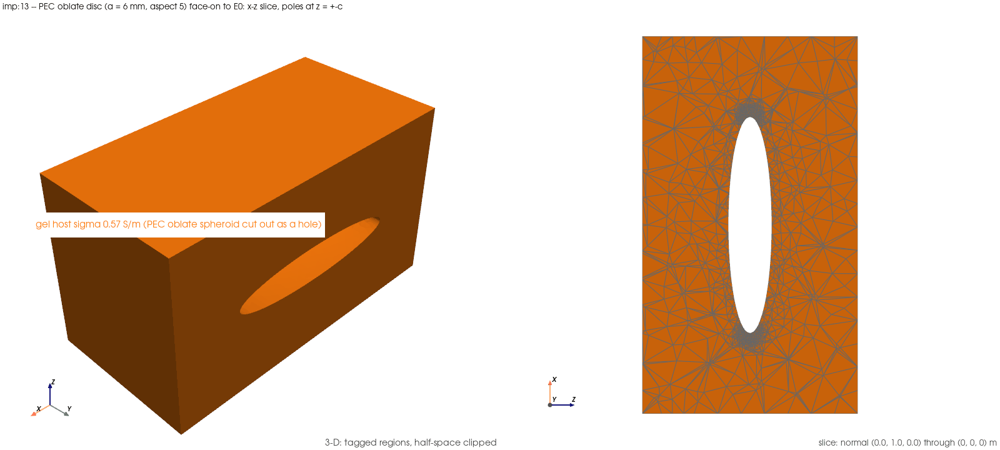

# `-e imp:13` — a PEC disc face-on to the field: the pole, and the drive that misses it

Script: `examples/implants/13_pec_oblate_disc_face_in_gel.py` (`EX-147`)
Gate: `tests/validation/test_imp6_oblate_axial_fem.py` (`IMP-6` step 3)

## 1. What this demonstrates

`imp:8` showed a flat body's rim under a field in the plane of the flat
(1/L_x ≈ 8). This example is its face-on twin. It solves the same perfectly
conducting oblate spheroid (a = 6 mm in x and y, c = 1.2 mm along z, aspect 5)
cut out of the gelled-saline host (σ = 0.57 S/m, ε_r = 78) at 64 MHz, degree 2,
on the same 32 676-cell mesh, under the imposed quasi-static field E₀ẑ normal
to the disc.

- The field at the flat faces is E₀/L_z with L_z = 0.750484, so 1/L_z = 1.332474
  and the pointwise SAR ratio is (1/L_z)² = 1.775. The mesh resolves a pole-ball
  mean Φ_pole = ⟨|E|²⟩/E₀² over the cells within r_p = a/5 = 1.2 mm of
  (0, 0, ±c): 1.683758 against the axial closed form's 1.667975 over the same
  cells (+0.9463 %). The ball mean is below the pointwise 1.775 because the ball
  reaches off the pole (0.939 of it).
- So the orientation of a flat implant against E sets which feature heats, and
  the face-on case is the mild one: a thin disc concentrates the field at its
  faces only by 1/L_z ≈ 1.33. Edge-on, its rim reaches 1/L_x ≈ 8 (see
  `examples/implants/08_pec_oblate_disc_edge_in_gel.md`, the edge-on twin).

Everything is imported from the gate modules and nothing is restated: the
gate solve `_solve_pole` and its own `_report_and_gate`, the bands
`TH15_BETA_BAND` and `MAT4_BAND`, and `E0` from
`tests/validation/test_imp1_pec_sphere_lossy_host.py`, and
`oblate_spheroid_depolarisation` from the package. No gate module or `src/`
file was edited.

Asserted (bands imported), each printed beside
`20261013T050558Z_IMP-6-step3-W1b.log:189–192`; this run is
`20261024T170054Z_EX-147-relabel.log`:

- (β) |β_axial − 1| ≤ `TH15_BETA_BAND` (4.886 %): β = 1.005469 (0.5469 %);
- (Φ) |Φ_pole,h/Φ_pole,cf,h − 1| ≤ `MAT4_BAND` (10 %): 1.683758 against
  1.667975, +0.9463 %;
- (cav) cavity dofs 19 952 > 0, max |E| = 0 below the gate's own literal.

**Negative control (asserted only as "> band"):** the in-plane drive on the
same cached mesh gives β = −0.032226 (|β − 1| = 1.0322, 21.1× the band) and
Φ_pole,h = 0.043756 against the axial closed form 1.667975, a 97.3767 % miss
(9.7× the 10 % band; a miss cannot exceed 100 %, so 10× is the most this
fixture can show). Record: `20261013T050819Z_IMP-6-step3-W2.log:192–193`.

All of these match the gate's records to the printed digits in this run.

Not claimed: aspect 2 (gate W1a, not run), a coil-driven field, SAR averaging
or a SAR figure, tissue, heating, any implant-safety statement, an external
check. The field is a quasi-static imposed trace, not a coil.

## 2. How to run it

```
./run_examples.sh -e imp:13 -n 2 -t 600
```

The runner sources the complex DolfinX build for the `imp:` group. Tier:
**heavy**. The run takes ≈ 114–117 s wall at `-n 2` (gate solve 38.6 s,
control 36.5 s, picture solve 35.2 s; `20261024T170054Z_EX-147-relabel.log`). Verification runs go through the logging
harness with the runner's emitted command
(`./run_examples.sh -e imp:13 -n 2 -t 600 --dry-run`). Add
`-e FEM_EM_SETUP_FIGURES=1` after `exec -T` to re-render the setup figure.

## Setup figure



`examples/implants/figures/implants_13_pec_oblate_disc_face_in_gel_setup.png`.
The figure shows the gel host (cell tag 2 only; the disc is a hole), the block
clipped at y < 0, and the x–z slice at y = 0, which shows the disc edge-on in
the drawing plane with its two flat faces (the poles, at z = ±c) facing the
applied field.

## 3. How to analyze it, step by step

**Step 1 — the closed form.** `[closed form]` prints L_z, 1/L_z and the
pointwise (1/L_z)² from `oblate_spheroid_depolarisation`.

**Step 2 — the gate.** The `[IMP-6 step 3]` lines are the gate's own prints:
β, Φ_pole,h beside Φ_pole,cf,h, pole-mask cells 154, h_pole 1.948 mm, and the
cavity check. The `[records]` line beside it carries W1b's values; the digits
agree.

**Step 3 — the control.** `[control]` shows that the in-plane drive gives
β ≈ 0 on the axial basis and Φ_pole = 0.043756: the pole enhancement exists
only for the field normal to the disc.

**Step 4 — the picture solve.** One more axial-drive solve feeds the XDMF. The
`[picture]` line prints its β as −0.001796, labelled "in-plane basis": the
imported routine `_solve_oblate` fits β on the in-plane basis whatever the
drive, so for this face-on drive that basis sees almost nothing and β ≈ 0. It is
the same reading as `imp:8`'s control, a record from the imported routine and not
a gate here (`20261024T170054Z_EX-147-relabel.log`). The asserted axial-basis β
is the gate's 1.005469 in Step 2.

**Step 5 — ParaView.** Open
`examples/implants/paraview_output/implants_13_pec_oblate_disc_face_in_gel_combined.xdmf`.
Cut y = 0 and colour by `sar_ratio_axial` (|E|²/E₀², DG0): the two faces carry
the modest pole enhancement and the rim stays cold. `pole_mask` marks the
pole-ball cells. DG0 cell fields export exactly; any P1 export of the Nédélec
field would be a qualitative picture only.

## Related

- The edge-on twin: `examples/implants/08_pec_oblate_disc_edge_in_gel.md`.
- The prolate tip: `examples/implants/02_pec_spheroid_tip_in_gel.md`.
- The gate modules: `tests/validation/test_imp6_oblate_axial_fem.py`,
  `tests/validation/test_imp6_oblate_fem.py`,
  `tests/validation/test_imp1_pec_sphere_lossy_host.py`.
