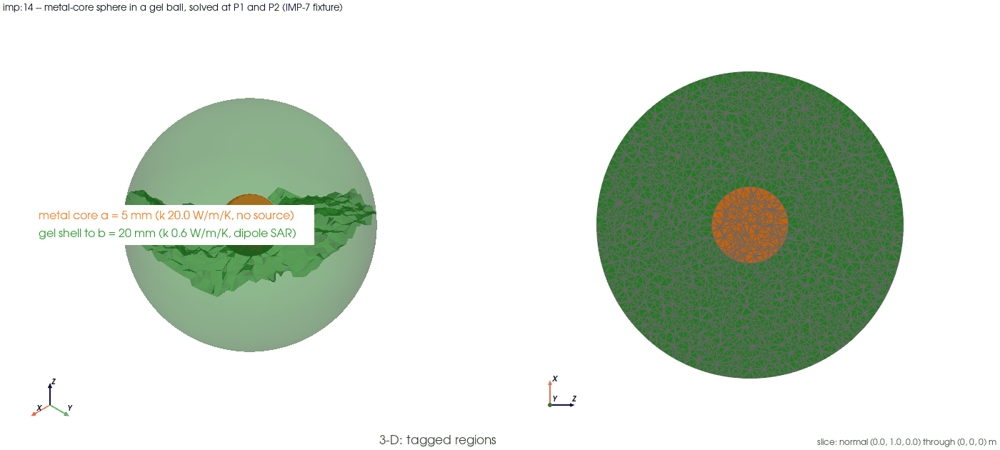

# `-e imp:14` — the implant-heated gel ball at P2

Guide for `examples/implants/14_implant_heating_p2_metal_core.py`. Written to be followed
without the source open.

## 1. What this demonstrates

**Element order on the implant-heated gel ball.** `imp:11` solves `IMP-7`
step 1's metal-core case at P1 on the 1.0 mm rung: a 5 mm metal core
(k = 20 W/m/K) in a gel shell (k = 0.6 W/m/K) out to b = 4a, Robin-cooled
(h = 100 W/m²/K), heated by the β = 1 quasi-static dipole SAR of the PEC
sphere (shell only). This example solves **the same fixture and the same rung
(152 914 cells) at P1 and at P2** against the same closed form and shows what
the element order buys: the interior relative L2 error falls from 1.2080e-03 to
8.4803e-04, and the l = 2 pole moment moves from a double-digit-percent miss
to ≈ 2 % beside the series.

Every band, constant, degree route and helper is **imported** from the `IMP-7`
gate module (`tests/validation/test_imp7_implant_heating_fem.py`, as `m7`) —
never restated. Two disclosed local pieces: the gate's `_metal_rung` calls
`_errors`, which squares the error as `d**2` (not a norm in the complex
build), so `_rung` writes `_metal_rung`'s body out with `DEG_ROUTE[degree]` and
a local `_errors_c` using `ufl.inner(d, d)`.

**Why P2 needs a DG3 source and a P3 comparand at quadrature 6.** The P2
solution is third-order accurate in the interior at best; a DG2 source or a P2
comparand would put an interpolation floor of the same size under the error
being measured. `DEG_ROUTE[2]` therefore interpolates the source at DG3,
compares against a P3 interpolant of the closed form, and integrates the
error forms at quadrature degree 6.

**What the control proves.** Replacing the β = 1 dipole source by the β = 0
(uniform) source and solving at P2 on the same rung misses the interior band
by 6.0×. The 8.5e-04 above is therefore agreement with the dipole's angular
structure, not a property of any smooth solution.

Scope: one rung, steady state. **Not shown:** the adiabatic-hole variant
(`imp:12`), a convergence rate (one rung; the gate prints ≈ 2 for P2, not 3,
and the affine r = a interface is suspected but not diagnosed), any coil or
transient, tissue, perfusion, or an external check.

## Setup figure



`examples/implants/figures/implants_14_implant_heating_p2_metal_core_setup.png`.
The shell (tag 2, the heated gel) is translucent so the 5 mm metal core
(tag 1) shows through; the right panel slices at y = 0.

## 2. How to run it

```
./scripts/run_examples.sh -e imp:14 -n 2 -t 420
```

**Complex build required** — the `imp:` group sources it automatically.
Tier: **heavy**; 154 s in-example, 157 s harness-wall at `-n 2`. In a
scheduled session, emit with `--dry-run` and run the printed command through
`scripts/testing/run_and_log.sh`; set `FEM_EM_SETUP_FIGURES=1` in the container
command to regenerate the figure.

## 3. How to analyze it, step by step

Records below are from `20261025T203007Z_EX-154.log` (`-n 2`, flagged run).

**Step 1 — P1, asserted.** Interior rel L2 1.2080e-03 (whole 1.2015e-03)
against `S2_BAND` 1e-2 — `imp:11`'s value; balance 5.060e-14 against
`S3_BAND` 1e-9.

**Step 2 — P2, asserted.** Interior rel L2 8.4803e-04 (whole 8.1490e-04);
balance 2.369e-13 (the gate's finest-rung record is 2.822e-13). Solve 71.5 s
against 2.1 s at P1.

**Step 3 — the control, asserted.** β = 0 source at P2: interior miss
5.9510e-02 = 6.0× the band (the gate's measured value is 5.9510e-02; the P1
record is 5.965e-02).

**Step 4 — printed, never gated.**

- P2 / P1 error ratio: whole 0.6782, interior 0.7020 on this one rung (the
  gate's finest-rung ratio is 0.69). No rate is shown.
- The l = 2 readout R₂,h at r = 1.1a: P1 8.9967e-03, **P2 1.2221e-02**, series
  1.1966e-02. Pole / equator rise: P1 0.358025 / 0.345290 K, P2 0.362426 /
  0.344305 K, series 0.361610 / 0.343661 K. R₂ is a difference of two
  near-equal numbers (pole − equator ≈ 5 % of the mean), so it is a
  cancellation readout, not a defect; no band.
- 152 914 cells; mesh build 5.2 s.

**Step 5 — open it in ParaView.**
`File → Open → examples/implants/paraview_output/implants_14_implant_heating_p2_metal_core_combined.xdmf`.
Colour by `theta_p1`, `theta_p2` and `theta_exact` (rise above T∞, K; P2
sampled onto P1 nodes for output) and compare.

**Step 6 — what a deviation means.** An S2, S3 or control reading off the gate's
record is an example/test divergence — report it, do not move a band. A
control that lands under `S2_BAND` means the l = 2 source term no longer
reaches the P2 solve.

## Related

- The gate: `tests/validation/test_imp7_implant_heating_fem.py` (`IMP-7`
  step 2, I40) and its closed form `test_imp7_implant_heating_closed_form.py`.
- `examples/implants/11_pec_sphere_implant_heating_in_gel_ball.py` (`imp:11`,
  the P1 rung).
- `examples/implants/12_insulating_implant_heating_in_gel_shell.py` (`imp:12`,
  the adiabatic-hole variant).
