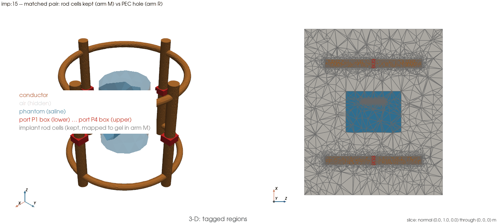

# `-e imp:15` — the rod heats the coil-driven phantom, like for like

Guide for `examples/implants/15_rod_heating_matched_phantom.py`. Written to be followed
without the source open.

## 1. What this demonstrates

**An implant as a heat source in a coil-driven phantom.** `imp:3` shows the
PEC rod's SAR in the driven F-small birdcage phantom; `imp:11` / `imp:14` heat
a gel ball with an implant-shaped source. No example shows the rod change the
*temperature* of a coil-driven phantom. This one does, in the same units for
two arms: the gapped four-port birdcage at 64 MHz, degree 1, ccw quadrature
superposition, one normalisation G = 1 W / P_phantom(arm M) (the phantom
dissipates 1 W), then `MAT-15`'s thermal route (Crank-Nicolson to t\* = 1254 s,
P1, Robin cooling on the outer surface).

**Why a matched pair.** `IMP-3` step 11 (I39) compared a without-rod phantom
of 537 cells with the rod build's 51 693-cell phantom: two separately meshed
phantoms, so part of any ratio was mesh. Here the arms share every cell
outside the rod. **Arm M** is `GEO-36`'s kept-cells twin of the rod build
(182 371 cells): the rod's 15 000 cells carry tag 403 and are *mapped to the
gel*, so the rod is just more phantom. **Arm R** is the hole build (167 371
cells): the rod is a PEC cavity with an adiabatic wall. Both have 51 693
tag-3 cells.

**It asserts, and it does not re-implement** (the `ANS-1` rule). I41's
`tests/validation/test_imp3_rod_heating_matched.py` (as `i41`) supplies the
census, the tag merge, the 403 → gel patch (`_arm_with_403`, restored in
`finally`) and the bands; the heat route `_heat_arm`, the builders and
`_arm` are imported from their gate modules. I41's `_run` is **not** called:
it also solves a vacuum-control arm (≈ 61 s) that this example leaves out, so
the arm sequence is written out with the same helpers.

**What (W0) proves.** The thermal submesh takes tag 3 (arm M: tags 3 and 403
merged). Its exterior facets are the outer surface plus, in arm R, the rod
wall. (W0) counts the rod-wall facets *excluded* from the Robin condition:
arm M must exclude 0 (the rod surface is interior) and arm R exactly its
parent tag-402 count, 4 958. A build that left the rod in arm M would read
4 958 there, not 0 — the check discriminates the two builds.

**Why (C4) is asserted on arm M only.** Arm M is the C4-symmetric phantom
(the rod is gel), so the four 10 g θ readings at 0 / 90 / 180 / 270° must
agree within `C4_COVARIANCE_BAND`. Arm R's rod sits on one leg's azimuth and
breaks that symmetry by design; its pairs are printed, not gated.

Scope: one mesh pair, degree-1 EM, P1 thermal. I41 is chain I and provisional
until the 10-26 weekly ratifies it. **Not shown:** a converged ratio (one
mesh), any compliance or dose figure, the F2182 rod (W3), a degree-2 thermal
arm, F-human or F-clinical.

## Setup figure



`examples/implants/figures/implants_15_rod_heating_matched_phantom_setup.png`.
Arm M's mesh: the copper birdcage (conductor), the four port boxes (red) and
the translucent phantom, air hidden; the right panel slices at y = 0, through
the rod's axis (x = 15 mm), whose kept cells (tag 403) show in the phantom.

## 2. How to run it

```
./scripts/run_examples.sh -e imp:15 -n 2 -t 420
```

**Complex build required** — the `imp:` group sources it automatically.
Tier: **heavy**; 228.3 s in-example, 233 s harness-wall at `-n 2`. In a
scheduled session, emit with `--dry-run` and run the printed command through
`scripts/testing/run_and_log.sh`; set `FEM_EM_SETUP_FIGURES=1` in the container
command to regenerate the figure.

## 3. How to analyze it, step by step

Records below are from `20261026T033157Z_EX-155.log` (`-n 2`, flagged run).

**Step 1 — (A0m), asserted before any solve.** Arm M 182 371 cells =
`KEPT_ROD_CELL_RECORD`, tag-403 15 000, tag-3 51 693 = arm R's (arm R 167 371).

**Step 2 — (W0), asserted.** Rod-wall facets excluded: arm M 0, arm R 4 958 =
the parent tag-402 count.

**Step 3 — identities, asserted on both arms** at the imported bands:

| arm | (B) ≤ 1e-10 | (E) ≤ 1e-9 | (E′) ≤ 1e-9 | (S2) ≤ 1e-4 |
|---|---|---|---|---|
| M | 7.105e-15 | 4.916e-11 | 3.242e-14 | 5.1274e-06 |
| R | 2.605e-15 | 5.125e-12 | 2.410e-14 | 5.0000e-06 |

**Step 4 — (C4) on arm M, asserted.** Pairs 0.9318 / 0.0478 / 0.2853 /
0.6053 % against 5 %.

**Step 5 — printed, never gated** (records beside readings; digit equality is
never asserted):

- Tip 1 g θ(t\*) ratio R / M: top 1.104515, bottom 1.108684 (I41's record
  1.104515 / 1.108684; I39's mesh pair read 1.1109 / 1.0884). The 1 g SAR
  ratio Q = 4.090342 / 4.113695. Ball masses 0.981846 / 0.982903 g on both arms
  (the rod volume is excluded from both alike).
- Max θ ratio 1.013722 (1.624567 / 1.602576 K); mean θ ratio 1.024921;
  P(R)/P(M) − 1 = +2.2683 % (P_phantom M 1.031313e-05 W, R 1.054706e-05 W).
- Arm R's (C4) pairs 2.9607 / 3.6591 / 2.6120 / 3.7910 % — the rod breaks the
  symmetry.
- Seconds: arms M 69.7 / R 61.9; mesh wall 45.6 / 41.0.

The tip θ ratio (≈ 1.10) is smaller than the SAR ratio (≈ 4.1): conduction
spreads the rod's hot spot over the 1 g ball.

**Step 6 — open it in ParaView.** The two arms live on different meshes, so
there are two files in `examples/implants/paraview_output/`:
`implants_15_rod_heating_matched_phantom_armM_combined.xdmf` and
`implants_15_rod_heating_matched_phantom_armR_combined.xdmf`. Each carries the
cell tags (arm M: 3 / 403) and `sar_source_w_per_m3`, the DG0 SAR source with G
applied, as the heating route builds it. **θ is not exported:** the thermal
route returns scalars and the example never re-solves for the picture.

**Step 7 — what a deviation means.** A gate red here where I41 was green is a
route difference between the example and the module — report both, never move
a band.

## Related

- `examples/implants/03_rod_in_birdcage_tip_sar.py` (`imp:3`, the rod's SAR in
  the driven phantom, without the heating).
- `examples/implants/14_implant_heating_p2_metal_core.py` (`imp:14`, implant
  heating of the gel ball at degree 2).
- `examples/materials/09_coil_driven_heating_phantom.py` (`MAT-15`'s
  coil-driven heating of the phantom, no implant).
- Gate: `tests/validation/test_imp3_rod_heating_matched.py` (I41).
