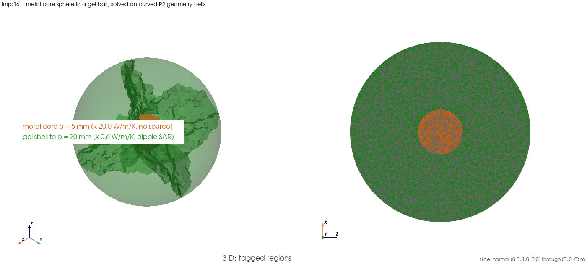

# `-e imp:16` — the implant-heated gel ball on curved (P2-geometry) cells

Guide for `examples/implants/16_implant_heating_curved_p2.py`. Written to be followed
without the source open.

## 1. What this demonstrates

**What removing the chord floor buys.** `imp:14` solves the metal-core case
(a 5 mm core, k = 20 W/m/K, in a gel shell, k = 0.6 W/m/K, out to b = 4a,
Robin-cooled, heated by the β = 1 quasi-static dipole SAR of the PEC sphere,
shell only) at P2 on the 1.0 mm rung (152 914 cells), and lands at interior
relative L2 8.4803e-04. That sits on a floor that no element order moves: an
**affine** tetrahedral mesh approximates the r = a and r = b spheres by flat
facets, so the geometry itself is off by a chord of depth ≈ h²/(8a), an
O(h²) error that caps even a P2 solution at a rate ≈ 2 instead of 3. This
example solves the same fixture, same rung, same P2 solution space on a mesh
with a **degree-2 coordinate element** (`geometry_order=2`): every tetrahedron
has 10 nodes and curved edges and faces, and the sphere volumes are
reproduced to O(h⁴). The interior error falls to 6.2631e-05, 0.074× the affine
figure.

Every band, constant, degree route and helper is **imported** from the `IMP-7`
gate modules (`test_imp7_implant_heating_fem` as `m7`, and
`test_imp7_curved_p2`) — never restated. Three disclosed local pieces: the
gate's `_curved_metal_rung` and `m7._errors` square the error as `d**2`, which
is not a norm in the complex build, so `_rung` writes the rung body out with
`DEG_ROUTE[2]` and `_errors_c` uses `ufl.inner(d, d)`; `_volumes_c` writes the
two volume integrals out with `np.real`.

**Why the comparand and source routes are unchanged.** The geometry order
changes only where the nodes sit. The P2 solution is still third-order at
best, so `DEG_ROUTE[2]` still interpolates the source at DG3, compares against
a P3 interpolant of the closed form and integrates the error forms at
quadrature degree 6. Changing the route as well as the mesh would confound the
reading.

**What the control proves.** Replacing the β = 1 dipole source by the β = 0
(uniform) source and solving at P2 on the *same curved mesh* misses the
interior band by 5.9×. The 6.3e-05 above is therefore agreement with the
dipole's angular structure, not a property of any smooth solution — and the
curved mesh does not make the check any softer.

Scope: one rung, steady state. **Not shown:** the adiabatic-hole variant on
curved cells (`IMP-7` step 3b, §9 item 651, if landed), a convergence rate
(one rung; the gate prints 3.036 / 3.105 on its two curved rungs), any coil or
transient, tissue, perfusion, or an external check.

## Setup figure



`examples/implants/figures/implants_16_implant_heating_curved_p2_setup.png`.
The shell (tag 2, the heated gel) is translucent so the 5 mm metal core
(tag 1) shows through; the right panel slices at y = 0. The figure is rendered
from the affine mesh of the same rung (identical cells; the curved mesh only
adds mid-edge geometry nodes, invisible at this scale).

## 2. How to run it

```
./scripts/run_examples.sh -e imp:16 -n 4 -t 540
```

**Complex build required** — the `imp:` group sources it automatically.
Tier: **heavy**; 177.2 s in-example, 180 s harness-wall at `-n 4`. In a
scheduled session, emit with `--dry-run` and run the printed command through
`scripts/testing/run_and_log.sh`; set `FEM_EM_SETUP_FIGURES=1` in the container
command to regenerate the figure.

## 3. How to analyze it, step by step

Records below are from `20261026T095740Z_EX-156.log` (`-n 4`, complex build,
flagged run).

**Step 1 — the meshes, asserted.** Curved and affine each 152 914 cells;
coordinate degree 2 and 1 respectively. Builds 8.2 s and 4.7 s.

**Step 2 — volumes, printed.** Core volume against 4/3·π·a³: curved
−2.5646e-05, affine −1.4391e-02. Ball volume against 4/3·π·b³: curved
−1.0256e-07, affine −9.1608e-04. The gate's records for the core are
−2.56e-05 / −1.44e-02.

**Step 3 — curved P2, asserted.** Interior rel L2 6.2631e-05 (whole
5.8831e-05) against `S2_BAND` 1e-2; balance 4.332e-13 against `S3_BAND` 1e-9.
Solve 78.6 s. Both reproduce the gate's real-build records (6.2631e-05; balance
≤ 7.1e-13).

**Step 4 — the control, asserted.** β = 0 source on the curved mesh: interior
miss 5.9317e-02 = 5.9× the band (the gate's record is 5.9317e-02); balance
4.966e-13.

**Step 5 — printed, never gated.**

- Curved / affine ratio against `imp:14`'s record (8.1490e-04 whole,
  8.4803e-04 interior, `-n 2`): whole 0.0722, interior 0.0739 (the gate read
  0.072). Widths differ, so this is a ratio, not a digit comparison.
- The l = 2 readout R₂,h at r = 1.1a: 1.1775e-02 against the series 1.1966e-02
  (−1.6 %); pole / equator rise 0.361365 / 0.343746 K against 0.361610 /
  0.343661 K. R₂ is a difference of two near-equal numbers, so it is a
  cancellation readout, not a defect; no band.

**Step 6 — open it in ParaView.**
`File → Open → examples/implants/paraview_output/implants_16_implant_heating_curved_p2_combined.xdmf`.
Colour by `theta_curved_p2`, `theta_exact` (rise above T∞, K) and
`theta_error` (the pointwise absolute error); all three are P2 Lagrange on the
curved mesh, as the XDMF writer requires.

**Step 7 — what a deviation means.** An S2c, S3c or control reading off the
gate's record is an example/test divergence — report it, do not move a band. A
control that lands under `S2_BAND` means the l = 2 source term no longer
reaches the P2 solve.

## Related

- The gate: `tests/validation/test_imp7_curved_p2.py` (`IMP-7` step 3, I42) and
  `test_imp7_implant_heating_fem.py`.
- `examples/implants/14_implant_heating_p2_metal_core.py` (`imp:14`, the same
  fixture at P2 on affine cells).
- `examples/implants/11_pec_sphere_implant_heating_in_gel_ball.py` (`imp:11`,
  the P1 rung).
