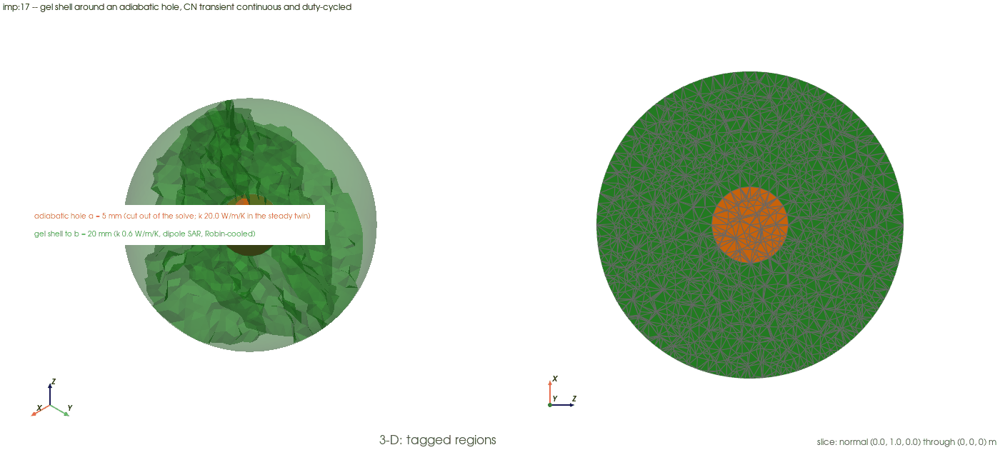

# `-e imp:17` — the implant-heated gel shell switched on, continuous and duty-cycled

Guide for `examples/implants/17_implant_heating_transient_duty.py`. Written to be followed
without the source open.

## 1. What this demonstrates

**The first implant example with a time-dependent source.** Every earlier
`examples/implants/*.py` is steady, and the duty examples (`mat:11`, `mat:15`,
`mat:17`, `mat:25`, `mat:27`, `mri:25`) are gel-only. Here the fixture is the
curved adiabatic-hole shell of `IMP-7` steps 5–6 (I46′, I47): a gel shell
a = 5 mm to b = 20 mm (k = 0.6 W/m/K), Robin-cooled at r = b, heated by the
β = 1 quasi-static dipole SAR of the PEC sphere, with the metal core replaced by
an **adiabatic hole** at r = a. The mesh is the degree-2-geometry mesh of
`LADDER[0]` (1.414 mm), the solve is P2, and the temperature starts at θ = 0.
Two drives run to t\* = 313.5 s:

1. the **continuous** source, switched on at t = 0;
2. the **50 % duty** source, period 0.5 t\* (two periods in t\*), on for the first
   half of each.

Each is compared against its series.

**The series.** The hollow-sphere problem with an adiabatic inner wall and a
Robin outer wall has an eigen-function expansion in spherical Bessel functions
(Carslaw & Jaeger, ch. IX; I45). The continuous response is the sum of
`(1 − e^(−λₙ t))/λₙ` mode terms against the steady series; the duty response
is the Duhamel superposition of shifted step responses, which the same modes
give in closed form (`pec_sphere_implant_duty_cycle_from_modes`).

**Why CN takes backward-Euler half-steps under a switched source.** Crank–
Nicolson is second order but only weakly damps: a source that jumps from 0 to Q
at t = 0 leaves a high-frequency ringing that CN carries forward undamped. The
solver replaces the first full step by two BE half-steps (`startup_half_steps=2`),
which damp it. Both runs use that start-up.

**Why each switch falls on a step boundary.** The period is 156.75 s = exactly
20 steps of dt = t\*/40 = 7.8375 s, and the on-time 10 steps. χ(t) is sampled at
the step midpoint and is therefore constant across each step: no step straddles a
switch. The census Σχ·dt then equals the on-time to the last digit (20 off and 21
on (half-)steps, the extra one being the BE half-step pair).

**What the control proves.** Comparing the *duty* FEM against the *continuous*
series misses by 0.53873 — 54× the band. The 1e-4 agreement above is therefore
agreement with the duty-cycled series, not with a source that was simply on.

Every band, helper and constant is **imported** from the `IMP-7` gate modules
(`test_imp7_transient_fem`, `test_imp7_duty_cycle_fem`, and the modules those
take `INTERIOR_BAND` and `E_BAND` from) — never restated. One disclosed local
piece: `m7._errors` squares the error as `d**2`, not a norm in the complex build,
so `_errors_c` uses `ufl.inner(d, d)`.

Scope: one rung, one Δt. **Not shown:** a rate in h or Δt, the metal core (here
a hole), a coil source, CEM43, tissue or perfusion.

## Setup figure



`examples/implants/figures/implants_17_implant_heating_transient_duty_setup.png`.
The shell (tag 2) is translucent so the 5 mm core region (tag 1) shows through;
the right panel slices at y = 0. The figure is rendered from the **affine** mesh
of the same rung; the solve meshes the shell alone (the core region is cut out,
leaving the adiabatic hole) with a degree-2 coordinate element.

## 2. How to run it

```
./scripts/run_examples.sh -e imp:17 -n 4 -t 480
```

**Complex build required** — the `imp:` group sources it automatically.
Tier: **heavy**; 166.1 s in-example, 169 s harness-wall at `-n 4`. In a
scheduled session, emit with `--dry-run` (logged as
`20261028T021919Z_EX-158-dryrun.log`) and run the printed command through
`scripts/testing/run_and_log.sh`; set `FEM_EM_SETUP_FIGURES=1` in the container
command to regenerate the figure.

## 3. How to analyze it, step by step

Records below are from `20261028T022737Z_EX-158.log` (`-n 4`, complex build,
flagged run). The gate records are I46′'s W1r and I47's W1, real build.

**Step 1 — the mesh.** Curved shell sub-mesh, 53 643 cells; build 2.7 s. CN
solves: continuous 42.2 s, duty 40.5 s.

**Step 2 — (T), asserted.** Interior rel L2 at t\* against `INTERIOR_BAND`
(1e-2): continuous 1.8004e-04 (record 1.8004e-4), duty 1.0444e-04 (record
1.0444e-4). Whole-domain 1.6849e-04 / 1.2019e-04.

**Step 3 — (E), asserted.** CN max balance against `E_BAND` (1e-9): continuous
5.912e-12, duty 5.867e-12 (records 5.807e-12 / 5.809e-12; the last digits move
with the build and rank width, the bands are 150× away).

**Step 4 — (S0), asserted.** Σχ·dt = 156.750000000000 s against the on-time
156.750000000000 s: relative 0 against `S0_BAND` 1e-12 (record 0).

**Step 5 — (c-cont), asserted.** Continuous series against the duty FEM:
interior miss 0.53873 (record 0.53873), 54× `INTERIOR_BAND`.

**Step 6 — printed, never gated.** θ(t) in K at r = 1.1a, pole (0,0,1.1a) /
equator (1.1a,0,0):

| t (s) | continuous FEM | continuous series | duty FEM | duty series |
|---|---|---|---|---|
| 78.375 | 0.087175 / 0.032262 | 0.087493 / 0.032293 | 0.087175 / 0.032262 | 0.087493 / 0.032293 |
| 156.750 | 0.133340 / 0.071100 | 0.133642 / 0.071140 | 0.046109 / 0.038843 | 0.046149 / 0.038847 |
| 235.125 | 0.171871 / 0.107226 | 0.172168 / 0.107265 | 0.125743 / 0.068376 | 0.126019 / 0.068418 |
| 313.500 | 0.204928 / 0.139212 | 0.205221 / 0.139247 | 0.079170 / 0.070826 | 0.079202 / 0.070829 |

The duty column tracks the continuous one for the first on-half, falls away
during the off-half, and rises again. The deposited energy ratio duty /
continuous is 0.500000. The pole-to-series offset (≈ 3e-4 K of 0.2 K) is the
P2 discretisation error the (T) gate bounds.

**Step 7 — open it in ParaView.**
`File → Open → examples/implants/paraview_output/implants_17_implant_heating_transient_duty_combined.xdmf`.
Colour by `theta_cont_fem`, `theta_cont_series`, `theta_duty_fem`,
`theta_duty_series` (rise above T∞, K) and `error_cont`, `error_duty` (pointwise
absolute error); all are P2 Lagrange on the curved mesh, as the XDMF writer
requires.

**Step 8 — what a deviation means.** A (T), (E) or (S0) reading off the gate's
record is an example/test divergence — report it, do not move a band. A
(c-cont) that lands under `INTERIOR_BAND` means the switching no longer reaches
the solve.

## Related

- The gates: `tests/validation/test_imp7_transient_fem.py` (I46′) and
  `tests/validation/test_imp7_duty_cycle_fem.py` (I47).
- `examples/implants/16_implant_heating_curved_p2.py` (`imp:16`, the steady
  curved-cell twin).
- `examples/materials/11_duty_cycled_gel_ball.py` (`mat:11`) and
  `examples/materials/27_duty_cycle_time_step_rate.py` (`mat:27`), the gel-only
  duty cases.
