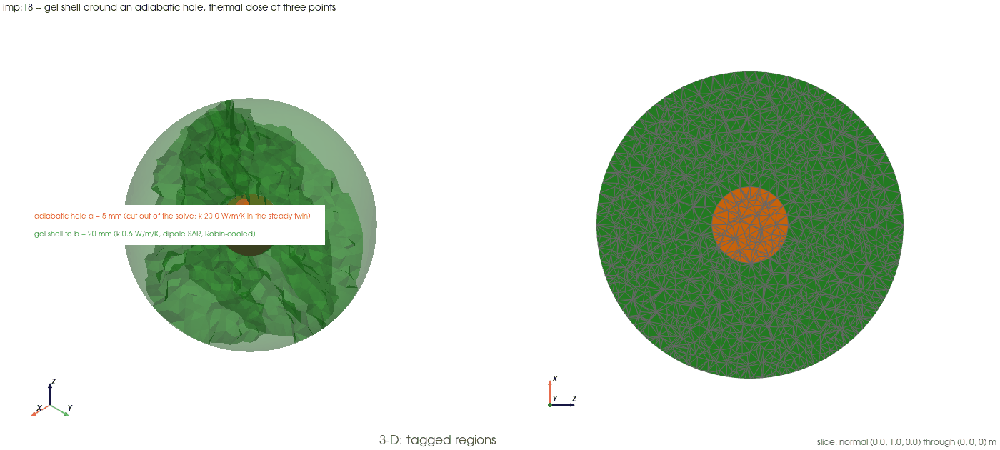

# `-e imp:18` — the thermal dose around the implant hole: CEM43 and the six-minute window

Guide for `examples/implants/18_implant_thermal_dose.py`. Written to be followed
without the source open.

## 1. What this demonstrates

`imp:17` shows the duty-cycled temperature around the adiabatic hole. This example
turns that history into what a safety reading uses: the **CEM43 dose** and the
**maximum six-minute running mean**, at three points whose distance from the hole
differs. It is the first example to read a dose around an implant (the other dose
examples, `mat:17`, `mat:18`, `mat:25` and `mri:20`, are gel-only).

**The fixture** is `imp:17`'s: the curved gel shell a = 5 mm to b = 20 mm
(k = 0.6 W/m/K), Robin-cooled at r = b, heated by the β = 1 quasi-static dipole SAR
of the PEC sphere, with the metal core replaced by an adiabatic hole at r = a;
`LADDER[0]` (1.414 mm), P2 on the degree-2-geometry mesh. The source is the 50 %
duty cycle (period 156.75 s = 20 steps), run for **4 t\*** = 1254 s, which is 160
Crank–Nicolson steps of Δt = t\*/40 (two backward-Euler start-up half-steps). Every
step's snapshot is kept and read at three points in one fixed batch:

| point | position | distance from the hole wall |
|---|---|---|
| pole | (0, 0, 1.05 a) | 0.25 mm |
| equator | (1.05 a, 0, 0) | 0.25 mm |
| outer pole | (0, 0, 0.95 b) | 1 mm inside the outer wall |

**What `cem43` and `running_average` compute.** `cem43(t, T)` integrates the
Sapareto–Dewey equivalent minutes at 43 °C along a temperature history,
`∫ R^(43−T) dt` with R = 0.5 above 43 °C and 0.25 below (the constants live in
`fem_em_solver.thermal.dose`), over the piecewise-linear history on the grid.
`running_average(t, θ, window)` returns the trailing mean of θ over a six-minute
(360 s) window, its maximum, and the time of the maximum. The two gates on these
are:

- **(Q-hd)** — the dose of the history equals an independent adaptive quadrature of
  the same piecewise-linear history, to `DOSE_BAR`;
- **(Win-hd)** — the window maximum equals an independent quadrature of the window
  mean, to `AVG_BAR`, with `t_max` at least one window after the start and the
  maximum bracketed by the history's values inside the window.

**These are identities of those functions on a history** — quadrature against the
implementation — **not a claim about the FEM's dose accuracy.** The FEM's accuracy
enters only through (T), below.

**Both source scales.** The history is evaluated at the fixture's *peak* power and
at the *equal-mean* power (θ/duty, the continuous source with the same mean). Two
controls prove the gates can fail:

- **(c-R), asserted:** swapping the two rate constants (R above ↔ below 43 °C)
  moves the dose by a factor of ≈ 7e+06 — the asserted bar is `DOSE_BAR`, so the
  separation is enormous;
- **(c-cont), asserted:** the continuous-source series compared with the duty FEM at
  4 t\* misses by 0.539 interior rel L2, 54× `INTERIOR_BAND`.

**Why the pole's point error sits above the (T) figure.** The (T) gate is the
interior relative L2 over the shell volume, ≈ 9e-05. The pole sample is 0.25 mm off
the hole wall, where the field is steepest: its worst error against the series is
1.3e-03 K of a peak θ of ≈ 0.21 K, ≈ 0.6 %, far above the volume figure (the
equator and outer pole are at 2e-04 and 6e-05 K). That is why the FEM-vs-series
dose differs at 1e-04 at the pole and 3e-06 at the outer pole, though both are
"correct" at the (T) band.

**What the numbers do not mean.** The doses are ≈ 1e-11 s at the fixture's source
scale: an identity on a history, **not a thermal-damage statement**. The fixture
has no metal core, no coil and no tissue; the temperature never exceeds 20.5 °C.
One mesh and one Δt give a reading, **not a rate** — `I47`'s interior error does not
shrink with h at fixed Δt.

**Every band, grid and helper is imported by name** from the gate modules
(`test_imp7_duty_dose_fem`, `test_imp7_duty_dose_closed_form`,
`test_imp7_duty_cycle_fem`, `test_imp7_transient_fem`, `test_mat21_wall_duty_dose_closed_form`
and the modules those take `E_BAND`, `INTERIOR_BAND`, `W_B2`, `T_REF` from) — never
restated. Two disclosed local pieces: the gate's `fem_dose` fixture is a pytest
fixture and is not imported, so its body is written out in `main()` (shell fixture,
CN run, 161 reads, series history), as `mat:30` did; and `m7._errors` squares the
error as `d**2`, not a norm in the complex build, so `_err_c` uses
`ufl.inner(d, d)` and takes the real part (as `imp:17` does).

## Setup figure



`examples/implants/figures/implants_18_implant_thermal_dose_setup.png`. The shell
(tag 2) is translucent so the 5 mm core region (tag 1) shows through; the right
panel slices at y = 0. The figure is rendered from the **affine** mesh of the same
rung, as `imp:17`'s is; the solve meshes the shell alone (the core region is cut
out, leaving the adiabatic hole) with a degree-2 coordinate element.

## 2. How to run it

```
./scripts/run_examples.sh -e imp:18 -n 4 -t 480
```

**Complex build required** — the `imp:` group sources it automatically. Tier:
**heavy**; 131.4 s in-example, 134 s harness-wall at `-n 4`. In a scheduled session,
emit with `--dry-run` (logged as `20261031T094227Z_EX-165-dry-run.log`) and run the
printed command through `scripts/testing/run_and_log.sh`; set
`FEM_EM_SETUP_FIGURES=1` in the container command to regenerate the figure.

## 3. How to analyze it, step by step

Records below are from `20261031T094231Z_EX-165.log` (`-n 4`, complex build, flagged
run). The gate records are `IMP-7` step 8's, real build, `-n 4`.

**Step 1 — the mesh and the solve.** Curved shell sub-mesh, 53 643 cells; build
2.6 s; CN 62.8 s; 161 reads of three points 4.7 s; the series history 20.4 s.

**Step 2 — (E), (S0), validity, max T, asserted.** CN max balance 5.866e-12 against
`E_BAND` 1e-9; the census Σχ·dt = 627 s against the on-time 627 s, relative 0 against
`S0_BAND` 1e-12; all three points valid. Maximum temperature 20.21 / 20.16 / 20.09 °C
at peak power and 20.43 / 20.31 / 20.17 °C at equal-mean power (pole / equator /
outer pole), all below `T_REF` = 43 °C.

**Step 3 — (T), asserted.** Interior rel L2 at 4 t\* against the duty series:
9.0012e-05 (whole 8.6001e-05) against `INTERIOR_BAND` 1e-2.

**Step 4 — (Q-hd) and (Win-hd), asserted.** At each point and scale the FEM dose
equals the quadrature to ≤ 4.7e-16 relative (bar 1e-10) and the window maximum
equals its quadrature to ≤ 6.2e-16 (bar 1e-12), `t_max` inside
[T_GRID[0] + 360 s, 1254 s], bracket holds. Peak scale:

| point | CEM43 (s) | six-minute peak (K) at t (s) |
|---|---|---|
| pole | 2.163491e-11 | 0.179697 at 1191.30 |
| equator | 2.065037e-11 | 0.145280 at 1254.00 |
| outer pole | 1.933315e-11 | 0.075803 at 1206.98 |

Equal-mean doses are 2.636575e-11 / 2.400538e-11 / 2.098858e-11 s.

**Step 5 — controls, asserted.** (c-R) the R swap misses by 7.6e+06 / 7.8e+06 /
8.1e+06 at peak scale (6.9e+06 / 7.2e+06 / 7.7e+06 equal-mean); (c-cont) 5.3906e-01
(gate records ≥ 6.9e+06 and 0.539).

**Step 6 — printed, never gated.** FEM history against the series history:

| point | dose rel (peak) | dose rel (equal-mean) | six-minute peak FEM / series (K) | max\|Δθ\| (K) |
|---|---|---|---|---|
| pole | 1.245e-04 | 2.481e-04 | 0.179697 / 0.179779 | 1.285e-03 |
| equator | 1.795e-05 | 3.556e-05 | 0.145280 / 0.145288 | 2.181e-04 |
| outer pole | 2.605e-06 | 4.630e-06 | 0.075803 / 0.075798 | 6.484e-05 |

No dose band exists on this fixture and this example implies none.

**Step 7 — open it in ParaView.**
`File → Open → examples/implants/paraview_output/implants_18_implant_thermal_dose_combined.xdmf`.
Colour by `theta_fem_4tstar` and `theta_series_4tstar` (rise above T∞ at 4 t\*, K) and
`error_4tstar` (pointwise absolute error); all are P2 Lagrange on the curved mesh.

**Step 8 — what a deviation means.** A reading off the gate's record is an
example/test divergence — report it, do not move a band.

## Related

- The gate: `tests/validation/test_imp7_duty_dose_fem.py` (`IMP-7` step 8) and its
  closed-form side `test_imp7_duty_dose_closed_form.py`.
- `examples/implants/17_implant_heating_transient_duty.py` (`imp:17`, the
  temperature history this example reads).
- `examples/materials/17_*` (`mat:17`), `examples/materials/18_*` (`mat:18`),
  `examples/materials/25_*` (`mat:25`): the gel-only dose examples.
