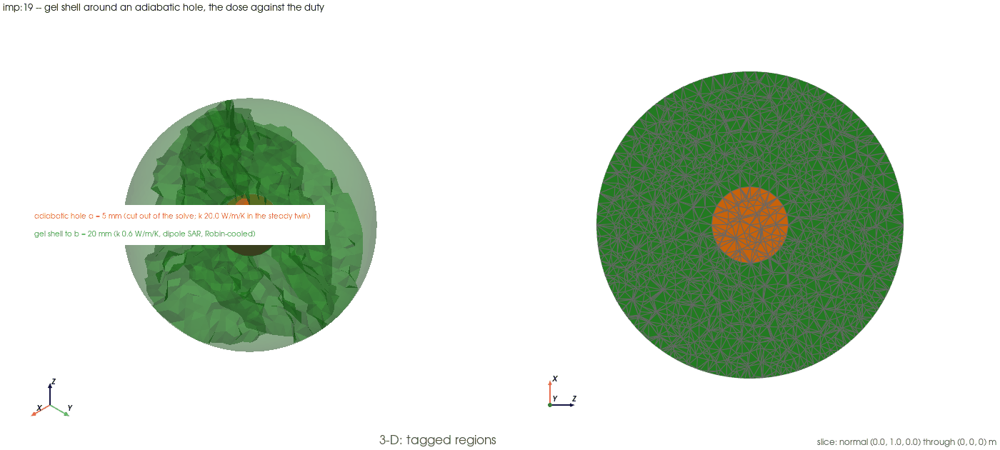

# `-e imp:19` — the dose around the implant hole against the duty cycle

Guide for `examples/implants/19_implant_dose_against_duty.py`. Written to be followed
without the source open.

## 1. What this demonstrates

`imp:18` reads the CEM43 dose and the six-minute window at one duty, D = 0.5. This
example asks what **the drive** does: the same adiabatic hole in the same Robin-cooled
gel shell, and the same *mean* power delivered at different duties, D = 1, 0.5 and
0.25. It reads two points on the z axis: the **pole** (1.05 a, 0.25 mm off the hole
wall) and **mid** (the shell's mid-radius, (a + b)/2 = 12.5 mm).

It runs in two halves:

- **The closed-form matrix** (`IMP-7` step 10, `I49`): the hollow-sphere duty-cycle
  series on the 161-point grid at D = 1, 0.5, 0.25, at the two points, at two source
  scales. The *peak* scale keeps the fixture's peak power (so the mean power falls as
  D); the *equal-mean* scale multiplies θ by 1/D (so the mean power is the same at
  every duty). Twelve cells.
- **The FEM at D = 0.25** (`IMP-7` step 11, `I50`): `imp:18`'s run again — curved
  `LADDER[0]` (P2), Crank–Nicolson with two backward-Euler start-up half-steps,
  Δt = t\*/40, 160 steps to 4 t\* = 1254 s, 161 snapshots read at both points — but
  under the 25 % duty source (on-phase 5 Δt of a 20 Δt period).

The gates on a history are `imp:18`'s, so the first-reading explanation holds:
**(Q)** the `cem43` dose equals an independent adaptive quadrature of the same
piecewise-linear history to `DOSE_BAR`; **(Win)** the maximum six-minute running mean
equals an independent quadrature of the window mean to `AVG_BAR`, `t_max` at least one
window in and the maximum bracketed by the history inside the window. **These are
identities of those functions on a history, not a claim about the FEM's dose accuracy.**
The FEM's accuracy enters only through (T).

**Why the equal-mean dose rises slightly as the duty falls.** CEM43 integrates
R^(T − 43) with R = 0.25 below 43 °C, i.e. 4^(T − 43): a *convex* function of the
temperature. At equal mean power a pulsed source swings the temperature about the same
mean, and the convex dose gains from the swing more than it loses on the troughs. At the
pole the equal-mean dose reads 2.598306e-11 s (D = 1), 2.637229e-11 s (D = 0.5) and
2.657487e-11 s (D = 0.25): a rise of 1.5 % and then 0.8 %. The six-minute peak at equal
mean power is nearly flat for the same reason (0.355655, 0.359558, 0.362915 K).

**Why the six-minute peak falls on the peak scale, and what the equal-mean scale
compares.** On the peak scale the source amplitude is fixed, so the mean power is D
times as large and the temperature rise falls with D: the pole's six-minute peak is
0.355655, 0.179779, 0.090729 K and its dose 2.598306, 2.163760, 1.966077e-11 s. That is
the *hardware* question — the same transmitter, switched on less often. The equal-mean
scale (θ/D) holds the delivered mean power fixed, so what it compares is only the
*shape* of the drive in time. The two scales answer different questions; neither is a
recommended duty.

**What the numbers do not mean.** The doses are ≈ 1e-11 s at the fixture's source scale,
an identity on a history and **not a thermal-damage statement**; the temperature never
exceeds 20.5 °C. The fixture has no metal core, no coil and no tissue. One mesh and one
Δt give a reading, **not a rate**.

**Controls, all asserted:**

- **(c-R)** swapping the two rate constants moves the dose by ≈ 7e+06 on every cell
  (the bar is `DOSE_BAR`);
- **(c-cont)** the continuous-source series compared with the D = 0.25 FEM at 4 t\*
  misses by 0.78 (interior rel L2), 78× `INTERIOR_BAND`;
- **(c-50)** the D = 0.5 series compared with the D = 0.25 FEM misses by 0.52, 52×
  `INTERIOR_BAND` — the duty is resolved, not just the presence of pulsing.

**Every band, grid and helper is imported by name** from the gate modules
(`test_imp7_duty25_dose_fem`, `test_imp7_duty_matrix_closed_form`,
`test_imp7_duty_dose_fem`, `test_imp7_duty_dose_closed_form`, `test_imp7_duty_cycle_fem`,
`test_imp7_transient_fem` and the modules those take `E_BAND`, `INTERIOR_BAND`, `W_B2`,
`T_REF` from), never restated. Disclosed local pieces: the gate's `fem_dose` fixture is a
pytest fixture and is not imported, so its body is written out in `main()`; `_err_c`
uses `ufl.inner(d, d)` and takes the real part (as `imp:17` and `imp:18` do); every
integral, norm and series value is passed through `np.real` in this complex build.

## Setup figure



`examples/implants/figures/implants_19_implant_dose_against_duty_setup.png`. The shell
(tag 2) is translucent so the 5 mm core region (tag 1) shows through; the right panel
slices at y = 0. The figure is rendered from the **affine** mesh of the same rung, as
`imp:17`'s and `imp:18`'s are; the solve meshes the shell alone (the core region is cut
out, leaving the adiabatic hole) with a degree-2 coordinate element.

## 2. How to run it

```
./scripts/run_examples.sh -e imp:19 -n 4 -t 480
```

**Complex build required** — the `imp:` group sources it automatically. Tier: **heavy**;
186.2 s in-example, 190 s harness-wall at `-n 4`. In a scheduled session, emit with
`--dry-run` (logged as `20261101T223159Z_EX-168-dry-run.log`) and run the printed
command through `scripts/testing/run_and_log.sh`; set `FEM_EM_SETUP_FIGURES=1` in the
container command to regenerate the figure.

## 3. How to analyze it, step by step

Records below are from `20261101T223205Z_EX-168.log` (`-n 4`, complex build, flagged
run). The gate records are `IMP-7` steps 10 and 11's.

**Step 1 — the mesh and the solve.** Curved shell sub-mesh, 53 643 cells; build 2.6 s;
CN 67.6 s; 161 reads of two points 4.9 s; the matrix histories (3 duties × 160 series
evaluations × 2 points) 51.2 s.

**Step 2 — (E), (S0), validity, max T, asserted.** CN max balance 5.910e-12 against
`E_BAND` 1e-9; the census Σχ·dt = 313.5 s against the on-time 313.5 s, relative 0
against `S0_BAND` 1e-12; both points valid. Maximum temperature 20.124 / 20.077 °C
(pole / mid) at peak power and 20.496 / 20.308 °C at equal-mean power, all below
`T_REF` = 43 °C.

**Step 3 — (T) and the series controls, asserted.** Interior rel L2 at 4 t\* against the
D = 0.25 series: 7.3744e-05 (whole 7.0926e-05) against `INTERIOR_BAND` 1e-2; (c-cont)
7.7871e-01, (c-50) 5.1989e-01.

**Step 4 — (Q-hd) and (Win-hd) on the FEM history, asserted.** At each point and scale the
FEM dose equals the quadrature to ≤ 5.4e-16 relative (bar 1e-10) and the window maximum
equals its quadrature to ≤ 6.3e-16 (bar 1e-12), `t_max` inside [360 s, 1254 s], bracket
holds. Peak scale: pole 1.965912e-11 s, six-minute peak 0.090679 K at 1159.95 s; mid
1.914398e-11 s, 0.066580 K at 1183.46 s. The R swap misses by 7.9856e+06 / 8.0929e+06
(peak) and 6.8557e+06 / 7.2499e+06 (equal-mean).

**Step 5 — (Q-m) and (Win-m) on the matrix, asserted.** All 12 cells meet `DOSE_BAR` and
`AVG_BAR` (worst 1.1e-15 and 6.2e-16) with every maximum below `T_REF`.

**Step 6 — the matrix, printed only.**

| D | point | D(peak) (s) | D(equal mean) (s) | six-minute peak, peak scale (K) | six-minute peak, equal mean (K) | cap `INTERIOR_BAND`·max θ_s (K) |
|---|---|---|---|---|---|---|
| 1 | pole | 2.598306e-11 | 2.598306e-11 | 0.355655 | 0.355655 | 3.6878e-03 |
| 1 | mid | 2.342155e-11 | 2.342155e-11 | 0.263963 | 0.263963 | 2.7408e-03 |
| 0.5 | pole | 2.163760e-11 | 2.637229e-11 | 0.179779 | 0.359558 | 2.1490e-03 |
| 0.5 | mid | 2.052262e-11 | 2.368667e-11 | 0.132976 | 0.265952 | 1.4877e-03 |
| 0.25 | pole | 1.966077e-11 | 2.657487e-11 | 0.090729 | 0.362915 | 1.2410e-03 |
| 0.25 | mid | 1.914405e-11 | 2.380887e-11 | 0.066578 | 0.266313 | 7.7009e-04 |

**Step 7 — the FEM against the series at D = 0.25, printed only.** Pole: dose 1.965912e-11
vs 1.966077e-11 s (rel 8.403e-05; equal-mean 3.392e-04), max\|Δθ\| 1.285e-03 K. Mid: dose
rel 4.072e-06 (equal-mean 1.462e-05), max\|Δθ\| 2.627e-05 K. No dose band exists on this
fixture and this example implies none. For the pole the max\|Δθ\| is 0.966 of the cap
`INTERIOR_BAND`·max θ_s — a reading of `IMP-7`'s (Bd)(ii), not a gate; the cap shrinks with
D while the start-up error does not.

**Step 8 — open it in ParaView.**
`File → Open → examples/implants/paraview_output/implants_19_implant_dose_against_duty_combined.xdmf`.
Colour by `theta_fem_d025_4tstar` and `theta_series_d025_4tstar` (rise above T∞ at 4 t\*
under D = 0.25, K) and `error_d025_4tstar` (pointwise absolute error); all are P2
Lagrange on the curved mesh.

**Step 9 — what a deviation means.** A reading off the gate's record is an example/test
divergence — report it, do not move a band. The only difference from the gate's printed
records is (E), 5.910e-12 here against 5.794e-12 (real build), a last-digit difference at
the 1e-12 rounding level.

## Related

- The gates: `tests/validation/test_imp7_duty25_dose_fem.py` (`IMP-7` step 11) and
  `tests/validation/test_imp7_duty_matrix_closed_form.py` (`IMP-7` step 10).
- `examples/implants/17_implant_heating_transient_duty.py` (`imp:17`, the temperature
  history) and `examples/implants/18_implant_thermal_dose.py` (`imp:18`, the dose at
  D = 0.5).
- `examples/materials/17_*` (`mat:17`): the gel-only dose example.
