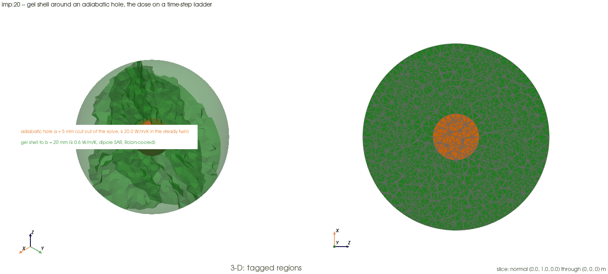

# `-e imp:20` — the dose gap around the implant hole on a time-step ladder

Guide for `examples/implants/20_implant_dose_time_step_ladder.py`. Written to be followed
without the source open.

## 1. What this demonstrates

`imp:19` reads the CEM43 dose of the FEM history at one time step. This example refines the
step on **one mesh** and reads the same quantity at each: the curved `LADDER[0]` (P2)
Robin-cooled gel shell around the adiabatic hole (53 643 cells), Crank–Nicolson with two
backward-Euler start-up half-steps, under the D = 0.5 duty source, at Δt = `DT`,
`DT` / 2 and `DT` / 4 (`DT` = t\*/40 = 7.8375 s; 160, 320 and 640 steps to 4 t\* = 1254 s).
Every run is read at the **same 161 rows of `T_GRID`** (every 1st, 2nd and 4th step) at
three points on the axes: the **pole** (1.05 a on z, 0.25 mm off the hole wall), the
**equator** (1.05 a on x) and the **outer pole** (0.95 b on z). The comparand is the
hollow-sphere duty series at `N_DEFAULT` modes.

The point of a ladder is to learn whether a residual is the time step. The table below
answers that at this mesh and nothing wider.

**Gates, asserted on each of the three runs** (bands imported, collected first, asserted
after all three have run):

- **(T)** interior relative L2 of the final temperature against the series at 4 t\* is at
  most `INTERIOR_BAND`;
- **(E)** the Crank–Nicolson balance residual is at most `E_BAND`;
- **(S0)** the on-time census is within `S0_BAND`;
- **(Grid)** the run's read times equal `T_GRID` to `GRID_BAR`;
- every point is valid, and the maximum temperature at both source scales is below
  `T_REF`.

**Control, asserted:** **(c-cont)** the *continuous-source* series compared with the pulsed
FEM at 4 t\* misses by more than `INTERIOR_BAND` on every run (0.54, 54 × the band), so a
pulsed history is resolved, not just a smooth one.

**What the numbers do not mean.** The doses are ≈ 1e-11 s at the fixture's source scale,
an identity on a history and **not a thermal-damage statement**; the temperature never
exceeds 20.43 °C. The fixture has no metal core, no coil and no tissue. One mesh and three
steps give a reading, **not a rate**: no rate, band or converged dose is claimed here.

**Every band, grid and helper is imported by name** from the gate modules
(`test_imp7_duty_dose_ladder`, `test_imp7_duty_dose_both`, `test_imp7_duty_dose_closed_form`,
`test_imp7_duty_dose_fem`, `test_imp7_duty_cycle_fem`, `test_imp7_transient_fem` and the
modules those take `E_BAND` and `INTERIOR_BAND` from), never restated. Disclosed local
pieces: the gates' `run` fixtures are pytest fixtures and are not imported, so their body
(one function, called once per Δt) is written out; `_err_c` uses `ufl.inner(d, d)` and
takes the real part (as `imp:17` – `imp:19` do), and every integral and norm is passed
through `np.real` in this complex build.

## Setup figure



`examples/implants/figures/implants_20_implant_dose_time_step_ladder_setup.png`. The shell
(tag 2) is translucent so the 5 mm core region (tag 1) shows through; the right panel
slices at y = 0. The figure is rendered from the **affine** mesh of the same rung, as
`imp:17`–`imp:19`'s are; the solve meshes the shell alone (the core region is cut out,
leaving the adiabatic hole) with a degree-2 coordinate element.

## 2. How to run it

```
./scripts/run_examples.sh -e imp:20 -n 4 -t 560
```

**Complex build required** — the `imp:` group sources it automatically. Tier: **heavy**;
the flagged window ran 488.8 s in-example (491 s harness-wall) at `-n 4`, of which the
three Crank–Nicolson solves are 65.5 / 102.7 / 176.0 s. In a scheduled session, emit with
`--dry-run` and run the printed command through `scripts/testing/run_and_log.sh`; set
`FEM_EM_SETUP_FIGURES=1` in the container command to regenerate the figure.

## 3. How to analyze it, step by step

Digits below are from the flagged window `20261102T122428Z_EX-174-figure.log` (`-n 4`,
complex build); the closing window's digits are the closing log's. The gate records are
`IMP-7` step 9's (item 710) and step 15's (item 745,
`20261102T015038Z_IMP-7-step15-W1.log`).

**Step 1 — the series.** The duty history on the 161 rows × 3 points: 19.5 s.

**Step 2 — the three runs.** Mesh 53 643 cells each (2.6 s build). Δt = `DT`: CN 65.5 s;
`DT` / 2: 102.7 s; `DT` / 4: 176.0 s. Each reads 161 batches of three points (4.2–4.5 s),
all points valid, (Grid) 0 and (S0) 0 (the on-time census 627.000000000 s exactly).

**Step 3 — (E), (T), (c-cont), asserted.** (E) is 5.9e-12, 1.2e-11 and 2.4e-11 on the three
runs against `E_BAND` = 1e-9: a round-off-level residual, quoted here as a figure from
this window and bounded by the band, not a number to compare across builds (the step 15
gate's real-build 2.386e-11 differs from this complex-build 2.388e-11 in the last digit).
(T) interior rel L2 at 4 t\*: 9.0012e-05 (`DT`), 8.4187e-05 (`DT` / 2), 8.3973e-05
(`DT` / 4), each against `INTERIOR_BAND` 1e-2; the `DT` / 4 value equals step 15's to the
printed digits. (c-cont) 5.3906e-01 on all three. Maximum temperature 20.2148 / 20.1565 /
20.0866 °C (peak scale, pole / equator / outer pole, `DT`) and 20.4296 / 20.3130 /
20.1733 °C at equal-mean scale, all below `T_REF` = 43 °C.

**Step 4 — the table, printed only, no band.** Dose gap = |FEM CEM43 / series CEM43 − 1|
on the same 161 rows; "equal mean" is the θ/D scale; the six-minute peak Δ is the FEM
minus the series maximum six-minute running mean (K); max\_n |Δθ| is the largest pointwise
FEM–series temperature difference over the rows (K).

| point | run | peak-scale dose rel | equal-mean dose rel | six-minute peak Δ (K) | max\_n \|Δθ\| (K) |
|---|---|---|---|---|---|
| pole | `DT` | 1.245e-04 | 2.481e-04 | −8.242e-05 | 1.285e-03 |
| pole | `DT` / 2 | 9.462e-05 | 1.903e-04 | −6.774e-05 | 3.413e-04 |
| pole | `DT` / 4 | 8.917e-05 | 1.806e-04 | −6.717e-05 | 1.867e-04 |
| equator | `DT` | 1.795e-05 | 3.556e-05 | −7.155e-06 | 2.181e-04 |
| equator | `DT` / 2 | 1.732e-05 | 3.412e-05 | −7.082e-06 | 3.889e-05 |
| equator | `DT` / 4 | 1.701e-05 | 3.344e-05 | −7.063e-06 | 3.812e-05 |
| outer pole | `DT` | 2.605e-06 | 4.630e-06 | +4.165e-06 | 6.484e-05 |
| outer pole | `DT` / 2 | 2.484e-06 | 5.219e-06 | +4.917e-06 | 1.697e-05 |
| outer pole | `DT` / 4 | 3.774e-06 | 7.724e-06 | +5.154e-06 | 8.618e-06 |

The `DT` and `DT` / 2 rows equal the gate records (`ITEM_700`, `ITEM_710_DT`) at every
printed digit — the script prints that comparison beside each — and the `DT` / 4 rows
equal step 15's log lines.

**Step 5 — what the table shows at this one mesh.**

- **The pole's gap stops shrinking.** The peak-scale dose gap at the pole falls from
  1.245e-04 to 9.462e-05 to 8.917e-05 as Δt halves twice: a drop of 3.0e-05 and then of
  5.5e-06. Halving Δt a second time moved it under a fifth as far as the first halving did,
  and it is still 8.9e-05, not near zero. The same holds for the equal-mean dose (2.481e-04,
  1.903e-04, 1.806e-04) and the six-minute peak Δ (−8.242e-05, −6.774e-05, −6.717e-05 K).
- **max\_n |Δθ| follows Δt.** At the pole it is 1.285e-03, 3.413e-04, 1.867e-04 K: 3.8×
  and then 1.8× smaller. At the equator 2.181e-04, 3.889e-05, 3.812e-05 K and at the outer
  pole 6.484e-05, 1.697e-05, 8.618e-06 K.
- **The outer pole's dose gap does not follow the others**: 2.605e-06, 2.484e-06 and then
  3.774e-06 — larger at `DT` / 4 than at `DT`. Its max\_n |Δθ| still falls.

So at this mesh the temperature difference between FEM and series falls with Δt, while
the pole's dose gap has nearly stopped moving, at ≈ 8.9e-05. **This guide names no cause for that gap:**
none is established here, and a ladder on one mesh cannot separate the candidates. No
rate is read from three points.

**Step 6 — the comparand's own floor.** The series is evaluated at `N_DEFAULT` modes.
`IMP-7` step 14 (item 752, `20261102T103036Z_IMP-7-step14-W1.log`) measured the series'
own dose against its mode count: the pole's dose at 800 modes equals the 200-mode value
(relative difference 0 against a 1e-12 band), and truncating to 8 modes moves it by
6.6e-08, which is three orders below the `DT` / 4 pole gap of 8.9e-05. The Q and window
identities of that window hold to ≤ 8e-16 on every row, a round-off bound from that window, not a claim
about the dose. Against the pole's gap of 8.9e-05, the series' mode count is a term three
orders smaller.

**Step 7 — open it in ParaView.**
`File → Open → examples/implants/paraview_output/implants_20_implant_dose_time_step_ladder_combined.xdmf`.
Colour by `theta_fem_dt4_4tstar` (rise above T∞ at 4 t\* on the finest Δt, K, P2 Lagrange
on the curved shell mesh).

**Step 8 — what a deviation means.** A reading off the gate records is an example/test
divergence — report it, do not move a band. The only difference from the gate's printed
records is in (E)'s trailing digits, the real-vs-complex rounding level.

## Related

- The gates: `tests/validation/test_imp7_duty_dose_ladder.py` (`IMP-7` step 9),
  `tests/validation/test_imp7_duty_dose_quarter_dt.py` (`IMP-7` step 15).
- `examples/implants/18_implant_thermal_dose.py` (`imp:18`, the dose at one Δt),
  `examples/implants/19_implant_dose_against_duty.py` (`imp:19`, the dose against the
  duty).
