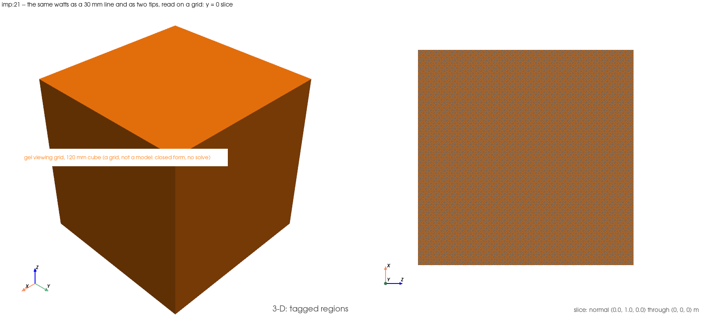

# `-e imp:21` — the same watts on a rod as a line and as two tips

Guide for `examples/implants/21_rod_line_and_tip_sources.py`. Written to be followed
without the source open.

## 1. What this demonstrates

**This is a closed form on a viewing grid: no FEM, no solve, no wall, no rod heat capacity,
and neither shape is claimed to be a real rod's.** `IMP-8` steps 0 and 1 (items 759 and 760,
`tests/validation/test_imp8_rod_line_source_closed_form.py`) give the temperature rise θ in
an infinite gel medium, per watt of total power, from two ways of spreading the same power
over a 30 mm rod (`ROD_LENGTH`): uniformly along its length (the *line*), or in two equal
halves at its two ends (the *tips*). This example evaluates both at t = `T_PRINT` = 900 s on
the vertices of a 120 mm cube, 41 cells per axis (413 526 tetrahedra, 74 088 P1 vertices),
and compares them. The count is odd on a symmetric box, so no vertex lies on the line: the
nearest vertex to it is at r = 2.0696 mm, outside the 1 mm `ROD_RADIUS`, and that is asserted.

- `theta_line` = Φ / (4πkL), Φ by the gate's midpoint sum on `N_FIELD` = 64 points,
  written with the imported `_point` so it broadcasts over the vertices (the gate's
  `_phi_midpoint` is scalar).
- `theta_tips` = Φ₂ / (4πkL), from the imported `_phi_tips`.
- `ratio` = `theta_tips` / `theta_line`.

**Gates, asserted** (bands imported by name, collected first, then asserted; the
digits below are the flagged window `20261103T014225Z_EX-178-figure.log`, `-n 2`, complex
build; the closing window's log is the run of record):

- **(Geom)** the minimum r over the grid's vertices, 2.0696 mm, exceeds `ROD_RADIUS`.
- **(Rate)** the midpoint-sum slope on `RATE_LADDER` at `RATE_POINT` (20, 0) mm: 2.0047
  inside [`RATE_LO`, `RATE_HI`] = [1.95, 2.05]. **That band is item 760's and provisional.**
- **(Far2)** `_far2_miss()` = 1.871e-06 against its bound `FAR2_A`⁴ = 1e-4, and the
  steady gap Φ∞ − Φ₂∞ = 8.3146e-05 is positive.
- **(Node)** at the vertex nearest (20, 0, 0) mm, the grid arrays equal the gate's scalar
  forms (`_phi_midpoint`, `_phi_tips`) to `B1_BAND` = 1e-12: both gaps print 0.000e+00. The
  vertex is (19.0244, 1.4634, 1.4634) mm, so r ≈ 19.08 mm and z ≈ 1.46 mm there; the test
  pins the broadcast form to the scalar one at that vertex.
- max |Im θ| = 0 (≤ 1e-12), the complex build's check.

**Controls, asserted:**

- **(c-one)** `_far2_miss(signs=(1.0,))`, one tip dropped, misses by 4.994e-01 against the
  bound 1e-4 (the gate records 0.4994).
- **(c-field)** at the vertex nearest (0, 0, 15) mm, (−1.4634, 1.4634, 16.0976) mm,
  dropping the tip nearest it (the +L/2 one) moves `theta_tips` by 9.9556e-01, against
  `B1_BAND` 1e-12. Dropping the other tip moves it by 4.4443e-03 there (printed, not
  asserted).

**Printed only, no band.**

| quantity | value |
|---|---|
| Φ₂ / Φ at (r, z) = (2, 15) mm | 3.179482 (item 760's record: 3.179482) |
| Φ₂ / Φ at (2, 0) mm | 0.1714577 (item 760's record: 0.1714577) |
| min, max of `ratio` on the grid | 0.179298, 3.44965 |
| ρc ∫ θ dV per watt, line | 896.5456 J/W (0.99616 of 900 J/W) |
| ρc ∫ θ dV per watt, tips | 895.9059 J/W (0.99545 of 900 J/W) |

The two shapes agree where the field is far from the rod: item 760's far-field gate has
the steady gap Φ∞ − Φ₂∞ at L / r = 0.1 equal to a²/12 of a = L / r to 1.871e-06 (a²/12 =
8.3333e-04; the measured gap over a is 8.3146e-04, and 8.3333e-04 − 8.3146e-04 =
1.87e-06). They differ most near the rod: at r = 2 mm the tips' Φ₂ is 3.18 times the line's Φ at z = 15 mm, beside a tip, and
0.171 times it at z = 0, mid-length; on the grid the ratio's extremes are 0.179 and 3.45.

**What the numbers do not mean.** The energy integral is a reading with no band: the
shapes come out 0.38 % and 0.46 % low of 900 J per watt, and the guide does not separate leakage past
the 120 mm box from P1 interpolation of the near-line field, because nobody has computed
how much each contributes. The ratio's extremes sit at the grid's vertices, not at the
line. Neither shape is claimed to be a real rod's: a real rod has a radius, a heat
capacity and a coating, none of which is in this closed form. No F2182 figure, no wall
effect, no rod SAR shape and no FEM half of `IMP-8` is claimed.

**Every band, constant and helper is imported by name** from the gate module
(`B1_BAND`, `FAR2_A`, `K_GEL`, `L`, `MM`, `RATE_HI`, `RATE_LO`, `RATE_LADDER`,
`RATE_POINT`, `RHO_C`, `T_PRINT`, `_far2_miss`, `_phi`, `_phi_midpoint`, `_phi_tips`,
`_point`), plus `ROD_RADIUS` from `tests/mesh/test_birdcage_implant_rod.py` and `_max_imag`
from `tests/validation/test_mat15_finite_cylinder_fem.py`; none is restated. Disclosed
local pieces: `theta_line` is the gate's midpoint sum written for arrays; the gates' test
bodies for (Rate), (Far2) and (c-one) are written out, since test functions are not
imported.

## Setup figure



`examples/implants/figures/implants_21_rod_line_and_tip_sources_setup.png`. The figure
shows the 120 mm cube grid (one region), with the slice at y = 0, the plane through the
line's axis. The rod and its two shapes are not in the mesh: they are the closed form
evaluated on the grid's vertices.

## 2. How to run it

```
./scripts/run_examples.sh -e imp:21 -n 2 -t 180
```

**Complex build required** — the `imp:` group sources it automatically. Tier: **standard**;
the flagged window, figure included, ran 6.1 s in-example (9 s harness-wall) at `-n 2`,
and the first unflagged window `20261103T014315Z_EX-178.log` took 1.2 s (3 s). In a scheduled session, emit with
`--dry-run` and run the printed command through `scripts/testing/run_and_log.sh`; set
`FEM_EM_SETUP_FIGURES=1` in the container command to regenerate the figure.

## 3. How to analyze it, step by step

**Step 1 — the grid.** `create_box` on ±60 mm, 41 cells per axis. Vertices lie at
−60 + 120 i / 41 mm, so the vertex nearest an axis is at ±1.4634 mm in x and in y, giving
r = 2.0696 mm (= 1.4634 √2; 2.0696 mm > 1 mm, asserted).

**Step 2 — the two fields.** Evaluate Φ (midpoint sum on 64 points) and Φ₂ at every
vertex at 900 s, divide by 4πkL. Written to P1 functions as real values; max |Im θ| = 0.

**Step 3 — the gates.** Read the list in section 1. (Rate)'s relative errors on
`RATE_LADDER` = (4, 8, 16, 32) are 8.929e-03, 2.215e-03, 5.527e-04, 1.381e-04, each
about a quarter of the last: the second-order slope 2.0047 of item 760.

**Step 4 — the energy.** ρc ∫ θ dV over the cube, per watt: 896.5456 J/W (line) and
895.9059 J/W (tips), 0.99616 and 0.99545 of 900 J/W. Both are low and the two are not
separated here (leakage past the box, P1 on the near-line field): a reading only.

**Step 5 — open it in ParaView.**
`File → Open → examples/implants/paraview_output/implants_21_rod_line_and_tip_sources_combined.xdmf`.
Colour by `theta_line_per_watt`, `theta_tips_per_watt` (K per watt of total power, P1) or
`ratio_tips_over_line`.

**Step 6 — what a deviation means.** A reading off the gate records is an example/test
divergence — report it, do not move a band.

## Related

- The gate: `tests/validation/test_imp8_rod_line_source_closed_form.py` (`IMP-8`
  steps 0 and 1, items 759 and 760).
- `examples/implants/17_implant_heating_transient_duty.py` (`imp:17`),
  `examples/implants/20_implant_dose_time_step_ladder.py` (`imp:20`).
