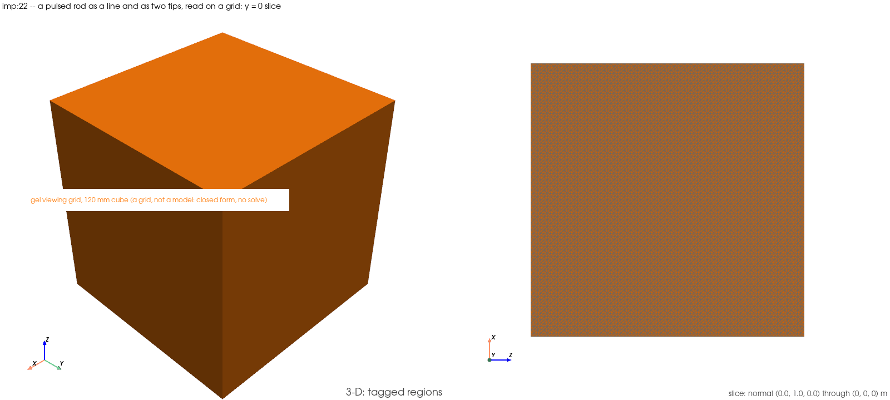

# `-e imp:22` — a rod under a duty cycle, as a line and as two tips: the six-minute window and the dose

Guide for `examples/implants/22_rod_duty_cycle_window_and_dose.py`. Written to be followed
without the source open.

## 1. What this demonstrates

**This is a closed form: an infinite gel medium, no wall, no rod heat capacity, no FEM, no
solve, and neither shape is claimed to be a real rod's.** `IMP-8` step 4 (item 787,
`tests/validation/test_imp8_rod_line_source_duty_closed_form.py`) and step 7 (item 811,
`tests/validation/test_imp8_rod_tips_duty_closed_form.py`) give the temperature rise θ, per
watt of total power, from a pulsed source of period `PERIOD` = 450 s read to `T_STAR` = 900 s,
at duties D = 1, 0.5 and 0.25, for two ways of spreading the power over a 30 mm rod: uniformly
along its length (the *line*) or in two equal halves at its two ends (the *tips*). The history
is Duhamel's sum of step responses at the switch instants. The example reads both histories
at (r, z) = (2, 15) and (10, 0) mm, runs the gates' checks on them, prints the six-minute
maximum and CEM43 for the two shapes at (2, 15) mm, and evaluates both shapes at t\* under
D = 0.5 on the vertices of `imp:21`'s viewing grid (120 mm cube, 41 cells per axis, 413 526
tetrahedra, 74 088 P1 vertices).

**Gates, asserted** (bands imported by name, collected first, then asserted; the digits
below are the flagged window `20261104T180603Z_EX-181-figure.log`, `-n 2`, complex build; the
closing window's log is the run of record and prints the same):

- **(D1)** the D = 1 sum equals the step response within `D1_BAND` = 1e-13 of θ_ss, on both
  kernels at both points: line 0.000e+00 / 0.000e+00, tips 0.000e+00 / 3.018e-17.
- **(Duh)** the step sum equals the impulse-kernel convolution within `DUH_BAND` = 1e-10 of
  θ_ss, both kernels, both points, three duties: worst 2.952e-16 (line), 2.951e-16 (tips).
- **(Q-d)** `_q_check_g` within `DOSE_BAR` = 1e-10: worst 4.042e-16 (line), 2.052e-16 (tips).
  **(Win-d)** `_win_check_g` within `AVG_BAR` = 1e-12: worst 5.720e-16 (line), 3.987e-16
  (tips). The temperature scale is each module's own: **the line at 1 W (item 787), the tips
  at `P_DOSE_W` = 0.5 W (item 811's ruling)**. Max T over every case is below 43 °C, the
  precondition `_q_check_g`'s quadrature needs: 29.43848 °C (line), 35.00473 °C (tips). The
  precondition is not moved.
- **Reproduction control:** θ(t\*) at both points and three duties, both kernels (twelve
  values), against the `.9e` prints of the two items' logs (`20261103T211919Z_IMP-8-item787-W1.log`
  `:54–59`, `20261104T103134Z_IMP-8-item811-W1.log` `:55–60`): worst relative gap 3.413e-10,
  inside the brief's 1e-9. That bound is set by the prints: a `.9e` print of a value with
  leading digit 1 has a half-ulp of up to 5e-10 relative (the worst case here, 1.004369893e+00),
  and 3.413e-10 is under that.
- **(c-cont), asserted at factor 1:** the continuous form (D = 1) misses the D = 0.5 history
  at t\* by more than `INTERIOR_BAND` = 1e-2: least over the two points 1.0722 (line) and
  0.69531 (tips), against 1e-2.
- **(Node)** at the vertex nearest (20, 0, 0) mm, (19.0244, 1.4634, 1.4634) mm, the grid
  arrays equal the scalar forms (`_phi_midpoint` through the imported `_duhamel` for the line;
  `_phi_tips` for the tips) to `B1_BAND` = 1e-12: both gaps print 0.000e+00. Both sides run
  the same arithmetic at that vertex, so this pins the broadcast form to the scalar one and
  adds nothing more.
- **(Geom)** the minimum r over the grid's vertices, 2.0696 mm, exceeds `ROD_RADIUS` = 1 mm.
- max |Im θ| = 0 (≤ 1e-12), the complex build's check.

**Printed only, no band.** At (2, 15) mm, 1 mm off the rod's surface, where the FEM is not
gated (see below). Six-minute maximum is per watt for both shapes; CEM43 is at 1 W for the line
and 0.5 W for the tips, so **the two doses are at different powers and no dose ratio is
printed or claimed.**

| D | line θ(t\*) K/W | tips θ(t\*) K/W | tips / line θ(t\*) | line six-min max K/W | tips six-min max K/W | line CEM43 s (1 W) | tips CEM43 s (0.5 W) |
|---|---|---|---|---|---|---|---|
| 1 | 9.438477 | 30.00947 | 3.179482 | 8.948814 | 29.54154 | 1.572e-06 | 0.005531 |
| 0.5 | 2.096145 | 2.474674 | 1.180583 | 5.135368 | 17.81965 | 3.548e-08 | 0.0002972 |
| 0.25 | 0.8986021 | 0.9807666 | 1.091436 | 2.656731 | 9.05116 | 1.816e-09 | 1.651e-05 |

The six-minute maxima and CEM43 values equal item 787's and item 811's printed records at 7
digits (the run prints them side by side). At (10, 0) mm, θ(t\*) is, line and tips in K/W:
4.645356 and 1.92792 (D = 1), 2.241722 and 1.13721 (D = 0.5), 1.00437 and 0.5680058
(D = 0.25).

**What the numbers say, and what they do not.**

- At t\* = 900 s the D = 0.5 source has been off for 225 s (switches at 0+, 225−, 450+, 675−)
  and the D = 0.25 source for 337.5 s (0+, 112.5−, 450+, 562.5−), so θ(t\*) is a decayed
  value, far below the six-minute maximum. At (2, 15) mm the tips' six-minute maximum divided
  by the line's (both per watt) is 29.54154 / 8.948814 ≈ 3.30 at D = 1, 17.81965 / 5.135368 ≈ 3.47 at
  D = 0.5 and 9.05116 / 2.656731 ≈ 3.41 at D = 0.25, while the θ(t\*) ratio falls from 3.18 to 1.18 and 1.09.
  So the θ(t\*) ratio understates how much hotter the tips' window is there: a reading, not
  a mechanism claim.
- On the grid at D = 0.5, t\*, θ tips / θ line has minimum 0.4903546 and maximum 3.243214, at
  grid vertices (not on the line).
- At (10, 0) mm, mid-length and 10 mm out, the tips' θ(t\*) is below the line's at every
  duty (tips / line 0.415 at D = 1 by item 811's log, 1.13721 / 2.241722 ≈ 0.507 at D = 0.5,
  0.5680058 / 1.00437 ≈ 0.566 at D = 0.25).
- Neither shape is claimed to be a real rod's: a real rod has a radius, a heat capacity and a
  coating, none of which is in this closed form. No wall, no dose comparison across the two
  powers, and no recommended duty is claimed.
- **The FEM twins exist as records** (I60 for the line, I63 for the tips, both ≤ 4.4e-3
  against 1e-2 at r ≥ 10 mm). **r = 2 mm is 1 mm off the rod surface, where the FEM is not
  gated.**

**Every band, constant and helper is imported by name** from the gate modules and the modules
they import (`B1_BAND`, `L`, `MM`, `_phi_midpoint`, `_phi_tips`, `_point`, `DUTIES`, `POINTS`,
`T_GRID`, `T_STAR`, `_theta_step`, `_convolution`, `_hist`, `_theta_ss`, `P_DOSE_W`,
`_duhamel`, `_phi_tips_dot`, `_step`, `INTERIOR_BAND`, `T_INF`, `AVG_BAR`, `DOSE_BAR`,
`W_B2`, `_q_check_g`, `_win_check_g`, `D1_BAND`, `DUH_BAND`, `ROD_RADIUS`, `_max_imag`);
none is restated. Disclosed local pieces: the gates' test bodies (D1), (Duh), (Q-d),
(Win-d), (c-cont) are written out, since test functions are not importable; `_line_kernel` is
the line's midpoint sum on 64 points with the imported `_point`, written so it broadcasts
(`_phi_midpoint` is scalar), as `imp:21` does; the grid's Duhamel sum is the tips module's
`_duhamel`, which takes the kernel as an argument. The twelve log digits and the printed
records are copied from the two logs named above.

## Setup figure



`examples/implants/figures/implants_22_rod_duty_cycle_window_and_dose_setup.png`. The figure
shows the 120 mm cube grid (one region), with the slice at y = 0, the plane through the
line's axis. The rod and its two shapes are not in the mesh: they are the closed form
evaluated on the grid's vertices.

## 2. How to run it

```
./scripts/run_examples.sh -e imp:22 -n 2 -t 180
```

**Complex build required** — the `imp:` group sources it automatically. Tier: **standard**;
the flagged window, figure included, ran 6.5 s in-example (11 s harness-wall) at `-n 2`. In
a scheduled session, emit with `--dry-run` and run the printed command through
`scripts/testing/run_and_log.sh`; set `FEM_EM_SETUP_FIGURES=1` in the container command to
regenerate the figure.

## 3. How to analyze it, step by step

**Step 1 — the histories.** For each kernel, point and duty, θ(t) on `T_GRID` (41 points,
Δt = 22.5 s) is the Duhamel sum Σ s θ_step(t − tⱼ) over the switch instants before t.

**Step 2 — the gates.** Read the list in section 1: (D1), (Duh), (Q-d), (Win-d), the
reproduction control, (c-cont), then the grid's (Node) and (Geom).

**Step 3 — the reading.** Compare the six-minute maxima and CEM43 values per duty. The doses
are at different powers; compare θ and the six-minute window per watt only.

**Step 4 — open it in ParaView.**
`File → Open → examples/implants/paraview_output/implants_22_rod_duty_cycle_window_and_dose_combined.xdmf`.
Colour by `theta_line_per_watt`, `theta_tips_per_watt` (K per watt of total power at t\* = 900 s
under D = 0.5, P1) or `ratio_tips_over_line`.

**Step 5 — what a deviation means.** A reading off the gate records is an example/test
divergence — report it, do not move a band.

## Related

- The gates: `tests/validation/test_imp8_rod_line_source_duty_closed_form.py` (item 787) and
  `tests/validation/test_imp8_rod_tips_duty_closed_form.py` (item 811).
- `examples/implants/21_rod_line_and_tip_sources.py` (`imp:21`),
  `examples/implants/17_implant_heating_transient_duty.py` (`imp:17`),
  `examples/implants/19_implant_dose_against_duty.py` (`imp:19`).
