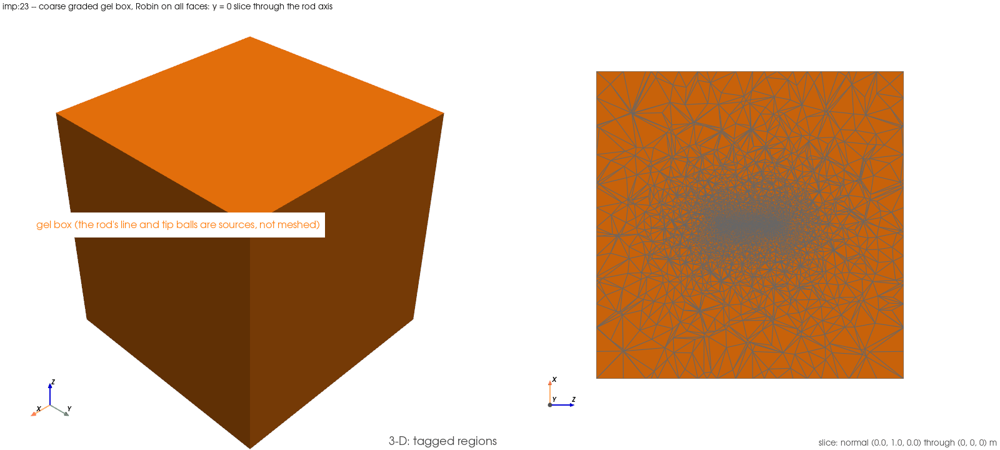

# `-e imp:23` — the rod's heat in FEM: the line source and its two-tip twin on a coarse box

Guide for `examples/implants/23_rod_line_source_fem_twin.py`. Written to be followed without
the source open.

## 1. What this demonstrates

**This is a demonstration on a mesh coarser than the gates' mesh.** `imp:21` / `imp:22` give
the finite line source and its two-tip twin in closed form in an infinite gel medium. Here the
same two sources are run in FEM, per watt (P = 1 W): a 0.20 m gel cube, Robin on all six faces
(`H_GEL`), degree 2, Crank-Nicolson with two backward-Euler half-steps, `N_MAIN` = 40 steps to
`T_PRINT` = 900 s, from θ₀ = 0. The line is a DG0 source on the cells whose midpoint has
r ≤ `ROD_RADIUS` = 1 mm and |z| ≤ 15 mm; the tips are two DG0 balls of radius 1 mm at z = ±15 mm,
P/2 each. The comparands are q′/(4πk)·Φ (`_phi`) and q′/(4πk)·Φ₂ (`_phi_tips`) of `IMP-8`
steps 1 and 3, read at `GATE_PTS` (r, z) = (10, 0), (20, 0), (10, 15), (20, 15) mm.

**The mesh.** The gates' graded box (`IMP-8` item 803) has 485 291 cells. Its three target
sizes are module constants, so `_coarse_box` is a **disclosed local copy** of its gmsh body with
`H_IN`, `H_MID`, `H_OUT` multiplied by `SIZE_SCALE`. The build-only window
`20261105T193505Z_EX-182-W0.log` read, at `-n 2`: scale 1.6 gives 122 448 cells (over the
120 000 limit), **1.8 gives 86 726**, 2.0 gives 64 140. Scale 1.8 is used. h within 3 mm of the
gate points is 3.744, 5.580, 3.821 and 5.304 mm, and 2.033 / 2.092 mm at (2, 0) / (2, 15) mm.

**Gates, asserted** (bands imported by name, collected first, then asserted; digits below are
the flagged window `20261105T194455Z_EX-182-figure.log`, `-n 2`, complex build; the closing
window's log is the run of record and prints the same):

- the cell count equals `W0_CELLS` = 86 726 and is ≤ 120 000;
- **(E)** ≤ `E_BAND` = 1e-9: line 2.209e-14, tips 2.365e-14;
- **(S0)** ≤ `B_BAND` = 1e-10: line 4.441e-16 (1 075 selected cells); tips balls
  −1.110e-16 (49 cells) and 0 (45 cells); the total 0;
- max |Im θ| ≤ 1e-12: 0;
- **(I)** at the four gate points, on both runs, ≤ `INTERIOR_BAND` = 1e-2. The flagged window
  read all four inside the band on both runs (line 3.578e-04, 1.045e-03, 8.730e-03, 7.490e-03;
  tips 4.585e-03, 4.999e-03, 6.810e-03, 5.986e-03), so (I) is asserted. The two points at 15 mm
  sit within 0.0013 of the band on the line; this is a coarse mesh and the margin there is
  thin.
- **(c-2L), asserted at factor 1:** the comparand with L → 2L misses the line at (10, 15) mm by
  8.1455e-02 > 1e-2 (the gates' mesh gave 7.517e-02, `20261103T182723Z_IMP-8-I55-W2-n8.log`).
- **(c-one), asserted at factor 1:** the one-ball comparand misses the tips at every gate point,
  least miss 1.0092 > 1e-2 (the gates' mesh gave 1.0045, `20261104T043245Z_IMP-8-I56-W1-item796.log`).

**Printed only, no band.** At (2, 15) mm, 1 mm off the rod surface, the FEM tips over line ratio
is Φ₂/Φ = 3.171874, beside the closed forms' 3.179482 and item 796's 3.186418 (its FEM tips over
the line's closed form). The two points at r = 2 mm are not gated: the line's relative miss to
its closed form there is 3.875e-03 at (2, 0) and 1.522e-02 at (2, 15) mm, the tips' 4.653e-03 and
1.279e-02. Timing at `-n 2`: t_build 2.5 s, line t_call 105.9 s and tips t_call 102.5 s, each with
`n_factorizations` 2, in-script total 214.7 s.

**Not claimed:** a rate, a wall, the rod's own heat capacity or entry 48's rod. The gated records
are `IMP-8` I55 / I56 on the gates' mesh; this run is not a gate on that mesh.

**Disclosed local pieces.** `_coarse_box` (above). `_rod_source` and `_tips_source` are local
copies of the gate helpers with `ufl.conj(w)` on the volume form: the gates' `one * w * ufl.dx`
is rejected by the complex build the `imp:` group sources (`ArityMismatch: Failure to conjugate
test function in complex Form`, `20261105T193522Z_EX-182-figure.log`), and `ufl.conj` is the
identity in real mode. Selection and normalisation are line for line the gates'; (S0) asserts
that. Everything else is imported by name: `E_BAND`, `B_BAND`, `INTERIOR_BAND`, `N_MAIN`,
`H_GEL`, `K_GEL`, `RHO_C`, `ROD_RADIUS`, `L`, `MM`, `T_PRINT`, `_phi`, `_phi_tips`,
`GATE_PTS`, `C2L_PT`, `QP`, `P`, `DEGREE`, `T_INF`, `H_IN`, `H_MID`, `H_OUT`, `D_IN0`, `D_IN1`,
`D_OUT1`, `HALF_WIDTH`, `AXIS_HALF`, `N_AXIS_PTS`, `SIGNS`, `_theta_pts`, `_h_near`,
`_cells_global`, `_max_imag`.

## Setup figure



`examples/implants/figures/implants_23_rod_line_source_fem_twin_setup.png`. The figure shows the
86 726-cell gel box (one region), sliced at y = 0, the plane through the rod's axis. The rod and
its tip balls are not separate regions: they are source cells inside the gel.

## 2. How to run it

```
./scripts/run_examples.sh -e imp:23 -n 2 -t 480
```

**Complex build required** — the `imp:` group sources it automatically. Tier: **heavy**; the
flagged window ran 217 s harness-wall at `-n 2`. In a scheduled session, emit with `--dry-run`
and run the printed command through `scripts/testing/run_and_log.sh`; set
`FEM_EM_SETUP_FIGURES=1` in the container command to regenerate the figure, and
`FEM_EM_IMP23_W0=1` for the build-only cell count at scales 1.6 / 1.8 / 2.0.

## 3. How to analyze it, step by step

**Step 1 — the mesh.** Read `[mesh] cells` against `W0_CELLS` and the h values at the points.

**Step 2 — the two runs.** `[line]` and `[tips]` print t_call, `n_factorizations`, (E) and (S0).

**Step 3 — the interior.** `[I]` prints θ_FEM, the comparand and the relative miss at six
points; the first four are gated. Read `[c-2L]` and `[c-one]`, then the `[record]` ratio.

**Step 4 — open it in ParaView.**
`File → Open → examples/implants/paraview_output/implants_23_rod_line_source_fem_twin_combined.xdmf`.
Colour by `theta_line_t_star`, `theta_tips_t_star` (K per watt at t\* = 900 s, P1) or
`ratio_tips_over_line`.

**Step 5 — what a deviation means.** A reading off the gate records is an example/test
divergence — report it, do not move a band.

## Related

- The gates: `tests/validation/test_imp8_rod_line_source_fem.py` (item 778 / 800 / 803) and
  `tests/validation/test_imp8_rod_tips_fem.py` (item 796).
- `examples/implants/21_rod_line_and_tip_sources.py` (`imp:21`),
  `examples/implants/22_rod_duty_cycle_window_and_dose.py` (`imp:22`).
