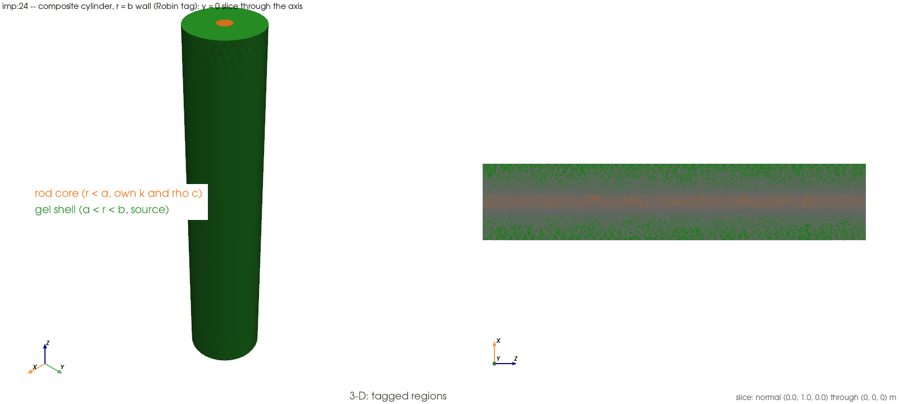

# `-e imp:24` — the rod's own heat capacity and conductivity: the composite cylinder, closed form and FEM

Guide for `examples/implants/24_rod_composite_cylinder_heat.py`. Written to be followed without
the source open.

## 1. What this demonstrates

**A demonstration of a material in the rod's place.** Every other `imp:` heating page
(`imp:15`, `imp:17`–`imp:23`) treats the implant as gel or as a hole. Here the rod is a core
0 < r < a with its own conductivity and volumetric heat capacity, in perfect contact with a gel
shell a < r < b: a = `A_ROD` = 1 mm, b = 5 mm. A uniform source `Q_SHELL` = 13 262.91 W/m³
(exactly 1 W per metre of rod) heats the **shell only**, switched on at t = 0; θ = 0 at r = b.
Results are in K per W/m. The core is a **nominal** titanium pair, `ROD_K` = 6.7 W/(m·K) and
`ROD_RHO_C` = 2.33018e6 J/(m³·K), taken from memory — **there is no source for it in the
repo**. The geometry is an infinite cylinder (FEM: length 10 b = 50 mm, insulated ends) with a
Dirichlet wall and a uniform shell source. No finite rod, no SAR shape, no titanium property is
claimed.

**Closed form.** `_theta` of `IMP-8` step 9 (item 843): the composite-region series of
Carslaw & Jaeger ch. XIII (cited from memory; the text is not in the repo), with the core's
`k_r`, `rhoc_r` as keywords. The three cores are Ti, a gel core (`k_r=K_GEL, rhoc_r=RHO_C`) and an
adiabatic hole. Characteristic times: t_c = a²/κ_gel = 6.966667 s and t\* = 5 t_c = 34.83333 s.

**FEM.** Item 837's construction (`IMP-8` step 10), written out in `main()` because the gate
module's fixtures are pytest fixtures. `_composite_cylinder` is imported, never copied: 53 504
curved-P2 cells (the gate's own count), core tag 1, shell tag 2, the r = b face the Robin tag,
end faces untagged. DG0 k, ρc and q through `_dg0`; one Crank–Nicolson run of N = 80 steps of
t\*/80 with two backward-Euler half-steps and a snapshot at step 16 (= t_c); one steady solve;
degree 2; the wall a near-Dirichlet Robin at `H_DIR` = 1e7 W/(m²·K), because the solver takes a
Robin wall only.

**Gates, asserted** (bands imported by name, collected first, then asserted; the digits below
are the flagged window `20261106T030934Z_EX-184-figure.log`, `-n 2`, complex build; the closing
window's log is the run of record and prints the same gated readings — the closing log is read
after this guide is final, and a digit that differs there makes the guide wrong, not the log):

- the cell count ≤ `CELL_CAP` (53 504 ≤ 250 000); coordinate degree 2; no NaN left in k, ρc, q;
- **(E)** ≤ `E_BAND` = 1e-9: 3.381e-13 (item 837: 3.382e-13);
- **(S0)** ∫q dx = `Q_SHELL`·V_shell,h within `B_BAND` = 1e-10: 2.776e-15, and ∫q dx over the
  core is exactly 0;
- **(I)** |θ_FEM/θ_cf − 1| ≤ `INTERIOR_BAND` = 1e-2 at (a, 0) and ((a+b)/2, 0) at t\* and at
  steady state: 2.225e-05, 6.017e-04, 1.324e-05, 2.373e-04 (worst 6.017e-04, item 837's record);
- **(I0)** the same at the axis (0, 0), t_c: 1.657e-03 (item 837: 1.657e-03);
- **closed form, re-asserted on the page**, through the module's helpers and `B1_BAND` = 1e-12:
  (St) the series at 50 b²/κ against θ_ss, worst 0; (Lim) the series with the core set to gel
  against the homogeneous Dirichlet J0 series, worst 3.625e-16 (item 843's record);
- **control, asserted at factor 1:** the k_r = `K_GEL` comparand (core conductivity only
  changed) at (0, t_c) is 1.5226983e-02 against θ_FEM 1.7542562e-02, a miss of 1.5207e-01
  > `INTERIOR_BAND` (item 837: 0.1521). The core's own capacity and conductivity are what the
  FEM resolves and a gel-valued core does not;
- max |Im θ| ≤ 1e-12: 0.

**Printed only, no band.** θ(r, t) in K per W/m at r = 0, a, (a+b)/2 for the three cores
(`[rec]` lines), beside θ_FEM for Ti. At r = a the ordering is hole > Ti > gel at t_c and at t\*
(hole 2.203835e-02 / 8.187838e-02, Ti 1.781919e-02 / 7.724169e-02, gel 1.577245e-02 /
7.356171e-02); at steady state all three cores give 0.1148409 at r = a, because with no source
in the core and a conducting core the steady core is uniform at θ(a) whatever k_r is. What moves
the early axis temperature is the core's capacity: 1.757168e-02 for Ti against 1.143408e-02 for a
gel core at (0, t_c). z-invariance at t\*: θ_FEM(a, 0) 7.7239975e-02, (a, +L/4) 7.7240339e-02,
(a, −L/4) 7.7241276e-02. The Robin offset, the mean wall θ over θ_ss(a): 2.7717e-05 (predicted
2.8e-05, item 837 read 2.7717e-05). Steady convected over source − 1: 2.420e-14.

**Round-off.** The (S0) and steady-balance readings (2.776e-15, 2.420e-14) are bounds on this
window's round-off, not claims; a re-run on another rank count may differ in the last digits.

**Not claimed:** a finite rod in gel (that is a later step), a titanium property, a heating
rate, an implant SAR shape.

## Setup figure



`examples/implants/figures/implants_24_rod_composite_cylinder_heat_setup.png`. The figure
shows the 53 504-cell mesh, rod core (orange, tag 1) and gel shell (green, tag 2), sliced at
y = 0, the plane through the axis. The outer lateral face at r = b carries the Robin tag; the end
faces are untagged (insulated).

## 2. How to run it

```
./scripts/run_examples.sh -e imp:24 -n 2 -t 480
```

**Complex build required** — the `imp:` group sources it automatically. Tier: **heavy**; the
closing window `20261106T031102Z_EX-184.log` ran 44 s harness-wall at `-n 2` (in-script 41.5 s:
transient 30.9 s, steady 5.3 s); this timing line was corrected after that window, from its log. In a scheduled session, emit with `--dry-run` and run the printed command through
`scripts/testing/run_and_log.sh`; set `FEM_EM_SETUP_FIGURES=1` in the container command to
regenerate the figure.

## 3. How to analyze it, step by step

**Step 1 — the closed form.** `[cf]` prints θ_ss(a) = 0.1148409 K per W/m and the (St) / (Lim)
residuals.

**Step 2 — the mesh and the runs.** `[mesh]` gives the cell count against item 837's 53 504;
`[run]` prints t_call, `n_factorizations` (2), (E) and (S0).

**Step 3 — the interior.** `[I]` prints θ_FEM, the composite θ and the relative miss at nine
read points (five are gated). `[ctrl]` is the control.

**Step 4 — the three cores.** `[rec]` prints the closed form for Ti, gel and hole beside θ_FEM
for Ti, the ordering at r = a, z-invariance and the Robin offset.

**Step 5 — open it in ParaView.**
`File → Open → examples/implants/paraview_output/implants_24_rod_composite_cylinder_heat_combined.xdmf`.
Colour by `theta_t_star`, `theta_steady` (K per W/m, P2, real parts), `k_W_per_mK` or
`rho_c_J_per_m3K` (DG0), or threshold on `CellTags`.

**Step 6 — what a deviation means.** A reading off item 837's records is an example/test
divergence — report it, do not move a band.

## Related

- The gates: `tests/validation/test_imp8_composite_cylinder_closed_form.py` (item 843) and
  `tests/validation/test_imp8_composite_cylinder_fem.py` (item 837).
- `examples/implants/15_rod_heating_matched_phantom.py` (`imp:15`),
  `examples/implants/22_rod_duty_cycle_window_and_dose.py` (`imp:22`),
  `examples/implants/23_rod_line_source_fem_twin.py` (`imp:23`).
