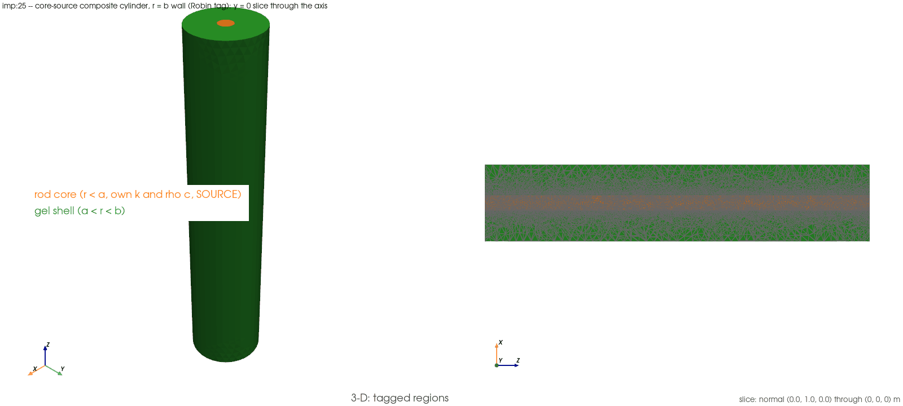

# `-e imp:25` — the implant as the heat source: the core-source composite cylinder, closed form and FEM

Guide for `examples/implants/25_rod_core_source_heat.py`. Written to be followed without
the source open.

## 1. What this demonstrates

**A demonstration of a source inside a material rod.** `imp:24` heats the gel shell around a
passive core; no other `imp:` page puts the source in the implant. Here the rod is a core
0 < r < a with its own conductivity and volumetric heat capacity, in perfect contact with a gel
shell a < r < b: a = `A_ROD` = 1 mm, b = 5 mm. A uniform source `Q_CORE` = 318 309.9 W/m³
(exactly 1 W per metre of rod, 1/(πa²)) heats the **core only**, switched on at t = 0; θ = 0 at
r = b. Results are in K per W/m. The core is a **nominal** titanium pair, `ROD_K` = 6.7 W/(m·K)
and `ROD_RHO_C` = 2.33018e6 J/(m³·K), taken from memory — **there is no source for it in the
repo**. The geometry is an infinite cylinder (FEM: length 10 b = 50 mm, insulated ends) with a
Dirichlet wall and a uniform core source. A real implant's Joule heating is not uniform (no step
has that SAR shape). No finite rod, no SAR shape, no titanium property is claimed.

**What the drive does.** At steady state θ(a) = q_c a² ln(b/a) / (2 k_g), independent of the
core's conductivity: the shell sees only the total power, so the rod's conductivity shows only
inside the rod (the axis). θ_ss(a) = 0.4269167 K per W/m for Ti and for a gel core alike; the
axis is 0.4387939 for Ti and 0.5595458 for a gel-valued core. Characteristic times: t_c = a²/κ_gel
= 6.966667 s and t\* = 5 t_c = 34.83333 s.

**Closed form.** `_theta`, `_theta_ss`, `_theta_j0` of `IMP-8` step 12 (item 847): the
composite-region series of Carslaw & Jaeger ch. XIII (cited from memory; the text is not in the
repo), with the core's `k_r`, `rhoc_r` as keywords. Two cores are tabulated: Ti and a gel core
(`k_r=K_GEL, rhoc_r=RHO_C`).

**FEM.** Item 852's construction (`IMP-8` step 14), written out in `main()` because the gate
module's fixtures are pytest fixtures. `_composite_cylinder` is imported, never copied: 53 504
curved-P2 cells, core tag 1, shell tag 2, the r = b face the Robin tag, end faces untagged. DG0
k, ρc and q through `_dg0`; one Crank–Nicolson run of N = 80 steps of t\*/80 with two
backward-Euler half-steps and a snapshot at step 16 (= t_c); one steady solve; degree 2; the
wall a near-Dirichlet Robin at `H_DIR` = 1e7 W/(m²·K), because the solver takes a Robin wall
only.

**Gates, asserted** (bands imported by name, collected first, then asserted; the digits below
are the closing window's log, `-n 2`, complex build):

- the cell count ≤ `CELL_CAP` (53 504 ≤ 250 000); coordinate degree 2; no NaN left in k, ρc, q;
- **(E)** ≤ `E_BAND` = 1e-9: below 3.1e-13 (a round-off bound; the last digits move between
  windows — item 852, real build: 3.009e-13);
- **(S0)** ∫q dx = `Q_CORE`·V_core,h within `B_BAND` = 1e-10: 3.553e-15, and ∫q dx over the
  shell is exactly 0;
- **(I)** |θ_FEM/θ_cf − 1| ≤ `INTERIOR_BAND` = 1e-2 at (a, 0) and ((a+b)/2, 0) at t\* and at
  steady state: 5.426e-04, 1.713e-03, 3.979e-04, 1.423e-03 (worst 1.713e-03, item 852's
  record);
- **(I0)** the same on the axis (0, 0): 5.458e-04 at t\*, 4.044e-04 at steady (item 852's
  records);
- **closed form, re-asserted on the page**, through the module's helpers and `B1_BAND` = 1e-12:
  (St) the series at `T_ST` against θ_ss, worst 0; (Lim) the series with the core set to gel
  against the homogeneous Dirichlet J0 series, worst 2.093e-16 (item 847's record);
- **control, asserted at factor 1:** the k_r = `K_GEL` steady comparand at (0, 0) is
  5.5954578e-01 against θ_FEM 4.3861645e-01; θ_FEM/comparand − 1 = −2.1612e-01, |miss|
  > `INTERIOR_BAND` (predicted −0.2158, item 852 read 0.2161). The core's own conductivity is
  what the FEM resolves on the axis and a gel-valued core does not;
- max |Im θ| ≤ 1e-12: 0.

**Printed only, no band.** θ(r, t) in K per W/m at r = 0, a, (a+b)/2 for Ti and the gel core
(`[rec]` lines), beside θ_FEM for Ti. At t\* the Ti axis is 0.3551997 against 0.4552613 for the
gel core, and at r = a 0.3435803 against 0.3286419: the core's own capacity and conductivity move
the rod, not the steady shell. θ(a, steady) with the source in the core is 0.4269167 against
0.1148409 with the same power in the shell (item 843), ratio 3.717461. The t_c read at (3, 0) mm
(θ_FEM 9.181349e-03 against 9.287464e-03) has relative error 1.143e-02 — a small-number
relative error, **not gated** (the gated reads are at t\* and steady). z-invariance at t\*:
θ_FEM(a, 0) 3.4339392e-01, (a, +L/4) 3.4336489e-01, (a, −L/4) 3.4337752e-01. The Robin offset,
the mean wall θ over θ_ss(a): 7.4560e-06 (item 852: 7.456e-06). Steady convected over source − 1:
6.217e-14.

**Round-off.** The (S0) and steady-balance readings (3.553e-15, 6.217e-14) are bounds on this
window's round-off, not claims; a re-run on another rank count may differ in the last digits.

**Not claimed:** a finite rod in gel, a titanium property, a heating rate, an implant SAR shape.

## Setup figure



`examples/implants/figures/implants_25_rod_core_source_heat_setup.png`. The figure shows the
53 504-cell mesh, rod core (tag 1, the source) and gel shell (tag 2), sliced at y = 0, the plane
through the axis. The outer lateral face at r = b carries the Robin tag; the end faces are
untagged (insulated).

## 2. How to run it

```
./scripts/run_examples.sh -e imp:25 -n 2 -t 480
```

**Complex build required** — the `imp:` group sources it automatically. Tier: **heavy**; the
closing window's wall time is in its log's `Elapsed` and the script's own `[timing]` line. In a
scheduled session, emit with `--dry-run` and run the printed command through
`scripts/testing/run_and_log.sh`; set `FEM_EM_SETUP_FIGURES=1` in the container command to
regenerate the figure.

## 3. How to analyze it, step by step

**Step 1 — the closed form.** `[cf]` prints θ_ss(a), the two axis values, and the (St) / (Lim)
residuals.

**Step 2 — the mesh and the runs.** `[mesh]` gives the cell count against item 852's 53 504;
`[run]` prints t_call, `n_factorizations` (2), (E) and (S0).

**Step 3 — the interior.** `[I]` prints θ_FEM, the composite θ and the relative miss at nine
read points (six are gated). `[ctrl]` is the control.

**Step 4 — the two cores.** `[rec]` prints the closed form for Ti and gel beside θ_FEM for Ti,
the core-versus-shell source ratio, z-invariance and the Robin offset.

**Step 5 — open it in ParaView.**
`File → Open → examples/implants/paraview_output/implants_25_rod_core_source_heat_combined.xdmf`.
Colour by `theta_t_star`, `theta_steady` (K per W/m, P2, real parts), `k_W_per_mK`,
`rho_c_J_per_m3K` or `q_W_per_m3` (DG0), or threshold on `CellTags`.

**Step 6 — what a deviation means.** A reading off item 852's records is an example/test
divergence — report it, do not move a band.

## Related

- The gates: `tests/validation/test_imp8_composite_cylinder_core_source_closed_form.py`
  (item 847) and `tests/validation/test_imp8_composite_cylinder_core_source_fem.py` (item 852).
- `examples/implants/24_rod_composite_cylinder_heat.py` (`imp:24`),
  `examples/implants/23_rod_line_source_fem_twin.py` (`imp:23`),
  `examples/implants/15_rod_heating_matched_phantom.py` (`imp:15`).
