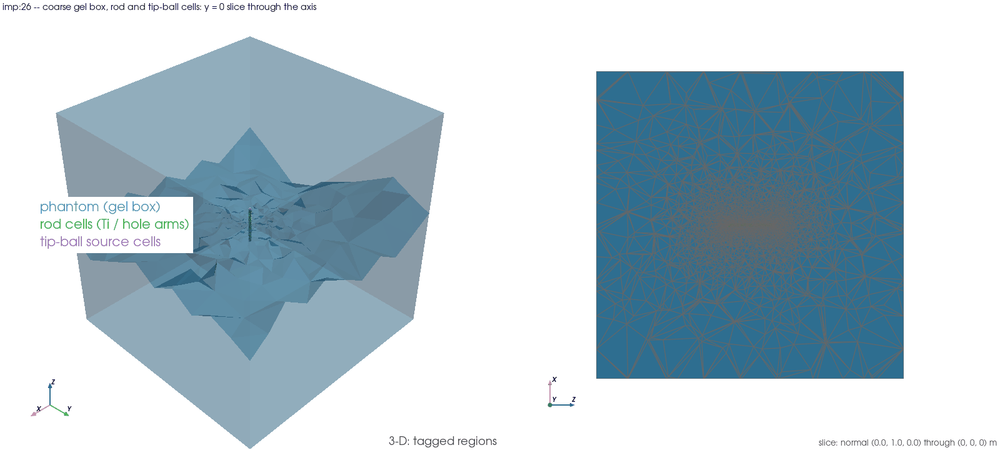

# `-e imp:26` — the rod as gel, as titanium and as a hole, on one page

Guide for `examples/implants/26_rod_bracket_gel_ti_hole.py`. Written to be followed without
the source open.

## 1. What this demonstrates

**This is a demonstration on a mesh coarser than the gates' mesh, so its digits are not the
records.** `imp:23` runs the finite rod's two heat sources in gel; `imp:24` / `imp:25` run the
infinite composite cylinder. No page puts the finite rod's material bracket (gel, titanium,
near-adiabatic hole) on one box. Here the same rod (r = `ROD_RADIUS` = 1 mm, length `L` = 30 mm)
is run in FEM with three materials, per watt (P = 1 W): a 0.20 m gel cube, Robin on all six
faces (`H_GEL`), degree 2, Crank-Nicolson with two backward-Euler half-steps, `N_MAIN` = 40 steps
to `T_PRINT` = 900 s, from θ₀ = 0. Five runs:

1. **tips / gel** — two DG0 balls at z = ±15 mm, P/2 each (`IMP-8` I56's source);
2. **tips / Ti** — the same source, the rod cells (cylinder minus the two balls) at the nominal Ti
   pair `ROD_K` = 6.7 W/(m K), `ROD_RHO_C` = 2.33018e6 J/(m³ K) (`IMP-8` I66);
3. **tips / hole** — the same source, the rod cells at `EPS_HOLE` = 1e-6 × gel k and ρc (I69);
4. **rod / gel** — the DG0 line source on the cells with r ≤ 1 mm, |z| ≤ 15 mm (I55's source);
5. **rod / Ti** — the same source, the body (the cells of q's positive DG0 dofs) at the Ti pair
   (I73).

**What is and is not claimed.**

- The box is coarser than the gates' 485 291-cell box by design (below), so its digits are not
  the records. The records are printed beside the rows with their log basenames.
- The Ti pair is **nominal** (from memory; there is no source for it in the repo).
- "Hole" means **rod cells at ε = 1e-6 × gel k and ρc, not a mesh hole**: the cells stay in the
  mesh and the Robin face is unchanged.
- The tip source and the body source are two **idealised shapes**; neither is a Joule SAR shape.
- Nothing here is an F2182 reading. The probe is `IMP-8` I75's.

**The mesh.** `_coarse_box` is a **disclosed local copy** of `imp:23`'s, which is itself a copy
of the gates' graded box with `H_IN`, `H_MID`, `H_OUT` multiplied by `SIZE_SCALE`; examples do
not import examples. The build-only window `20261108T210314Z_EX-188-W0.log` read, at `-n 2`:
scale 2.0 gives 64 140 cells, 2.2 gives 48 858, 2.4 gives 38 020. Scale 2.0 is used, because five
runs at `imp:23`'s scale 1.8 would not fit `-t 480`. The rod cells are 789 (cylinder minus the
balls), the overlap 44 (gel properties, they carry the source), the cylinder 833. h within 3 mm
of the points is 3.990, 5.929, 3.744 and 6.045 mm at the four gate points, and 2.236 / 2.107 mm
at (2, 15) / (2, 0) mm.

**Gates, asserted** (bands imported by name, collected first, then asserted; digits are the
closing window's; the flagged window `20261108T210330Z_EX-188-figure.log` printed the same
apart from (E)'s round-off digits and the timings):

- the cell count equals `W0_CELLS` = 64 140 and is ≤ 120 000;
- **(E)** ≤ `E_BAND` = 1e-9 on all five runs: ≤ 2e-14 on every run (a round-off term, quoted as a bound; its
  digits differ in the third place between windows);
- **(S0)** ≤ `B_BAND` = 1e-10: the line 4.441e-16 (833 selected cells), the tip balls
  −4.441e-16 (40 cells) and 0 (41 cells), the tips' total 2.220e-16; the selected, rod, overlap
  and body cell counts are all > 0 (833 body cells);
- max |Im θ| ≤ 1e-12: 0; no non-finite coefficient dof;
- **control, asserted at factor 1** (`CONTROL_FLOOR` = 1e-9, FEM over FEM on this mesh): each
  non-gel arm's θ(2, 0) moves off its same-source gel run's: tips / Ti +0.50244, tips / hole
  −0.078325, rod / Ti −0.030925. On the gates' mesh the Ti moves were +0.5550 (tips) and −0.0207
  (rod); their signs repeat. A DG0 path that ignored its coefficients would return the gel θ and
  read 0.

**The table, printed only** (θ in K/W at t\* = 900 s; ratio = θ(2, 15)/θ(2, 0)):

| run | θ(2, 0) | θ(2, 15) | ratio | record on the 485 291-cell box (ratio) |
|---|---|---|---|---|
| tips / gel | 3.03486 | 31.146 | 10.2628 | 3.04423 / 30.0749 (9.87933), `20261104T043245Z_IMP-8-I56-W1-item796.log` |
| tips / Ti | 4.5597 | 26.3374 | 5.77613 | 4.73522 / 25.2527 (5.33296), `20261106T013519Z_IMP-8-item846-W1.log:119-121` |
| tips / hole | 2.79715 | 33.5918 | 12.0093 | item 851, log leak-held |
| rod / gel | 17.7246 | 9.77473 | 0.551479 | 17.7232 / 9.48223 (0.535019), `20261106T103928Z_IMP-8-item856-W2.log:117-119` |
| rod / Ti | 17.1764 | 10.6763 | 0.621564 | 17.3561 / 10.4166 (0.600168), `20261106T103149Z_IMP-8-item856-W1.log:117-119` |

**The ordering** for the tip source at r = 2 mm: Ti > gel > hole at z = 0 and hole > gel > Ti at
z = 15 mm, the same order as on the gates' mesh. The Ti rod conducts the heat from the tip along
its axis, which raises θ(2, 0) and lowers θ(2, 15) and so lowers the tip-point ratio; the hole does the opposite.

**(I), printed not asserted** (relative miss to the closed forms at `GATE_PTS`, with
`INTERIOR_BAND` = 1e-2 beside): run 1 against `QP`·`_phi_tips` reads 2.233e-04, 6.161e-04,
8.229e-03 and 5.839e-03, inside the band at all four. Run 4 against `QP`·`_phi` reads 4.934e-03,
2.653e-03, 1.457e-02 and 1.218e-02: **outside the band at the two 15 mm points**, which is a
coarser-mesh reading, not a red; it is printed only.

**Not claimed:** the gates' mesh, a rate, a Ti property, perfect-contact physics beyond the
model, the F2182 probe, an implant SAR shape, a gate on the rod's effect.

**Disclosed local pieces.** `_coarse_box` (above), and `_rod_cell_sets`, a local copy of the
gates' `_rod_cells` midpoint selection **without its volume form**: `_rod_cells` assembles
`one * w * ufl.dx`, which the complex build rejects (`ArityMismatch`,
`20261105T193522Z_EX-182-figure.log`). Everything else is imported by name: `CONTROL_FLOOR`,
`EPS_HOLE`, `I56_THETA`, `TI_THETA`, `_coefficients`, `ROD_K`, `ROD_RHO_C`, `I55_THETA`, `E_BAND`,
`B_BAND`, `INTERIOR_BAND`, `N_MAIN`, `H_GEL`, `K_GEL`, `RHO_C`, `ROD_RADIUS`, `L`, `MM`,
`T_PRINT`, `_phi`, `_phi_tips`, `GATE_PTS`, `RATIO_PTS`, `QP`, `P`, `DEGREE`, `T_INF`, `H_IN`,
`H_MID`, `H_OUT`, `D_IN0`, `D_IN1`, `D_OUT1`, `HALF_WIDTH`, `AXIS_HALF`, `N_AXIS_PTS`, `SIGNS`,
`_rod_source`, `_tips_source`, `_theta_pts`, `_h_near`, `_cells_global`, `_max_imag`.

## Setup figure



`examples/implants/figures/implants_26_rod_bracket_gel_ti_hole_setup.png`. The figure shows the
64 140-cell gel box (translucent), sliced at y = 0, the plane through the rod's axis. The green
cells are the rod's (the Ti and hole arms' coefficient cells), the purple ones the two tip balls
that carry the source in runs 1 to 3; the rod and balls are cells inside the gel mesh, not
separate meshed bodies.

## 2. How to run it

```
./scripts/run_examples.sh -e imp:26 -n 2 -t 480
```

**Complex build required** — the `imp:` group sources it automatically. Tier: **heavy**; five
CN runs at ≈ 48 s `t_call` each at `-n 2`, the in-script total is printed in the `[timing]` line.
In a scheduled session, emit with `--dry-run` and run the printed command through
`scripts/testing/run_and_log.sh`; set `FEM_EM_SETUP_FIGURES=1` in the container command to
regenerate the figure, and `FEM_EM_IMP26_W0=1` for the build-only cell count at scales 2.0 / 2.2
/ 2.4.

## 3. How to analyze it, step by step

**Step 1 — the mesh.** Read `[mesh] cells` against `W0_CELLS` and `[cells]` for the rod, overlap
and ball counts.

**Step 2 — the five runs.** `[tips_gel]` … `[rod_ti]` print t_call, `n_factorizations` and (E).
`[S0]` prints the source integrals.

**Step 3 — the table.** `[table]` prints θ(2, 0), θ(2, 15) and their ratio for each run, with
the gates' record beneath each row. Then `[control]` (asserted), `[order]` and `[I]` (printed).

**Step 4 — open it in ParaView.**
`File → Open → examples/implants/paraview_output/implants_26_rod_bracket_gel_ti_hole_combined.xdmf`.
Colour by `theta_tips_gel_t_star`, `theta_tips_ti_t_star`, `theta_tips_hole_t_star`,
`theta_rod_gel_t_star`, `theta_rod_ti_t_star` (K per watt at t\* = 900 s, P1), or by the DG0
`k_tips_ti`, `k_tips_hole`, `k_rod_ti`.

**Step 5 — what a deviation means.** A reading off the gate records is an example/test
divergence — report it, do not move a band. A coarser-mesh offset in the table is expected.

## Related

- The gates: `tests/validation/test_imp8_rod_conducting_body_fem.py` (I66 / I69),
  `tests/validation/test_imp8_rod_self_heated_fem.py` (I73),
  `tests/validation/test_imp8_rod_line_source_fem.py` (I55),
  `tests/validation/test_imp8_rod_tips_fem.py` (I56).
- `examples/implants/23_rod_line_source_fem_twin.py` (`imp:23`),
  `examples/implants/24_rod_composite_cylinder_heat.py` (`imp:24`),
  `examples/implants/25_rod_core_source_heat.py` (`imp:25`),
  `examples/implants/15_rod_heating_matched_phantom.py` (`imp:15`).
