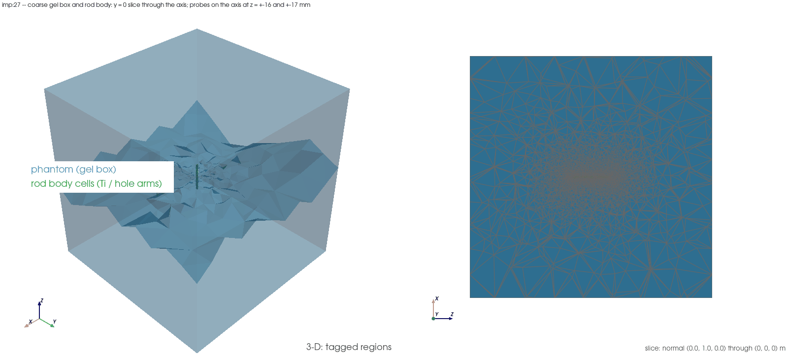

# `-e imp:27` — the F2182-shaped probe on the rod bracket

Guide for `examples/implants/27_rod_f2182_probe_bracket.py`. Written to be followed without the
source open.

## 1. What this demonstrates

**This is a demonstration on a mesh coarser than the gates' mesh, so its digits are not the
records.** `imp:26` puts the finite rod's material bracket (gel, titanium, near-adiabatic hole)
on one box but reads it at (2, 0) and (2, 15) mm only. This page reads the same bracket where the
standard's probe would sit: on the axis, 1 mm beyond the tip, at 900 s. The rod source is `IMP-8`
I55's DG0 line source (P = 1 W) on the 64 140-cell box of `imp:26`; degree 2, Crank-Nicolson with
two backward-Euler half-steps, `N_MAIN` = 40 steps to `T_PRINT` = 900 s, Robin `H_GEL` on all six
faces of the 0.20 m gel cube, from θ₀ = 0. Three runs, each with snapshots at steps 10 / 20 / 30
(225 / 450 / 675 s):

1. **rod / gel** — the body cells (the cells of q's positive DG0 dofs, 833 of them) at the gel
   pair (`imp:26`'s run 4);
2. **rod / Ti** — the body cells at the nominal Ti pair `ROD_K` = 6.7 W/(m K), `ROD_RHO_C` =
   2.33018e6 J/(m³ K) (`IMP-8` I73; `imp:26`'s run 5);
3. **rod / hole** — the body cells at `EPS_HOLE` = 1e-6 × gel k and ρc (I75's hole arm; **new on
   this box**).

**The probe.** Four points on the axis, built from I75's `Z_P` and I78's `Z_C`, never typed:
(0, +16), (0, −16), (0, +17), (0, −17) mm. **16 mm is 1 mm beyond this flat-ended rod** (its end
is at 15 mm). **17 mm is where "1 mm beyond the apex" lands on the clinical capsule rod**, 2 mm
beyond the same line. θ is read at 900 s on the final field, and at 675 / 450 / 225 s on the
snapshots. The **D = 0.5 read is a superposition**, θ(900) − θ(675) + θ(450) − θ(225) (I75's
`_superpose`), **not a switched solve**. I78's infinite-gel closed forms (the line and the
two-ball twin, 1 W per rod) are printed beside.

**What is and is not claimed.**

- The box is coarser than the gates' 485 291-cell box by design, so its digits are not I75's
  records. The records are printed beside the rows with their log basenames.
- The probe placement and the 900 s are **quoted from memory** (the standard's text was not
  consulted in this repo). Nothing here is a clinical or published F2182 figure.
- The Ti pair is **nominal** (from memory; there is no source for it in the repo).
- "Hole" means **rod cells at ε = 1e-6 × gel k and ρc, not a mesh hole**: the cells stay in the
  mesh and the Robin face is unchanged.
- The source is **idealised**, a uniform line source, not a Joule SAR shape.
- The rod's own interior reaches very large θ on the hole arm (item 881's trap); no rod-interior
  or maximum θ is printed here. The XDMF holds it. Every probe is outside the source cells.
- The twin closed form is the two-ball source of `imp:21`; the FEM here is the line source, so
  the line is the like-for-like closed form.

**The mesh.** `_coarse_box` is a **disclosed local copy** of `imp:26`'s (itself a copy of
`imp:23`'s, of the gates' graded box with `H_IN`, `H_MID`, `H_OUT` multiplied by `SIZE_SCALE` =
2.0); examples do not import examples. `imp:26`'s build-only window
`20261108T210314Z_EX-188-W0.log` read 64 140 cells at `-n 2`. h within 3 mm of the probe points
is 1.857 / 1.840 / 1.877 / 1.883 mm at +16 / −16 / +17 / −17 mm.

**Gates, asserted** (bands imported by name, collected first, then asserted):

- the cell count equals `W0_CELLS` = 64 140 and is ≤ 120 000; the body count is 833 and equals
  `imp:26`'s (`20261108T211230Z_EX-188.log:55`);
- **(E)** ≤ `E_BAND` = 1e-9 on all three runs: ≤ 2e-14 on every run (a round-off term, quoted as a
  bound);
- **(S0)** ≤ `B_BAND` = 1e-10: the line 4.441e-16 (833 selected cells); no non-finite coefficient
  dof; max |Im θ| ≤ 1e-12 over the fields and the probe reads: 0;
- **the reproduction (anchor)**: rod / gel and rod / Ti θ(2, 0) and θ(2, 15) equal `imp:26`'s
  closing-log prints within one unit of the sixth significant digit (I75's `_sixth`). Gel
  17.72459 / 9.774734 against 17.7246 / 9.77473; Ti 17.17645 / 10.67626 against 17.1764 /
  10.6763. It is the same box, source, solve and batch; `snapshot_steps` adds only copies;
- **coefficient control**: θ(2, 0) of the Ti and hole arms is off the gel run's by more than
  `CONTROL_FLOOR` = 1e-9: Ti −3.0925e-02 (the same as `imp:26`), hole −1.7516e-03;
- **I75's re-posed control** (factor 1, strict): θ_probe(900 s) > θ_probe(675 s) at (0, ±16) mm
  on every arm; the ratios are in the table;
- **I78's placement control on the FEM** (factor 1 on `INTERIOR_BAND` = 1e-2): 1 −
  θ(0, ±17)/θ(0, ±16) exceeds the band on every arm at 900 s, continuous. The infinite-medium
  line reads 0.2941583 (`20261108T133157Z_IMP-8-item874-W1.log:54`). A source of 1 mm radius on a
  mesh of h ≈ 1.9 mm near the probe was predicted to read lower, as a sign only; it does: gel
  0.2820663 / 0.2693607, Ti 0.2982887 / 0.289623, hole 0.2717167 / 0.2545369 (+17 / −17 mm
  against +16 / −16 mm).

**The table, printed only** (θ in K/W per rod at 900 s; points +16, −16, +17, −17 mm; means over
±):

| arm | θ(900 s) at +16, −16, +17, −17 | mean 16 / 17 mm | D = 0.5 mean 16 / 17 mm | θ(900)/θ(675) at ±16 | θ(17)/θ(16) | I75 485 291-cell mean 16 mm (cont. / D = 0.5) |
|---|---|---|---|---|---|---|
| rod / gel | 9.638764, 8.866075, 6.919993, 6.477902 | 9.252419 / 6.698948 | 1.970653 / 1.814308 | 1.064292, 1.068837 | 0.7240212 | 9.161894 / 1.975098 (`20261108T195853Z_IMP-8-item881-W2b.log:122`) |
| rod / Ti | 11.02901, 10.10473, 7.739184, 7.178166 | 10.56687 / 7.458675 | 2.100275 / 1.898788 | 1.057953, 1.062129 | 0.7058547 | 10.57039 / 2.104578 (`20261108T194323Z_IMP-8-item881-W1.log:122`) |
| rod / hole | 9.219078, 8.410015, 6.714101, 6.269356 | 8.814547 / 6.491728 | 1.888976 / 1.761298 | 1.065351, 1.070896 | 0.736479 | 8.783168 / 1.891937 (`20261108T200636Z_IMP-8-item881-W3.log:122`) |

**The closed forms beside** (I78, infinite gel, 1 W per rod, `20261108T133157Z_IMP-8-item874-W1.log:58-62`):

| shape | θ(900 s) at 16 / 17 mm | D = 0.5 at 16 / 17 mm | steady at 16 / 17 mm |
|---|---|---|---|
| line | 9.648662 / 6.810428 | 1.978384 / 1.822237 | 15.18156 / 12.25753 |
| twin | 63.14 / 29.97039 | 2.498341 / 2.451249 | 68.45374 / 35.22961 |

**The ordering** at 16 mm, continuous mean: Ti > gel > hole, the same order as on the gates' mesh
(item 881). The Ti rod conducts heat toward the probe; the hole arm lowers the reading. Moving the
probe by 1 mm (16 → 17 mm) lowers the reading by 25 to 30 % on this box, on every arm.

**Not claimed:** the gates' mesh, a rate, a Ti property, the clinical fixture (entry 63 / I76) or
the ladder (I80 / I81), a switched-source duty solve, an implant SAR shape, a gate on the rod's
effect at the probe, any F2182 or published value.

**Disclosed local pieces.** `_coarse_box` (above) and `_body_cells` (a copy of `imp:26`'s). The
reproduction values are `imp:26`'s closing-log prints, typed as constants with their log line.
Everything else is imported by name: `SHAPES`, `Z_C`, `_reads`, `Z_P` (I78, metres, as `Z_P_M`),
`Z_P` (I75, millimetres, as `Z_P_MM`), `SNAP_STEPS`, `_sixth`, `_superpose`, `CONTROL_FLOOR`,
`EPS_HOLE`, `_coefficients`, `ROD_K`, `ROD_RHO_C`, `E_BAND`, `B_BAND`, `INTERIOR_BAND`, `N_MAIN`,
`H_GEL`, `K_GEL`, `RHO_C`, `ROD_RADIUS`, `L`, `MM`, `T_PRINT`, `GATE_PTS`, `RATIO_PTS`, `P`,
`DEGREE`, `T_INF`, `H_IN`, `H_MID`, `H_OUT`, `D_IN0`, `D_IN1`, `D_OUT1`, `HALF_WIDTH`,
`AXIS_HALF`, `N_AXIS_PTS`, `_rod_source`, `_theta_pts`, `_h_near`, `_cells_global`, `_max_imag`.

## Setup figure



`examples/implants/figures/implants_27_rod_f2182_probe_bracket_setup.png`. The figure shows the
64 140-cell gel box (translucent), sliced at y = 0, the plane through the rod's axis. The opaque
cells are the 833 body cells (the Ti and hole arms' coefficient cells and the source's cells); they
are cells inside the gel mesh, not a separate meshed body. The four probe points lie on the axis
at z = +16, −16, +17 and −17 mm (r = 0), just beyond the ends of the body at z = ±15 mm; they are
named here rather than drawn.

## 2. How to run it

```
./scripts/run_examples.sh -e imp:27 -n 2 -t 480
```

**Complex build required** — the `imp:` group sources it automatically. Tier: **heavy**; three
CN runs at ≈ 50 s `t_call` each at `-n 2`, the in-script total is printed in the `[timing]` line.
In a scheduled session, emit with `--dry-run` and run the printed command through
`scripts/testing/run_and_log.sh`; set `FEM_EM_SETUP_FIGURES=1` in the container command to
regenerate the figure.

## 3. How to analyze it, step by step

**Step 1 — the mesh.** Read `[mesh] cells` against `W0_CELLS`, and `[S0]` for the selected and
body cell counts.

**Step 2 — the three runs.** `[gel]`, `[ti]`, `[hole]` print t_call, `n_factorizations` and (E).

**Step 3 — the reproduction and controls.** `[repro]` compares rod / gel and rod / Ti to
`imp:26`'s prints; `[control]` is the coefficient control.

**Step 4 — the probe table.** `[table]` prints θ at the four points, the means, the D = 0.5
superposed means, θ(900)/θ(675) and θ(17)/θ(16), with I75's record beneath each arm; `[I78]`
prints the closed forms; `[order]` the ordering.

**Step 5 — open it in ParaView.**
`File → Open → examples/implants/paraview_output/implants_27_rod_f2182_probe_bracket_combined.xdmf`.
Colour by `theta_rod_gel_t_star`, `theta_rod_ti_t_star`, `theta_rod_hole_t_star` (K per watt at
t\* = 900 s, P1), or by the DG0 `k_rod_ti`, `k_rod_hole`. The hole arm's rod core is very hot;
rescale the colour map to the gel.

**Step 6 — what a deviation means.** A reading off `imp:26`'s records is an example/test
divergence — report it, do not move a band. A coarser-mesh offset against I75's table is expected.

## Related

- The gates: `tests/validation/test_imp8_rod_probe_f2182_fem.py` (I75),
  `tests/validation/test_imp8_probe_f2182_closed_form.py` (I78),
  `tests/validation/test_imp8_rod_conducting_body_fem.py` (I66 / I69),
  `tests/validation/test_imp8_rod_self_heated_fem.py` (I73),
  `tests/validation/test_imp8_rod_line_source_fem.py` (I55).
- `examples/implants/26_rod_bracket_gel_ti_hole.py` (`imp:26`),
  `examples/implants/23_rod_line_source_fem_twin.py` (`imp:23`),
  `examples/implants/22_rod_duty_cycle_window_and_dose.py` (`imp:22`),
  `examples/implants/21_rod_line_and_tip_sources.py` (`imp:21`).
