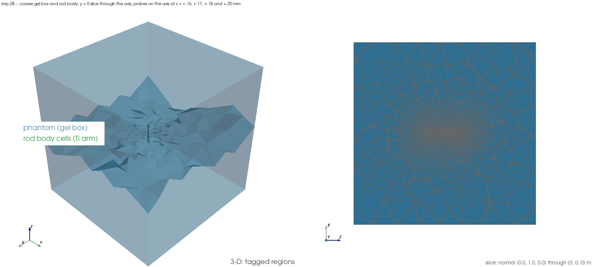

# `-e imp:28` — the rod's finite radius at the probe

Guide for `examples/implants/28_rod_finite_radius_probe.py`. Written to be followed without the
source open.

## 1. What this demonstrates

**This is a demonstration on a mesh coarser than the gates' mesh, so its digits are not the
records.** `imp:27` sets `IMP-8` I78's zero-radius line beside its probe reads and calls it "the
like-for-like closed form". `IMP-8` I83 (item 911) showed that 1 mm from the end of a 1 mm-radius
source the line is the wrong comparand: the uniform finite cylinder Φ_a (radius `ROD_RADIUS`,
length L = 30 mm) is the right one, and the line overshoots it by the radius factor. This page
shows Φ_a, the radius factor Φ_a/Φ, and the first-drop split into a radius term and a rod term.

It re-runs `imp:27`'s box and rod source (64 140 cells, 833 body cells, P = 1 W, degree 2,
Crank-Nicolson with two backward-Euler half-steps, `N_MAIN` = 40 steps to `T_PRINT` = 900 s, Robin
`H_GEL` on all six faces, from θ₀ = 0), twice, each with snapshots at steps 10 / 20 / 30
(225 / 450 / 675 s):

1. **rod / gel**: the body cells at the gel pair;
2. **rod / Ti**: the body cells at the nominal Ti pair `ROD_K` = 6.7 W/(m K), `ROD_RHO_C` =
   2.33018e6 J/(m³ K). There is no hole arm here (`imp:27` carries it).

**The probe.** Eight axis points, read in two batches per field (one batch per call): `imp:27`'s
batch, (0, ±16) and (0, ±17) mm, unchanged and in the same order; and the ladder batch, (0, ±18)
and (0, ±20) mm, built from I80's `RUNGS`. The four rungs are 16 / 17 / 18 / 20 mm, 1 / 2 / 3 / 5 mm
beyond the rod's end at 15 mm. **The D = 0.5 read is a superposition**, θ(900) − θ(675) + θ(450) −
θ(225) (I75's `_superpose`), **not a switched solve**.

**What is and is not claimed.**

- The box is coarser than the gates' box by design, so its digits are not records. I83's records
  on the gates' mesh are printed beside the (G) reads with their log basename
  (`20261109T061107Z_IMP-8-item895-W2.log`).
- **The gel-vs-Φ_a read is I83's (G), flagged for the weekly. It is printed here and not gated.**
  Two meshes are not a ladder; the page makes no h or rate statement.
- Φ_a is the **uniform** cylinder at the nominal `ROD_RADIUS`. There is no closed form for the
  conducting (Ti) rod, so Ti − gel is a record, not a gate.
- Placement and the 900 s are **quoted from memory**; the Ti pair is nominal; the source is
  idealised (a uniform line source, not a Joule SAR shape); D = 0.5 is a superposition. Nothing
  here is a clinical or published F2182 figure.

**The mesh.** `_coarse_box` is a **disclosed local copy** of `imp:27`'s (examples do not import
examples), with `_body_cells`, `_p1_theta` and `_real_dg0` local too. 64 140 cells at `-n 2`; h
within 3 mm of the probe points is 1.857 / 1.840 / 1.877 / 1.883 mm at ±16 / ±17 mm and rises to
2.005 / 2.026 mm at ±18 mm and 2.532 / 2.603 mm at ±20 mm.

**Gates, asserted** (bands imported by name, collected first, then asserted):

- the cell count equals `W0_CELLS` = 64 140 and is ≤ 120 000; the body count is 833, allreduced;
- **(E)** ≤ `E_BAND` = 1e-9 on both runs (a round-off term, ≤ 2e-14); **(S0)** ≤ `B_BAND` =
  1e-10 (4.441e-16, 833 selected cells); no non-finite coefficient dof; max |Im θ| ≤ 1e-12 (0);
- **the reproduction (anchor)**: gel and Ti θ(900 s) at +16, −16, +17, −17 mm and the D = 0.5
  means at 16 / 17 mm equal `imp:27`'s closing-log prints (`20261109T105242Z_EX-190.log:61`, `:62`,
  `:64`, `:65`) within one unit of the sixth significant digit. Gel 9.638764 / 8.866075 / 6.919993 /
  6.477902, D = 0.5 means 1.970653 / 1.814308; Ti 11.02901 / 10.10473 / 7.739184 / 7.178166,
  D = 0.5 means 2.100275 / 1.898788; every difference is below 5e-6, well inside the unit;
- **(Lim)**, I83's identity: |Φ_a(0, z, ∞) / g-form − 1| ≤ `B1_BAND` = 1e-12 at every rung and
  both signs; worst 2.220e-16;
- **(C1), the blind comparand** (factor 1 on `INTERIOR_BAND` = 1e-2): 1 − θ̄_gel / (SCALE·Φ_line)
  exceeds the band at 16 / 17 mm: 0.041067 / 0.016369 (the exact-FEM ceiling, 1 − Φ_a/Φ, is
  0.04672 / 0.01884 per I83). At 18 / 20 mm it reads 0.011092 / 0.007839, printed only;
- **(C2), the read sees the arm** (factor 1): |θ̄_Ti / (SCALE·Φ_a) − 1| exceeds the band at 16 / 17
  mm: 0.148835 / 0.116209; printed at 18 / 20 mm, 0.092567 / 0.069279;
- **I78's placement control on the FEM**: 1 − θ(17)/θ(16) exceeds the band on both arms and both
  signs (gel 0.2820663 / 0.2693607, Ti 0.2982887 / 0.289623), and θ(16) > θ(17) > θ(18) > θ(20)
  strictly at each sign on each arm (I81's control).

**The table, printed only** (K/W per rod at 900 s; ± mean; D = 0.5 superposed mean):

| rung | gel mean | gel D = 0.5 | Ti mean | Ti D = 0.5 | Ti/gel − 1 |
|---|---|---|---|---|---|
| 16 mm | 9.252419 | 1.970653 | 10.56687 | 2.100275 | +0.142066 |
| 17 mm | 6.698948 | 1.814308 | 7.458675 | 1.898788 | +0.113410 |
| 18 mm | 5.184169 | 1.660682 | 5.664421 | 1.725242 | +0.092638 |
| 20 mm | 3.400423 | 1.367587 | 3.643261 | 1.416012 | +0.071414 |

**The closed forms beside** (I83's Φ_a and I78's line, infinite gel, 1 W, SCALE = 4.420971 K/W
per unit Φ):

| rung | SCALE·Φ_a 900 s | D = 0.5 | steady | line 900 s | radius factor Φ_a/Φ |
|---|---|---|---|---|---|
| 16 mm | 9.197899 | 1.973839 | 14.72925 | 9.648662 | 0.9532823 |
| 17 mm | 6.682151 | 1.818084 | 12.12776 | 6.810428 | 0.9811647 |
| 18 mm | 5.184508 | 1.664784 | 10.54176 | 5.242317 | 0.9889726 |
| 20 mm | 3.407212 | 1.371573 | 8.581375 | 3.427288 | 0.9941423 |

**I83's (G), flagged for the weekly; not gated here.** θ̄_gel / (SCALE·Φ_a) − 1, continuous and at
D = 0.5, with `INTERIOR_BAND` = 1e-2 beside:

| rung | continuous | D = 0.5 | I83 on the gates' mesh (continuous / D = 0.5) |
|---|---|---|---|
| 16 mm | +5.928e-03 | −1.614e-03 | −3.914e-03 / +6.380e-04 |
| 17 mm | +2.514e-03 | −2.077e-03 | −2.992e-03 / +3.610e-04 |
| 18 mm | −6.540e-05 | −2.464e-03 | −2.420e-03 / +1.922e-04 |
| 20 mm | −1.993e-03 | −2.906e-03 | −1.921e-03 / +3.656e-05 |

All eight reads on this box are inside the band. The sign of the continuous read at 16 / 17 mm
differs from the gates' mesh; it is a statement about two meshes, not a rate.

**The first drop (16 → 17 mm) on the means.** Line 0.294158, cylinder 0.273513, gel 0.275979, Ti
0.294145. Decomposition: radius (cylinder − line) −0.020645; mesh (gel − cylinder) +0.002466; rod
(Ti − gel) +0.018167. The radius term matches I83's (−0.020645, a closed-form difference); the
mesh term here is +0.002466 where I83 read −0.000673 on the gates' mesh. The rod term here is
+0.018167 against I83's +0.022018. The Ti rod's first drop lands within 1.3e-5 of the line's
by arithmetic from the log, a coincidence of the radius and rod terms on this box, not a claim.

**Not claimed:** the gates' mesh, an h-statement or a rate (two meshes are not a ladder); I83's
(G) on this box (printed, not gated); any closed form for the conducting rod; a Ti property; the
hole arm; the clinical fixture (entry 63 / I76); a switched duty solve; an implant SAR shape; any
F2182 or published value.

**Disclosed local pieces.** `_coarse_box`, `_body_cells`, `_p1_theta`, `_real_dg0`. The
reproduction values are `imp:27`'s closing-log prints, typed as constants with their log. Everything
else is imported by name: `FEM` (I83's gates'-mesh reads), `_closed`, `_cyl_steady`, `_phi_cyl`
(I83), `SHAPES`, `Z_C`, `_reads`, `Z_P` (I78), `RUNGS`, `_lab` (I80), `SCALE`, `_duhamel`,
`SNAP_STEPS`, `_sixth`, `_superpose`, `Z_P` (I75), `CONTROL_FLOOR`, `_coefficients`, `ROD_K`,
`ROD_RHO_C`, `B1_BAND`, `E_BAND`, `B_BAND`, `INTERIOR_BAND`, `N_MAIN`, `H_GEL`, `K_GEL`, `RHO_C`,
`ROD_RADIUS`, `L`, `MM`, `T_PRINT`, `P`, `DEGREE`, `T_INF`, `H_IN`, `H_MID`, `H_OUT`, `D_IN0`,
`D_IN1`, `D_OUT1`, `HALF_WIDTH`, `AXIS_HALF`, `N_AXIS_PTS`, `_rod_source`, `_theta_pts`,
`_h_near`, `_cells_global`, `_max_imag`.

## Setup figure



`examples/implants/figures/implants_28_rod_finite_radius_probe_setup.png`. The figure shows the
64 140-cell gel box (translucent), sliced at y = 0, the plane through the rod's axis. The opaque
cells are the 833 body cells (the Ti arm's coefficient cells and the source's cells); they are
cells inside the gel mesh, not a separate meshed body. The eight probe points lie on the axis
(r = 0) at z = ±16, ±17, ±18 and ±20 mm, just beyond the ends of the body at z = ±15 mm; they are
named here rather than drawn.

## 2. How to run it

```
./scripts/run_examples.sh -e imp:28 -n 2 -t 480
```

**Complex build required** — the `imp:` group sources it automatically. Tier: **heavy**; two CN
runs at ≈ 50 s `t_call` each at `-n 2`, the in-script total is printed in the `[timing]`
line. In a scheduled session, emit with `--dry-run` and run the printed command through
`scripts/testing/run_and_log.sh`; set `FEM_EM_SETUP_FIGURES=1` in the container command to
regenerate the figure.

## 3. How to analyze it, step by step

**Step 1 — the mesh.** Read `[mesh] cells` against `W0_CELLS`, and `[S0]` for the selected and
body cell counts.

**Step 2 — the two runs.** `[gel]` and `[ti]` print t_call, `n_factorizations` and (E).

**Step 3 — the reproduction.** `[repro]` compares both arms' θ(900 s) at ±16 / ±17 mm and the
D = 0.5 means to `imp:27`'s prints.

**Step 4 — the closed forms.** `[I83]` prints SCALE·Φ_a, the line and the radius factor per rung;
`[Lim]` is I83's identity.

**Step 5 — the table and (G).** `[table]` prints θ at ±z per rung, the ± mean, |difference|, the
D = 0.5 mean and Ti/gel − 1; `[G]` prints I83's (G) beside its gates'-mesh reads; `[drop]` the
first-drop split; `[C1]` / `[C2]` / `[control]` the controls.

**Step 6 — open it in ParaView.**
`File → Open → examples/implants/paraview_output/implants_28_rod_finite_radius_probe_combined.xdmf`.
Colour by `theta_rod_gel_t_star` or `theta_rod_ti_t_star` (K per watt at t\* = 900 s, P1), or by
the DG0 `k_rod_ti`.

**Step 7 — what a deviation means.** A reading off `imp:27`'s records is an example/test
divergence — report it, do not move a band. A coarser-mesh offset against I83's gates'-mesh reads
is expected.

## Related

- The gates: `tests/validation/test_imp8_probe_cylinder_source_closed_form.py` (I83),
  `tests/validation/test_imp8_probe_ladder_closed_form.py` (I80),
  `tests/validation/test_imp8_probe_f2182_closed_form.py` (I78),
  `tests/validation/test_imp8_rod_probe_f2182_fem.py` (I75).
- `examples/implants/27_rod_f2182_probe_bracket.py` (`imp:27`),
  `examples/implants/26_rod_bracket_gel_ti_hole.py` (`imp:26`),
  `examples/implants/23_rod_line_source_fem_twin.py` (`imp:23`),
  `examples/implants/21_rod_line_and_tip_sources.py` (`imp:21`).
