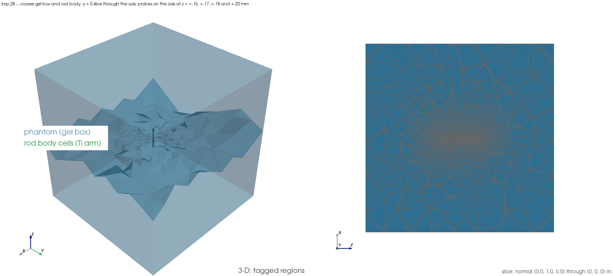

# `-e imp:29` — the finite-radius two-tip twin at the probe

Guide for `examples/implants/29_rod_tip_twin_finite_radius_probe.py`. Written to be followed
without the source open.

## 1. What this demonstrates

**This is a closed-form record page: infinite gel, no box, no FEM, no mesh, no solve, no rod
conduction. Every digit is `IMP-8` I86's (item 934), reproduced by string from I86's tracked log.**
I86 answered, in closed form, whether the rod's radius or the tip weighting dominates the two-tip
twin's probe read. No page showed that answer. `imp:28` puts I83's finite-radius *line* Φ_a beside
the FEM; this page sets the finite-radius *twin* beside the point twin, the line and Φ_a on I80's
ladder.

**The twin.** Each tip is a uniform cylinder, a = h/2 = `ROD_RADIUS` (1 mm), length h = 2a,
centred on z = ±L/2 (L = 30 mm), carrying P/2 = 0.5 W; the 11-11 weekly ratified that length. The
twin's read on the axis is Φ₂,a, in K per watt per rod via `SCALE` = 4.420971 K/W per unit Φ.

**Names.** In the plan, "point twin" and "line twin" both mean I80's zero-radius two-tip twin
`_phi_tips`. This page calls it the zero-radius (point) twin, and calls `_phi` "the line".

**The rungs.** I80's four placements, 16 / 17 / 18 / 20 mm, 1 / 2 / 3 / 5 mm beyond the rod's end
at 15 mm, read at 900 s continuous, at D = 0.5 (I78's `_duhamel` on the duty period) and at steady
state. The rungs are placements, not a convergence ladder. Placement and 900 s are quoted from
memory (W3 confirms or corrects). Nothing here is a clinical or published F2182 figure.

**The custody.** The comparand strings are parsed from
`docs/testing/logs/20261110T120247Z_IMP-8-item934-W1.log` (real build, `-n 2`, Status 0), one
`re.search` per line on lines carrying `[imp8-i86]`, never typed. The page's expressions are I86's
own, written out operand for operand, so the floats are the same. The page runs in the complex
build; the strings are identical.

**Gates, asserted** (bands imported by name, collected first, then asserted):

- **(X) custody**: the log exists and reads `Status: 0`; parse counts are exactly 1 / 1 / 1 / 4 /
  4 / 4 / 4; the rung keys are (1, 16), (2, 17), (3, 18), (4, 20) and match `RUNGS`;
- **(K), the weekly's four strings, by string, no tolerance**, at 16 mm: cylinder twin 60.34935 K/W,
  point twin 63.14 K/W, radius factor Φ₂,a/Φ₂ 0.9558023, tip weighting twin_a/line_a 6.561211;
- **(K-rec)**, the rest of I86's record block by string: 46 comparisons, covering the steady and
  D = 0.5 control pairs and, at every rung, the continuous / D = 0.5 / steady reads, the three
  radius factors, the two tip weightings and the point twin / line (also against I80's logged
  value). All equal;
- **(Lim)**: |Φ₂,a(0, z, ∞) / g-form − 1| ≤ `B1_BAND` = 1e-12 at every rung and sign; worst
  4.441e-16, I86 logged 4.441e-16;
- **(Lim-a)**: at a = `A_LIM` = 1e-10 m, the twin against the point twin at 900 s, ∞ and D = 0.5,
  ≤ `B1_BAND`; worst 4.441e-15, I86 logged 4.441e-15.

**Controls, asserted.**

- **(C-twin)**, factor 1 on `INTERIOR_BAND` = 1e-2: at 16 mm, continuous θ(900 s), 1 − cylinder
  twin / point twin = 4.4198e-02, 4.42 times the band. Steady 4.0796e-02 is printed. D = 0.5,
  3.9031e-03, is printed with the label "below the band; not the weekly's control";
- **(C-a10)**, I86's own negative: at a = `ROD_RADIUS`/10 the deficit |Φ₂,a/Φ₂ − 1| at 16 mm,
  900 s is 8.5713e-04, above `B1_BAND`, so (Lim-a) is not comparing a kernel with itself;
- **(N-len)**: at h = a the 16 mm read is 0.6013158 of the point twin's, equal to the logged
  string, and `SCALE`·twin(h = a) = 37.96708 differs from 60.34935. So the (K) string resolves the
  length the 11-11 weekly ratified.

**The answer at 16 mm, continuous 900 s.** The radius factor Φ₂,a/Φ₂ is 0.9558023 (the read moves
4.42 %), against a tip weighting twin_a/line_a of × 6.561211: the tip weighting dominates. The
length matters far more than the radius: at h = a the twin's read is 0.6013158 of the point twin's,
against 0.9558023 at h = 2a (both closing-log prints), so the twin's read is far more sensitive to
the tip's length than to its radius.

**The record, printed only** (K per watt per rod, infinite gel):

| rung | twin_a 900 s | twin_a D = 0.5 | twin_a steady | point twin 900 s | point twin D = 0.5 | point twin steady |
|---|---|---|---|---|---|---|
| 16 mm | 60.34935 | 2.488589 | 65.66113 | 63.14 | 2.498341 | 68.45374 |
| 17 mm | 30.29385 | 2.441764 | 35.55115 | 29.97039 | 2.451249 | 35.22961 |
| 18 mm | 19.07042 | 2.374175 | 24.27028 | 18.91265 | 2.38321 | 24.11439 |
| 20 mm | 10.12165 | 2.18383 | 15.19819 | 10.07929 | 2.191513 | 15.15761 |

| rung | line 900 s | I83 cylinder 900 s | Φ₂,a/Φ₂ 900 s | D = 0.5 | steady | twin_a/line_a 900 s | steady | point twin / line |
|---|---|---|---|---|---|---|---|---|
| 16 mm | 9.648662 | 9.197899 | 0.9558023 | 0.9960969 | 0.9592045 | 6.561211 | 4.457874 | 6.543912 |
| 17 mm | 6.810428 | 6.682151 | 1.010793 | 0.9961304 | 1.009127 | 4.533547 | 2.931387 | 4.400661 |
| 18 mm | 5.242317 | 5.184508 | 1.008342 | 0.996209 | 1.006465 | 3.678348 | 2.302298 | 3.60769 |
| 20 mm | 3.427288 | 3.407212 | 1.004202 | 0.9964941 | 1.002677 | 2.970653 | 1.771067 | 2.940895 |

**The rungs beyond the face.** From 17 mm on, Φ₂,a/Φ₂ > 1 (I86's Outcome: the h = 2a cylinder's
quadrupole excess), beside the line's Φ_a/Φ < 1 (I83's record, `imp:28`). A record; no claim is
made about it.

**The h = a sensitivity** (h = 2a is ratified by the 11-11 weekly; h = a is a sensitivity), Φ₂,a/Φ₂
at 900 s: 0.6013158 / 0.7560154 / 0.8203262 / 0.8755296 at 16 / 17 / 18 / 20 mm, each equal to the
logged string.

**Not claimed:** a new record (every digit is I86's, reproduced); FEM, the box walls, the rod's own
conduction, a ball-averaged read; the clinical fixture (entry 63 / I76); a switched duty solve; any
F2182 or published value.

**Disclosed local pieces.** The line patterns and `parse_i86`. Everything else is imported by
name: `_twin_a`, `_twin_a_steady`, `A_LIM` (I86), `_phi_cyl` (I83), `RUNGS`, `LADDER_MM`, `_lab`
(I80), `DUTY`, `_p` (I78), `_tips_steady` (I58), `L`, `MM`, `T_PRINT`, `_phi`, `_phi_tips` (step 0),
`SCALE`, `T_STAR` (I59), `_duhamel` (I62), `ROD_RADIUS`, `B1_BAND`, `INTERIOR_BAND`.

## Setup figure



`examples/implants/figures/implants_29_rod_tip_twin_finite_radius_probe_setup.png`. This is
`imp:28`'s committed render (`figures/implants_28_rod_finite_radius_probe_setup.png`), copied byte
for byte: the rod in the translucent coarse gel box, sliced at y = 0. **This page
has no box and no mesh**; the figure shows the rod and axis geometry the closed forms refer to.

## 2. How to run it

```
./scripts/run_examples.sh -e imp:29 -n 1 -t 120
```

**Complex build required** — the `imp:` group sources it automatically. Tier: **standard**; no
mesh and no solve, the in-script total is printed in the `[timing]` line. In a scheduled session,
emit with `--dry-run` and run the printed command through `scripts/testing/run_and_log.sh`. The
page also runs at `-n 2` (every rank computes, rank 0 prints).

## 3. How to analyze it, step by step

**Step 1 — custody.** `[X]` prints the log's status, the parse counts and the rung keys.

**Step 2 — the strings.** `[K]` prints the weekly's four strings, page against log; `[K-rec]`
counts the rest of the record by string.

**Step 3 — the limits.** `[Lim]` and `[Lim-a]` print the worst relative differences beside I86's.

**Step 4 — the controls.** `[C-twin]`, `[C-a10]` and `[N-len]`.

**Step 5 — the record.** `[record]` prints the reads per rung, `[answer]` the 16 mm answer,
`[beyond]` the rungs past the face, `[h=a]` the sensitivity.

**Step 6 — what a deviation means.** A string off I86's log is an example/test divergence: report
it, do not loosen the equality or move a band.

## Related

- The gate: `tests/validation/test_imp8_probe_twin_cylinder_closed_form.py` (I86), with
  `tests/validation/test_imp8_probe_ladder_closed_form.py` (I80) and
  `tests/validation/test_imp8_probe_cylinder_source_closed_form.py` (I83).
- `examples/implants/28_rod_finite_radius_probe.py` (`imp:28`),
  `examples/implants/22_rod_duty_cycle_window_and_dose.py` (`imp:22`),
  `examples/implants/21_rod_line_and_tip_sources.py` (`imp:21`),
  `examples/implants/27_rod_f2182_probe_bracket.py` (`imp:27`).
