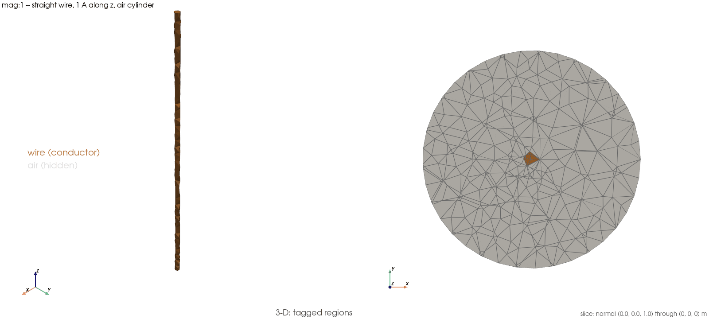

# `-e 1` — magnetic field of a straight wire

Guide for `examples/magnetostatics/01_straight_wire.py`. Written to be followed
without the source open.

## 1. What this demonstrates

The magnetostatic solver end to end on the simplest fixture there is: a
finite-length current-carrying wire (1.0 A, length 0.3 m, radius 3 mm) inside a
4 cm air cylinder, solved for the vector potential `A`, post-processed to `B`,
and compared point by point against the infinite-wire closed form
`B_θ = μ₀I/2πr`.

**Read the accuracy honestly.** At this example's defaults the agreement is
*poor by design*, and the numbers below are the record, not a bug:

| Quantity | On record at `-n 2` |
| --- | --- |
| Relative L2 error vs `μ₀I/2πr` | **43.8071%** |
| Max relative error | **84.1711%** |
| Decay ratio `B(3 mm)/B(38 mm)`, numerical | **44.36** (analytic: **12.67**) |
| Magnetic energy | **2.630243e-08 J** |
| Mesh | **21 830 cells, 4 662 vertices** |

Those three sampled rows are re-recorded (`(1*)`, `POST-8` step 3b-ii-e3b, §9
item 580, 2026-10-21) from `20261021T110135Z_POST-8-step3b-ii-e3b-mag1-n2.log`:
the probes now sample the DG `B` from `solver.compute_b_field()` under the owner
rule (`owner="lowest_original_cell"`), not the CG1 `B_lag` (which stays the VTX
export, round-trip check untouched). Energy and mesh are not sampled and did not
move. The DG sample is width-invariant up to the printed (O) spread (L2 43.8071%
at `-n 2` and `-n 4`, 43.8073% / 84.1731% at `-n 1`; field spread 1.527e-05 at
`-n 4`, 1.434e-04 at `-n 1`; `…110214Z_…-mag1-n4.log`, `…110242Z_…-mag1-n1.log`).
Labelled `-n 2` record of the CG1 `B_lag` route, printed no longer and kept
here: relative L2 **51.9781%**, max relative **76.7330%**, decay ratio **20.31**
(`20260826T170155Z_EX-30-root2-run-mag1.log`). The DG field is piecewise
constant, so the per-radius ratio below is a cell staircase (several radii
read one cell) and the point-0 probe sits in 24 cells at the wire edge (owner
210, a 2.2 delta against the legacy cell, printed).

<!-- Record re-recorded 2026-08-26 (EX-30 leg (root) completion) from
     docs/testing/logs/20260826T170155Z_EX-30-root2-run-mag1.log, Status 0,
     9 s, `./scripts/run_examples.sh -e 1 -n 2 -t 300` at commit c466143.
     The move is caused by the ruled resolution change 0.01 -> 0.008 (the
     0.11-image coarse-resolution floor in `straight_wire_domain`; see
     docs/testing/known-issues.md), not by any solver change — a coarser
     mesh was over-predicting the mirror, so the finer mesh lands closer to
     the closed form on every row. Superseded digits, valid at
     `resolution = 0.01` on the 0.7.2 image (2026-08-04,
     20260804T174037Z_MAG-EX.log): relL2 65.8739%, max rel 85.2498%, decay
     ratio 29.83, energy 2.307201e-08 J, mesh 15 001 cells / 3 259 vertices.
     Un-asserted guide table; no band, tolerance or gate constant moved. -->

Two independent reasons, both physical rather than numerical: the wire is
**finite** (0.3 m) while the closed form is infinite, and the outer wall carries
the **natural** condition `n × H = 0`, a magnetic mirror that inflates the field
near the boundary. That is why the numerical decay is steeper than `1/r`.

The **gated** wire result is a different fixture: `tests/validation/`
`test_straight_wire.py` under `MAG-13`, which replaces the natural wall with an
**analytic Dirichlet** boundary and lands at **12.75%** with measured
convergence rate **1.10** (PROJECT_PLAN.md §7, `MAG-13` ✅, heavy tier). This
example is the *demonstration*; `MAG-13` is the *gate*. Do not quote 65.87% as
solver accuracy, and do not quote 12.75% as this example's output.

## 2. How to run it

```
./run_examples.sh -e 1 -n 2 -t 180
```

Real DolfinX build; the runner selects it. Tier: **smoke** in practice — on
record **5 s** at `-n 2` for the example alone
(`20260810T033438Z_EX-8-refcheck-refresh.log`), 4 s of that in gmsh.

The VTX/`.bp` export was repaired 2026-08-10 (`EX-14`). A healthy run prints,
on rank 0,

```
  VTX round-trip check (EX-14 anchor):
    in-memory  max|B| = 4.972891321210e-05 T
    read-back  max|B| = 4.972891321210e-05 T
    relative difference = 0.000e+00  (tol 1e-10)
    control (read-back vs 0.5 x in-memory) = 1.000e+00  -- must exceed the band
    ✓ written .bp reproduces the in-memory field
    ✓ control separated: wrong reference reads rel ~ 1
```

— the written `magnetostatics_01_straight_wire_B.bp` read back through ADIOS2 and compared with
the field still in memory (`20260916T094210Z_OPS-48-mag1.log`, Status 0, 7 s,
real build, `-n 2`). A mismatch raises rather than printing a warning, and so
does a read-back that cannot run at all. The `control` line is the negative
control: the same comparison against a deliberately wrong reference (half the
in-memory value) reads `1.000e+00`, i.e. 1e10× the 1e-10 band, so `0.000e+00`
on the real comparison is evidence the file matches and not evidence that the
comparison is inert.

`OPS-48` (2026-09-16) restored this check. Between the move to the dolfinx 0.11
image and that date the reader called the pre-2.10 top-level `adios2.ADIOS()`,
which `adios2` 2.12.1 no longer has; `_check_vtx_roundtrip` caught the
`AttributeError`, printed `⚠ VTX round-trip read-back unavailable: …` and
returned `False`, and the example still exited 0 — so the anchor did not
execute on any run in that interval. The reader now uses `adios2.bindings`
(the same low-level classes, moved) and the failure path raises. If you see the
`⚠ unavailable` line in an older log, that run did not exercise this anchor.
Older still, before the 2026-08-10 `EX-14` repair, the run printed
`⚠ VTX output failed (ADIOS2 may not be available)` on every rank and wrote no
`.bp` at all.

## Setup figure



`examples/magnetostatics/figures/magnetostatics_01_straight_wire_setup.png`.
It is rendered right after `straight_wire_domain` builds the mesh
(`FEM_EM_SETUP_FIGURES=1`). The 3-D panel hides the air (tag 2) and leaves the
wire (tag 1, copper). The slice is the z = 0 mid-plane through the whole
domain, the plane where the example evaluates the B profile along the x-axis.

## 3. How to analyze it, step by step

**Step 1 — check the printed numbers against the record above.** In order of
diagnostic value:

1. **Cell/vertex count** (`21 830` / `4 662`). If this moved, nothing below is
   comparable — a mesh change explains any error change on its own.
2. **Relative L2 error 43.8071%** and **max relative error 84.1711%**. These
   reproduce digit for digit across runs and ranks `-n 2` / `-n 4` (the DG
   sample is width-invariant up to the printed (O) spread: `-n 1` reads
   43.8073% / 84.1731%) — *any* larger movement in these digits is a real
   change in the solver, the mesh, or the evaluation path, not noise.
3. **Decay ratio 44.36 vs analytic 12.67** (the CG1 route read 20.31). A ratio moving *toward* 12.67 means
   the boundary treatment changed (that would be good, and would belong in a
   chunk); a ratio moving further above means the mirror got stronger, i.e. the
   wall moved inward. The 0.01 → 0.008 resolution move already took it
   29.83 → 20.31 for exactly the second reason in reverse: resolving the wire
   better weakens the numerical over-steepening, it does not move the wall.
4. **Magnetic energy 2.630243e-08 J** — the one global, non-pointwise number
   here; it catches errors that pointwise sampling at a handful of radii can
   miss.

**Step 2 — read the per-radius table.** The run prints `r`, `|B_num|`,
`|B_ana|`, and their ratio at ≈30 radii from the wire edge (3.00 mm) to
38.00 mm. On record the ratio falls from 0.659 at the wire edge to 0.188 at the outer
radius, with cell-staircase steps (0.402, 0.517, 0.514, … 0.176, 0.182, 0.188)
because the DG `B` is cell-constant. What to look at: **the trend, not the
value.** A
roughly flat ratio would mean a uniform scale error (suspect current density or
`μ₀`); the observed *decreasing* trend is the finite-length plus mirrored-wall
signature. A ratio that jumps around by more than the cell staircase points at
the point evaluation, not the physics — evaluation must go through
`post.evaluation.evaluate_vector_field_parallel`, never `B.eval(points,
np.arange(n))` (that bug is what killed the deleted example 03, the
predecessor of `04_helmholtz_analytic_comparison.py`).

**Step 3 — check the field direction.** The component table at `(x, 0, 0)`
should give `By` dominant with `Bx ≈ Bz ≈ 0` (exact answer: `Bx = Bz = 0`,
`By = μ₀I/2πx`). On record at r = 3.00 mm the numerical field is
`(2.08e-05, 9.13e-06, 4.37e-06) T` — the off-axis components are *not* small
there, which is the near-wire discretisation showing; by r = 21.10 mm `By`
dominates by two orders. Off-axis components growing with r instead of
shrinking would mean the current is not confined to the wire volume.

**Step 4 — open the fields in ParaView.**
`File → Open → paraview_output/magnetostatics_01_straight_wire_combined.xdmf` (one file carrying
`A`, `B`, `B_analytical` and `CellTags` on the *same* grid):

1. **Threshold** on `CellTags`, min 2 max 2, to drop the wire cells (tag 1 =
   wire, 2 = air) — the closed form is singular inside the conductor, so
   comparisons there are meaningless.
2. **Glyph** on the thresholded data, orientation and scale by `B`. What to
   look at: the arrows must circulate azimuthally around the wire axis with no
   radial component and no swirl at the outer wall.
3. **Calculator** with `mag(B - B_analytical)`: the pointwise error field.
   What to look at: the error must be largest **near the wire surface and near
   the outer wall** and smallest in the middle annulus. Error concentrated in
   one azimuthal sector instead means a mesh or partitioning artefact — that is
   worth a known-issues entry.

Individual files (`magnetostatics_01_straight_wire_A.xdmf`, `magnetostatics_01_straight_wire_B.xdmf`,
`magnetostatics_01_straight_wire_B_analytical.xdmf`) carry the same mesh and `CellTags` if you
prefer one field per reader.

**Step 5 — the validation plot.** The run writes
`paraview_output/magnetostatics_01_straight_wire_validation.png`, `|B|` vs `r` for numerical and
analytic. A copy regenerated on 2026-08-09 is committed at
`examples/magnetostatics/magnetostatics_01_straight_wire_validation.png` (provenance: `EX-12`;
the original 2026-02-18 image predated the example's 2026-08-03 rewrite and was
replaced). What to look at: two curves, both falling, the numerical one falling
faster — the visual form of the 20.31 vs 12.67 ratio.

**Owner-cell sampling (`POST-8` step 3b-ii-e1).** The per-radius table samples
the CG1 interpolant `B_lag` through `evaluate_vector_field_parallel` with
`owner="lowest_original_cell"`; nothing else in the example changed and no
record above was re-recorded. Under the spied run 1 call was made and 29 of its
30 probes are single-incidence (bitwise equal to the legacy owner); the one
multi-incidence probe is point 0 on the wire surface. Log:
`20261019T170143Z_POST-8-step3b-ii-e1b-mag1-n2.log`.

## Related

- ParaView workflow for this group: `examples/magnetostatics/PARAVIEW_GUIDE.md`.
- Combined-file layout: `examples/magnetostatics/COMBINED_XDMF_README.md`.
- The gated counterpart of this physics: `MAG-13` in PROJECT_PLAN.md §7.
