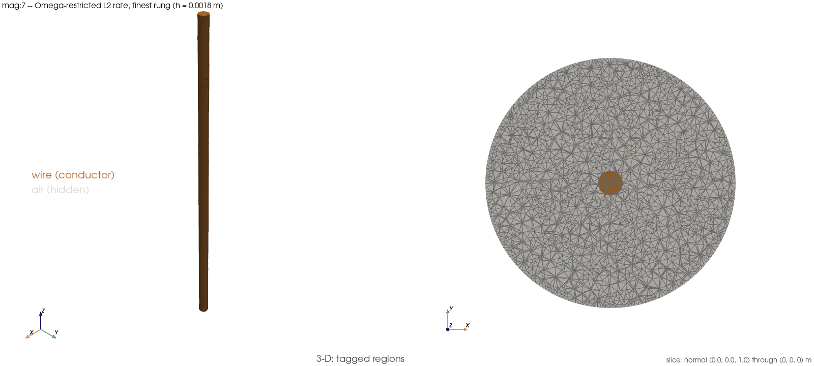

# `-e 7` — sampler-free convergence rate of the straight-wire solve

Guide for `examples/magnetostatics/07_domain_l2_convergence_rate.py`. Written to
be followed without the source open.

## 1. What this demonstrates

**A convergence rate measured by a domain integral**, with no sample count for
the answer to depend on, and the **natural-versus-analytic outer wall compared in
that same norm**.

`examples/magnetostatics/06_h_convergence_rate.py` (`mag:6`, `EX-9`) is the
sampled-statistic twin: it fits a rate to the error of `|B|` at ten points on a
line. That statistic swung 34 % with its own sample count (`MAG-19`) and read
21 % differently on the 0.11 image on the same field, so its rate band was
retired and the rate duty moved to `MAG-18`. A rate of a *reduced domain
integral* cannot depend on a sampler: the quantity is

`E_Ω = ‖ |B_h| − |B_ana| ‖_L2(Ω) / ‖ |B_ana| ‖_L2(Ω)`,
`Ω = { 2a ≤ r ≤ 0.8 R, |z| ≤ 0.25 L }`,

an integral over cells (both integrals reduced across ranks before the ratio).
The annulus keeps the conductor interior (where the closed form is invalid) and
the end caps and wall (where boundary layers live) out of the norm.

This example runs the gate's own measurement. The ladder (`E_OMEGA_LADDER`),
the one-sided floor (`E_OMEGA_RATE_MIN`), the record (`E_OMEGA_H0025_RECORD`),
the solve (`_solve_straight_wire`), the norm (`_domain_l2_error`), the mask
(`_annulus_indicator`) and the rate fit (`fit_convergence_rate`) are all
**imported by name** from `tests/validation/test_straight_wire.py` and
`tests/validation/test_convergence.py`, never restated. No `test_*` name is
imported.

Then the wall. With the natural condition `n × H = 0` on the outer boundary the
wall forces the azimuthal component to zero, which contradicts Ampère's law for
a net axial current; no refinement removes that. At h = 0.0025 the example
solves both walls and asserts the analytic-wall error is strictly the smaller.

On record at `-n 2` (`20261024T094607Z_EX-148.log`, 2026-10-24, 178 s):

| h (m) | Cells | `E_Ω` | `MAG-18` record (`20260824T003650Z_MAG-18-regate-run2.log.gz`) |
| --- | --- | --- | --- |
| 0.0040 | 38 740 | **25.286826 %** | 25.286824 % (38 740) |
| 0.0025 | 147 235 | **10.617170 %** | 10.617170 % (147 235) |
| 0.0018 | 383 146 | **6.645807 %** | 6.645807 % (383 146) |

| Quantity | Value | Bound |
| --- | --- | --- |
| Monotone decrease, coarse → fine (M) | holds | asserted |
| Fitted rate | **1.6854** | ≥ `E_OMEGA_RATE_MIN` = 0.7 (Rate), 2.41× the floor; `MAG-18` record 1.6854 |
| Natural wall, h = 0.0025 | **32.315493 %** | analytic 10.617170 % strictly smaller (c-BC); ratio 0.3285 |
| h = 0.0025 reading | 1.061717e-01 | printed beside `E_OMEGA_H0025_RECORD` = 1.061717e-01 (diff −6.2e-10), **not asserted** |
| Wall time per rung | 7.0 / 30.4 / 105.1 s | heavy tier, 178 s total |

N1curl degree 1 predicts a rate near 1.0 for a pointwise quantity; the reduced
integral reads 1.69 on this ladder, which is a measurement on three rungs and
not a claim about the asymptotic order.

The h = 0.0025 reading matches the record to the digits the record carries. It
is printed and never asserted: the record is version-tagged, and an image change
moving it is the gate's business (`test_domain_l2_record`), not this example's.

The script's natural-wall line labels `0.323155` as "MAG-18 record"; that is the
record of the natural-wall `E_Ω` itself (32.3155 %), printed beside the reading
32.315493 %, not a record of the ratio.

## Setup figure



`examples/magnetostatics/figures/magnetostatics_07_domain_l2_convergence_rate_setup.png`.
Rendered right after the finest rung's solve (`FEM_EM_SETUP_FIGURES=1`), because
four meshes are built and only the finest — h = 0.0018 m, the rung the export
uses — survives. Air (tag 2) is hidden, the wire (tag 1) is copper, and the
slice is the z = 0 mid-plane. `_solve_straight_wire` returns no cell tags, so
the example tags cells by midpoint radius (r ≤ a is the wire) for the picture.

## 2. How to run it

```
./run_examples.sh -e 7 -n 2 -t 900
```

Real DolfinX build; the runner selects it. Magnetostatics is a real-valued
solve, so do **not** source the complex mode. Tier: **heavy**. 178 s at `-n 2`,
dominated by the 383 k-cell rung (105 s). Exit status 0 with every assertion
holding, or the run fails loudly.

## 3. How to analyze it, step by step

**Step 1 — read the reproduction table first.** The printed table lists each
rung's cells and `E_Ω` beside the `MAG-18` record. The cell counts reproduce
exactly (38 740 / 147 235 / 383 146); the errors agree to about 1e-8 relative
(the last digits move with the solver's reduction order).

**Step 2 — (M), monotone decrease.** 25.29 % → 10.62 % → 6.65 %. Asserted.

**Step 3 — (Rate).** The fitted least-squares slope of `log E_Ω` against
`log h` through three points is 1.6854, against a floor of 0.7. The floor is
one-sided and imported; nothing on the high side is gated.

**Step 4 — (c-BC), the natural wall.** At h = 0.0025 the natural wall reads
32.32 % against the analytic wall's 10.62 %, the latter 0.3285 of the former.
Only strict inequality is asserted; the ratio is printed. Reading a rate
without this control would not say whether the outer wall had reached the
solve.

**Step 5 — the export, and why the picture is not the measurement.** The
finest rung's `B_numeric`, the analytic `B_analytic` (interpolated as
`_domain_l2_error` does) and the Ω indicator `chi_Omega` (DG0) are written to
one combined XDMF. `curl A` is cell-wise constant for N1curl degree 1, so
writing it to CG1 averages at the vertices: `mag:6` measured 17.15 % on its
export against 9.26 % solved. `E_Ω` is measured on the solved field, not on the
exported one.

**Step 6 — ParaView.**
`File → Open → paraview_output/magnetostatics_07_domain_l2_convergence_rate_combined.xdmf`
(the artifact is on disk, not in git).

1. **Threshold** `chi_Omega` ≥ 0.5 to isolate Ω — the cells the norm integrates.
2. **Calculator** `mag(B_numeric) - mag(B_analytic)` on that threshold: the
   pointwise difference whose L2 norm is `E_Ω`; expect it largest nearest the
   wire.
3. **Plot Over Line** from `(0.006, 0, 0)` to `(0.024, 0, 0)` on both fields.
4. **Threshold** `CellTags = 1` isolates the conductor, where `B_analytic` is
   not a valid comparison (and is outside Ω by construction).

**Step 7 — what a deviation means.** (M) or (Rate) red while the record was
green means an image, gmsh or library change since 2026-08-24: report against
`MAG-18` and do not move the band. (c-BC) red means the analytic wall did not
reach the solve. A moved h = 0.0025 reading is not a red here; whether the
gate's record needs re-recording is the review's call.

## What it does not show

- No degree 2: the `MAG-10` note in `_solve_straight_wire` records that degree 2
  diverges at h = 0.003 on this formulation.
- No assertion on the h = 0.0025 record (printed only).
- No rank-independence claim (`MAG-18`'s anchor (ii)).
- No time-harmonic, coil or tissue statement.

## Related

- The sampled-statistic twin: `examples/magnetostatics/06_h_convergence_rate.py`
  and its guide `examples/magnetostatics/06_h_convergence_rate.md`.
- The gates this example runs: `tests/validation/test_straight_wire.py`
  (`MAG-18`) and `tests/validation/test_convergence.py`.
- ParaView workflow for this group: `examples/magnetostatics/PARAVIEW_GUIDE.md`.
- Combined-file layout: `examples/magnetostatics/COMBINED_XDMF_README.md`.
