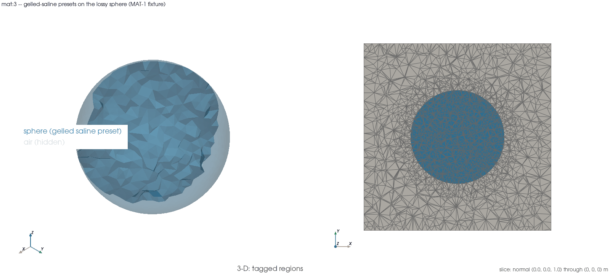

# `mat:3` — which gel: the low / mid / high gelled-saline presets on the lossy sphere

Script: `examples/materials/03_gelled_saline_presets.py` (`EX-65`)
Gate: `tests/materials/test_phantom_material_model.py` (`MAT-1`, re-anchored 2026-09-30)

## 1. What this demonstrates

Materials. `mat:2` sets the sphere by `material_map` at σ = 0.05 / 0.57 S/m;
`mri:1` hand-types a `GelledSalinePhantomMaterial` and asserts nothing. No other
example calls `from_preset`, and none anchors the `phantom_material` /
`phantom_tag` path every coil-and-phantom workflow uses. This example solves the
`low` (σ = 0.45, ε_r = 80), `mid` (0.75, 78) and `high` (1.05, 76) presets at
64 MHz on one mesh (74 020 cells, degree 1), each passed as
`phantom_material` with `phantom_tag = SPHERE_TAG`.

The reading it shows: on an **imposed field** the more conductive gel absorbs
*less*. SAR_high / SAR_low is 0.5693 (closed form 0.5692), where a σ-blind
field says 2.5788.

Everything comes from the gate module by import: `_solve_case`, `_closed_case`,
`MAT4_BAND` (0.10), `_PREDICTED` and the `MAT-4` fixture constants. The one
change to the gate module is additive: the mesh build is lifted verbatim into a
module-level `build_preset_sphere_mesh(comm)`, which the gate now calls too. The
gate was re-run green in the same slot
(`docs/testing/logs/20260930T123853Z_EX-65-mat1-regate.log`, 17 passed).

Asserted, per preset: mean SAR and interior Im/Re E_z each within `MAT4_BAND` of
`_closed_case`. Printed beside the gate record
(`docs/testing/logs/20260930T003229Z_MAT-1-reanchor-W1.log:496–499`), not
asserted: SAR misses 3.523 / 3.548 / 3.557 %, Im/Re misses 0.404 / 0.835 /
1.499 %.

**Negative control (asserted only as "misses `MAT4_BAND`"):** each preset's FEM
SAR against each *other* preset's closed form, six pairs. Measured 20.896 % (high
vs mid) to 81.888 % (low vs high); the predictions, printed beside them, are
20.892 % to 81.777 %.

Scope: imposed uniform field, 64 MHz, degree 1, one mesh rung. No coil, no mass
averaging, no accuracy claim against measured gels.

## 2. How to run it

```
./run_examples.sh -e mat:3 -n 2 -t 300
```

Needs the complex DolfinX build, which the runner sources for the `mat:` group.
Tier: **standard**; the whole run takes ≈ 65 s at `-n 2` (three solves ≈ 39 s).
Verification runs go through the logging harness with the runner's emitted
command (`./scripts/run_examples.sh -e mat:3 --dry-run`). Add
`-e FEM_EM_SETUP_FIGURES=1` after `exec -T` to re-render the setup figure.

## Setup figure



`examples/materials/figures/materials_03_gelled_saline_presets_setup.png`. The
air box is hidden, the sphere (tag 1) is translucent, and the slice is z = 0, the
equatorial plane. All three presets share this mesh; only the sphere's material
changes.

## 3. How to analyze it, step by step

**Step 1 — the preset lines.** Each `preset` line prints σ, ε_r, |k_in|R, the
closed-form SAR, the FEM SAR and its miss, and the Im/Re E_z miss, each with
the gate record beside it. The digits match the record to print precision. A
miss beyond print rounding is an example/test divergence, never a re-record.

**Step 2 — the ratio.** SAR_high / SAR_low is 0.5693 (FEM), 0.5692 (closed),
2.5788 (σ-blind). Printed, not asserted. A higher σ raises the loss but lowers
the interior field by more, so the absorbed power falls.

**Step 3 — the control.** The six wrong-preset pairs miss by 20.9 % to 81.9 %,
against 3.5 % for the right one. `MAT4_BAND` (10 %) therefore tells the presets
apart.

**Step 4 — ParaView.** Open
`examples/materials/paraview_output/materials_03_gelled_saline_presets_combined.xdmf`
and colour by `SAR_low`, `SAR_mid` or `SAR_high` (DG0, zero off the sphere tag)
or threshold on `CellTags`. The per-preset table is
`examples/materials/paraview_output/materials_03_gelled_saline_presets_table.csv`.
Nothing is asserted on these files.

## Related

- The two-σ sphere by `material_map`: `examples/materials/02_lossy_sphere_sar.md`.
- The gate module: `tests/materials/test_phantom_material_model.py`.
