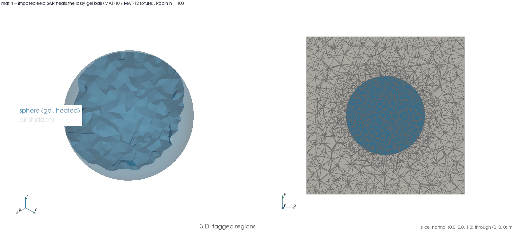

# `mat:4` — SAR heats the gel ball: the steady temperature, the rise curve, and the calorimetric slope SAR/c

Script: `examples/materials/04_sar_heats_gel_ball.py` (`EX-67`)
Gates: `tests/validation/test_mat10_sar_to_heat_sphere.py` (`MAT-10`),
`tests/validation/test_mat12_transient_sar_heating_sphere.py` (`MAT-12`);
the thermal solver is `MAT-9`'s.

## 1. What this demonstrates

The output quantity is temperature. Every other example stops at SAR, and
none imports `fem_em_solver.thermal`. This one takes `mat:2`'s lossy sphere
(R = 0.01 m, σ = 0.57 S/m, ε_r = 78, 64 MHz, imposed uniform field, degree 1)
and turns ½σ|E|² into a heat source. The source is scaled by
G = (5 kV/m / E₀)² = 2.5e7 so the rise is visible, and it is taken as the DG0
cell average q_h on the sphere's own submesh (19 496 cells). The example then
shows three readings:

- **Steady** — the Robin-cooled ball (h = 100 W/m²/K, k = 0.6 W/m/K,
  Bi = 5/3) against the closed-form parabola (`MAT-10`).
- **Rise** — from θ = 0 to t\* = 0.2 R²ρc/k = 139.3 s, Crank–Nicolson with
  two backward-Euler start-up half-steps, N = 40, against the
  eigenfunction series (`MAT-12`). At t\* the steady answer is about twice too
  hot, so it cannot stand in for a short exposure.
- **Slope** — one backward-Euler step of Δt₁ = 1e-5 t_R from θ = 0. Its
  volume mean rises at mean SAR / c, the identity that phantom calorimetry
  rests on (`MAT-12` (S2)).

Everything is imported from the gate modules: the submesh (`_sphere_submesh`,
`_robin_tags`), the source transfer (`_cell_average_dg0`, `_to_sub`), the
closed forms (`_theta_cf`, `_exact_theta`), the norms (`_interior_rel`,
`_whole_rel`, `_mean`), the time-steppers (`_cn`, `_be_one`), the constants,
and every band. The EM solve is `_solve_lossy_sphere` from
`tests/validation/test_lossy_sphere_sar.py`. Nothing is restated. The one gate
change is additive: `_cn(sub, ft, q, snapshot_steps=())` passes the keyword
through to `solve_transient_conduction`. The gate was re-run green in the same
slot (`EX-67-mat12-regate`, 13 passed).

Errors are taken on θ = T − T∞, never on T. The steady solves use
`t_inf = T_INF` (20 °C, `MAT-10`); the transient ones start from T = T∞ = 0
(`MAT-12`).

Asserted, each as its gate writes it:

- (B) ∫_sub q_h = G · `dissipated_power_w` on the parent, `<= B_BAND` (1e-10);
- (P), (A) the steady θ under uniform q_cf and under q_h, interior relative
  L2 `<= P_BAND` (1 %) and `<= A_BAND` (11 %); (C) the steady balance
  `<= C_BAND` (1e-9);
- (P_t), (A_t) the same comparisons at t\*, `<= P_BAND` and `<= A_BAND`;
- (S2) |ρc·θ̄¹ / (Δt₁·q̄_h) − 1| `<= S2_BAND` (1e-4);
- (E) the worst per-step energy balance `<= E_BAND` (1e-9);
- (∞) twenty backward-Euler steps of 5 t_R equal the steady solve with the
  same source, `<= INF_BAND` (1e-8).

**Negative controls (asserted only as "misses `A_BAND`"):** (a) the source
built from Re E alone, through the steady solve (gate read 7.9323e-01);
(b) the steady θ_h[q_h] standing in for θ(t\*) (gate read 1.0108).

Printed beside the gate records
(`docs/testing/logs/20260930T021802Z_MAT-10-step1-W1.log:157–167`,
`docs/testing/logs/20260930T110230Z_MAT-12-W1.log:158–170`), a difference
reported and not asserted: (P) 3.1923e-03, (A) 3.2464e-02, (P_t) 1.6845e-03,
(A_t) 3.4708e-02, (S2) 4.9994e-05 (a slope of 4.958818e-04 K/s on
4.959066e-04 K/s).

Scope: imposed uniform field, 64 MHz, one mesh rung, P1, gel constants
(ρc = 4.18e6 J/m³/K). It does not cover perfusion (`MAT-13`), σ(T)
(`MAT-5`), a coil, mass-averaged SAR, adaptive Δt, `MAT-9`'s real-build ladder,
or any ASTM F2182 claim.

## 2. How to run it

```
./run_examples.sh -e mat:4 -n 2 -t 180
```

Needs the complex DolfinX build, which the runner sources for the `mat:` group.
Tier: **standard**. The whole run takes ≈ 24 s at `-n 2`, 16 s of it the
EM solve. Verification runs go through the logging harness with the runner's
emitted command (`./scripts/run_examples.sh -e mat:4 --dry-run`). Add
`-e FEM_EM_SETUP_FIGURES=1` after `exec -T` to re-render the setup figure.

## Setup figure



`examples/materials/figures/materials_04_sar_heats_gel_ball_setup.png`. The
figure shows the parent mesh of the EM solve (74 020 cells). The sphere (tag 1)
is translucent and the air (tag 2) is hidden in 3-D. The slice is at z = 0.
The heat problem runs only on the sphere's cells, as a submesh whose whole
surface carries the Robin condition.

## 3. How to analyze it, step by step

**Step 1 — the source.** `[source]` prints q_cf = 2002.09 W/m³ from the
closed-form SAR and the FEM mean q̄_h, which is 3.54 % higher. That offset is
`MAT-4`'s mean-SAR error on this mesh, and it carries through every θ below.
(B) shows that no power is lost moving the source from the parent onto the
submesh (≈ 1e-14).

**Step 2 — steady.** (P) at 0.32 % is the thermal solver alone. (A) at 3.2 %
is mostly the source offset of step 1. The controls say why the band can
tell: the Re-E-only source misses by 79 %. It is the classic mistake of
dropping the out-of-phase half of a phasor field.

**Step 3 — the rise curve.** The `[rise]` table gives the volume-mean θ_h
every fourth step, beside the calorimetric line q̄_h·t/(ρc) and the steady
mean. At first the mean follows the line, since no heat has reached the
surface yet. By t\* it has fallen to 69 % of the line, and it sits at 52 % of
the steady mean. Control (b) is the same statement as an interior norm: the
steady field misses θ(t\*) by ≈ 101 %.

**Step 4 — the slope.** (S2) reads |ratio − 1| = 5.0e-5. That is the surface
loss in one Δt₁ (the printed estimate 3·Bi·Δt₁/t_R = 5.0e-5), not a solver
error. So a calorimetric SAR measured from the initial slope of a gel phantom
is exact in the limit, and this is how early "early" has to be.

**Step 5 — ParaView.** Open
`examples/materials/paraview_output/materials_04_sar_heats_gel_ball_steady_combined.xdmf`
and colour by `q_h` (DG0) or `theta_steady` (P1, θ = T − T∞). Then open
`examples/materials/paraview_output/materials_04_sar_heats_gel_ball_transient_combined.xdmf`
and play the time steps: `theta` at steps 0, 4, …, 40 (t = 0 … 139.3 s).
The table is `examples/materials/paraview_output/materials_04_sar_heats_gel_ball_rise_curve.csv`.
The files are written on the submesh, so the air is absent. E and SAR on
the parent mesh are `mat:2`'s outputs.

## Related

- The SAR this heats: `examples/materials/02_lossy_sphere_sar.md`.
- The gel presets on the same sphere: `examples/materials/03_gelled_saline_presets.md`.
- The gate modules: `tests/validation/test_mat10_sar_to_heat_sphere.py`, `tests/validation/test_mat12_transient_sar_heating_sphere.py`.
