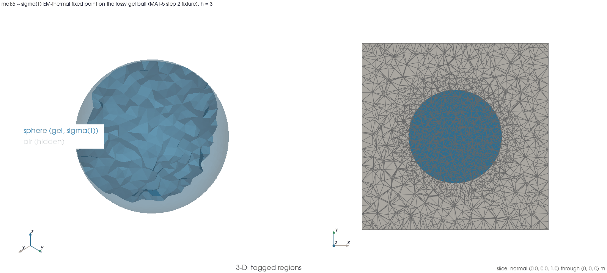

# `mat:5` — the gel warms and conducts better: the σ(T) EM–thermal fixed point, iterate by iterate

Script: `examples/materials/05_sigma_of_t_fixed_point.py` (`EX-68`)
Gate: `tests/validation/test_mat5_em_coupled_sphere.py` (`MAT-5` step 2)

## 1. What this demonstrates

A material driven by a field: σ is a per-cell field set by the previous
thermal solve. No other example feeds a temperature back into a material.
`mat:5` takes `mat:2`'s lossy sphere (R = 0.01 m, ε_r = 78, 64 MHz, imposed
uniform field, degree 1) and runs eight Picard iterates. Each iterate does
four things:

1. an EM solve with a DG0 σ on the sphere's cells;
2. a DG0 heat source G·½σ|E|² on the sphere's submesh (19 496 cells);
3. the Robin-cooled ball (h = 3 W/m²/K, Bi = 0.05, k = 0.6 W/m/K);
4. σ_K = σ₀[1 + α θ̄_K] (σ₀ = 0.285 S/m at T_ref, α = 0.02 /K), which feeds
   the next EM solve.

It starts from θ₀ = 0, runs a fixed N = 8, and applies no relaxation.

The iterates **alternate**. On an imposed field the more conductive sphere
absorbs *less* (the `mat:3` reading), so a hotter gel draws less power and
cools. The feedback is negative and contracts by ≈ −0.31 per step. Freezing
σ at σ₀ (iterate 1) overshoots the fixed point's surface temperature by 26 %
and misses the profile by 29 %.

`src/` has no coupled-solver API. The loop is the script's own, written over
the gate module's module-level helpers (`_em_solve`, `_heat_source`,
`_volume_mean`, `_real`), `MAT-10`'s submesh tools, and public calls
(`solve_steady_conduction`, `LinearTemperatureConductivity`,
`robin_sphere_steady_temperature`). `N_PICARD` and the bands are imported,
and no gate module is edited. The loop is held to the gate's printed record:
every surface-mean iterate θ_s must equal the record to its six printed
decimals. A miss would mean this loop is not the gate's, and the script
reports it as a divergence and stops.

Asserted at iterate 8, as the gate writes them:

- (A′) interior θ₈ against the closed-form profile at q\* = 45 000 W/m³,
  `<= A2_BAND` (11.7 %);
- (S) the increments alternate in sign, and |δ₈|/θ₈ `<= S_BAND` (1e-3);
- (B′) ∫_sub q_h = G·P_diss `<= B_BAND`; (C′) the surface balance
  `<= C_BAND`; (D′) ∫σ x·x on the parent's sphere cells against the submesh,
  `<= D_BAND`;
- the eight θ_s iterates equal to the record's printed digits.

**Negative control (asserted only as "misses `A2_BAND`"):** iterate 1, the
frozen-σ₀ solve (gate read 2.9192e-01).

Printed beside the record (`docs/testing/logs/20260930T124701Z_MAT-5-step2-W2.log:163–183`):
θ_s = 64.599332 / 47.180063 / 52.417352 / 50.780364 / 51.286944 / 51.129658 /
51.178444 / 51.163307 K; last ratio −0.31027; (A′) 2.3225e-02; |δ₈|/θ₈
2.959e-04.

Scope: imposed field, linear σ(T), α = 0.02 /K, Bi = 0.05, eight undamped
iterates, P1. This is a numerical fixture with a 50 K rise, not a material or
exposure claim. It does not cover ε(T), perfusion, transient coupling, a coil,
or any `src/` change.

## 2. How to run it

```
./run_examples.sh -e mat:5 -n 2 -t 600
```

Needs the complex DolfinX build, which the runner sources for the `mat:` group.
Tier: **heavy**. The whole run takes ≈ 121 s at `-n 2`: nine EM solves
averaging ≈ 13 s, including the mesh builder's reference solve. Verification
runs go through the logging harness with the runner's emitted command
(`./scripts/run_examples.sh -e mat:5 -t 600 --dry-run`). Add
`-e FEM_EM_SETUP_FIGURES=1` after `exec -T` to re-render the setup figure.

## Setup figure



`examples/materials/figures/materials_05_sigma_of_t_fixed_point_setup.png`.
The figure shows the parent mesh of the EM solves (74 020 cells). The sphere
(tag 1, the σ(T) region) is translucent and the air (tag 2) is hidden in 3-D.
The slice is at z = 0. The thermal problem runs on the sphere's submesh with
the Robin condition on its whole surface.

## 3. How to analyze it, step by step

**Step 1 — the iterate table.** Each `[picard]` line prints the volume-mean
σ fed into the EM solve, the surface-mean θ_s beside its record, the
increment δ_n, and the interior error against the profile. σ̄ swings from
0.285 (iterate 1, T = T∞) to 0.657 and settles at ≈ 0.5796 S/m. θ_s swings
64.6 → 47.2 → 52.4 → … → 51.163 K.

**Step 2 — the contraction.** The ratios δ_{n+1}/δ_n settle at −0.310. The
sign is the physics: a negative feedback gives alternating iterates. The
magnitude sets how many iterates a tolerance costs, since |δ₈|/θ₈ = 3.0e-4
after eight undamped steps.

**Step 3 — the fixed point against the anchor.** θ_s,8 = 51.163 K sits
+2.33 % above the lumped root θ_L = 50 K. That gap is the FEM SAR's ≈ 3.5 %
mean offset seen through the feedback, which damps it. (A′) = 2.3 % is the
same figure as an interior norm, and the frozen-σ₀ control misses by 29 %.

**Step 4 — ParaView.** Open
`examples/materials/paraview_output/materials_05_sigma_of_t_fixed_point_combined.xdmf`
and step through time 1…8, one iterate per step. Colour by `sigma` (DG0),
`q_h` (DG0) or `theta` (P1, θ = T − T∞) to watch the field swing and settle.
The table is
`examples/materials/paraview_output/materials_05_sigma_of_t_fixed_point_iterates.csv`.

## Related

- The presets that show the imposed-field inversion: `examples/materials/03_gelled_saline_presets.md`.
- SAR heating without feedback: `examples/materials/04_sar_heats_gel_ball.md`.
- The gate module: `tests/validation/test_mat5_em_coupled_sphere.py`.
