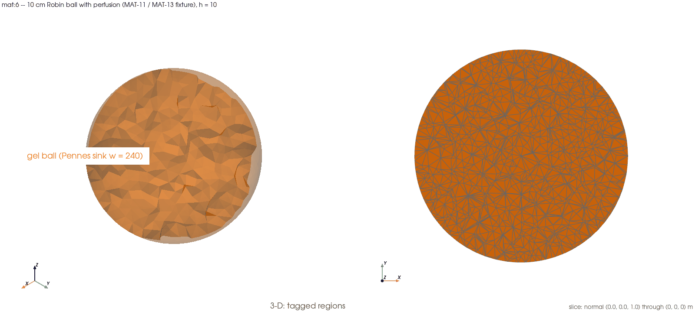

# `mat:6` — perfusion carries half the heat: the Pennes sink on the Robin ball, steady and rising

Script: `examples/materials/06_perfusion_sink_robin_ball.py` (`EX-69`)
Gates: `tests/validation/test_mat11_perfusion_sphere.py` (`MAT-11`),
`tests/validation/test_mat13_transient_perfusion_sphere.py` (`MAT-13`); the
thermal solver is `MAT-9`'s with the perfusion term of `MAT-11` / `MAT-13`.

## 1. What this demonstrates

This is the first example with a perfusion term; `mat:4` and `mat:5` exclude
it by name. The fixture is the gates' own: a 10 cm ball, k = 0.6 W/m/K,
uniform source q = 2000 W/m³, Robin h = 10 W/m²/K, arterial blood and ambient
both at 20 °C. The Pennes sink w(T − T_a) is switched on at
w = 240 W/m³/K (m R = 2) and set against w = 0. Two readings:

- **Steady** (`MAT-11`) — perfusion removes 4.251 of the 8.347 W (50.9 %); the
  surface convects 4.096 W. The centre sits at θ = 5.55 K and the surface at
  3.27 K. Without perfusion the volume-mean θ is 8.87 K; with it, 4.24 K.
- **Rise** (`MAT-13`) — from θ = 0 to t\* = 0.2 R²ρc/k = 13 933 s,
  Crank–Nicolson with two backward-Euler start-up half-steps, N = 40. At t\*
  the power splits storage / convection / perfusion = 21.3 / 38.9 / 39.8 %.

Everything is imported from the gate modules: `W`, `INTERIOR_BAND`,
`BALANCE_BAND`, `_errors`, `_balance`, `_centre_surface` from `MAT-11`; `R`,
`K`, `Q`, `H`, `T_INF`, `RHO_C`, `T_END`, `ROBIN_TAG`, `_ball`, `_transient`,
`_exact_theta`, `_series_w`, `_series_0`, `_interior_error` from `MAT-13`.
The bands come from `MAT-11`, where they are defined, and the example asserts
structurally that `MAT-13`'s by-value copies equal them. Nothing is restated
and no gate is edited. The mesh is built once, through `MAT-13`'s `_ball()`
(19 463 cells), and passed to `MAT-11`'s `_errors`.

Errors are on θ = T − T∞, never on T; both gates run at T∞ = 20.

Asserted, each as its gate writes it:

- steady (i) the interior relative L2 error on θ `<= INTERIOR_BAND` (1e-2);
- steady (iii) the balance |convected + perfused − source|/source
  `<= BALANCE_BAND` (1e-9);
- transient (P_w) the interior relative L2 error at t\* `<= INTERIOR_BAND`;
- transient (E) the per-step energy balance `<= BALANCE_BAND`, both the
  solver's worst step and the last step recomputed from snapshots 39 and 40.

**Negative controls (asserted only as "misses `INTERIOR_BAND`"):** steady
w = 0 against the perfused closed form (gate read 1.1055); transient w = 0
against the perfused series at t\* (gate read 3.8871e-01).

Printed beside the gate records, a difference reported and not asserted. The
records are the gates' complex-build legs
(`docs/testing/logs/20261001T004409Z_MAT-11-cx-W2.log:119,130`,
`docs/testing/logs/20261001T004517Z_MAT-13-cx-W3.log:99–102`): steady (i)
1.8285e-03, 4.095893 / 4.251127 / 8.347021 W, 5.5505 / 3.2660 K; (P_w)
1.6426e-03, perfused 3.3197 of 8.3470 W, split 0.2134 / 0.3889 / 0.3977,
(w → 0) 1.7085e-03.

Scope: one w, one mesh rung, uniform q, arterial = ambient, P1, fixed Δt.
It does not cover the convergence rates, the long-time limit, the first-step
rate, the sign-flip control, a SAR source (`MAT-14`), σ(T), any tissue
property, or any ASTM F2182 claim.

## 2. How to run it

```
./run_examples.sh -e mat:6 -n 2 -t 180
```

Needs the complex DolfinX build, which the runner sources for the `mat:`
group. Tier: **standard**. The whole run takes ≈ 14 s wall at `-n 2`. Verification runs
go through the logging harness with the runner's emitted command
(`./scripts/run_examples.sh -e mat:6 --dry-run`). Add
`-e FEM_EM_SETUP_FIGURES=1` after `exec -T` to re-render the setup figure.

## Setup figure



`examples/materials/figures/materials_06_perfusion_sink_robin_ball_setup.png`.
The figure shows `MAT-13`'s `_ball()` mesh (19 463 cells, one region, tag 1,
drawn translucent). The slice is at z = 0. The whole outer surface carries the
Robin condition; there is no air region.

## 3. How to analyze it, step by step

**Step 1 — the steady split.** `[steady]` prints (i) at 1.83e-03, well inside
the 1 % band, and (iii) at 1.7e-15. The convected and perfused powers and the
centre / surface values equal the gate's to the digits printed. Perfusion
carries 0.5093 of the source. The control reads 1.1055: with w = 0 the
field is 110 % off the perfused closed form.

**Step 2 — the rise.** `[transient]` prints (P_w) at 1.64e-03 and the balance
at 1.3e-14. At t\* perfusion takes 3.32 of 8.35 W, still below its steady
4.25 W because the ball has not yet warmed. The control reads 0.389, so the
band does see a missing sink even though t\* is short.

**Step 3 — the rise curve.** The `[rise]` table gives the volume-mean θ_h
every fourth step for w = 240 and w = 0. The unperfused ball rises faster at
every step, and by t\* is at 4.61 K against 3.33 K; the perfused steady mean is
4.24 K. The frames are CG1 interpolants; nothing is asserted on them.

**Step 4 — ParaView.** Open
`examples/materials/paraview_output/materials_06_perfusion_sink_robin_ball_steady_combined.xdmf`
and colour by `theta_perfused` or `theta_unperfused` (P1, θ = T − T∞). Then
open
`examples/materials/paraview_output/materials_06_perfusion_sink_robin_ball_transient_combined.xdmf`
and play the time steps: `theta` (w = 240) at steps 0, 4, …, 40. The table is
`examples/materials/paraview_output/materials_06_perfusion_sink_robin_ball_rise_curve.csv`.

## Related

- The unperfused heating of a gel ball: `examples/materials/04_sar_heats_gel_ball.md`.
- The gate modules: `tests/validation/test_mat11_perfusion_sphere.py`, `tests/validation/test_mat13_transient_perfusion_sphere.py`.
