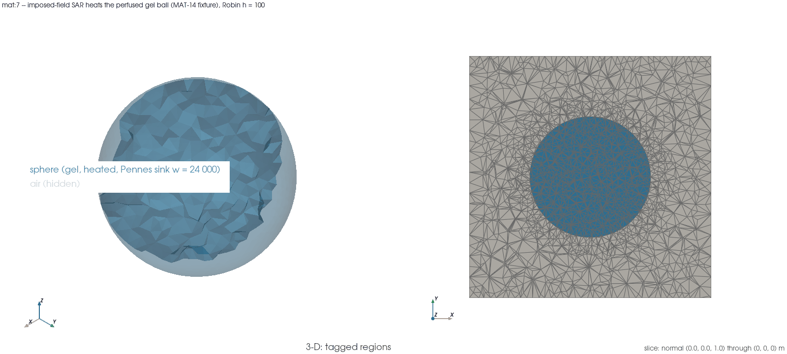

# `mat:7` — SAR heats a perfused ball: the rise with the Pennes sink switched on

Script: `examples/materials/07_sar_heats_perfused_ball.py` (`EX-73`)
Gates: `tests/validation/test_mat14_sar_pennes_transient_sphere.py` (`MAT-14`),
with `MAT-10` (`test_mat10_sar_to_heat_sphere.py`), `MAT-12`
(`test_mat12_transient_sar_heating_sphere.py`) and the lossy-sphere fixture
(`test_lossy_sphere_sar.py`).

## 1. What this demonstrates

`mat:4` heats the lossy gel ball with SAR but has no sink; `mat:6` has the
Pennes sink but a uniform source. This is the first example with SAR and
perfusion together. The fixture is `mat:4`'s: R = 0.01 m, σ = 0.57 S/m,
ε_r = 78, 64 MHz, an imposed uniform field, Robin h = 100 W/m²/K, arterial
blood = ambient = T(0) = 20 °C. The DG0 source q_h = G·½σ|E|² (G the `MAT-10`
factor) sits on the sphere submesh (19 496 cells) and drives `MAT-14`'s
Crank–Nicolson rise (two backward-Euler start-up half-steps, N = 40) to
t\* = 139.33 s with w = 24 000 W/m³/K, beside w = 0.

**w = 24 000 W/m³/K (m R = 2) is `MAT-13`'s dimensionless twin: a numerical
choice, not a tissue value.** No physiological perfusion, no coil and no
compliance claim is made.

At t\* the power splits storage / convection / perfusion =
0.2134 / 0.3888 / 0.3978 (the gate's digits). The volume-mean θ_h rises to
0.03454 K with the sink and 0.04779 K without it; the steady means are
0.0440 K and 0.0919 K.

Everything is imported from the gate modules and nothing is restated; the
names `MAT-14` re-imports are asserted `is` the originals, and no gate is
edited. One EM solve is reused for every leg.

Asserted, each as `MAT-14` writes it:

- (P_w′) uniform q_cf, interior relative L2 on θ at t\* `<= P_BAND` (1e-2);
- (A_w) q_h `<= A_BAND` (0.11, composed);
- (E) every run `<= E_BAND` (1e-9), and the last step recomputed from
  snapshots 39 / 40;
- (∞) 20 × 5 t_R backward Euler against the perfused steady solve with q_h
  `<= INF_BAND` (1e-8);
- (w→0) `MAT-12`'s own `_cn` legs print `1.6845e-03` and `3.4708e-02`
  (string equality with `MAT-14`'s `MAT12_P_RECORD` / `MAT12_A_RECORD`).

**Negative control (asserted only as "misses `A_BAND`"):** (a′) w dropped with
q_h, against the perfused series, reads 0.43826 (gate record 0.43826).

Printed beside `docs/testing/logs/20261001T004928Z_MAT-14-W1.log:162–171`, a
difference reported and not asserted: (P_w′) 1.6089e-03 (diff −1.5e-08), (A_w)
3.4979e-02 (diff −2.6e-07), (E) 5.634e-14 against 3.308e-14, (∞) 3.089e-13
against 3.105e-13.

Scope: `MAT-14`'s fixture and legs. Not: (S1) / (S2), (N-sim), a physiological
w, coil-driven SAR, thermal dose.

## 2. How to run it

```
./run_examples.sh -e mat:7 -n 2 -t 180
```

Needs the complex DolfinX build, which the runner sources for the `mat:`
group. Tier: **standard**. The whole run takes ≈ 35 s wall at `-n 2`
(EM ≈ 17 s). Verification runs go through the logging harness with the
runner's emitted command (`./scripts/run_examples.sh -e mat:7 --dry-run`). Add
`-e FEM_EM_SETUP_FIGURES=1` after `exec -T` to re-render the setup figure.

## Setup figure



`examples/materials/figures/materials_07_sar_heats_perfused_ball_setup.png`.
The figure shows `MAT-4`'s lossy-sphere mesh (74 020 cells; the air region is
hidden, the gel ball is drawn translucent, with the Pennes sink w = 24 000).
The slice is at z = 0.

## 3. How to analyze it, step by step

**Step 1 — the two perfused legs.** `[transient]` prints (P_w′) at 1.61e-03
and (A_w) at 3.50e-02: the FEM SAR source adds the +3.5 % mean-SAR offset of
`mat:4` on top of the discretisation error, as it does without the sink.

**Step 2 — the energy balance.** (E) is ≈ 1e-13 against the 1e-9 band, with
the perfused term in the sum. The split 0.2134 / 0.3888 / 0.3978 is the
gate's; dropping the sink from the balance would leave 0.398 unaccounted.

**Step 3 — the control and the limits.** (a′) reads 0.438: with w = 0 the
field is 44 % off the perfused series, so the band does see a missing sink.
(∞) agrees to 3e-13, and with w → 0 the legs are `MAT-12`'s to the digit.

**Step 4 — the rise curve.** The `[rise]` table gives the volume-mean θ_h
every fourth step for w = 24 000 and w = 0. The unperfused ball rises faster
at every step; the frames are CG1 interpolants and nothing is asserted on
them.

**Step 5 — ParaView.** Open
`examples/materials/paraview_output/materials_07_sar_heats_perfused_ball_transient_combined.xdmf`
and play the time steps: `theta_w24000` and `theta_w0` (P1, θ = T − T∞) at
steps 0, 4, …, 40, and the DG0 source `q_h`. The steady fields under q_h are
in
`examples/materials/paraview_output/materials_07_sar_heats_perfused_ball_steady_combined.xdmf`
(`theta_perfused`, `theta_unperfused`). The table is
`examples/materials/paraview_output/materials_07_sar_heats_perfused_ball_rise_curve.csv`.

## Related

- Heating without a sink: `examples/materials/04_sar_heats_gel_ball.md`.
- A sink without a SAR source: `examples/materials/06_perfusion_sink_robin_ball.md`.
- The gate module: `tests/validation/test_mat14_sar_pennes_transient_sphere.py`.
