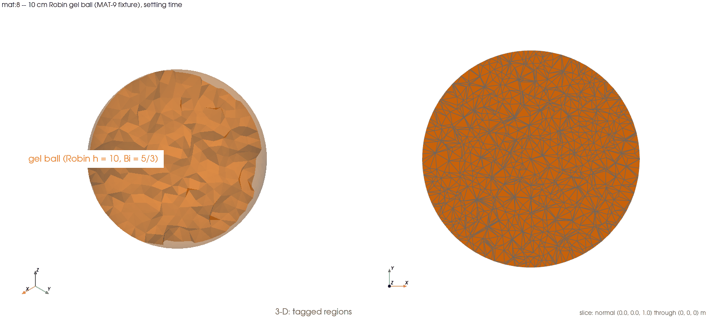

# `mat:8` — how long a gel ball takes to settle: the time axis

Script: `examples/materials/08_gel_ball_settling_time.py` (`EX-74`)
Gates: `tests/validation/test_mat9_transient_conduction_sphere.py` (`MAT-9`),
with the complex-safe norm twins of
`tests/validation/test_mat13_transient_perfusion_sphere.py` (`MAT-13`).

## 1. What this demonstrates

`mat:6` and `mat:4` solve the Robin-cooled ball's transient only to Fo 0.2
(t\* = 13 933 s), where the ball is about half-way to steady. This example runs
`MAT-9`'s 10 cm gel ball (k = 0.6 W/m/K, Q = 2000 W/m³, ρc = 4.18e6 J/m³/K,
h = 10 W/m²/K, Bi = 5/3, T∞ = T(0) = 20 °C; 19 463 cells) out to 3 t_R
(t_R = R²ρc/k = 69 667 s) and shows the settling time.

The slowest mode λ₁ = 1.907090 sets τ₁ = t_R/λ₁² = 19 155 s = 5.32 h. The
volume-mean θ reaches within 1 % of its steady value at t₉₉ = 88 118 s
(24.48 h, Fo 1.265) from the series, 87 864 s from the FEM (−2.9e-03 relative);
the one-mode asymptote gives the series value to 5e-07. No physiological claim:
a gel ball with a surface film, no perfusion, no SAR.

Everything is imported from the gate modules and nothing is restated; `MAT-13`'s
by-value fixture constants are asserted equal to `MAT-9`'s. `MAT-9`'s own
`_interior_error` / `_rel_diff` call `float()` on a complex value and are not
used. No gate is edited.

Asserted:

- (i) CN + Rannacher, N = 40, 0.01 m, interior relative L2 on θ at t\* against
  the series `<= INTERIOR_BAND` (1e-2), and the formatted error equals
  `MAT9_RECORD`: `1.7085e-03`;
- (iii) every run (13) `<= BALANCE_BAND` (1e-9); worst 3.724e-14.

**Negative control (asserted only as "misses `INTERIOR_BAND`"):** the steady
field standing in for θ(t\*) reads 0.94145, a 94 % miss. `MAT-9`'s own
record, 0.94421, was taken on the 0.005 m mesh (`MAT-9`
step 2b log); this run is on the 0.01 m mesh, so the −2.8e-03 difference is
the mesh and is not a divergence.

Printed beside their records, never gated:

- (iv) 20 × 5 t_R backward Euler against the steady solve: 4.053e-15 (`MAT-9`
  asserts 1e-8);
- the Δt ladder (N = 10 … 160, whole-ball self-differences): backward Euler LSQ
  rate 0.984 (record 0.984), CN + Rannacher 2.001 (record 2.001), pairwise
  0.972 / 0.986 / 0.993 and 2.002 / 2.000 / 2.000;
- the settle curve (CN N = 120, Fo 0.05 … 3), below.

## 2. How to run it

```
./run_examples.sh -e mat:8 -n 2 -t 180
```

Needs the complex DolfinX build, which the runner sources for the `mat:` group.
Tier: **standard**. The whole run takes ≈ 27 s wall at `-n 2`. Verification
runs go through the logging harness with the runner's emitted command
(`./scripts/run_examples.sh -e mat:8 --dry-run`). Add `-e FEM_EM_SETUP_FIGURES=1`
after `exec -T` to re-render the setup figure.

## Setup figure



`examples/materials/figures/materials_08_gel_ball_settling_time_setup.png`.
The figure shows `MAT-9`'s ball mesh (19 463 cells, one region: the gel ball,
drawn translucent), with the slice at z = 0.

## 3. How to analyze it, step by step

**Step 1 — the gated end.** `[transient] (i)` prints 1.7085e-03 against the
record 1.7085e-03, string-equal, and the quasi-static control 0.94145 misses
the 1e-2 band by two orders of magnitude: at Fo 0.2 the ball is nowhere near
steady.

**Step 2 — the Δt order.** `[ladder]` prints the two rates: backward Euler is
first order (0.984), CN with two backward-Euler start-up half-steps is second
(2.001), both to the third digit of `MAT-9`'s records.

**Step 3 — the settle curve.** `[settle]` gives the volume-mean θ at Fo 0.05 to
3 beside the series and the deficit (θ_ss − θ_mean)/θ_ss, FEM, series and
one-mode. By Fo 0.3 the deficit is on the one-mode line e^(−λ₁²Fo) (prefactor
fitted at Fo 3) to the printed digits; the FEM deficit sits below it by 0.15 % at Fo 0.3
growing to 3.4 % at Fo 3, because its discrete steady mean is 8.8657 K against
the closed form 8.8889 K (the late-time deficit is a small difference of two
nearly equal means). The late-time FEM log-slope is −3.649 against −λ₁² = −3.637.

**Step 4 — t₉₉.** The series needs 88 118 s (1.02 d), the FEM 87 864 s. The
cooling curve θ_ss,h − θ_heat,h is the exact cooling from the discrete steady
state for the linear θ-scheme (q off; the discrete steady state is a fixed
point with q on), so it is written, not solved separately.

**Step 5 — ParaView.** Open
`examples/materials/paraview_output/materials_08_gel_ball_settling_time_settle_combined.xdmf`
and play the time steps: `theta_heating` and `theta_cooling` (P1, θ = T − T∞,
CG1 interpolants, nothing asserted) at steps 0, 4, …, 120. The table
`examples/materials/paraview_output/materials_08_gel_ball_settling_time_settle_curve.csv`
has the volume-mean heating and cooling curves and the series mean at every step.

## Related

- The same ball to Fo 0.2: `examples/materials/06_perfusion_sink_robin_ball.md`.
- The gate modules: `tests/validation/test_mat9_transient_conduction_sphere.py`,
  `tests/validation/test_mat13_transient_perfusion_sphere.py`.
