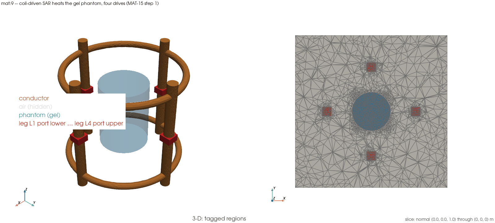

# `mat:9` — coil-driven SAR heats the gel phantom: four drives, four hot spots

Script: `examples/materials/09_coil_driven_heating_phantom.py` (`EX-79`)
Gate: `tests/validation/test_mat15_coil_driven_heating_phantom.py` (`MAT-15` step 1).

## 1. What this demonstrates

`mat:4` and `mat:7` heat a gel ball under an imposed uniform field, and `mri:3`
shows the four single-leg drives' SAR without heat. This example puts the two
together on a coil: `ANS-2`'s 10 MHz loaded F-small birdcage on the 0.0025 m
phantom rung (199 920 cells, 58 866 in the phantom), each of the four
single-leg drives solved through `_solve_driven`, the dissipated power ½σ|E|²
transferred as a DG0 heat source to the phantom submesh at **one** normalisation
G = 1 W / P₁, and a Robin-cooled gel transient (k 0.6 W/m/K, ρc 4.18e6, h 10,
T∞ = 20 °C, t\* = 0.2 t_R = 1254 s) driven by each.

The script calls `_run_heated(return_fields=True)`, `MAT-15` step 1's fixture
body lifted to module level (a disclosed, additive rule (a) lift; the gate was
re-run green after it). Bands and records are imported, never restated, and
the script checks by identity (`is`) that its `E_BAND`, `S2_BAND`, `B_BAND`,
`C4_COVARIANCE_BAND` and `_solve_driven` are the gate modules' own objects.

Asserted, each printed beside `20261001T123309Z_MAT-15-step1-W1.log:1924-1954`:
(B) source transfer ≤ `B_BAND`; V_sub against the record ≤ `V_BAND`; (E) every
run and (E′) per drive ≤ `E_BAND`; (S2) ≤ `S2_BAND`; (C4) the four cyclic 10 g θ
pairs ≤ `C4_COVARIANCE_BAND`.

**Negative controls (asserted):** (d) a doubled source misses (E′) by exactly 1
(> `D_CONTROL_FLOOR`); (f) the far-side ball's θ misses the own-side ball's by
≈ 75 % (> `F_CONTROL_FLOOR`).

Not claimed: absolute temperature (1 W normalisation), quadrature drive,
convergence, a θ(t) series, perfusion, tissue, thermal dose, `ANS-9`.

## 2. How to run it

```
./scripts/run_examples.sh -e mat:9 -n 2 -t 480
```

Needs the complex DolfinX build, which the runner sources for the `mat:` group.
Tier: **heavy**, ≈ 220 s wall at `-n 2`. Verification runs go through the logging
harness with the runner's emitted command
(`./scripts/run_examples.sh -e mat:9 -n 2 -t 480 --dry-run`). Add
`-e FEM_EM_SETUP_FIGURES=1` after `exec -T` to re-render the setup figure.
Output: `examples/materials/paraview_output/materials_09_coil_driven_heating_phantom_combined.xdmf`.

## Setup figure



`examples/materials/figures/materials_09_coil_driven_heating_phantom_setup.png`.
The `GEO-18` gapped, sheeted four-leg birdcage on `ANS-2`'s phantom rung:
conductor and port sheets shown, the gel phantom translucent, air hidden, sliced
at z = 0.

## 3. How to analyze it, step by step

**Step 1 — the four hot spots are one rotation.** Open
`examples/materials/paraview_output/materials_09_coil_driven_heating_phantom_combined.xdmf`
and colour by `real_theta_k0`; then `real_theta_k1` under a 90° Transform about
z: it lands on `theta_k0`. The script's (C4) pairs say the same in numbers: the
four 10 g ball means of θ at the four rotated centres agree cyclically to
0.02–0.05 % against a 5 % band, while the far-side ball (control (f)) misses by
75 %. `theta_k*` are P1 fields of T − T∞ at t\*, `q_h_k*` DG0 in W/m³ at
G = 1 W / P₁; the complex build writes `real_` / `imag_` splits (the imaginary
parts are zero).

## Related

- `mat:4`: `examples/materials/04_sar_heats_gel_ball.md`
- `mat:7`: `examples/materials/07_sar_heats_perfused_ball.md`
- `mri:3`: `examples/mri/03_birdcage_mass_averaged_sar.md`
- `ports:9`: `examples/ports/09_birdcage_sar_quadrant_powers.md`
