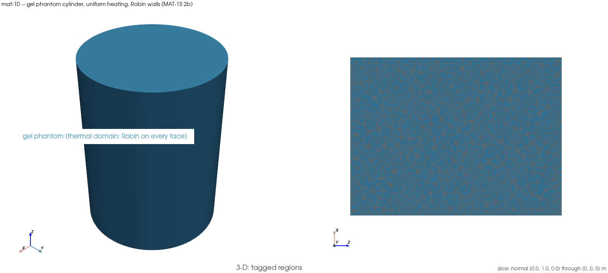

# `mat:10` — the phantom's own cylinder against its closed form: uniform heating, Robin walls, steady and at t*

Script: `examples/materials/10_finite_cylinder_robin_series.py` (`EX-81`)
Gate: `tests/validation/test_mat15_finite_cylinder_fem.py` (`MAT-15` step 2(b)).

## 1. What this demonstrates

`mat:4` / `mat:6` / `mat:7` / `mat:8` compare heat balls with a one-index series;
`mat:9` heats this cylinder under a coil source with no comparand. Here the
source is uniform q and the gel cylinder (a = 0.03 m, 2L = 0.08 m, the 0.0025 m
phantom rung, 58 866 cells) is cooled by a Robin film (h = 10) on every face. The
comparand is `MAT-15` step 2(a)'s double eigen-series (radial J₀ roots by axial
cosine roots), so the P1 error is read pointwise, in L2 over the interior
(r < 0.9 a, |z| < 0.9 L), and mapped onto the faceted lateral wall and the corners.

The script calls `_run_transient(return_fields=True)`, the gate's `transient`
fixture body lifted to module level (a disclosed, additive rule (a) lift; the
transient nodes were re-gated green in the same slot). Bands, records and the
series helpers are imported, never restated; `INTERIOR_BAND`, `E_BAND` and
`INF_BAND` are checked by identity (`is`) against the gate modules' objects.

Asserted, each printed beside its record: cells = `FINEST_CELLS`; (T) CN interior,
(E) balance and (∞) backward-Euler-vs-steady against
`20261002T093610Z_MAT-15-step2b-W5-transient.log:1875-1883`; the steady interior
and Gauss balance against `20261002T093152Z_MAT-15-step2b-W4-steady.log:7174-7176`.

**Negative control (asserted):** (c2), the Dirichlet radial roots in the series,
misses `INTERIOR_BAND` (record 0.77946, ≈ 78× the band).

Not claimed: the LSQ rate (the gate's four-rung fixture), EM, perfusion, degree 2, `ANS-9`.

## 2. How to run it

```
./scripts/run_examples.sh -e mat:10 -n 2 -t 480
```

Needs the complex DolfinX build, which the runner sources for the `mat:` group.
Tier: **heavy**, ≈ 270 s wall at `-n 2`. Verification runs go through the logging
harness with the runner's emitted command
(`./scripts/run_examples.sh -e mat:10 -n 2 -t 480 --dry-run`). Add
`-e FEM_EM_SETUP_FIGURES=1` after `exec -T` to re-render the setup figure.
Output: `examples/materials/paraview_output/materials_10_finite_cylinder_robin_series_combined.xdmf`.

## Setup figure



`examples/materials/figures/materials_10_finite_cylinder_robin_series_setup.png`.
The tag-3 thermal submesh alone (the gel phantom, 58 866 tetrahedra, Robin on
every exterior face), sliced at y = 0.

## 3. How to analyze it, step by step

**Step 1 — Plot Over Line, colour by error.** Open
`examples/materials/paraview_output/materials_10_finite_cylinder_robin_series_combined.xdmf`.
Apply Plot Over Line from (0, 0, −0.04) to (0, 0, 0.04) for `real_theta_h_steady`
and `real_theta_series_steady`; the curves overlie to ≈ 7e-4 relative. Repeat along
(0, 0, 0) to (0.03, 0, 0). The complex build writes `real_` / `imag_` splits (the
imaginary parts are zero).

**Step 2 — where the error lives.** Slice at y = 0 and colour by
`real_theta_err_steady`, then `real_theta_err_tstar`: the error is concentrated on
the faceted lateral wall and at the rim corners, where the P1 mesh cannot follow the
true cylinder.

**Step 3 — threshold the interior mask.** Threshold `interior_mask` ≥ 0.5 to see the
r < 0.9 a, |z| < 0.9 L cells over which the asserted L2 is taken; the interior
steady error is 7.373685e-04 and the CN error at t* is 3.494532e-04, against a
1e-2 band. Control (c2) shows the same interior misses by 0.78 when the series
uses Dirichlet radial roots.

## Related

- `mat:8`: `examples/materials/08_gel_ball_settling_time.md`
- `mat:9`: `examples/materials/09_coil_driven_heating_phantom.md`
- `mat:6`: `examples/materials/06_perfusion_sink_robin_ball.md`
- `mesh:2`: `examples/meshing/02_cylindrical_phantom.md`
