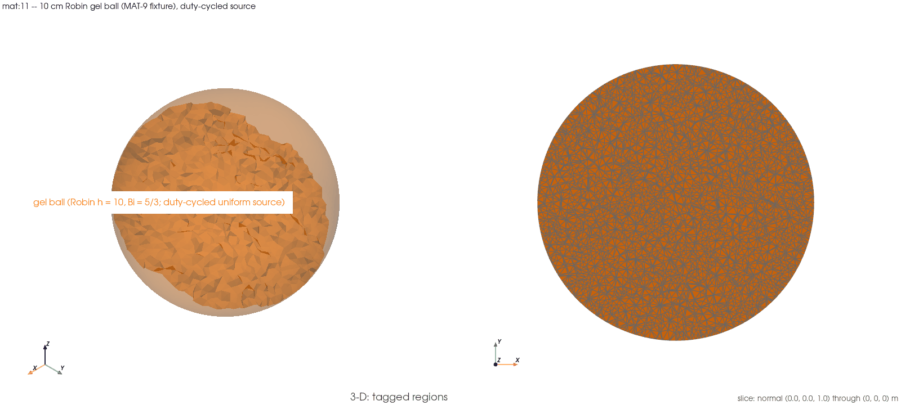

# `mat:11` — a duty-cycled source on the gel ball: what the average hides

Script: `examples/materials/11_duty_cycled_gel_ball.py` (`EX-85`)
Gates: `tests/validation/test_mat17_duty_cycle_fem.py` (`MAT-17` step 2) and
`tests/validation/test_mat17_duty_cycle_closed_form.py` (`MAT-17` step 1), with
the complex-safe norm twins of
`tests/validation/test_mat13_transient_perfusion_sphere.py` (`MAT-13`).

## 1. What this demonstrates

`mat:4`, `mat:6` and `mat:8` heat `MAT-9`'s 10 cm gel ball (k = 0.6 W/m/K,
Q = 2000 W/m³, ρc = 4.18e6 J/m³/K, Robin h = 10 W/m²/K, Bi = 5/3,
T∞ = T(0) = 20 °C; 151 548 cells at 0.005 m) with a source that is always on.
This example switches the same uniform source 0/1 through `MAT-17` step 2's
`source_schedule`, in the complex build, P1, CN + Rannacher:

- **case A**: period P = 1200 s, duty D = 0.5, Δt = 150 s, N = 94, to
  t = 14 100 s (mid off-phase of cycle 11);
- **case B**: P = 0.2 t_R, D = 0.25, Δt = DP/8 = 435.4 s, N = 20, to
  t = 2.5 DP (mid off-phase of cycle 0).

Every band and helper is imported from the gate modules, nothing is restated;
the structural checks (same `CASES`, same bands, same fixture tuple across
`MAT-17`, its step-1 module and `MAT-13`) are asserted at run time. `MAT-9`'s own
`_interior_error` / `_rel_diff` call `float()` on a complex value and are not
used. No gate and no `src/` edit.

Asserted, all at the imported bands (interior 1e-2, balance 1e-9):

- (S0) Σχ·Δt equals the on-time on both scheduled runs (relative 0);
- (iii) every run's balance: worst 2.632e-14 (gate record 2.823e-14);
- (i) the gate's comparison re-run in the complex build, **equal to the printed
  digits of the real-build record**: case A 4.3870e-04, case B 1.0683e-03;
  centre 3.053003 K vs closed form 3.050426 K (A), 1.537399 vs 1.535862 K (B);
- (H) two new mid-phase instants: case A cycle 11 mid-on (t = 13 500 s)
  4.5039e-04; case B mid-on (t = DP/2) 1.2687e-03;
- (AVG) the always-on run against the duty-1 closed form (step response):
  4.3532e-04.

**Negative controls (asserted as band misses):** (c1) the always-on run against
case A's duty comparand reads 9.7087e-01 (record 9.7087e-01, equal); (c-avg B)
the average-power stand-in D·(T_full − T∞) against case B's duty comparand reads
2.8818e-01, 28.8 × the band (the factor is printed, not asserted).

## 2. How to run it

```
./scripts/run_examples.sh -e mat:11 -n 2 -t 420
```

Needs the complex DolfinX build, which the runner sources for the `mat:` group.
Tier: **heavy** (≈ 260–320 s wall at `-n 2`; the ceiling is 420 s). Verification
runs go through the logging harness with the runner's emitted command
(`./scripts/run_examples.sh -e mat:11 -n 2 -t 420 --dry-run`). Add
`-e FEM_EM_SETUP_FIGURES=1` after `exec -T` to re-render the setup figure.

## Setup figure



`examples/materials/figures/materials_11_duty_cycled_gel_ball_setup.png`.
The figure shows `MAT-9`'s ball mesh (151 548 cells, one region: the gel ball,
drawn translucent), with the slice at z = 0.

## 3. How to analyze it, step by step

**Step 1 — the governing ratio.** The slowest mode λ₁ = 1.907090 sets
τ₁ = 1.915501e4 s. P/τ₁ is 0.0626 in case A and 0.7274 in case B. Averaging the
power is safe only when P ≪ τ₁: the closed-form periodic steady state (gated in
numpy by `MAT-17` step 1, printed here) has a centre peak above D·θ_ss of
**+1.174 %** in case A (peak 6.182881 K, trough 6.039341 K, mean 6.111111 K,
ripple 0.143540 K) and **+20.440 %** in case B (peak 3.680100 K, trough
2.404248 K, mean 3.055556 K). Case A needs 111 cycles to come within 1e-3 of
periodic (j\* = 479 to 30 τ₁); case B j\* = 42. The FEM periodic state is not run.

**Step 2 — the gated end.** `[(i)]` reproduces the real-build records to the
digit, so the scheduled path (first complex-build reading) agrees with the
closed form: 4.3870e-04 and 1.0683e-03, far inside 1e-2. `[(H)]` and `[(AVG)]`
show the agreement is not special to the end instant or to the schedule.

**Step 3 — what the cycle mean hides.** The cycle mean equals D·θ_ss exactly
(`MAT-17` step 1 (P1)), yet a continuous source at that power cannot show the
peak. At case A's last peak (step 92, t = 13 800 s) the centre is 3.076757 K
(closed form, left limit 3.074212 K) against 2.955927 K for the average-power
stand-in: **+4.088 %**, the 0.1435 K excess over a still-rising mean, decaying
toward the periodic +1.17 %. At the end of the run (mid-off) the stand-in is
1.457 % off in the interior, printed only (it straddles the band).

**Step 4 — the first on-phase.** Case B's first on-phase is a full-power
exposure: at step 8 (t = DP) the centre reads 1.665437 K against
D·θ_full = 0.416359 K, exactly 1/D − 1 = **+300.000 %**, and the duty and
always-on fields are identical to 2.5e-15 (relative). By t_end the stand-in
misses the duty field by 28.8 % in the interior (the control).

**Step 5 — ParaView.** Open
`examples/materials/paraview_output/materials_11_duty_cycled_gel_ball_history_combined.xdmf`
and Play: P1 `theta_duty`, `theta_avg_power` and `theta_hidden` (their
difference) at case-A steps 0, 2, …, 94 (t = n·150 s). Probe Location at the
origin + Plot Data Over Time, `theta_duty` against `theta_avg_power`, shows the
saw-tooth about the mean. Open
`examples/materials/paraview_output/materials_11_duty_cycled_gel_ball_tend_combined.xdmf`,
threshold `interior_mask` and colour by `theta_err_A` (or `theta_err_B`); the
files carry `theta_h_*`, `theta_series_*`, `theta_err_*`, `theta_avg_*` at t_end.
The centre table is
`examples/materials/paraview_output/materials_11_duty_cycled_gel_ball_centre_history.csv`
(69 rows: every even step of case A and every step of case B; the exports are CG1
interpolants, nothing asserted).

**Not claimed:** the FEM periodic steady state (≈ 111 cycles away; printed only
from the gated closed form); an SAR- or coil-driven duty cycle; perfusion under a
schedule; a fractional χ or switches off step boundaries; the backward-Euler rate;
any pulse-sequence, 6-minute-averaging, IEC 60601-2-33 or other regulatory statement.

## Related

- The same ball with an always-on source: `examples/materials/08_gel_ball_settling_time.md`.
- The gate modules: `tests/validation/test_mat17_duty_cycle_fem.py`,
  `tests/validation/test_mat17_duty_cycle_closed_form.py`,
  `tests/validation/test_mat13_transient_perfusion_sphere.py`.
