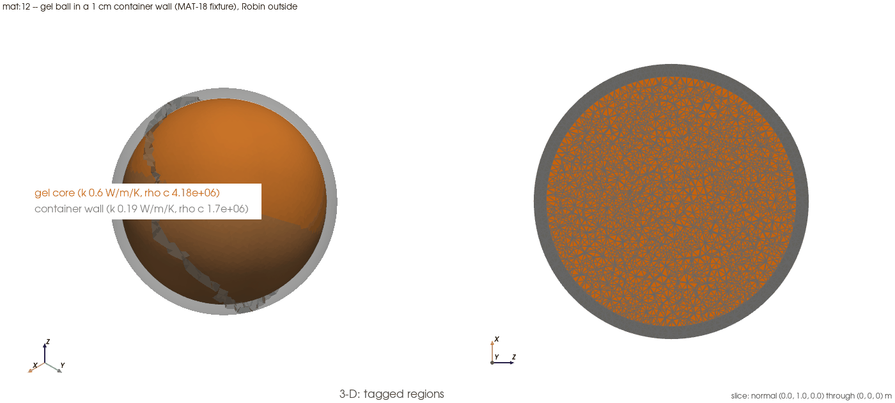

# `mat:12` — what a container wall does to the gel ball

Script: `examples/materials/12_gel_ball_in_container_wall.py` (`EX-86`)
Gates: `tests/validation/test_mat18_two_layer_sphere_closed_form.py`,
`tests/validation/test_mat18_two_layer_sphere_fem.py` and
`tests/validation/test_mat18_two_layer_sphere_transient_fem.py` (`MAT-18`), with
the bands of `tests/validation/test_mat13_transient_perfusion_sphere.py`
(`MAT-13`) and the bare ball of `tests/validation/test_mat9_transient_conduction_sphere.py`
(`MAT-9`).

## 1. What this demonstrates

Every other thermal example solves one homogeneous medium. This one puts
`MAT-18`'s 1 cm container wall (a = 0.1 m < r < b = 0.11 m, k₂ = 0.19 W/m/K,
ρc₂ = 1.7e6 J/m³/K, no source, perfect contact) round `MAT-9`'s gel ball
(k₁ = 0.6, ρc₁ = 4.18e6, Q = 2000 W/m³, Robin h = 10 W/m²/K on r = b,
T∞ = T(0) = 20 °C), 215 542 cells, degree 1, the complex build at `-n 2`. The
wall is the only difference from `mat:8`'s ball (asserted structurally).

Three things show:

1. **The kink.** θ is continuous at r = a and the heat flux is too, so the
   gradient jumps by k₁/k₂ = 3.158 (measured 3.064 across ±2.5 mm bands of
   cells) while q_r = −k ∂ᵣθ matches (shell/core 0.970; Gauss's law
   Q·V_core/(4πa²) = 66.61 W/m²).
2. **The series resistance.** The wall adds a 3.190 K drop and its larger outer
   area takes 1.157 K off the film, so the centre is 14.255 K against the bare
   ball's 12.222 K: +2.033 K (16.6 %). The critical radius of insulation
   2k₂/h = 0.038 m is below a, so *any* thickness of this wall raises the core.
3. **The slower settling.** The composite's slowest mode is τ₁ = 24 549 s
   against the bare ball's 19 155 s (ratio 1.282); the core mean reaches 1 % of
   its steady value at 113 017 s against 88 118 s (ratio 1.283).

Asserted (imported bands, never restated): the steady interior error 1.1206e-03
and balance 1.146e-14 (≤ 1e-2 and 1e-9); CN + Rannacher N = 40 at t* interior
8.2066e-04 against the composite series; every transient run's balance
≤ 1e-9; max |Im T_h| = 0 over every solve in the complex build; and two
negative controls. Printed only: the profile, budget, flux, settle table, τ₁ and
t₉₉. Not claimed: contact resistance, a real container's properties, degree 2,
the least-squares rate, SAR or EM drive, perfusion.

## 2. How to run it

```
./run_examples.sh -e mat:12 -n 2 -t 420
```

Needs the complex DolfinX build, which the runner sources for the `mat:` group.
Tier: **heavy**. The run takes ≈ 100 s wall at `-n 2`. Verification runs go
through the logging harness with the runner's emitted command
(`./scripts/run_examples.sh -e mat:12 -n 2 -t 420 --dry-run`). Add
`-e FEM_EM_SETUP_FIGURES=1` after `exec -T` to re-render the setup figure.

## Setup figure



`examples/materials/figures/materials_12_gel_ball_in_container_wall_setup.png`.
The figure shows the two-region mesh (gel core, container wall drawn
translucent so the core shows through) with the slice at y = 0, which cuts the
1 cm ring.

## 3. How to analyze it, step by step

**Step 1 — the profile and the kink.** `[profile]` prints θ_h along +x beside
the two-layer closed form and, for r ≤ a, the bare ball: θ_h(0) = 14.2544 K
against 14.2550 K, and the relative difference stays within 2e-3 across the
interface, where the P1 field is cut by the faceted sphere. `[flux]` prints the
gradient ratio 3.064 (the k₁/k₂ jump, 3.158, smeared by the first cell) and the
flux ratio 0.970 (continuous).

**Step 2 — the resistance budget and the critical radius.** `[budget]` splits
the centre rise into core 5.556 K, wall 3.190 K and film 5.510 K (closed form)
against the bare ball's 5.556 / 0 / 6.667 K; the FEM (read at 0.999 b) gives
5.572 / 3.145 / 5.538 K. The wall raises the centre by 2.033 K. Because
2k₂/h = 0.038 m < a, adding wall always raises the core. (Relative to the
bare ball's centre that is 2.033/12.222 = 16.6 %.)

**Step 3 — ParaView.** Open
`examples/materials/paraview_output/materials_12_gel_ball_in_container_wall_combined.xdmf`
and use Plot Over Line along x on `theta_h_steady`, `radial_gradient_steady` and
`radial_flux_steady`: the gradient jumps by k₁/k₂ at r = a, the flux does not.
`theta_err_steady` and `theta_err_tstar` are the P1 errors against the
closed form and the series; `k`, `rho_c`, `interface_band` (1 core band, 2 wall
band) and `interior_mask` are DG0.

**Step 4 — the two controls.** A model that treats the wall as more gel is wrong
where it matters. `[control] (c-k)` gives the wall the gel's conductivity: the
steady interior misses by 0.1986 (record 0.1986), about 20× the 1e-2 band.
`[control] (c-rhoc)` gives it the gel's heat capacity: the t* interior misses by
5.3140e-02 (record 5.3140e-02), about 5× the band. Each is asserted only as
"misses the band".

**Step 5 — the settle table and t₉₉.** `[settle]` prints the core-volume mean θ
at Fo 0.05 … 3 beside the series and the bare ball: the composite lags the bare
ball early (the wall's heat capacity must charge) and ends 22.9 % higher
(10.92 K against 8.889 K). The FEM core mean sits 0.7–1.2 % below the series
(its discrete steady mean is 10.9115 K against 10.9217 K). The settle end at
Fo 3 differs from the steady solve by 1.991e-04 (whole-ball). `[tau]` and
`[t99]` give the ratios above; the bare-ball t₉₉ reproduces `EX-74`'s 88 118 s
to 4e-06. The table
`examples/materials/paraview_output/materials_12_gel_ball_in_container_wall_settle_curve.csv`
has the three curves at every step.

## Related

- The bare ball's settling time: `examples/materials/08_gel_ball_settling_time.md`.
- SAR heating of the same ball: `examples/materials/04_sar_heats_gel_ball.md`.
- The finite cylinder against its series: `examples/materials/10_finite_cylinder_robin_series.md`.
- The duty-cycled ball: `examples/materials/11_duty_cycled_gel_ball.md`.
- The gate modules: the three `tests/validation/test_mat18_two_layer_sphere_*.py`.
