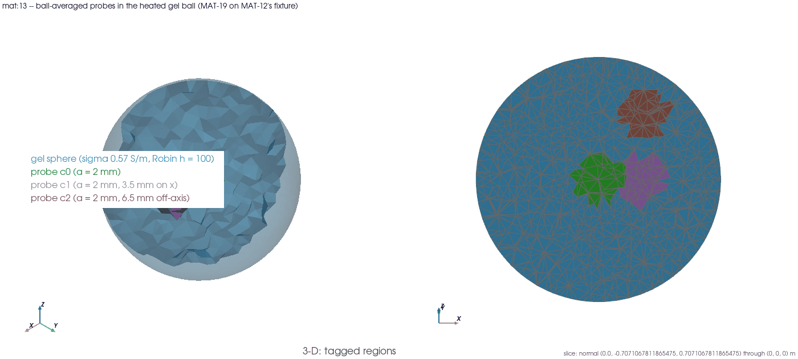

# `mat:13` — a temperature probe in a heated gel ball, and why its stated volume matters

Script: `examples/materials/13_virtual_probe_in_gel_ball.py` (`EX-90`)
Gate: `tests/validation/test_mat19_virtual_temperature_probe.py` (`MAT-19` step 1);
the fixture is `MAT-12`'s, the probe is `src/fem_em_solver/thermal/probe.py`.

## 1. What this demonstrates

The output quantity is a probe reading: the ball-averaged temperature
θ̄(c, a, t) over a ball of stated radius a, against time. One EM solve on
`mat:4`'s lossy sphere (R = 10 mm, σ = 0.57 S/m, 64 MHz, imposed field,
G = 2.5e7) heats the 19 496-cell sphere submesh: Robin h = 100 W/m²/K,
Crank–Nicolson with Rannacher start, N = 40 to t\* = 139.33 s. The run is
`MAT-12`'s and the probe is `MAT-19`'s. Three readings:

- **What the probe reads.** Three probes of radius a = 2 mm (centres 0, 3.5 mm
  on x, 6.5 mm off-axis) each give a series of 41 points. Each is set beside
  the **exact ball mean** of the Robin eigen-series, which the gate asserts to
  within 1 % (`P_BAND`), and beside the **point value** θ(d, t) a bare
  comparison would use.
- **The probe volume.** At the centre the same run is read again with
  a = 1, 4 and 8 mm. The volume offset (ball − point) grows as a². In the
  steady limit it is exactly −q a²/(10k), because θ_ss is quadratic in r and
  the ball mean of |x|² is d² + 3a²/5. At a = 2 mm it is −0.63 % at t\* (FEM;
  −0.726 % exact), below the 1 % band, so the gate cannot see it. At a = 8 mm
  it is −13.4 %, about 13× the band (C3).
- **Position beats volume at this a/R.** A 1 mm placement error at 6.5 mm (C1,
  5.42 % at t\*) costs about 4× the a = 2 mm volume offset there.

**Why an owned-cell integral and not a point sample.** The probe sums over
owned cells with one allreduce, so each cell is counted once at every width
(the gate re-reads `-n 4` against `-n 2` to 9e-16). Point evaluation on a
`create_submesh` mesh needs `parent=(parent_mesh, parent_cells)` since
`POST-10`; this example does no FEM point evaluation. The "point value" is the
closed form `_point(d, t, q)`, never a FEM sample.

**The comparand.** The Helmholtz mean-value theorem gives the exact ball mean
mode by mode: each eigenmode of the series is multiplied by
3 j₁(κa)/(κa), and the particular part has the offset −q a²/(10k). `MAT-19`
checks this closed form against a shell-cap quadrature to 1e-10.

**Imported, not restated.** `_build_run`, `_check_probe_series`, `_ball_mean`,
`_point`, `_q_cf`, `_theta_ss0` and the constants come from the gate module;
`B_BAND` from `test_mat10_sar_to_heat_sphere.py`. An `is` check against the
`MAT-10` / `MAT-12` objects (`P_BAND`, `B_BAND`, `R`, `N_MAIN`, `T_STAR`) is
printed and asserted. The one gate-module change is the rule (a) lift: the
`run` fixture body became `_build_run()` and the test body
`_check_probe_series(run)`, with additive return keys only. The gate was
re-run green at `-n 2` and `-n 4` in the same slot (`EX-90-mat19-regate-W1`,
`EX-90-mat19-regate-W2`, 14 passed each, digits identical to the `MAT-19`
records).

**Asserted.** Inside the lift: (M), (A0), snapshot 0 = 0, (T) ≤ `P_BAND`,
(C1) > `P_BAND`. On the returned values here: (A0) 19 496 cells, (T) max
1.7315e-03 ≤ 1e-2, (C1) 5.4207e-02 > 1e-2. Example-side: (X0) |c₀| + a ≤ 0.9 R
for the sweep radii, and (X1) the sweep call's first column equals the gate
series (0.0 measured).

**Printed, not asserted.** The sweep, the volume effect and (C3). The sweep
radii are **not gated**: `MAT-19`'s (T) covers a = 2 mm only. Records from
`docs/testing/logs/20261005T095808Z_MAT-19-step1-W1.log` are printed beside
this run, and every digit matched.

Scope: one fixture (`MAT-12`'s sphere, one mesh at h_in = R/10, P1), `-n 2`.
The radius a is a stated fixture parameter, **not** a fibre-optic sensing
volume. It does not model a real probe's thermal mass, self-heating, lead
artefact or optical volume, any other mesh, the coil, tissue or perfusion, or
any ASTM F2182 reading.

## 2. How to run it

```
./run_examples.sh -e mat:13 -n 2 -t 300
```

Needs the complex DolfinX build, which the runner sources for the `mat:`
group. Run it at `-n 2` only: the lifted gate body writes the `-n 2` npz.
Tier: **standard** (the run takes ≈ 80 s at `-n 2`, 35 s of it the fixture).
Verification runs go through the logging harness with the runner's emitted
command (`./scripts/run_examples.sh -e mat:13 --dry-run`). Add
`-e FEM_EM_SETUP_FIGURES=1` after `exec -T` to re-render the setup figure.

## Setup figure



`examples/materials/figures/materials_13_virtual_probe_in_gel_ball_setup.png`.
The figure is the sphere submesh the heat problem runs on (19 496 cells), with
the gel translucent in 3-D. The slice normal is (0, −1, 1)/√2 through the
origin, so the plane holds the x-axis and the (1, 1, 1) direction and cuts all
three balls. The colours are a figure-only meshtags (cells whose centroid lies
inside each ball); the tags never enter a solve. c₀ and c₁ overlap by 0.5 mm,
and c₁ is drawn only where it is not already c₀.

## 3. How to analyze it, step by step

**Step 1 — the anchors.** The `[anchor]` lines print the lifted gate's values
beside the `MAT-19` records: V_h/V − 1 = +6.289e-04, +4.055e-04, +5.064e-04,
+1.569e-04; the readings at t\* 5.918962e-02 / 5.681504e-02 / 5.020215e-02 K
(identical to 7 digits); (T) 1.7315e-03; (C1) 5.4207e-02; (C2) −6.2905e-03 /
−8.1485e-03 / −1.3531e-02. The q_h series sits at +3.73 / +3.65 / +3.47 % at
t\*. That offset is `mat:4`'s SAR offset (the FEM mean SAR is 3.5 % above the
closed form), not the probe: the gated series uses the uniform closed-form q.

**Step 2 — the sweep.** Read the `[sweep]` table. Each radius agrees with its
own exact ball mean to ≤ 1.8e-3 (a = 1 mm: 1.80e-3, 4 mm: 1.58e-3, 8 mm:
7.7e-4), as the probe is meant to. The offset against the point value at t\*:

| a [mm] | exact ball/point − 1 | FEM probe/point − 1 | steady −q a²/(10k)/θ_ss(0) |
| --- | --- | --- | --- |
| 1 | −0.180 % | −0.072 % | −0.273 % |
| 2 | −0.726 % | −0.629 % | −1.091 % |
| 4 | −2.994 % | −2.927 % | −4.364 % |
| 8 | −13.368 % | −13.420 % | −17.455 % |

At a = 1 mm the FEM error (≈ +0.1 % at the centre, t\*) is comparable to the
volume effect, so the offset below a ≈ h_in = 1 mm is not resolved on this
mesh (the FEM a² ratio reads 0.114 against the exact 0.248). The steady part
scales exactly as a² (0.25 / 4 / 16); the transient part does not, so the
exact ratios to a = 2 mm at t\* are 0.248 / 4.12 / 18.4 and the FEM ones
4.65 / 21.3 at 4 / 8 mm.

**Step 3 — the control (C3).** The volume-omitted comparand at a = 8 mm: the
ball probe against the point value θ(0, t\_n) misses by 13.42 % at n = 40,
13.4× the 1 % band. It was predicted in 12.9–13.8 % before the run (the
exact ratio is 13.368 %). Printed, not asserted. The miss grows with n (the
steady ceiling is 17.45 %), which is why the check is on the maximum.

**Step 4 — why a point comparison can fail a correct probe.** At c₂ with
a = 2 mm the exact ball/point offset is −1.259 % at t\*, and the FEM probe
against the point value reads −1.353 % (C2), past the 1 % band from n ≈ 20
(−1.139 % at n = 20). The probe is right (0.096 % off its own comparand) and
the comparison is wrong. At c₀ and c₁ the offset stays below the band
(−0.629 %, −0.815 %).

**Step 5 — position against volume.** The displaced probe (C1) is 1 mm
inward of c₂ and compared against c₂'s comparand: it misses by 5.42 %, about
4× the a = 2 mm volume offset there (−1.26 % exact, −1.35 % FEM). Against its
own comparand at 5.5 mm it reads 1.13e-03. At this a/R, where the probe sits
matters more than how big it is.

**Step 6 — ParaView.** Open
`examples/materials/paraview_output/materials_13_virtual_probe_in_gel_ball_combined.xdmf`
(41 time steps at t\_n = n·Δt, Δt = 3.4833 s): P1 `theta_h`, `theta_exact`,
`theta_error`, and DG0 masks `probe_c0_mask`, `probe_c1_mask`,
`probe_c2_mask`, `probe_c2_displaced_mask`, `probe_c0_a8mm_mask`. Threshold
`probe_c2_mask` ≥ 0.5 and colour by `theta_h`; play the 41 steps; Plot Over
Line from the origin along (1, 1, 1) on `theta_error`. Load
`examples/materials/paraview_output/materials_13_virtual_probe_in_gel_ball_probes.csv`
with Table To Points (cx\_m, cy\_m, cz\_m) and a Glyph sphere scaled by `a_m`
(seven rows: the gate's four probes and the three sweep radii). The series are
in `examples/materials/paraview_output/materials_13_virtual_probe_in_gel_ball_series.csv`
and plotted in
`examples/materials/paraview_output/materials_13_virtual_probe_in_gel_ball_series.png`
(left: θ against t; right: the volume offset against a on log–log axes with
the a² slope and the 1 % band).

## Related

- The same fixture's whole-ball rise curve: `examples/materials/04_sar_heats_gel_ball.md`.
- The lossy sphere's SAR: `examples/materials/02_lossy_sphere_sar.md`.
- A centre history on the full mesh: `examples/materials/11_duty_cycled_gel_ball.md`.
- The gate: `tests/validation/test_mat19_virtual_temperature_probe.py`, its unit tests `tests/solver/test_thermal_probe.py`, and the probe `src/fem_em_solver/thermal/probe.py`.
