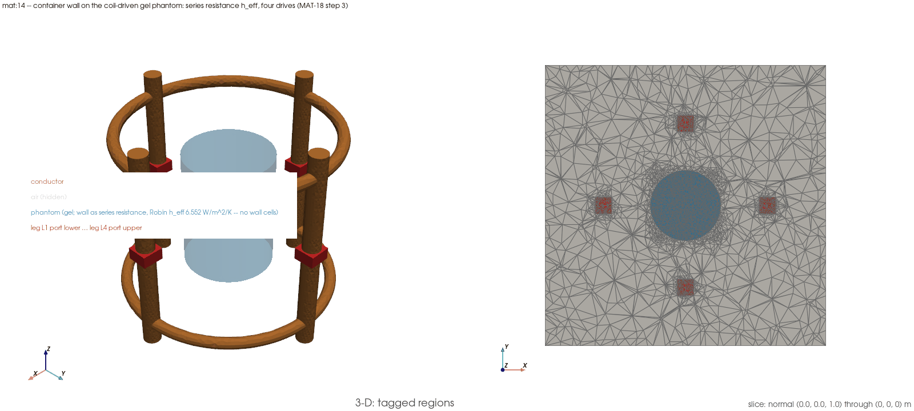

# `mat:14` — the container wall on the coil-driven gel phantom: a series resistance under four birdcage drives

Script: `examples/materials/14_coil_driven_phantom_in_container_wall.py` (`EX-98`)
Gate: `tests/validation/test_mat18_wall_coil_driven.py` (`MAT-18` step 3).

**The wall here is a coefficient, not geometry.** `MAT-15` P1's thermal domain is the
tag-3 submesh of the EM mesh and has no wall cells. The wall enters as its series
thermal resistance in the Robin coefficient, h_eff = 1 / (1/h + t_w/k₂), planar, one
scalar on the lateral faces and the caps (t_w = 0.01 m, k₂ = 0.19, h = 10). That is the
steady limit of `MAT-18`'s conforming shell, with no wall heat capacity.

## 1. What this demonstrates

`mat:12` has a conforming wall, but on a ball under an imposed field; `mat:9` has the
same coil and phantom, but no wall. This example is the wall on the coil-driven phantom:
`ANS-2`'s untuned 10 MHz, σ = 800 S/m F-small birdcage at degree 1, the four single-leg
drives, one normalisation G = 1 W / P₁, a Robin-cooled gel transient to t\* = 0.2 t_R
with h replaced by h_eff.

The script calls `_run_walled(return_fields=True)`, `MAT-18` step 3's fixture body lifted
to module level (a disclosed, additive rule (a) lift; the gate was re-run green after
it). Bands and records are imported, never restated, and the script checks by identity
(`is`) that its `E_BAND`, `B_BAND`, `C4_COVARIANCE_BAND`, `D_CONTROL_FLOOR`,
`_run_heated` and `K2` are the gate modules' own objects.

Asserted, each printed beside `20261006T200649Z_MAT-18-step3-W1.log`: (R) the
resistance algebra ≤ `R_BAND`; (E′) per drive and (E) every wall run ≤ `E_BAND`; (C4)
the four cyclic 10 g θ pairs ≤ `C4_COVARIANCE_BAND`; and **(L0) helper equivalence**
≤ `B_BAND`: the wall path with t_w = 0 is P1's code path to round-off. It is not an
independent wall → 0 limit and not physics.

**Negative controls (asserted):** (d) a doubled source misses (E′) with the wall by
exactly 1 (> `D_CONTROL_FLOOR`); (W-ctl) the wall is felt, |⟨θ⟩ ratio − 1| >
`W_CONTROL_FLOOR` on every drive.

**Printed, not asserted:** the wall effect, the ≈ +4.63 % move in ⟨θ⟩(t\*) on all four
drives (`W1` ratios 1.046316 / 1.046314 / 1.046316 / 1.046314) with a `.6f`
string-equality verdict; and the (h-swap) prediction, the k = 0 energy identity
re-evaluated with the bare gel h in the surface term, predicted 8.697e-2 (unbacked, so
printed only): a model that ignored the wall would be caught by the balance, not only
by ⟨θ⟩.

Not claimed: a conforming wall on the coil-driven phantom, the wall's heat storage,
contact resistance, a real container's properties or geometry (the lateral cylindrical
h is printed only), the wall → 0 limit as physics, absolute temperature (1 W
normalisation), a tuned or copper coil, 64 MHz, perfusion, tissue, `ANS-9`,
convergence.

## 2. How to run it

```
./scripts/run_examples.sh -e mat:14 -n 2 -t 590
```

Needs the complex DolfinX build, which the runner sources for the `mat:` group.
Tier: **heavy**, `-n 2`. Verification runs go through the logging harness with the
runner's emitted command (`./scripts/run_examples.sh -e mat:14 -n 2 -t 590 --dry-run`).
Add `-e FEM_EM_SETUP_FIGURES=1` after `exec -T` to re-render the setup figure.
Output: `examples/materials/paraview_output/materials_14_coil_driven_phantom_in_container_wall_combined.xdmf`.

## Setup figure



`examples/materials/figures/materials_14_coil_driven_phantom_in_container_wall_setup.png`.
The `GEO-18` gapped, sheeted four-leg birdcage on `ANS-2`'s phantom rung: conductor and
port sheets shown, the gel phantom translucent, air hidden, sliced at z = 0. The figure
cannot show a wall: there are no wall cells, and the region name says so.

## 3. How to analyze it, step by step

**Step 1 — where the wall's extra heat sits.** Open
`examples/materials/paraview_output/materials_14_coil_driven_phantom_in_container_wall_combined.xdmf`
and colour by `real_dtheta_k0` (wall minus bare θ at t\*). Then compare
`real_theta_wall_k0` and `real_theta_bare_k0` along a Plot Over Line through the k = 0
hot spot. The Robin facets, where h_eff acts, are their own block.

**Step 2 — the four hot spots are still one rotation.** Apply a 90° Transform about z to
`real_theta_wall_k1`: it lands on `theta_wall_k0`. The script's (C4) pairs say the same
in numbers (`W1`: 0.0402 / 0.0210 / 0.0292 / 0.0484 % against a 5 % band).

**Step 3 — hot spot against mean.** The mean θ rises by ≈ 4.6 % with the wall, but the
10 g hot-spot ratio (printed, `W1`: 1.029608 on k = 0) sits below it: the wall acts at
the surface, and the hot spot lies deeper than the bulk average. `theta_*` are P1 fields
of T − T∞ at t\*, `q_h_k*` DG0 in W/m³ at G = 1 W / P₁; the complex build writes `real_`
/ `imag_` splits (the imaginary parts are zero).

## Related

- `mat:9`: `examples/materials/09_coil_driven_heating_phantom.md`
- `mat:12`: `examples/materials/12_gel_ball_in_container_wall.md`
- `tests/validation/test_mat18_wall_coil_driven.py`
- `tests/validation/test_mat15_coil_driven_heating_phantom.py`
