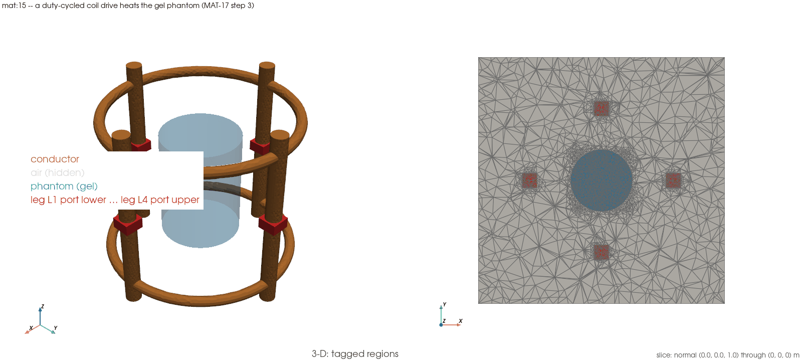

# `mat:15` — a duty-cycled coil drive heats the gel phantom: the on/off history, Duhamel's sum and the half-power stand-in

Script: `examples/materials/15_duty_cycled_coil_heating_phantom.py` (`EX-99`)
Gate: `tests/validation/test_mat17_duty_cycle_coil_driven.py` (`MAT-17` step 3).

## 1. What this demonstrates

`mat:9` heats the gel phantom with a coil-driven source that never switches off;
`mat:11` switches a *uniform* source on `MAT-9`'s ball. This example switches the
**coil-driven** source on and off and shows the time history.

**The drive.** `ANS-2`'s untuned 10 MHz loaded F-small birdcage, single-leg drive
k = 0 (P1), on the 0.0025 m phantom rung (58 866 cells in the phantom submesh). The
dissipated power ½σ|E|² is a DG0 heat source normalised to G = 1 W deposited, so
θ = T − T∞ is **per deposited watt, not an absolute temperature**. P1 thermal
(degree 1), gel constants, Robin h, no perfusion.

**The schedule.** Period P = t\*/5, duty D = 0.5, χ = 1 on [jP, jP + P/2) and 0 on
[jP + P/2, (j + 1)P). The module's step is Δt = t\*/40, so a half-period is four
steps and every switch lands on a grid point. The printed string of χ per
(half-)step is `11111000011110000111100001111000011110000` (two start-up
half-steps, then full steps 2 … 40); the on-time is 627.0000 s of t\* = 1254.0000 s.

**Duhamel's sum.** With H_m the Heaviside source switched on at t_m = m·P/2 (a full
run from t = 0), θ[χ] − T∞ = Σ_m (−1)^m (θ[H_m] − T∞), m = 0 … 9. The script
asserts it on the whole submesh at `L_BAND`, beside the gate's record (the example
and the gate's rows agree at noise, ≈ 3.7e-14 against 3.4e-14).

The script does not re-implement anything: `_run_duty(return_fields=True)` is
`MAT-17` step 3's fixture body lifted to module level (a disclosed, additive
rule (a) lift; the gate was re-run green after it, 19 passed, `MAT17s3` lines
equal to `20261006T201547Z_MAT-17-step3-W1.log:1956–1976` at noise). `_transient_s`
gained an additive `snapshot_steps=` keyword. The script adds two thermal runs
that keep every full-step snapshot, one for the duty schedule and one for χ ≡ 1.

Asserted at imported bands, each printed beside the W1 record:

- (S) `chi_binary`, and the history run's `source_multipliers` equal the gate's;
- (Δ) Duhamel superposition ≤ `L_BAND`;
- (D′) χ ≡ 1 reproduces P1 ≤ `D_BAND`;
- (E) every run's balance ≤ `E_BAND` (the gate's 12 and both history runs);
- (E′) the energy identity from the EM side, at the last step N (off) and the last
  on step n = 36, ≤ `E_BAND`. It is normalised by the *unscheduled* power G·P₁, so
  at an off step it reads stored + surface = 0;
- (Hist) the history runs are the gate's runs: whole-submesh relative L2 of the
  history duty run, of the χ ≡ 1 run and of the snapshots n = 32, 35, 36, 39, 40,
  each ≤ `D_BAND` (measured ≈ 4e-15; predicted ≈ 1e-15, so the prediction was
  slightly low, the band is untouched).

**Negative control (asserted): (Δ-ctl).** Drop one Duhamel term (m = 9). The sum no
longer reproduces θ[χ]: the miss is 0.298210, against `L_BAND` = 1e-12, so the
comparator is not blind. It equals the gate's 0.298210 to the printed digits.

**Printed, not asserted:**

- control (d), the doubled source, at both placements. At n = 36 (last on step,
  χ = 1) the balance misses by 1.000000; at N = 40 (off, χ = 0) it reads ≈ 2e-15,
  because at an off step the source is absent and θ is linear in q, so a doubled
  source cannot show in the balance. The gate asserts (d) at the on step and says
  why; whether that placement stands is `MAT-17`'s record, see
  `docs/planning/chunks/MAT-17.md`. This example asserts no (d);
- (c-sched), the schedule ignored: ‖θ[1] − θ_duty‖ / ‖θ_duty‖ at t\* = 1.068705
  (predicted 1.0–1.2; the logged-norm bracket is [1.067, 3.067]; it sits just
  inside the lower edge because θ[1] ≈ 2·θ_duty);
- the records at t\*: duty ⟨θ⟩ = 0.568835514 K against D·P1 = 0.576656825 K, ratio
  0.986437, and the last on/off pair 0.466250330 → 0.584438780 → 0.568835514 K; all
  equal the gate's W1 digits (`:1973–1975`), also printed at `!r`. max|Im θ| = 0.
  The run prints the 10 g ball record beside W1 `:1975`: θ(c₀) at t\* is duty 1.251111962e+00 K, P1 2.587441071e+00 K, duty/(D·P1) = 0.967065.

Not claimed: any pulse sequence, 6-minute SAR averaging or regulatory statement;
absolute temperature (1 W normalisation); a closed form for the coil-driven θ;
convergence (one rung, degree 1); the periodic steady state (t\* is five periods,
the gel's slowest time constant is far longer); the tuned or copper fixture,
64 MHz, quadrature drive, tissue, `ANS-9`.

## 2. How to run it

```
./scripts/run_examples.sh -e mat:15 -n 2 -t 590
```

Needs the complex DolfinX build, which the runner sources for the `mat:` group.
Tier: **heavy**, ≈ 230 s wall at `-n 2` (flagged run of record). Verification
runs go through the logging harness; add `-e FEM_EM_SETUP_FIGURES=1` after
`exec -T` to re-render the setup figure.

Outputs, all in `examples/materials/paraview_output/`:

- `materials_15_duty_cycled_coil_heating_phantom_combined.xdmf`: P1 `theta_duty`
  (θ at t\*), `theta_on_end` (θ at n = 36, the end of the last on phase),
  `theta_half_power` (D·θ of the continuous run, at t\*) and DG0 `q_h_k0` (W/m³ at
  G = 1 W / P₁);
- `materials_15_duty_cycled_coil_heating_phantom_history.xdmf`: P1 `theta` at all
  41 full-step indices, t_n = n·Δt, as a ParaView time series;
- `materials_15_duty_cycled_coil_heating_phantom_mean_history.csv`: n, t_n, χ,
  ⟨θ⟩_duty, D·⟨θ⟩_P1 and their ratio.

## Setup figure



`examples/materials/figures/materials_15_duty_cycled_coil_heating_phantom_setup.png`.
The `GEO-18` gapped, sheeted four-leg birdcage on `ANS-2`'s phantom rung:
conductor and port sheets shown, the gel phantom translucent, air hidden, sliced
at z = 0.

## 3. How to analyze it, step by step

**Step 1 — read the ripple.** Plot the CSV, or open
`examples/materials/paraview_output/materials_15_duty_cycled_coil_heating_phantom_history.xdmf`
and use Plot Data Over Time on `theta`. During an on phase ⟨θ⟩ climbs (n = 33 →
36: 0.4962 → 0.5844 K); during an off phase it relaxes slowly (n = 37 → 40:
0.5804 → 0.5688 K), so the curve is a staircase of period 8 steps. The last
on-end to off-end drop is 2.743 % of the off-end value.

**Step 2 — compare with the half-power stand-in.** The continuous run at power
D·P by linearity deposits the same energy by t\*. The ratio column of the CSV
reads 1.112 at the on-end n = 36 (the duty run is ahead, it has been heating at
full power) and 0.986 at the off-end n = 40 (slightly behind; this is the t\* record,
0.986437). The ratio is exactly 2 while the source has not yet switched off
(n ≤ 4) and returns to 0.984–0.986 at every later off-end (n = 8, 16, 24, 32,
40): the stand-in is right at the period boundaries to ≈ 1.6 %, and off by up
to 33 % in between (n = 12, ratio 1.334).

**Step 3 — the fields.** Open
`examples/materials/paraview_output/materials_15_duty_cycled_coil_heating_phantom_combined.xdmf`.
Colour by `real_theta_duty`, then apply a Calculator
`real_theta_duty - real_theta_half_power` to see where the duty run differs from
its stand-in (the complex build writes `real_` / `imag_` splits; the imaginary
parts are zero). `real_theta_on_end` against `real_theta_duty` shows the field's
fall over the final off phase.

**Step 4 — Duhamel in words.** θ at t\* is the alternating sum of ten Heaviside
runs. Drop the last term and the sum misses θ by 30 % of its norm (control
Δ-ctl); keep all ten and it agrees to ≈ 4e-14. That is a statement about the
linear thermal solver and the schedule, not about the coil.

## Related

- `mat:9`: `examples/materials/09_coil_driven_heating_phantom.md`
- `mat:11`: `examples/materials/11_duty_cycled_gel_ball.md`
- `tests/validation/test_mat17_duty_cycle_coil_driven.py`
- `tests/validation/test_mat15_coil_driven_heating_phantom.py`
- `src/fem_em_solver/thermal/transient.py`
